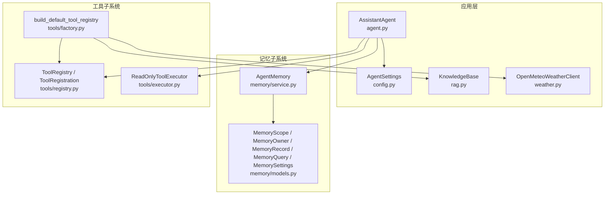
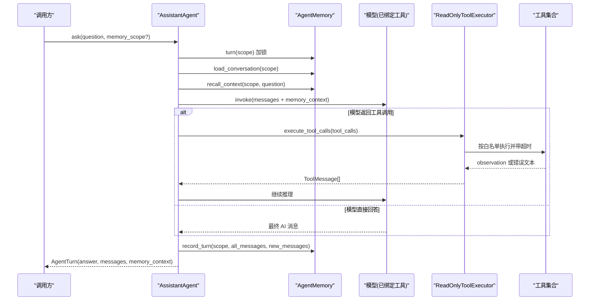
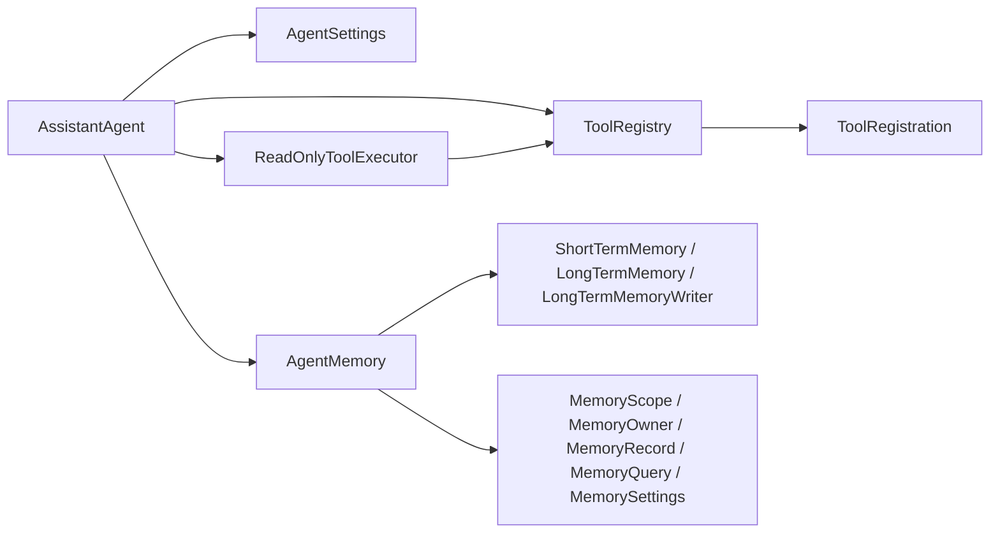

# API 参考文档

<cite>
**本文引用的文件**   
- [agent_platform/__init__.py](file://agent_platform/__init__.py)
- [agent_platform/agent.py](file://agent_platform/agent.py)
- [agent_platform/config.py](file://agent_platform/config.py)
- [agent_platform/memory/__init__.py](file://agent_platform/memory/__init__.py)
- [agent_platform/memory/models.py](file://agent_platform/memory/models.py)
- [agent_platform/memory/service.py](file://agent_platform/memory/service.py)
- [agent_platform/tools/__init__.py](file://agent_platform/tools/__init__.py)
- [agent_platform/tools/factory.py](file://agent_platform/tools/factory.py)
- [agent_platform/tools/registry.py](file://agent_platform/tools/registry.py)
- [agent_platform/tools/executor.py](file://agent_platform/tools/executor.py)
- [README.md](file://README.md)
</cite>

## 目录
1. [引言](#引言)
2. [项目结构](#项目结构)
3. [核心组件](#核心组件)
4. [架构总览](#架构总览)
5. [详细 API 说明](#详细-api-说明)
6. [依赖关系分析](#依赖关系分析)
7. [性能与超时特性](#性能与超时特性)
8. [故障排查指南](#故障排查指南)
9. [结论](#结论)
10. [附录：版本兼容性与弃用说明](#附录版本兼容性与弃用说明)

## 引言
本 API 参考文档面向 Agent Platform 的调用方，系统化记录公共接口、数据结构、枚举、常量与异常行为。重点覆盖以下能力：
- Agent 编排入口与一轮问答流程
- AgentSettings 配置类的所有属性与默认值
- AgentMemory 门面类的全部公开方法、参数与返回值
- ToolRegistration 与 ToolRegistry 的工具注册、查询与执行相关 API
- MemoryScope、MemoryOwner 等数据结构的字段定义与使用示例
- 所有枚举类型、常量定义和异常类型的详细说明
- 常见调用模式与最佳实践

## 项目结构
Agent Platform 采用分层与职责分离设计：
- agent_platform：应用层 Agent、通用配置、RAG 与天气客户端
- memory：短期记忆、长期记忆、写入策略与组合门面
- tools：工具注册表、执行器与默认工具工厂
- evaluation：评测套件（不在本次 API 范围）

**图表来源**
- [agent_platform/agent.py:35-142](file://agent_platform/agent.py#L35-L142)
- [agent_platform/config.py:12-48](file://agent_platform/config.py#L12-L48)
- [agent_platform/memory/service.py:24-106](file://agent_platform/memory/service.py#L24-L106)
- [agent_platform/memory/models.py:18-120](file://agent_platform/memory/models.py#L18-L120)
- [agent_platform/tools/registry.py:15-94](file://agent_platform/tools/registry.py#L15-L94)
- [agent_platform/tools/executor.py:17-67](file://agent_platform/tools/executor.py#L17-L67)
- [agent_platform/tools/factory.py:18-37](file://agent_platform/tools/factory.py#L18-L37)

**章节来源**
- [README.md:19-48](file://README.md#L19-L48)

## 核心组件
- AssistantAgent：Agent 编排入口，负责模型绑定、工具执行、记忆读写与 LangGraph 图调度。
- AgentSettings：统一运行配置，包含系统提示词、记忆参数、工具与网络超时、RAG 参数等。
- AgentMemory：短期会话、长期召回与写入策略的组合门面，提供 turn 串行化、历史裁剪、上下文召回与清理能力。
- ToolRegistry / ToolRegistration：不可变工具集合与工具元信息，集中管理工具 Schema、Prompt 目录与超时策略。
- ReadOnlyToolExecutor：白名单校验、超时控制与错误降级，将失败转为模型可见 observation。
- MemoryScope / MemoryOwner / MemoryRecord / MemoryQuery / MemorySettings：记忆域数据模型与检索契约。

**章节来源**
- [agent_platform/agent.py:26-142](file://agent_platform/agent.py#L26-L142)
- [agent_platform/config.py:12-48](file://agent_platform/config.py#L12-L48)
- [agent_platform/memory/service.py:24-106](file://agent_platform/memory/service.py#L24-L106)
- [agent_platform/tools/registry.py:15-94](file://agent_platform/tools/registry.py#L15-L94)
- [agent_platform/tools/executor.py:17-67](file://agent_platform/tools/executor.py#L17-L67)
- [agent_platform/memory/models.py:18-120](file://agent_platform/memory/models.py#L18-L120)

## 架构总览
AssistantAgent 通过 ToolRegistry 绑定模型工具 Schema，通过 AgentMemory 管理短期与长期记忆，并通过 ReadOnlyToolExecutor 安全执行工具调用。

**图表来源**
- [agent_platform/agent.py:84-142](file://agent_platform/agent.py#L84-L142)
- [agent_platform/memory/service.py:51-91](file://agent_platform/memory/service.py#L51-L91)
- [agent_platform/tools/executor.py:27-43](file://agent_platform/tools/executor.py#L27-L43)

## 详细 API 说明

### 公共导出清单
从包根导出的稳定公共 API 包括：
- AssistantAgent
- AgentMemory
- AgentSettings
- AgentTurn
- KnowledgeBase
- MemoryRecord
- MemoryScope
- MemorySettings
- OpenMeteoWeatherClient
- ToolRegistration
- ToolRegistry
- build_default_tool_registry

这些名称构成对外契约；内部模块布局可重构而不影响调用方。

**章节来源**
- [agent_platform/__init__.py:1-29](file://agent_platform/__init__.py#L1-L29)

### AgentSettings 配置类
AgentSettings 是不可变 dataclass，集中放置 Agent 的运行配置，并提供 Fail Fast 校验。

| 属性 | 类型 | 默认值 | 说明 |
| --- | --- | --- | --- |
| system_prompt | str | 内置中文助手提示词 | 系统提示词，新增工具时由 prompt_catalog 动态注入工具目录 |
| memory | MemorySettings \| None | None | 记忆子系统参数；未显式传入时会由 __post_init__ 按旧字段构造 |
| max_history_messages | int | 6 | 兼容旧版本配置；实际窗口值统一保存在 memory.short_term_max_messages |
| tool_timeout_seconds | float | 0.3 | 所有工具的默认执行超时（秒），在执行器层生效 |
| network_tool_timeout_seconds | float | 7.0 | 网络类工具（如天气）专用的执行超时，覆盖默认值 |
| weather_request_timeout_seconds | float | 6.0 | 天气 HTTP 请求级超时，与工具执行超时是两层概念 |
| rag_top_k | int | 3 | 知识库单次检索最多返回的片段数 |
| rag_chunk_size | int | 260 | 知识库切块的目标字符数（下限 80） |

关键行为：
- __post_init__ 会校验 max_history_messages ≥ 1；若 memory 为 None，则按 max_history_messages 构造 MemorySettings；若自定义了 MemorySettings，则反向同步 max_history_messages 保持一致。
- build_system_prompt(tool_catalog) 将当前工具目录追加到系统提示词末尾，避免手工维护工具名。

**章节来源**
- [agent_platform/config.py:12-48](file://agent_platform/config.py#L12-L48)

### AgentMemory 门面类
AgentMemory 是短期会话、长期召回与写入策略的唯一入口，构造时只依赖三个 Protocol（ShortTermMemory / LongTermMemory / LongTermMemoryWriter）。

#### 构造函数与工厂
- __init__(short_term, long_term, writer, settings)
  - short_term：短期记忆实现
  - long_term：长期记忆实现
  - writer：长期记忆写入策略
  - settings：MemorySettings
- in_memory(settings) → AgentMemory
  - 创建本地开发默认实现；长期记录在进程重启后丢失

#### 公开方法
- turn(scope) → contextmanager
  - 串行化同一会话完整的读—执行—写流程，避免并发覆盖短期历史；不同 scope 可并发执行
- load_conversation(scope) → list[BaseMessage]
  - 加载该会话的短期历史消息
- trim_for_model(messages) → list[BaseMessage]
  - 按窗口策略裁剪送入模型的消息，控制 token 成本
- recall_context(scope, question) → str
  - 按当前问题召回长期记忆，渲染为带防注入外壳的 Prompt 片段；无记忆时返回空串
- record_turn(scope, all_messages, new_messages) → None
  - 仅保存真实会话消息；合成的长期记忆 context 不会写回历史；new_messages 交给 writer 提取长期记忆
- reset_conversation(scope) → None
  - 只清除短期消息，不删除同一用户的长期偏好
- clear_long_term_memory(scope) → None
  - 删除当前用户跨会话的全部长期记忆，不影响短期窗口
- clear_all_memory(scope) → None
  - 同时清空当前会话的短期历史与当前用户的长期记忆

#### 使用示例（调用模式）
- 构建默认内存并共享给多个 Agent，但必须显式指定 memory_scope，避免作用域泄露
- 使用 turn 包裹一轮问答，确保同一会话串行化
- 使用 reset_conversation 仅清短期历史，保留长期偏好
- 使用 clear_long_term_memory 仅清长期偏好
- 使用 clear_all_memory 同时清理短期与长期记忆

**章节来源**
- [agent_platform/memory/service.py:24-106](file://agent_platform/memory/service.py#L24-L106)

### ToolRegistration 与 ToolRegistry
ToolRegistration 描述一个工具及其运行策略；ToolRegistry 是不可变工具集合，避免模型 Schema、Prompt 与执行器出现不同步。

#### ToolRegistration
| 字段 | 类型 | 默认值 | 说明 |
| --- | --- | --- | --- |
| tool | BaseTool | 必填 | LangChain 工具对象，其 docstring 即模型可见的使用说明 |
| timeout_seconds | float \| None | None | 该工具的执行超时；None 表示回落到执行器默认超时 |

约束：
- timeout_seconds 若不为 None，必须大于 0

#### ToolRegistry
| 成员 | 类型 | 说明 |
| --- | --- | --- |
| registrations | tuple[ToolRegistration, ...] | 不可变注册列表 |
| tools | tuple[BaseTool, ...] | 用于模型 bind_tools() 的工具列表 |
| timeouts_by_name | dict[str, float] | 显式配置了专用超时的工具映射 |
| bind_model(model) → Any | 方法 | 以注册表工具 Schema 绑定模型；不支持绑定的测试替身保持原样 |
| prompt_catalog() → str | 方法 | 从工具自身 description 动态生成模型可见目录 |
| replace(tool_name, registration) → ToolRegistry | 方法 | 返回替换指定工具后的新注册表，供 mock 和集成测试注入替身 |

约束与行为：
- 构造时固化为元组并 Fail Fast 校验工具名唯一
- replace 要求 replacement.tool.name 与目标工具名一致；未找到目标工具抛出 KeyError
- prompt_catalog 在无工具时返回“当前没有可调用工具”的提示

**章节来源**
- [agent_platform/tools/registry.py:15-94](file://agent_platform/tools/registry.py#L15-L94)

### 工具执行器 ReadOnlyToolExecutor
ReadOnlyToolExecutor 负责工具白名单、专用超时和错误 observation，保证 LangGraph 图不因单个工具故障整体崩溃。

| 成员 | 类型 | 说明 |
| --- | --- | --- |
| execute_tool_calls(tool_calls) → list[ToolMessage] | 方法 | 依次执行一轮工具调用，把每个结果（含失败说明）封装为 ToolMessage |

行为要点：
- 未注册工具直接拒绝，返回不允许调用的 observation
- 超时两级裁决：单工具显式配置优先，否则回落到执行器默认值
- 工具异常或超时均转为文本 observation，不向上抛出

**章节来源**
- [agent_platform/tools/executor.py:17-67](file://agent_platform/tools/executor.py#L17-L67)

### 默认工具工厂 build_default_tool_registry
build_default_tool_registry(settings, *, knowledge_base=None, weather_client=None) → ToolRegistry
- 缺省时用项目内置语料与默认天气客户端自建
- 支持注入测试替身 knowledge_base 与 weather_client
- 返回 ToolRegistry，其中包含 RAG 检索工具与天气工具

**章节来源**
- [agent_platform/tools/factory.py:18-37](file://agent_platform/tools/factory.py#L18-L37)

### 记忆数据模型
#### MemoryKind 枚举
| 值 | 含义 |
| --- | --- |
| PREFERENCE | 用户偏好，例如“喜欢安静的咖啡馆” |
| CONSTRAINT | 硬性约束，例如“预算不超过 2000”“海鲜过敏” |
| PROFILE | 用户档案事实，例如“带两个孩子出行” |
| SUMMARY | 会话摘要（预留类型，当前未启用） |

#### MemoryOwner
| 字段 | 类型 | 说明 |
| --- | --- | --- |
| tenant_id | str | 租户标识，多租户部署时的最外层隔离边界 |
| user_id | str | 用户标识，长期记忆按 tenant+user 归属 |

约束：
- tenant_id 与 user_id 都不能为空

#### MemoryScope
| 字段 | 类型 | 默认值 | 说明 |
| --- | --- | --- | --- |
| tenant_id | str | "local" | 租户标识 |
| user_id | str | "default" | 用户标识 |
| conversation_id | str | "default" | 会话标识，短期窗口按 conversation 一级隔离 |

方法：
- owner → MemoryOwner：由作用域派生长期记忆的归属边界（去掉 conversation 一级）
- local() → MemoryScope：返回适用于本地 CLI 演示的默认作用域

约束：
- tenant_id、user_id、conversation_id 都不能为空

#### MemoryRecord
| 字段 | 类型 | 默认值 | 说明 |
| --- | --- | --- | --- |
| owner | MemoryOwner | 必填 | 归属边界，检索时按它过滤 |
| content | str | 必填 | 记忆正文（用户显式保存的偏好/约束） |
| kind | MemoryKind | MemoryKind.PREFERENCE | 记忆语义类型 |
| id | str | 随机 uuid hex | 缺省随机 id；writer 改用确定性 id 实现幂等覆盖 |
| created_at | datetime | UTC 当前时间 | 创建时间，必须带时区 |
| source_turn_id | str \| None | None | 溯源：产生该记忆的消息 id |
| metadata | Mapping[str, str] | {} | 附加信息，构造后固化为只读视图 |

约束：
- id 与 content 不能为空
- created_at 必须带时区
- metadata 被固化为只读，防止外部篡改

#### MemoryQuery
| 字段 | 类型 | 默认值 | 说明 |
| --- | --- | --- | --- |
| owner | MemoryOwner | 必填 | 检索归属边界 |
| text | str | 必填 | 查询文本（通常是当前用户问题） |
| limit | int | 5 | 最多返回的记忆条数 |
| kinds | tuple[MemoryKind, ...] | () | 空元组表示不按类型过滤 |

约束：
- limit 必须至少为 1

#### RetrievedMemory
| 字段 | 类型 | 说明 |
| --- | --- | --- |
| record | MemoryRecord | 被检索到的记忆记录 |
| score | float | 检索分数；未来向量检索可保持同一返回契约 |

#### MemorySettings
| 字段 | 类型 | 默认值 | 说明 |
| --- | --- | --- | --- |
| short_term_max_messages | int | 6 | 送入模型的短期窗口最大消息数 |
| long_term_retrieval_limit | int | 4 | 单次召回的长期记忆条数上限 |
| long_term_context_max_characters | int | 800 | 注入 Prompt 的长期记忆字符预算（下限 80 防误配） |

约束：
- short_term_max_messages ≥ 1
- long_term_retrieval_limit ≥ 1
- long_term_context_max_characters ≥ 80

**章节来源**
- [agent_platform/memory/models.py:18-120](file://agent_platform/memory/models.py#L18-L120)

### AssistantAgent 与 AgentTurn
AssistantAgent 是通用助手平台的应用层 Agent；工具、短期记忆和长期记忆都通过可替换边界注入。

#### 构造函数
- __init__(model, settings=None, *, tool_registry=None, memory=None, memory_scope=None)
  - model：模型实例，会被 ToolRegistry.bind_model 绑定工具 Schema
  - settings：AgentSettings；未传入则使用默认配置
  - tool_registry：ToolRegistry；未传入则使用 build_default_tool_registry(settings)
  - memory：AgentMemory；未传入则使用 AgentMemory.in_memory(settings.memory)
  - memory_scope：MemoryScope；未传入则使用 MemoryScope.local()
  - 校验：注入共享 memory 时必须显式提供 memory_scope，避免跨用户或跨会话泄露

#### 公开方法与属性
- history → list[Any]
  - 返回当前作用域的短期会话历史，不包含合成的长期记忆 context
- reset_conversation() → None
  - 清空当前会话的短期上下文，保留同一用户的长期偏好
- clear_long_term_memory() → None
  - 显式删除当前用户跨会话的长期记忆
- clear_all_memory() → None
  - 同时删除当前会话短期历史和当前用户长期记忆
- ask(question, *, memory_scope=None) → AgentTurn
  - 执行一轮问答，并串行更新当前会话的短期窗口和长期偏好存储
  - 流程：turn 加锁 → 读短期历史、召回长期记忆 → 驱动 LangGraph 循环直到模型不再调用工具 → 写回记忆 → 取最终答复返回

#### AgentTurn
- answer: str
- messages: list[Any]
- memory_context: str = ""

**章节来源**
- [agent_platform/agent.py:26-142](file://agent_platform/agent.py#L26-L142)

### 常见调用模式与最佳实践
- 构建默认工具注册表并绑定模型：
  - 使用 build_default_tool_registry(settings) 获取 ToolRegistry
  - 使用 registry.bind_model(model) 绑定工具 Schema
- 使用 AgentMemory 管理记忆：
  - 使用 in_memory(settings.memory) 创建默认实现
  - 使用 turn(scope) 包裹一轮问答，确保串行化
  - 使用 recall_context(scope, question) 召回长期记忆
  - 使用 record_turn(scope, all_messages, new_messages) 写回短期历史并提取长期记忆
- 使用 AssistantAgent.ask 完成端到端问答：
  - 传入 question 与可选 memory_scope
  - 返回 AgentTurn，包含最终答案、完整消息流与长期记忆 context
- 清理记忆：
  - reset_conversation 仅清短期历史
  - clear_long_term_memory 仅清长期偏好
  - clear_all_memory 同时清理短期与长期记忆

**章节来源**
- [agent_platform/tools/factory.py:18-37](file://agent_platform/tools/factory.py#L18-L37)
- [agent_platform/memory/service.py:41-91](file://agent_platform/memory/service.py#L41-L91)
- [agent_platform/agent.py:84-108](file://agent_platform/agent.py#L84-L108)

## 依赖关系分析
- AssistantAgent 依赖：
  - AgentSettings：系统提示词与运行时参数
  - ToolRegistry：工具 Schema、Prompt 目录与超时策略
  - AgentMemory：短期与长期记忆门面
  - ReadOnlyToolExecutor：工具执行与错误降级
- ToolRegistry 依赖：
  - ToolRegistration：工具元信息与超时
  - BaseTool：LangChain 工具抽象
- AgentMemory 依赖：
  - ShortTermMemory / LongTermMemory / LongTermMemoryWriter：记忆契约
  - MemorySettings / MemoryScope / MemoryQuery / RetrievedMemory：记忆数据模型
- ReadOnlyToolExecutor 依赖：
  - ToolRegistry：工具白名单与超时映射
  - BaseTool：工具调用入口

**图表来源**
- [agent_platform/agent.py:15-18](file://agent_platform/agent.py#L15-L18)
- [agent_platform/tools/registry.py:12-13](file://agent_platform/tools/registry.py#L12-L13)
- [agent_platform/memory/service.py:17-21](file://agent_platform/memory/service.py#L17-L21)
- [agent_platform/tools/executor.py:14-15](file://agent_platform/tools/executor.py#L14-L15)

**章节来源**
- [agent_platform/agent.py:15-18](file://agent_platform/agent.py#L15-L18)
- [agent_platform/tools/registry.py:12-13](file://agent_platform/tools/registry.py#L12-L13)
- [agent_platform/memory/service.py:17-21](file://agent_platform/memory/service.py#L17-L21)
- [agent_platform/tools/executor.py:14-15](file://agent_platform/tools/executor.py#L14-L15)

## 性能与超时特性
- 短期窗口裁剪：trim_for_model 按窗口策略裁剪消息，控制 token 成本；当裁剪发生时会在日志中输出原始与裁剪后的消息数量。
- 长期记忆注入预算：recall_context 使用 long_term_context_max_characters 限制注入 Prompt 的字符数，超出预算时丢弃剩余条目。
- 工具执行超时：
  - 全局默认：tool_timeout_seconds（默认 0.3s）
  - 网络工具覆盖：network_tool_timeout_seconds（默认 7.0s）
  - 单工具显式超时：ToolRegistration.timeout_seconds
- 模型调用降级：模型调用异常时降级为普通 AI 消息，避免图整体崩溃。

**章节来源**
- [agent_platform/agent.py:120-137](file://agent_platform/agent.py#L120-L137)
- [agent_platform/memory/service.py:108-141](file://agent_platform/memory/service.py#L108-L141)
- [agent_platform/tools/executor.py:45-67](file://agent_platform/tools/executor.py#L45-L67)

## 故障排查指南
- 工具未注册：
  - 现象：模型尝试调用未注册工具
  - 处理：ReadOnlyToolExecutor 返回“不允许调用”的 observation，模型应说明资料不足或查询失败
- 工具超时：
  - 现象：工具执行超过超时阈值
  - 处理：返回“工具超时”的 observation，模型应说明暂时无法查询
- 工具异常：
  - 现象：工具抛出异常
  - 处理：返回“工具错误”的 observation，模型不应编造结果
- 记忆作用域泄露：
  - 现象：注入共享 memory 但未显式提供 memory_scope
  - 处理：构造 AssistantAgent 时抛出 ValueError，要求显式指定 memory_scope
- 配置校验失败：
  - 现象：max_history_messages < 1 或 MemorySettings 参数非法
  - 处理：__post_init__ 抛出 ValueError，需调整配置

**章节来源**
- [agent_platform/tools/executor.py:27-67](file://agent_platform/tools/executor.py#L27-L67)
- [agent_platform/agent.py:47-50](file://agent_platform/agent.py#L47-L50)
- [agent_platform/config.py:30-44](file://agent_platform/config.py#L30-L44)
- [agent_platform/memory/models.py:74-95](file://agent_platform/memory/models.py#L74-L95)

## 结论
Agent Platform 通过稳定的公共 API 将 Agent 编排、记忆系统与工具子系统解耦。调用方只需关注 AssistantAgent、AgentSettings、AgentMemory、ToolRegistry 与 ToolRegistration 等稳定边界，即可实现可扩展、可测试、可替换的 Agent 应用。建议在新增工具时仅在 factory 注册，新增记忆后端时实现契约并注入 AgentMemory，从而最小化对上层调用的影响。

## 附录：版本兼容性与弃用说明
- 兼容期：旧的 READ_ONLY_TOOLS 仍可导入但会发出弃用警告；请改用 build_default_tool_registry(settings).tools。
- 配置迁移：max_history_messages 仍可用，但实际窗口值统一保存在 memory.short_term_max_messages；__post_init__ 会双向同步两者。
- 记忆作用域：注入共享 memory 时必须显式提供 memory_scope，避免跨用户或跨会话泄露。

**章节来源**
- [README.md:63-65](file://README.md#L63-L65)
- [agent_platform/config.py:21-44](file://agent_platform/config.py#L21-L44)
- [agent_platform/agent.py:47-50](file://agent_platform/agent.py#L47-L50)