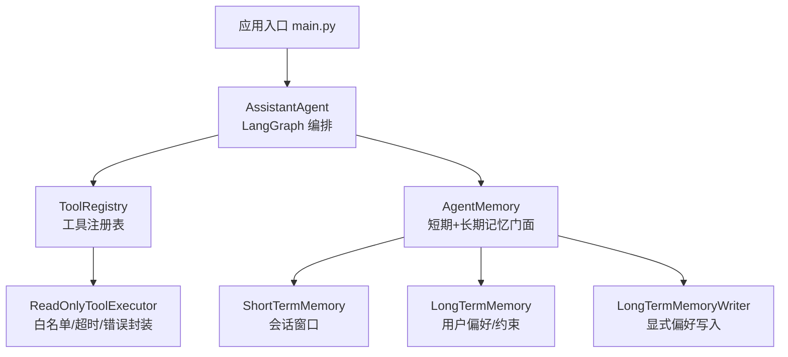
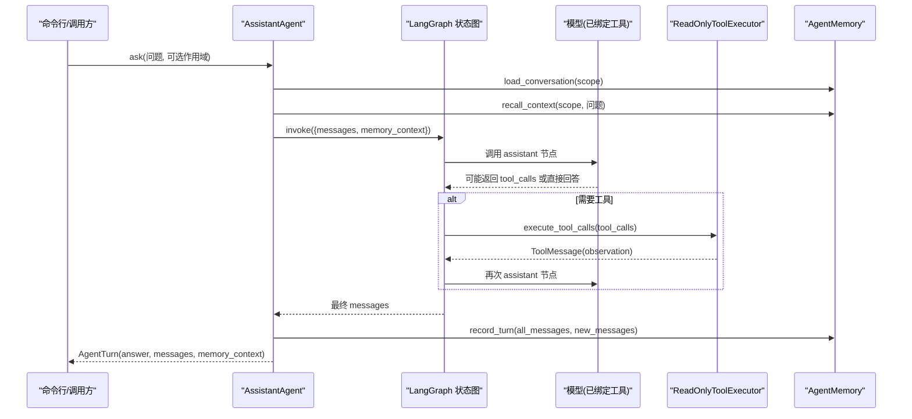
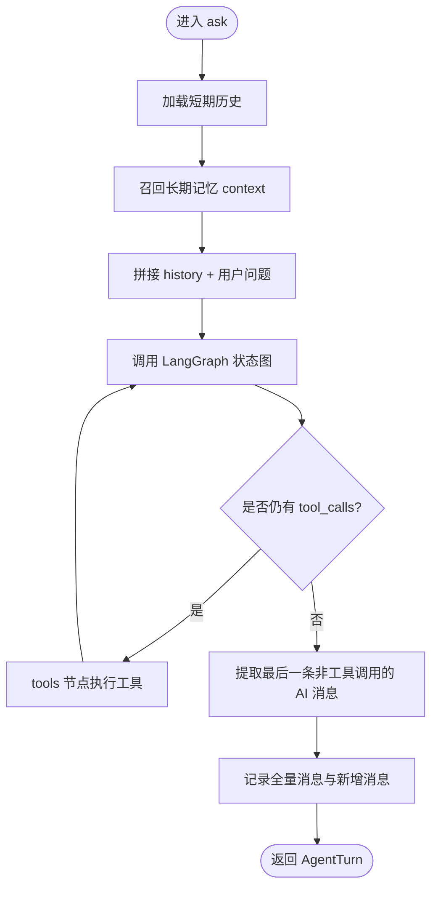
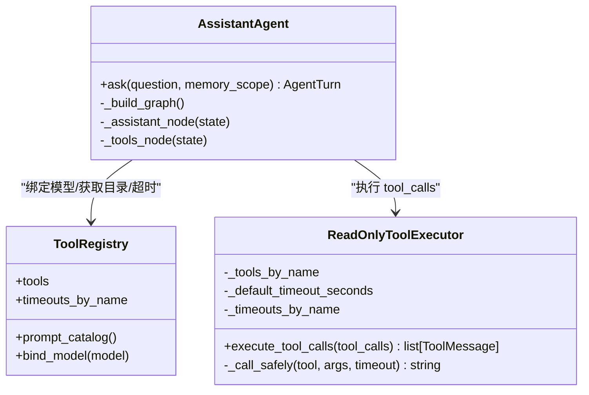
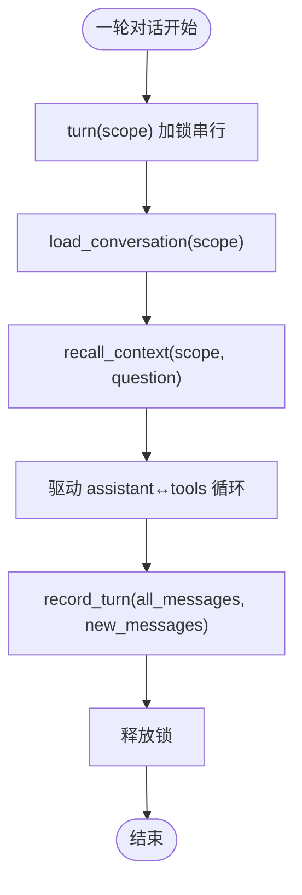
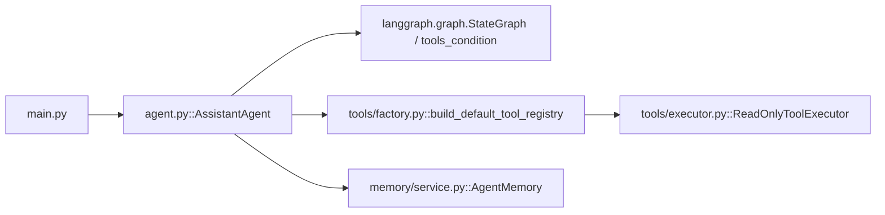

# Agent 核心系统

<cite>
**本文引用的文件**   
- [agent.py](file://agent_platform/agent.py)
- [main.py](file://main.py)
- [service.py](file://agent_platform/memory/service.py)
- [executor.py](file://agent_platform/tools/executor.py)
- [factory.py](file://agent_platform/tools/factory.py)
- [__init__.py](file://agent_platform/__init__.py)
- [README.md](file://README.md)
</cite>

## 目录
1. [引言](#引言)
2. [项目结构](#项目结构)
3. [核心组件](#核心组件)
4. [架构总览](#架构总览)
5. [详细组件分析](#详细组件分析)
6. [依赖关系分析](#依赖关系分析)
7. [性能与优化建议](#性能与优化建议)
8. [故障排查指南](#故障排查指南)
9. [结论](#结论)
10. [附录：配置与使用示例](#附录配置与使用示例)

## 引言
本技术文档围绕 AssistantAgent 类展开，系统性说明其在 LangGraph 状态图中的编排逻辑、对话流程控制、工具调用机制、记忆整合策略、错误处理与降级路径，以及性能优化与最佳实践。读者无需深入源码即可理解“用户消息 → 模型推理 → 工具执行 → 结果回传 → 记忆更新”的完整闭环。

## 项目结构
Agent 平台采用分层与可替换边界设计：应用层通过 AssistantAgent 组合模型、工具注册表与记忆门面；工具与记忆均提供稳定接口，便于替换实现或注入替身用于评测。

图表来源
- [main.py:43-94](file://main.py#L43-L94)
- [agent.py:35-141](file://agent_platform/agent.py#L35-L141)
- [service.py:24-105](file://agent_platform/memory/service.py#L24-L105)
- [executor.py:17-67](file://agent_platform/tools/executor.py#L17-L67)
- [factory.py:18-36](file://agent_platform/tools/factory.py#L18-L36)

章节来源
- [README.md:19-48](file://README.md#L19-L48)
- [__init__.py:1-28](file://agent_platform/__init__.py#L1-L28)

## 核心组件
- AssistantAgent：应用层 Agent，负责组装模型、工具、记忆，并驱动 LangGraph 状态图完成一轮问答。
- AgentState：扩展 LangGraph 的 MessagesState，增加 memory_context 字段用于注入长期记忆片段。
- AgentTurn：一轮调用的可观测结果，包含最终答复、消息序列和召回的长期记忆上下文。
- ToolRegistry：工具注册中心，统一暴露工具 Schema、Prompt 目录、执行超时等元信息。
- ReadOnlyToolExecutor：只读工具执行器，负责白名单校验、超时控制和异常转 observation。
- AgentMemory：短期/长期记忆门面，提供会话串行化、历史裁剪、长期记忆召回与写入。

章节来源
- [agent.py:20-33](file://agent_platform/agent.py#L20-L33)
- [agent.py:35-141](file://agent_platform/agent.py#L35-L141)
- [tools/__init__.py:1-18](file://agent_platform/tools/__init__.py#L1-L18)
- [memory/__init__.py:1-41](file://agent_platform/memory/__init__.py#L1-L41)

## 架构总览
AssistantAgent 在构造时绑定模型与工具、构建系统 Prompt、创建只读工具执行器和 LangGraph 状态图。运行时按作用域串行加载短期历史、召回长期记忆，驱动 assistant 与 tools 节点循环，直到模型直接回答。

图表来源
- [agent.py:84-141](file://agent_platform/agent.py#L84-L141)
- [executor.py:27-67](file://agent_platform/tools/executor.py#L27-L67)
- [service.py:59-90](file://agent_platform/memory/service.py#L59-L90)

## 详细组件分析

### AssistantAgent 与 LangGraph 编排
- 状态定义：AgentState 继承 MessagesState，新增 memory_context 字段，用于注入长期记忆片段，且该字段不会写回会话消息。
- 图构建：_build_graph 定义两个节点 assistant 与 tools，START→assistant，assistant 经 tools_condition 条件分支到 tools 或 END，tools→assistant 形成往返循环。
- 节点职责：
  - assistant 节点：按窗口裁剪历史、拼接 SystemMessage 与低权限 memory_context，调用模型；若模型异常则降级为普通 AI 消息，保证图正常收尾。
  - tools 节点：从最后一条 AI 消息提取 tool_calls，交由 ReadOnlyToolExecutor 执行，将 observation 写回消息流。
- 一轮问答：ask 方法串行加锁，读取短期历史、召回长期记忆，驱动图运行，写回全量消息，并从末尾取最后一条无 tool_calls 的 AI 消息作为最终答案。

图表来源
- [agent.py:84-141](file://agent_platform/agent.py#L84-L141)

章节来源
- [agent.py:20-33](file://agent_platform/agent.py#L20-L33)
- [agent.py:110-141](file://agent_platform/agent.py#L110-L141)

### 工具调用机制
- 工具注册：默认工具由 build_default_tool_registry 构造，包括 RAG 检索与天气查询；每个工具可设置专用超时。
- 模型绑定：ToolRegistry.bind_model 将工具 Schema 绑定到模型，使模型能在回复中发起结构化 tool_calls。
- 执行器：ReadOnlyToolExecutor 维护工具白名单，对未注册工具拒绝执行；对每个 tool_call 以线程池限时等待，超时或异常均转为文本 observation，避免整张图崩溃。
- 结果回传：tools 节点将 ToolMessage 追加到消息流，assistant 节点再次被调用，直至模型直接回答。

图表来源
- [factory.py:18-36](file://agent_platform/tools/factory.py#L18-L36)
- [executor.py:17-67](file://agent_platform/tools/executor.py#L17-L67)
- [agent.py:35-141](file://agent_platform/agent.py#L35-L141)

章节来源
- [factory.py:1-37](file://agent_platform/tools/factory.py#L1-L37)
- [executor.py:1-67](file://agent_platform/tools/executor.py#L1-L67)

### 记忆整合与对话流程控制
- 短期记忆：按 MemoryScope(tenant_id, user_id, conversation_id) 隔离；AgentMemory.turn 对同一 scope 串行化“读历史→执行→写历史”，防止并发覆盖。
- 长期记忆：按 MemoryOwner(tenant_id, user_id) 隔离，跨 conversation 召回；默认 ExplicitPreferenceWriter 仅保存明确授权的用户偏好/约束，并以不可信数据形式注入模型，不提升为 SystemMessage。
- 对话控制：ask 先加载短期历史，再召回长期记忆，将两者分别作为消息上下文与低权限提示片段；最终答案从最后一条无 tool_calls 的 AI 消息中提取。

图表来源
- [service.py:51-90](file://agent_platform/memory/service.py#L51-L90)
- [agent.py:84-108](file://agent_platform/agent.py#L84-L108)

章节来源
- [service.py:24-105](file://agent_platform/memory/service.py#L24-L105)
- [agent.py:84-108](file://agent_platform/agent.py#L84-L108)

### 错误处理、超时与降级
- 模型侧降级：assistant 节点捕获模型调用异常，返回带错误信息的 AIMessage，确保图能正常结束。
- 工具侧降级：ReadOnlyToolExecutor 对未注册工具、超时、异常均返回文本 observation，不向上抛出，避免 LangGraph 整体失败。
- 超时策略：执行器默认超时可由 settings.tool_timeout_seconds 指定；天气等网络工具可通过 registry 设置专用超时覆盖默认值。

章节来源
- [agent.py:120-137](file://agent_platform/agent.py#L120-L137)
- [executor.py:27-67](file://agent_platform/tools/executor.py#L27-L67)
- [factory.py:31-36](file://agent_platform/tools/factory.py#L31-L36)

## 依赖关系分析
AssistantAgent 依赖以下关键外部模块：
- LangChain/LangGraph：消息类型、状态图与工具条件路由。
- ToolRegistry：工具 Schema、Prompt 目录、执行超时。
- AgentMemory：短期/长期记忆门面，提供会话串行化、历史裁剪、长期记忆召回与写入。
- 应用入口 main.py：负责参数解析、真实/模拟模式切换、作用域配置与实例化 AssistantAgent。

图表来源
- [main.py:43-94](file://main.py#L43-L94)
- [agent.py:110-141](file://agent_platform/agent.py#L110-L141)
- [factory.py:18-36](file://agent_platform/tools/factory.py#L18-L36)
- [service.py:24-105](file://agent_platform/memory/service.py#L24-L105)
- [executor.py:17-67](file://agent_platform/tools/executor.py#L17-L67)

章节来源
- [main.py:43-94](file://main.py#L43-L94)
- [agent.py:35-141](file://agent_platform/agent.py#L35-L141)

## 性能与优化建议
- 控制模型输入长度：使用 AgentMemory.trim_for_model 裁剪历史，降低 token 成本；同时保留完整消息于图状态，保证后续推理一致性。
- 限制长期记忆注入大小：settings.long_term_context_max_characters 控制注入长度，避免 Prompt 膨胀。
- 合理设置工具超时：网络型工具（如天气）应设置专用超时，避免阻塞整个轮次；RAG 等本地工具可使用较短默认超时。
- 复用 Agent 实例：同一进程内多次提问共享短期会话与长期记忆，减少重复初始化开销。
- 评测与离线验证：优先使用 --mock 与 --evaluate 模式进行回归测试，避免网络波动影响性能评估。

[本节为通用指导，不直接分析具体文件]

## 故障排查指南
- 模型调用失败：检查 API Key、Base URL、模型名称与网络连通性；观察 assistant 节点降级消息中的异常类型与内容。
- 工具未注册或幻觉调用：确认 ToolRegistry 已正确注册所需工具；未注册工具会被拒绝并返回 observation。
- 工具超时：检查对应工具的专用超时配置与后端服务可用性；必要时提高 network_tool_timeout_seconds。
- 记忆作用域泄露：注入共享 AgentMemory 时必须显式传入 memory_scope，否则构造函数会抛错以防止跨用户串数据。
- 并发覆盖历史：确保通过 AgentMemory.turn(scope) 串行化同一会话的读写；不同 scope 可并发执行。

章节来源
- [agent.py:47-49](file://agent_platform/agent.py#L47-L49)
- [agent.py:120-137](file://agent_platform/agent.py#L120-L137)
- [executor.py:27-67](file://agent_platform/tools/executor.py#L27-L67)
- [service.py:51-57](file://agent_platform/memory/service.py#L51-L57)

## 结论
AssistantAgent 通过 LangGraph 将“助手推理”与“工具执行”解耦为可循环的状态图节点，结合 AgentMemory 的短期/长期记忆与 ToolRegistry 的工具治理，实现了可控、可观测、可替换的 Agent 编排。其错误处理与降级策略保证了系统在模型或工具异常时的鲁棒性；配合合理的超时与窗口策略，可在保证体验的同时控制资源消耗。

[本节为总结性内容，不直接分析具体文件]

## 附录：配置与使用示例
- 配置 AgentSettings：用于控制 RAG 分块大小、Top-K、长期记忆召回条数与字符预算、工具超时等。
- 创建 AssistantAgent：传入模型、settings、tool_registry、memory 与 memory_scope；共享 memory 必须显式指定作用域。
- 处理不同对话场景：
  - 真实模式：从 .env 读取模型配置，走完整链路。
  - Mock 模式：使用离线预置模型与工具替身，无需 API Key。
  - 评测模式：运行离线工具回归套件，全部通过返回退出码 0。

章节来源
- [main.py:22-40](file://main.py#L22-L40)
- [main.py:43-94](file://main.py#L43-L94)
- [agent.py:35-65](file://agent_platform/agent.py#L35-L65)
- [README.md:110-144](file://README.md#L110-L144)