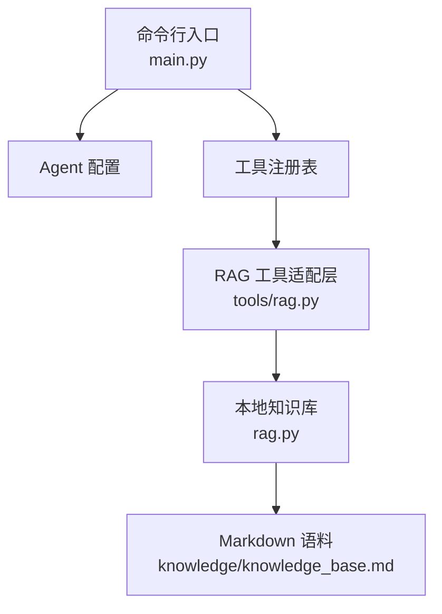
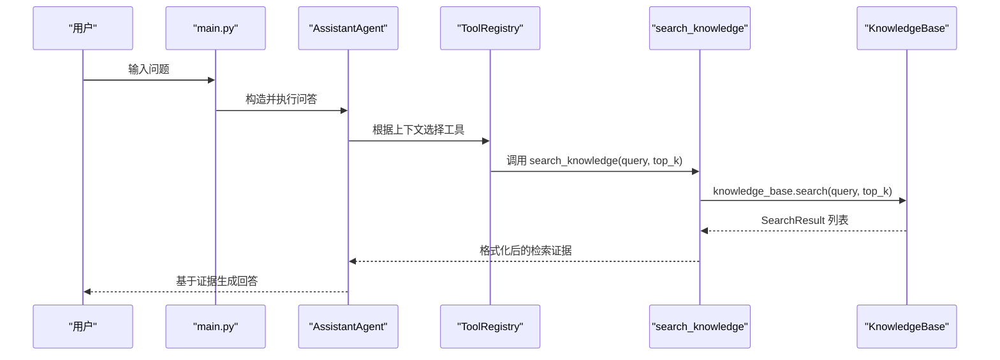
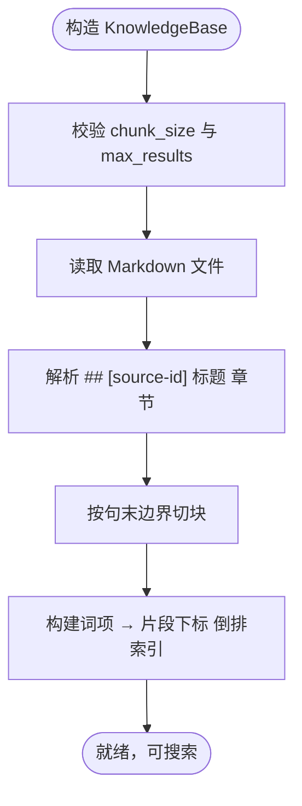
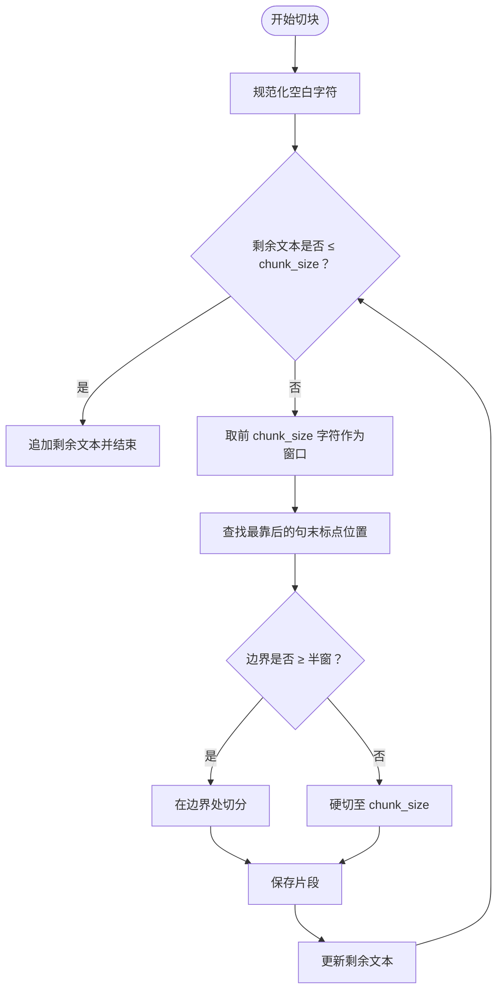
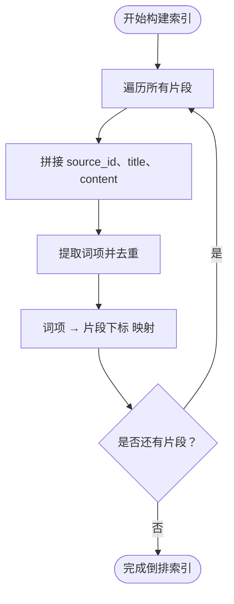
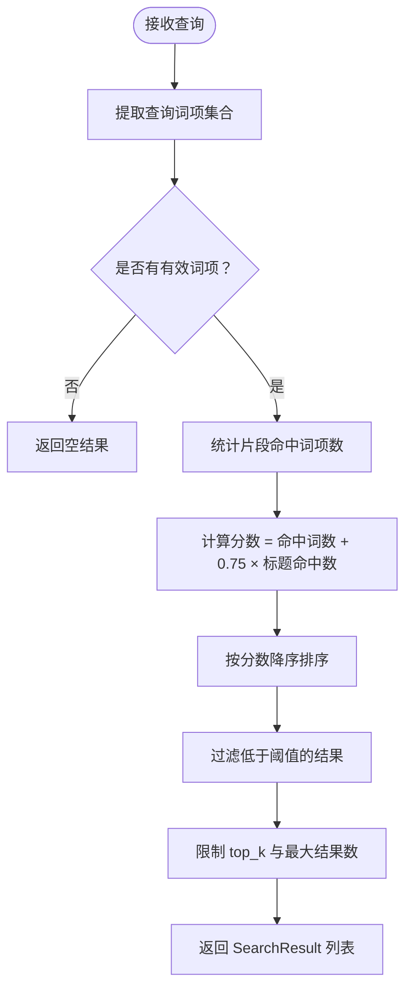
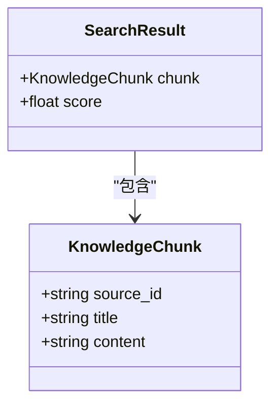
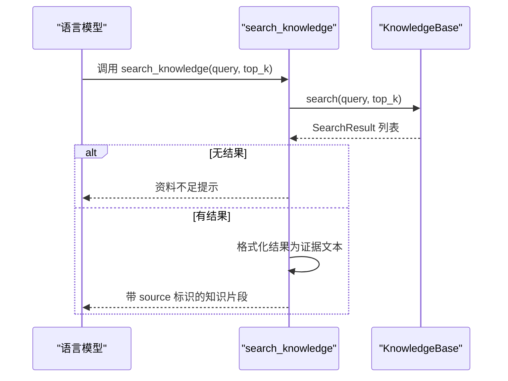
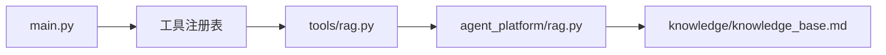

# RAG 知识检索

<cite>
**本文引用的文件**   
- [README.md](file://README.md)
- [main.py](file://main.py)
- [rag.py](file://agent_platform/rag.py)
- [tools_rag.py](file://agent_platform/tools/rag.py)
</cite>

## 目录
1. [引言](#引言)
2. [项目结构](#项目结构)
3. [核心组件](#核心组件)
4. [架构总览](#架构总览)
5. [详细组件分析](#详细组件分析)
6. [依赖关系分析](#依赖关系分析)
7. [性能与内存优化](#性能与内存优化)
8. [故障排查指南](#故障排查指南)
9. [结论](#结论)
10. [附录：API 使用示例](#附录api-使用示例)

## 引言
本技术文档面向本地 RAG 知识检索系统，重点解释以下能力：
- 纯内存倒排索引的设计原理、数据结构与优势。
- Markdown 知识库的章节解析、文本分块、关键词提取和索引构建流程。
- 查询解析、相关性评分、结果过滤与排序机制。
- `KnowledgeChunk` 与搜索结果格式化的数据模型。
- 知识库加载、更新与查询的 API 使用方式。
- 与工具系统的集成方式，特别是 `search_knowledge` 工具的实现细节。
- 性能优化建议、内存调优策略以及大规模知识库的处理思路。

该系统不依赖向量数据库或外部 embedding 服务，通过词项重合度实现可复现、可解释的本地检索，适合离线运行、快速验证和轻量部署。

## 项目结构
RAG 相关代码主要位于 `agent_platform/rag.py` 与 `agent_platform/tools/rag.py`；应用入口在 `main.py`；项目整体说明见 `README.md`。

**图表来源**
- [main.py:43-88](file://main.py#L43-L88)
- [tools_rag.py:14-26](file://agent_platform/tools/rag.py#L14-L26)
- [rag.py:42-98](file://agent_platform/rag.py#L42-L98)

**章节来源**
- [README.md:19-61](file://README.md#L19-L61)
- [main.py:43-88](file://main.py#L43-L88)

## 核心组件
- `KnowledgeBase`：负责读取 Markdown 语料、解析章节、切块、构建倒排索引并提供检索接口。
- `KnowledgeChunk`：知识库中可检索、可引用的最小片段，包含来源标识、标题和正文。
- `SearchResult`：一次检索命中的片段及其内部排序分数。
- `create_rag_tool`：将 `KnowledgeBase` 包装为 LangChain 工具，暴露 `search_knowledge`。
- `_format_search_results`：把检索结果格式化为带 `[source:...]` 的证据文本，供模型引用。

**章节来源**
- [rag.py:25-40](file://agent_platform/rag.py#L25-L40)
- [rag.py:42-98](file://agent_platform/rag.py#L42-L98)
- [tools_rag.py:14-35](file://agent_platform/tools/rag.py#L14-L35)

## 架构总览
下图展示从用户提问到工具调用、再到本地检索返回证据的完整链路。

**图表来源**
- [main.py:43-88](file://main.py#L43-L88)
- [tools_rag.py:14-35](file://agent_platform/tools/rag.py#L14-L35)
- [rag.py:71-98](file://agent_platform/rag.py#L71-L98)

## 详细组件分析

### 本地知识库与纯内存倒排索引
`KnowledgeBase` 在构造阶段完成三件事：
1. 校验参数并读取 Markdown 文件。
2. 解析章节并切块，得到只读的 `KnowledgeChunk` 序列。
3. 对每个片段的 `source_id`、标题和正文建立词项到片段下标的倒排索引。

倒排索引的优势：
- 无需向量计算，检索速度快且可复现。
- 内存占用可控，适合中小规模知识库。
- 支持中文双字词与英文整词混合检索，兼顾召回与精度。

**图表来源**
- [rag.py:42-58](file://agent_platform/rag.py#L42-L58)
- [rag.py:100-121](file://agent_platform/rag.py#L100-L121)

**章节来源**
- [rag.py:42-58](file://agent_platform/rag.py#L42-L58)
- [rag.py:100-121](file://agent_platform/rag.py#L100-L121)

### 文本分块算法
分块逻辑遵循以下原则：
- 优先在中文句末标点处断开，避免句子被截断。
- 当窗口内找不到合适的句末边界时，采用硬切，但保证片段长度不低于半窗。
- 所有空白字符被规范化，确保切块稳定。

**图表来源**
- [rag.py:152-167](file://agent_platform/rag.py#L152-L167)

**章节来源**
- [rag.py:152-167](file://agent_platform/rag.py#L152-L167)

### 关键词提取与索引构建
关键词提取规则：
- 英文与数字保留为完整词。
- 单个汉字直接成词。
- 连续中文切为双字 bigram，例如“西湖景区”拆为“西湖”“湖景”“景区”。

索引构建过程：
- 对每个片段拼接 `source_id + 标题 + 正文`。
- 提取去重后的词项集合。
- 将词项映射到片段下标，形成倒排索引。

**图表来源**
- [rag.py:112-121](file://agent_platform/rag.py#L112-L121)
- [rag.py:170-181](file://agent_platform/rag.py#L170-L181)

**章节来源**
- [rag.py:112-121](file://agent_platform/rag.py#L112-L121)
- [rag.py:170-181](file://agent_platform/rag.py#L170-L181)

### 检索算法：查询解析、相关性评分与排序
检索流程：
1. 查询分词，得到有效词项集合。
2. 通过倒排索引统计每个片段命中的词项数量。
3. 计算分数：命中词数 + 标题命中加权（标题命中权重更高）。
4. 按分数降序排序，并按最高分的固定比例过滤弱相关结果。
5. 截取 top_k 个结果，最多不超过内置上限。

**图表来源**
- [rag.py:71-98](file://agent_platform/rag.py#L71-L98)

**章节来源**
- [rag.py:71-98](file://agent_platform/rag.py#L71-L98)

### 数据结构：KnowledgeChunk 与 SearchResult
- `KnowledgeChunk`：不可变数据类，包含来源标识、标题和内容，便于引用与溯源。
- `SearchResult`：不可变数据类，封装片段与其内部排序分数，用于工具输出与上层消费。

**图表来源**
- [rag.py:25-40](file://agent_platform/rag.py#L25-L40)

**章节来源**
- [rag.py:25-40](file://agent_platform/rag.py#L25-L40)

### 工具系统集成：search_knowledge
`create_rag_tool` 将 `KnowledgeBase` 包装为 LangChain 工具，暴露 `search_knowledge(query, top_k)`。其职责包括：
- 调用底层检索接口。
- 未命中时返回引导性提示，防止模型编造事实。
- 命中时将结果格式化为带 `[source:...]` 的证据文本。

**图表来源**
- [tools_rag.py:14-35](file://agent_platform/tools/rag.py#L14-L35)
- [rag.py:71-98](file://agent_platform/rag.py#L71-L98)

**章节来源**
- [tools_rag.py:14-35](file://agent_platform/tools/rag.py#L14-L35)

## 依赖关系分析
RAG 模块与工具层的耦合点清晰：
- `tools/rag.py` 依赖 `agent_platform.rag` 的 `SearchResult` 与 `KnowledgeBase`。
- `main.py` 通过工具注册表注入默认工具，其中包含 RAG 工具。
- 知识库语料路径由 `KnowledgeBase.from_default_file` 指向 `knowledge/knowledge_base.md`。

**图表来源**
- [main.py:60-88](file://main.py#L60-L88)
- [tools_rag.py:10-11](file://agent_platform/tools/rag.py#L10-L11)
- [rag.py:60-64](file://agent_platform/rag.py#L60-L64)

**章节来源**
- [main.py:60-88](file://main.py#L60-L88)
- [tools_rag.py:10-11](file://agent_platform/tools/rag.py#L10-L11)
- [rag.py:60-64](file://agent_platform/rag.py#L60-L64)

## 性能与内存优化
- 分块大小调整：`chunk_size` 过小会导致片段过多、索引膨胀；过大则可能降低相关性精度。建议从默认值开始，结合业务语料长度逐步调优。
- 结果上限控制：`max_results` 限制工具返回的最大片段数，避免下游模型上下文过长。
- 查询词项过滤：无效查询直接返回空结果，减少不必要计算。
- 标题加权：标题命中给予更高权重，有助于提升主题相关性。
- 内存复用：`_chunks` 固化为元组，索引键值为不可变元组，降低运行期修改风险。
- 大规模知识库策略：
  - 分库分片：按来源或主题拆分多个 `KnowledgeBase`，按需加载。
  - 增量索引：新增章节后重建局部索引，而非全量重建。
  - 缓存热点词项：对高频查询词项做短期缓存，降低重复检索开销。
  - 压缩存储：对长文本内容使用压缩或延迟加载，减少常驻内存。

[本节为通用指导，不直接分析具体文件]

## 故障排查指南
常见问题与定位方法：
- 知识库文件不存在：检查 `knowledge/knowledge_base.md` 路径是否正确。
- 没有可检索内容：确认 Markdown 文件中存在符合 `## [source-id] 标题` 格式的章节。
- 参数非法：`chunk_size` 不能小于 80，`max_results` 至少为 1。
- 检索结果为空：检查查询是否包含有效词项，或知识库中是否存在匹配片段。
- 工具未返回证据：确认 `search_knowledge` 已注册并被模型调用。

**章节来源**
- [rag.py:45-58](file://agent_platform/rag.py#L45-L58)
- [rag.py:100-109](file://agent_platform/rag.py#L100-L109)
- [tools_rag.py:17-24](file://agent_platform/tools/rag.py#L17-L24)

## 结论
该 RAG 知识检索系统以纯内存倒排索引为核心，提供轻量、可复现、可解释的本地检索能力。通过清晰的模块化设计，RAG 领域逻辑与工具适配层解耦，便于扩展与替换。对于中小规模知识库，当前实现足以支撑离线演示、快速迭代与生产级轻量部署；对于更大规模场景，可通过分库分片、增量索引与缓存策略进一步优化性能与内存占用。

[本节为总结性内容，不直接分析具体文件]

## 附录：API 使用示例

### 初始化知识库
- 使用默认语料路径：
  - 调用 `KnowledgeBase.from_default_file(chunk_size=260, max_results=3)`。
- 自定义语料路径：
  - 调用 `KnowledgeBase(source_path, chunk_size=260, max_results=3)`。

**章节来源**
- [rag.py:45-64](file://agent_platform/rag.py#L45-L64)

### 查询知识库
- 基本查询：
  - 调用 `knowledge_base.search("杭州景点", top_k=3)`。
- 未命中处理：
  - 若返回空列表，上层应提示“资料不足”，避免模型编造。

**章节来源**
- [rag.py:71-98](file://agent_platform/rag.py#L71-L98)

### 使用工具 search_knowledge
- 在工具注册表中注册 RAG 工具：
  - 调用 `create_rag_tool(knowledge_base)`。
- 模型调用工具：
  - 传入 `query` 与可选 `top_k`。
- 工具返回：
  - 未命中：返回“检索结果：未检索到相关资料……”
  - 命中：返回带 `[source:...]` 标识的知识片段。

**章节来源**
- [tools_rag.py:14-35](file://agent_platform/tools/rag.py#L14-L35)

### 应用入口与运行模式
- 真实模式：
  - 配置 `.env` 中的 `MODEL_API_KEY`，运行 `python main.py "杭州有什么可玩的？"`。
- Mock 模式：
  - 运行 `python main.py --mock` 或指定场景 `--mock-scenario weather`。
- 评测模式：
  - 运行 `python main.py --evaluate`。

**章节来源**
- [main.py:22-40](file://main.py#L22-L40)
- [main.py:43-88](file://main.py#L43-L88)
- [README.md:110-144](file://README.md#L110-L144)