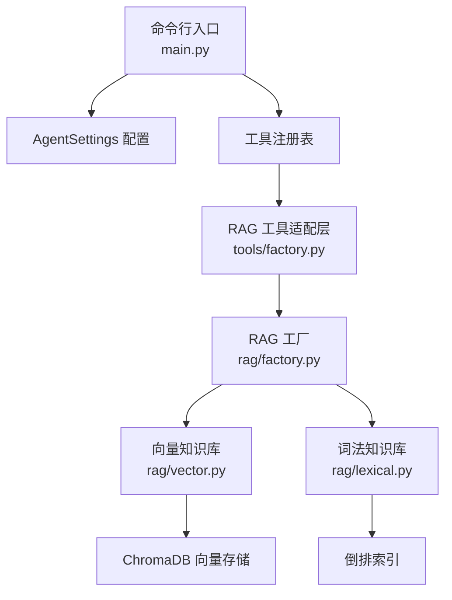
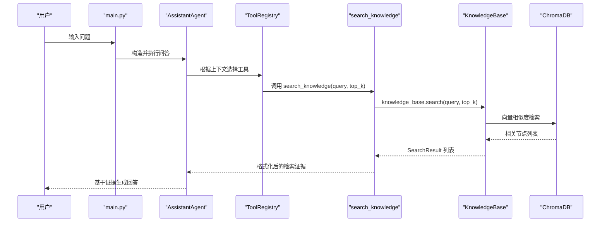
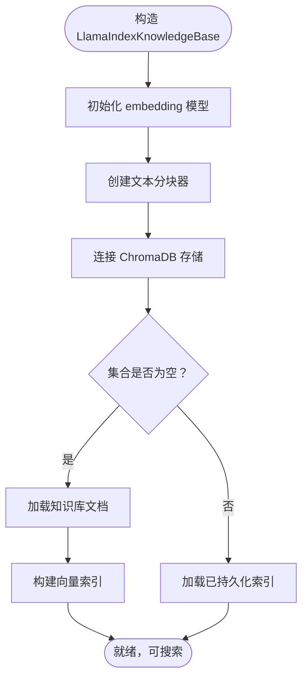
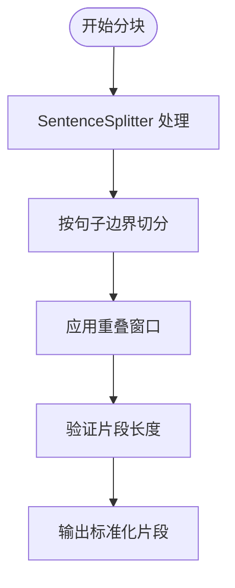
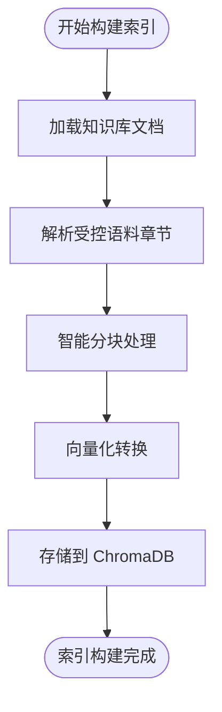
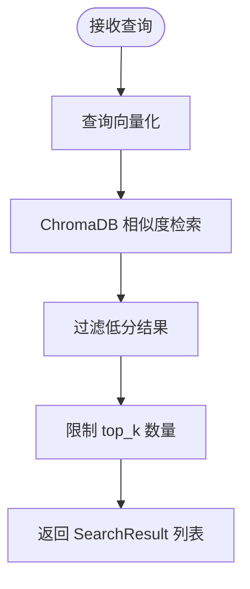
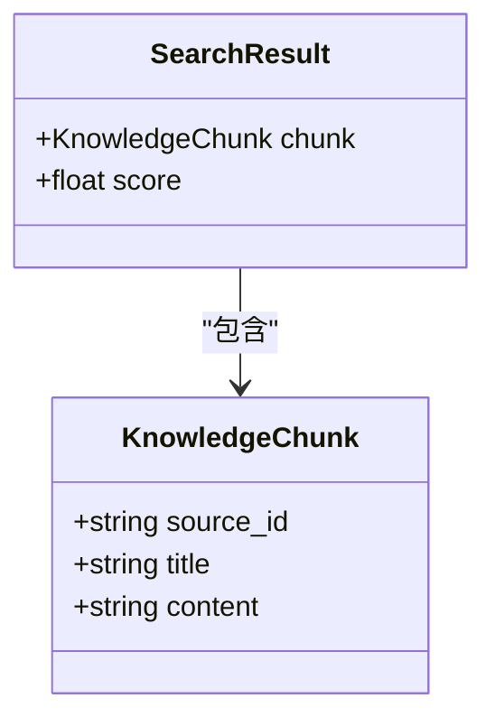
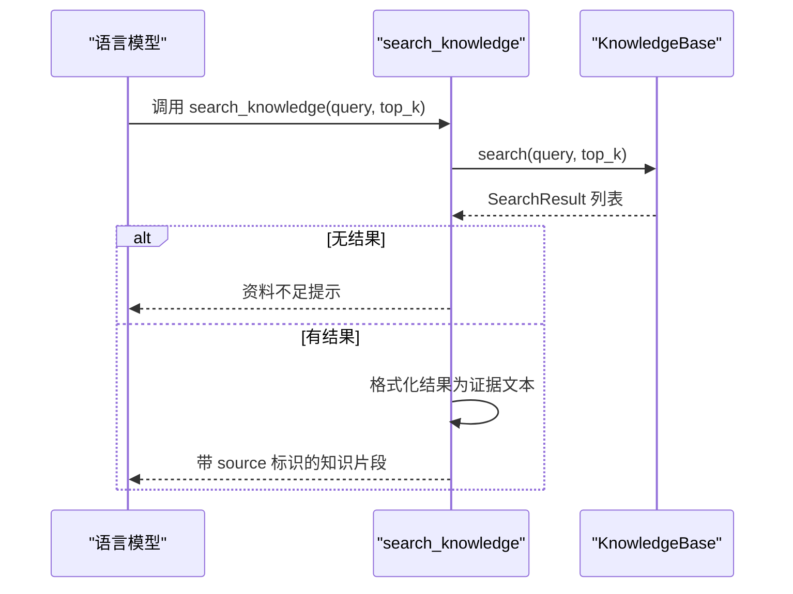
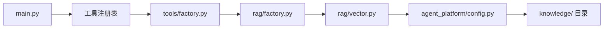

# RAG 知识检索

<cite>
**本文引用的文件**   
- [main.py](file://main.py)
- [config.py](file://agent_platform/config.py)
- [rag/__init__.py](file://agent_platform/rag/__init__.py)
- [rag/factory.py](file://agent_platform/rag/factory.py)
- [rag/models.py](file://agent_platform/rag/models.py)
- [rag/vector.py](file://agent_platform/rag/vector.py)
- [tools/factory.py](file://agent_platform/tools/factory.py)
</cite>

## 更新摘要
**变更内容**   
- 将纯内存倒排索引实现完全替换为 LlamaIndex + ChromaDB 向量数据库集成
- 新增语义搜索、持久化向量存储和多种 embedding 提供方支持（FastEmbed/OpenAI）
- 重构知识库管理功能，支持文档灌入和索引重建
- 更新架构设计以支持双后端模式（词法/向量）
- 修改配置系统以支持新的向量检索参数

## 目录
1. [引言](#引言)
2. [项目结构](#项目结构)
3. [核心组件](#核心组件)
4. [架构总览](#架构总览)
5. [详细组件分析](#详细组件分析)
6. [依赖关系分析](#依赖关系分析)
7. [性能与内存优化](#性能与内存优化)
8. [故障排查指南](#故障排查指南)
9. [结论](#结论)
10. [附录：API 使用示例](#附录api-使用示例)

## 引言
本技术文档面向基于 LlamaIndex + ChromaDB 的 RAG 知识检索系统，重点解释以下能力：
- 向量语义检索的实现原理、ChromaDB 持久化存储与多 embedding 提供方支持。
- Markdown 知识库的章节解析、文本分块、向量化和索引构建流程。
- 查询语义匹配、相似度评分和结果过滤机制。
- `KnowledgeChunk` 与搜索结果格式化的数据模型。
- 知识库加载、更新、灌入和查询的完整 API 使用方式。
- 与工具系统的集成方式，包括 `search_knowledge` 工具的适配层实现。
- 性能优化建议、向量维度调优和大规模知识库的处理策略。

该系统支持两种检索后端：默认的 LlamaIndex + ChromaDB 向量检索提供语义理解能力，以及可选的词法倒排索引用于离线评测和无 embedding 环境。

## 项目结构
RAG 相关代码主要位于 `agent_platform/rag/` 目录下，包含统一契约、工厂模式和具体实现；工具适配层位于 `agent_platform/tools/`；应用入口在 `main.py`。

**图表来源**
- [main.py:68-104](file://main.py#L68-L104)
- [tools/factory.py:18-33](file://agent_platform/tools/factory.py#L18-L33)
- [rag/factory.py:16-39](file://agent_platform/rag/factory.py#L16-L39)

## 核心组件
- `LlamaIndexKnowledgeBase`：基于 LlamaIndex 和 ChromaDB 的向量检索实现，负责语义搜索、文档灌入和索引管理。
- `LexicalKnowledgeBase`：离线词法倒排索引实现，用于评测、mock 和无 embedding 环境。
- `KnowledgeBase`：检索后端的统一 Protocol 接口，确保工具层不感知具体实现。
- `KnowledgeChunk`：知识库中可检索、可引用的最小文本片段，包含来源标识、标题和内容。
- `SearchResult`：一次检索命中的片段及其内部排序分数。
- `build_knowledge_base`：按配置装配不同检索后端的工厂函数。
- `create_rag_tool`：将 KnowledgeBase 包装为 LangChain 工具，暴露 `search_knowledge`。

**章节来源**
- [rag/models.py:14-42](file://agent_platform/rag/models.py#L14-L42)
- [rag/vector.py:33-199](file://agent_platform/rag/vector.py#L33-L199)
- [rag/factory.py:16-39](file://agent_platform/rag/factory.py#L16-L39)

## 架构总览
下图展示从用户提问到工具调用、再到向量语义检索返回证据的完整链路。

**图表来源**
- [main.py:68-104](file://main.py#L68-L104)
- [tools/factory.py:18-33](file://agent_platform/tools/factory.py#L18-L33)
- [rag/vector.py:149-176](file://agent_platform/rag/vector.py#L149-L176)

## 详细组件分析

### 向量知识库与 ChromaDB 集成
`LlamaIndexKnowledgeBase` 在构造阶段完成以下关键步骤：
1. 初始化 embedding 模型（FastEmbed 或 OpenAI）。
2. 创建 SentenceSplitter 进行智能文本分块。
3. 连接 ChromaDB 持久化存储，自动加载或重建索引。
4. 建立线程锁保证并发安全。

ChromaDB 的优势：
- 本地嵌入式向量数据库，无需独立服务进程。
- 支持余弦相似度空间，适合语义检索。
- 持久化存储，重启后保留向量索引。
- 轻量级部署，适合边缘计算场景。

**图表来源**
- [rag/vector.py:36-76](file://agent_platform/rag/vector.py#L36-L76)
- [rag/vector.py:78-133](file://agent_platform/rag/vector.py#L78-L133)

**章节来源**
- [rag/vector.py:36-76](file://agent_platform/rag/vector.py#L36-L76)
- [rag/vector.py:78-133](file://agent_platform/rag/vector.py#L78-L133)

### 文本分块算法
向量后端的分块逻辑使用 LlamaIndex 的 `SentenceSplitter`：
- 按句子边界智能切分，避免语义截断。
- 支持重叠窗口（默认约 15%），缓解边界信息丢失。
- 保持与词法后端一致的字符数目标。

**图表来源**
- [rag/vector.py:66-69](file://agent_platform/rag/vector.py#L66-L69)

**章节来源**
- [rag/vector.py:66-69](file://agent_platform/rag/vector.py#L66-L69)

### 向量化与索引构建
索引构建过程：
1. 读取内置 `knowledge_base.md` 和其他支持格式的文档。
2. 对受控语料按章节解析，保留 `[source-id]` 引用契约。
3. 使用 SentenceSplitter 进行智能分块。
4. 通过 embedding 模型转换为向量表示。
5. 存储到 ChromaDB 集合中，设置余弦相似度空间。

**图表来源**
- [rag/vector.py:231-258](file://agent_platform/rag/vector.py#L231-L258)
- [rag/vector.py:118-129](file://agent_platform/rag/vector.py#L118-L129)

**章节来源**
- [rag/vector.py:231-258](file://agent_platform/rag/vector.py#L231-L258)
- [rag/vector.py:118-129](file://agent_platform/rag/vector.py#L118-L129)

### 检索算法：语义匹配与相似度评分
向量检索流程：
1. 将查询文本转换为向量表示。
2. 在 ChromaDB 中进行余弦相似度检索。
3. 过滤低于阈值的低质量结果。
4. 返回 top_k 个最相关的片段。

相似度评分机制：
- 使用 exp(-余弦距离) 将距离转换为相似度分数。
- 分数范围 0~1，越大表示越相关。
- 可配置的最低相似度阈值防止噪声结果。

**图表来源**
- [rag/vector.py:149-176](file://agent_platform/rag/vector.py#L149-L176)

**章节来源**
- [rag/vector.py:149-176](file://agent_platform/rag/vector.py#L149-L176)

### 数据结构：KnowledgeChunk 与 SearchResult
- `KnowledgeChunk`：不可变数据类，包含来源标识、标题和内容，便于引用与溯源。
- `SearchResult`：不可变数据类，封装片段与其内部排序分数，用于工具输出与上层消费。

**图表来源**
- [rag/models.py:14-29](file://agent_platform/rag/models.py#L14-L29)

**章节来源**
- [rag/models.py:14-29](file://agent_platform/rag/models.py#L14-L29)

### 工具系统集成：search_knowledge
`create_rag_tool` 将 `KnowledgeBase` 包装为 LangChain 工具，暴露 `search_knowledge(query, top_k)`。其职责包括：
- 调用底层检索接口。
- 未命中时返回引导性提示，防止模型编造事实。
- 命中时将结果格式化为带 `[source:...]` 的证据文本。

**图表来源**
- [tools/factory.py:18-33](file://agent_platform/tools/factory.py#L18-L33)
- [rag/vector.py:149-176](file://agent_platform/rag/vector.py#L149-L176)

**章节来源**
- [tools/factory.py:18-33](file://agent_platform/tools/factory.py#L18-L33)

## 依赖关系分析
RAG 模块与工具层的耦合点清晰：
- `tools/factory.py` 依赖 `agent_platform.rag` 的 `build_knowledge_base`。
- `main.py` 通过工具注册表注入默认工具，其中包含 RAG 工具。
- 知识库语料路径由 `AgentSettings.rag_knowledge_dir` 指向 `knowledge/` 目录。
- ChromaDB 持久化目录由 `AgentSettings.rag_persist_dir` 指定。

**图表来源**
- [main.py:68-104](file://main.py#L68-L104)
- [tools/factory.py:18-33](file://agent_platform/tools/factory.py#L18-L33)
- [rag/factory.py:16-39](file://agent_platform/rag/factory.py#L16-L39)
- [config.py:29-36](file://agent_platform/config.py#L29-L36)

**章节来源**
- [main.py:68-104](file://main.py#L68-L104)
- [tools/factory.py:18-33](file://agent_platform/tools/factory.py#L18-L33)
- [rag/factory.py:16-39](file://agent_platform/rag/factory.py#L16-L39)
- [config.py:29-36](file://agent_platform/config.py#L29-L36)

## 性能与内存优化
- 向量维度选择：根据业务需求选择合适的 embedding 模型，平衡精度与性能。
- 分块大小调整：`chunk_size` 影响索引大小和检索精度，建议从默认值开始调优。
- 相似度阈值：`rag_min_score` 控制检索严格程度，过高可能漏检，过低引入噪声。
- 持久化存储：ChromaDB 本地存储避免重复向量化，提升启动速度。
- 并发安全：使用线程锁保护索引操作，避免重建过程中的竞态条件。
- 大规模知识库策略：
  - 增量灌入：使用 `ingest()` 方法追加新文档，避免全量重建。
  - 定期重建：定期执行 `reindex()` 清理碎片和优化索引。
  - 缓存热点查询：对高频查询做短期缓存，降低重复计算开销。
  - 批量处理：大批量文档灌入时使用批处理减少 I/O 开销。

## 故障排查指南
常见问题与定位方法：
- 向量后端依赖缺失：检查是否安装 llama-index 和 chromadb，或切换到词法后端。
- 知识库目录为空：确认 `knowledge/` 目录存在且包含 `.md`、`.txt`、`.pdf` 或 `.docx` 文件。
- Embedding 配置错误：检查 `EMBEDDING_API_KEY` 和 `EMBEDDING_BASE_URL` 配置。
- 索引构建失败：检查磁盘空间和 ChromaDB 持久化目录权限。
- 检索结果为空：调整 `rag_min_score` 阈值或检查文档内容质量。
- 工具未返回证据：确认 `search_knowledge` 已正确注册并被模型调用。

**章节来源**
- [rag/vector.py:49-57](file://agent_platform/rag/vector.py#L49-L57)
- [rag/vector.py:118-123](file://agent_platform/rag/vector.py#L118-L123)
- [rag/vector.py:220-228](file://agent_platform/rag/vector.py#L220-L228)

## 结论
该 RAG 知识检索系统以 LlamaIndex + ChromaDB 为核心，提供强大的语义检索能力和持久化存储支持。通过清晰的模块化设计和双后端架构，系统在保持向后兼容的同时，实现了从传统词法检索到现代语义检索的平滑迁移。对于需要深度语义理解的应用场景，当前实现提供了生产级的向量检索能力；对于资源受限或离线环境，仍可回退到词法倒排索引方案。

## 附录：API 使用示例

### 初始化知识库
- 使用默认配置：
  - 调用 `build_knowledge_base(settings)` 自动装配向量后端。
- 自定义 embedding 提供方：
  - 设置 `RAG_EMBEDDING_PROVIDER=openai` 并使用 OpenAI 兼容 API。
  - 设置 `RAG_EMBEDDING_PROVIDER=fastembed` 使用本地免费模型。

**章节来源**
- [rag/factory.py:16-39](file://agent_platform/rag/factory.py#L16-L39)
- [config.py:31-36](file://agent_platform/config.py#L31-L36)

### 查询知识库
- 基本查询：
  - 调用 `knowledge_base.search("杭州景点", top_k=3)`。
- 未命中处理：
  - 若返回空列表，上层应提示"资料不足"，避免模型编造。

**章节来源**
- [rag/vector.py:149-176](file://agent_platform/rag/vector.py#L149-L176)

### 文档灌入与索引管理
- 灌入外部文档：
  - 调用 `knowledge_base.ingest([Path("document.pdf")])`。
- 重建索引：
  - 调用 `knowledge_base.rebuild()` 清空并重建整个索引。
- 查看索引规模：
  - 访问 `knowledge_base.chunk_count` 属性获取片段总数。

**章节来源**
- [rag/vector.py:134-147](file://agent_platform/rag/vector.py#L134-L147)
- [rag/vector.py:178-199](file://agent_platform/rag/vector.py#L178-L199)

### 使用工具 search_knowledge
- 在工具注册表中注册 RAG 工具：
  - 调用 `create_rag_tool(knowledge_base)`。
- 模型调用工具：
  - 传入 `query` 与可选 `top_k`。
- 工具返回：
  - 未命中：返回"检索结果：未检索到相关资料……"
  - 命中：返回带 `[source:...]` 标识的知识片段。

**章节来源**
- [tools/factory.py:18-33](file://agent_platform/tools/factory.py#L18-L33)

### 应用入口与运行模式
- 真实模式：
  - 配置 `.env` 中的 `MODEL_API_KEY` 和 `EMBEDDING_API_KEY`，运行 `python main.py chat "杭州有什么可玩的？"`。
- Mock 模式：
  - 运行 `python main.py --mock` 或指定场景 `--mock-scenario weather`。
- 评测模式：
  - 运行 `python main.py --evaluate`。
- 文档灌入：
  - 运行 `python main.py ingest document.pdf`。
- 索引重建：
  - 运行 `python main.py reindex`。

**章节来源**
- [main.py:165-205](file://main.py#L165-L205)