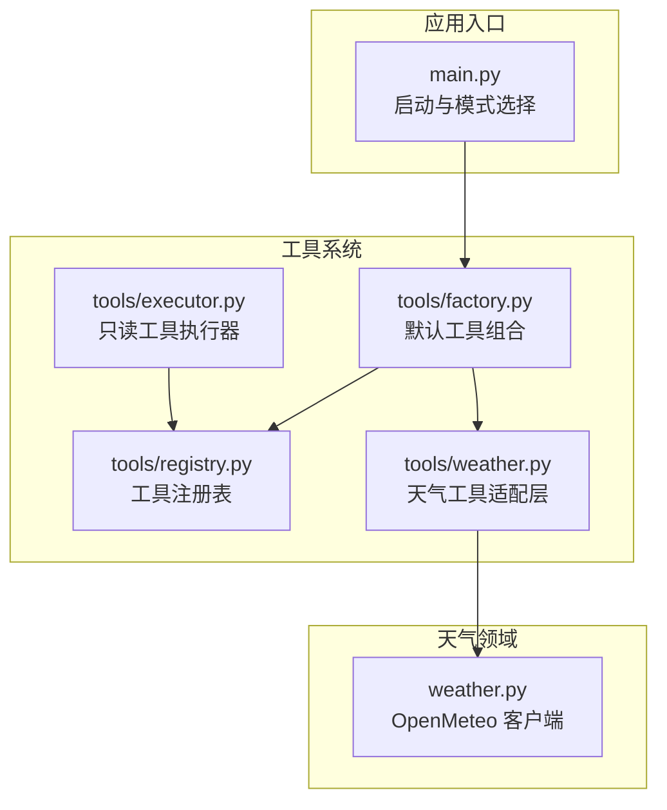
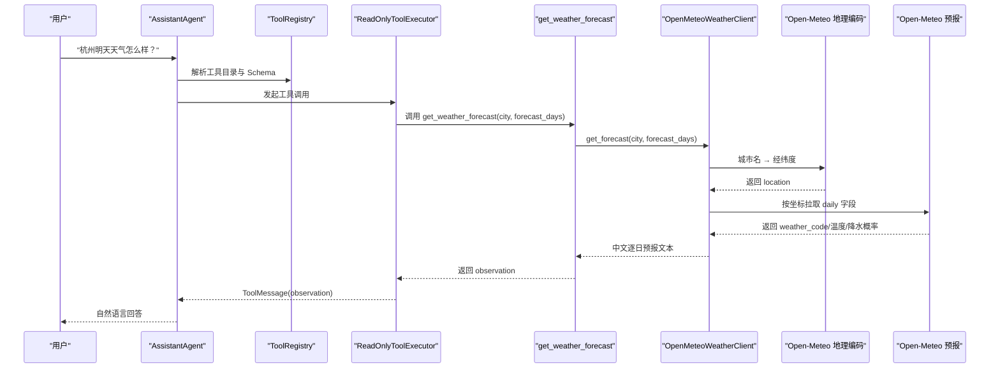
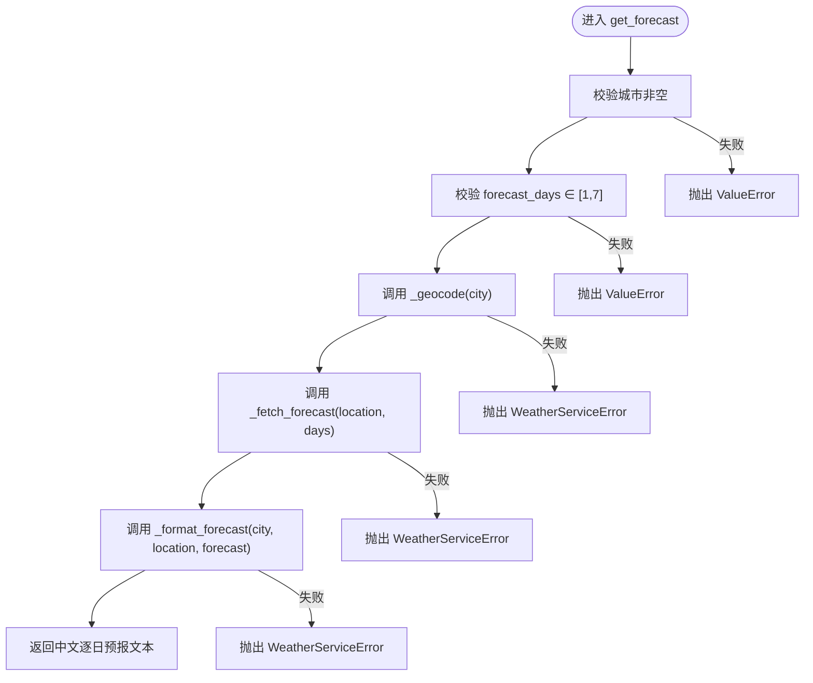
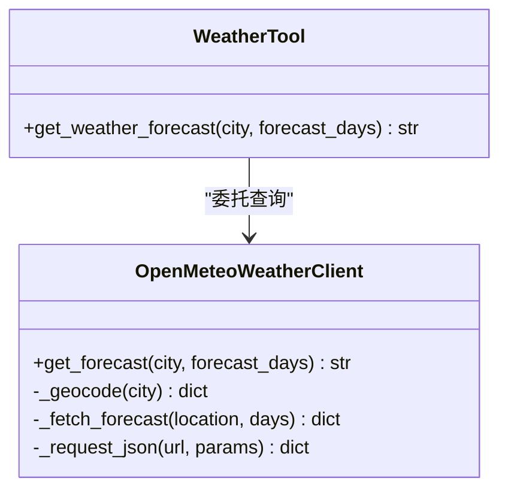
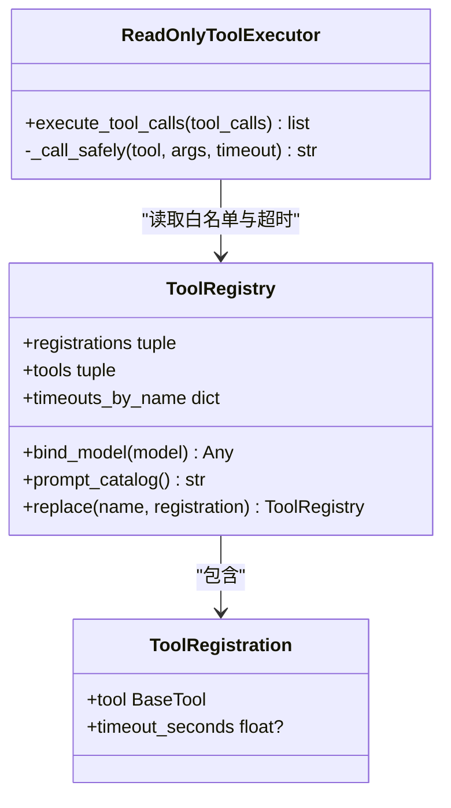
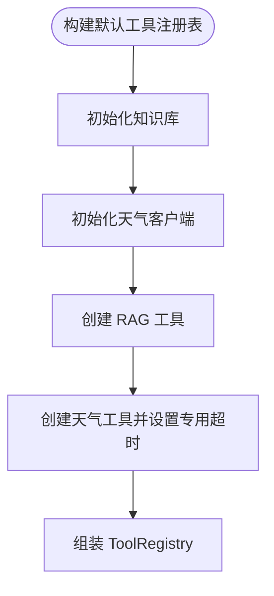
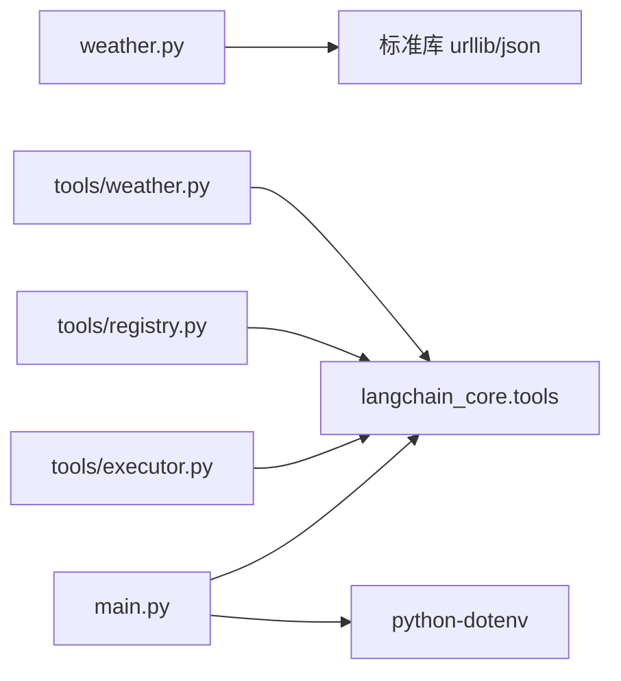

# 天气服务集成

<cite>
**本文引用的文件**   
- [weather.py](file://agent_platform/weather.py)
- [tools_weather.py](file://agent_platform/tools/weather.py)
- [tools_factory.py](file://agent_platform/tools/factory.py)
- [tools_registry.py](file://agent_platform/tools/registry.py)
- [tools_executor.py](file://agent_platform/tools/executor.py)
- [main.py](file://main.py)
- [README.md](file://README.md)
</cite>

## 目录
1. [引言](#引言)
2. [项目结构](#项目结构)
3. [核心组件](#核心组件)
4. [架构总览](#架构总览)
5. [详细组件分析](#详细组件分析)
6. [依赖关系分析](#依赖关系分析)
7. [性能与可靠性](#性能与可靠性)
8. [配置、参数校验与缓存建议](#配置参数校验与缓存建议)
9. [使用示例](#使用示例)
10. [故障排查指南](#故障排查指南)
11. [结论](#结论)

## 引言
本技术文档聚焦天气服务集成，说明如何通过 Open-Meteo API 实现“城市名 → 坐标 → 逐日天气预报”的完整链路。文档覆盖地理编码服务调用、预报接口调用、错误处理机制、工具适配层转换、配置选项、参数验证、结果缓存最佳实践，以及实际查询示例和常见问题排查方法。该集成以无状态客户端为核心，上层通过 LangChain 工具适配层暴露给 Agent，并由统一执行器保障超时与异常隔离。

## 项目结构
天气相关代码分布在领域客户端与工具适配层两个层次：
- 领域客户端 `agent_platform/weather.py` 负责 Open-Meteo 地理编码与预报请求、数据校验与中文格式化。
- 工具适配层 `agent_platform/tools/weather.py` 将客户端包装为 LangChain 工具，并声明专用执行超时。
- 工具工厂 `agent_platform/tools/factory.py` 组合默认工具集，注入天气客户端与网络超时。
- 工具注册表 `agent_platform/tools/registry.py` 管理工具 Schema、名称唯一性与模型绑定。
- 工具执行器 `agent_platform/tools/executor.py` 提供白名单、超时控制与错误观察文本。
- 应用入口 `main.py` 组装 Agent、模型与工具注册表；README 提供运行方式与整体架构说明。

**图表来源**
- [main.py:43-89](file://main.py#L43-L89)
- [tools_factory.py:18-36](file://agent_platform/tools/factory.py#L18-L36)
- [tools_registry.py:15-94](file://agent_platform/tools/registry.py#L15-L94)
- [tools_executor.py:17-67](file://agent_platform/tools/executor.py#L17-L67)
- [tools_weather.py:13-25](file://agent_platform/tools/weather.py#L13-L25)
- [weather.py:59-131](file://agent_platform/weather.py#L59-L131)

**章节来源**
- [README.md:19-65](file://README.md#L19-L65)
- [main.py:43-89](file://main.py#L43-L89)

## 核心组件
- **OpenMeteoWeatherClient**：无状态客户端，封装地理编码与预报请求，Fail Fast 校验响应结构，统一抛出 `WeatherServiceError`。
- **create_weather_tool**：LangChain 工具适配层，把客户端包装成可被 Agent 调用的工具，并声明专用超时。
- **ToolRegistry / ToolRegistration**：集中管理工具定义、名称唯一性、模型绑定与超时映射。
- **ReadOnlyToolExecutor**：执行工具调用，将未注册、超时与异常转换为模型可见的观察文本，避免图崩溃。
- **build_default_tool_registry**：组合 RAG 与天气工具，注入天气客户端与网络超时。

**章节来源**
- [weather.py:55-131](file://agent_platform/weather.py#L55-L131)
- [tools_weather.py:13-25](file://agent_platform/tools/weather.py#L13-L25)
- [tools_registry.py:15-94](file://agent_platform/tools/registry.py#L15-L94)
- [tools_executor.py:17-67](file://agent_platform/tools/executor.py#L17-L67)
- [tools_factory.py:18-36](file://agent_platform/tools/factory.py#L18-L36)

## 架构总览
天气查询从 Agent 到 Open-Meteo 的端到端流程如下：

**图表来源**
- [main.py:78-89](file://main.py#L78-L89)
- [tools_weather.py:20-25](file://agent_platform/tools/weather.py#L20-L25)
- [weather.py:67-131](file://agent_platform/weather.py#L67-L131)

## 详细组件分析

### 天气客户端：OpenMeteoWeatherClient
职责与行为：
- 初始化时校验请求超时参数必须大于 0。
- `get_forecast(city, forecast_days)` 先校验输入，再依次调用地理编码与预报接口，最后格式化为中文文本。
- `_geocode` 调用地理编码接口，要求返回 `results` 列表且首个结果包含 `latitude` 与 `longitude`。
- `_fetch_forecast` 调用预报接口，要求返回 `daily` 字典，包含天气码、最高温、最低温与最大降水概率。
- `_request_json` 统一发起 GET 请求，捕获网络异常、JSON 解析失败与非对象响应，并将所有问题收敛为 `WeatherServiceError`。
- `_format_forecast` 将逐日数组翻译为中文描述，校验各字段等长与数值有效性。

关键数据结构与复杂度：
- 输入：城市字符串、天数整数（1–7）。
- 输出：多行中文文本，每行对应一天。
- 时间复杂度：O(d)，d 为预报天数；空间复杂度：O(d)。

错误处理策略：
- 网络异常、HTTP 错误、URL 错误、超时、JSON 解码失败、非对象响应、上游 error 字段均转为 `WeatherServiceError`。
- 缺失或无效坐标、缺失 `daily`、字段长度不一致、数值类型异常也转为 `WeatherServiceError`。

**图表来源**
- [weather.py:62-78](file://agent_platform/weather.py#L62-L78)
- [weather.py:80-109](file://agent_platform/weather.py#L80-L109)
- [weather.py:134-174](file://agent_platform/weather.py#L134-L174)

**章节来源**
- [weather.py:55-174](file://agent_platform/weather.py#L55-L174)

### 工具适配层：create_weather_tool
职责与行为：
- 使用 `@tool` 装饰器创建 LangChain 工具 `get_weather_forecast`。
- 工具 docstring 作为模型可见的使用说明。
- 内部委托 `OpenMeteoWeatherClient.get_forecast` 完成真实查询。
- 返回 `ToolRegistration(tool=get_weather_forecast, timeout_seconds=timeout_seconds)`，让执行器为该工具设置专用超时。

**图表来源**
- [tools_weather.py:13-25](file://agent_platform/tools/weather.py#L13-L25)
- [weather.py:67-131](file://agent_platform/weather.py#L67-L131)

**章节来源**
- [tools_weather.py:1-26](file://agent_platform/tools/weather.py#L1-L26)

### 工具注册与执行：ToolRegistry 与 ReadOnlyToolExecutor
- `ToolRegistration` 保存工具对象与其专用超时；构造时校验超时必须大于 0。
- `ToolRegistry` 固化工具集合，保证名称唯一，并提供模型绑定、Prompt 目录生成与替换能力。
- `ReadOnlyToolExecutor` 维护工具白名单，对每个工具调用进行超时控制与异常捕获，返回 `ToolMessage` 形式的观察文本，避免 LangGraph 图崩溃。

**图表来源**
- [tools_registry.py:15-94](file://agent_platform/tools/registry.py#L15-L94)
- [tools_executor.py:17-67](file://agent_platform/tools/executor.py#L17-L67)

**章节来源**
- [tools_registry.py:1-94](file://agent_platform/tools/registry.py#L1-L94)
- [tools_executor.py:1-67](file://agent_platform/tools/executor.py#L1-L67)

### 工具工厂：build_default_tool_registry
职责与行为：
- 构建默认工具集合，包括 RAG 检索与天气查询。
- 若未显式注入，则使用内置知识库与 `OpenMeteoWeatherClient(settings.weather_request_timeout_seconds)`。
- 天气工具通过 `create_weather_tool(weather_client, timeout_seconds=settings.network_tool_timeout_seconds)` 注册，覆盖执行器默认超时。

**图表来源**
- [tools_factory.py:18-36](file://agent_platform/tools/factory.py#L18-L36)

**章节来源**
- [tools_factory.py:1-37](file://agent_platform/tools/factory.py#L1-L37)

## 依赖关系分析
- 天气客户端依赖标准库 `urllib` 与 `json`，不引入额外第三方依赖。
- 工具适配层依赖 LangChain 的 `@tool` 装饰器与 `BaseTool`。
- 工具注册表与执行器依赖 LangChain 的 `BaseTool` 与 `ToolMessage`。
- 应用入口依赖 `dotenv` 加载 `.env`，并通过 `init_chat_model` 创建模型。

**图表来源**
- [weather.py:11-15](file://agent_platform/weather.py#L11-L15)
- [tools_weather.py:7-10](file://agent_platform/tools/weather.py#L7-L10)
- [tools_registry.py:12-13](file://agent_platform/tools/registry.py#L12-L13)
- [tools_executor.py:8-14](file://agent_platform/tools/executor.py#L8-L14)
- [main.py:12-19](file://main.py#L12-L19)

**章节来源**
- [weather.py:1-17](file://agent_platform/weather.py#L1-L17)
- [tools_weather.py:1-11](file://agent_platform/tools/weather.py#L1-L11)
- [tools_registry.py:1-14](file://agent_platform/tools/registry.py#L1-L14)
- [tools_executor.py:1-15](file://agent_platform/tools/executor.py#L1-L15)
- [main.py:1-20](file://main.py#L1-L20)

## 性能与可靠性
- 网络请求超时：客户端构造时强制 `request_timeout_seconds > 0`；执行器对每个工具调用施加超时，天气工具通过注册表指定专用超时，避免默认短超时导致误判。
- Fail Fast 校验：地理编码与预报响应结构严格校验，缺失字段或类型异常立即抛出 `WeatherServiceError`，防止下游格式化阶段出现难以定位的错误。
- 错误收敛：所有网络、解析与业务校验异常统一收敛为单一异常类型，便于上层捕获与提示。
- 执行隔离：工具执行在单线程池中限时等待，超时或异常不会传播到 LangGraph 图，而是以观察文本反馈给模型。

[本节为通用指导，无需具体文件引用]

## 配置、参数校验与缓存建议
- 配置项
  - `settings.weather_request_timeout_seconds`：传入 `OpenMeteoWeatherClient`，限制单次网络请求超时。
  - `settings.network_tool_timeout_seconds`：传入 `create_weather_tool`，作为天气工具的专用执行超时。
  - `.env` 中的 `MODEL_API_KEY`、`MODEL_NAME`、`MODEL_BASE_URL` 用于真实模型模式；天气查询本身不需要 API Key。
- 参数校验
  - 城市名不能为空；`forecast_days` 必须在 1–7 之间。
  - 工具注册表的超时必须大于 0；执行器默认超时也必须大于 0。
- 缓存建议
  - 当前客户端无状态且不缓存结果。对于高频重复查询（如固定城市），可在工具适配层或外部缓存层增加基于城市名与天数的键值缓存，设置合理过期时间，降低网络压力与延迟。
  - 缓存需考虑时区与地区变化，避免跨时区或跨区域复用错误数据。

**章节来源**
- [weather.py:62-73](file://agent_platform/weather.py#L62-L73)
- [tools_weather.py:13-25](file://agent_platform/tools/weather.py#L13-L25)
- [tools_factory.py:30-35](file://agent_platform/tools/factory.py#L30-L35)
- [tools_registry.py:22-24](file://agent_platform/tools/registry.py#L22-L24)
- [tools_executor.py:20-25](file://agent_platform/tools/executor.py#L20-L25)
- [main.py:29-40](file://main.py#L29-L40)

## 使用示例
- 离线体验天气场景：
  - `python main.py --mock --mock-scenario weather "杭州明天天气怎么样？"`
- 真实模型模式：
  - 配置 `.env` 后运行：`python main.py "杭州明天天气怎么样？"`
- 评测套件：
  - `python main.py --evaluate`

这些命令由 `main.py` 的参数解析与模式分支驱动，天气查询在真实模式下走 Open-Meteo 接口，在 mock 模式下走预置替身。

**章节来源**
- [README.md:122-142](file://README.md#L122-L142)
- [main.py:43-89](file://main.py#L43-L89)

## 故障排查指南
- 网络异常或超时
  - 现象：工具执行超时或抛出网络相关异常。
  - 排查：检查 `network_tool_timeout_seconds` 是否过小；确认网络连通性与 DNS；查看执行器日志中 `[Tool] 执行只读工具 ...` 与 `[Tool] observation：...`。
  - 依据：执行器对超时与异常捕获并返回观察文本。
- 地理编码失败
  - 现象：未找到城市或坐标缺失。
  - 排查：提供更具体的城市名称；确认 Open-Meteo 地理编码服务可用；检查返回的 `results` 是否为空或缺少 `latitude`/`longitude`。
  - 依据：`_geocode` 对 `results` 与坐标字段做严格校验。
- 预报数据异常
  - 现象：缺少 `daily` 字段或字段长度不一致、数值无效。
  - 排查：检查预报接口返回结构；确认请求参数 `daily` 字段正确；校验天气码、温度与降水概率数据类型。
  - 依据：`_fetch_forecast` 与 `_format_forecast` 对 `daily` 与逐日字段做完整性与一致性校验。
- 工具未注册或名称冲突
  - 现象：模型尝试调用未注册工具或工具名称重复。
  - 排查：确认工具已在 `build_default_tool_registry` 中注册；检查工具名称唯一性。
  - 依据：`ToolRegistry` 构造时对名称去重并报错。
- 工具超时配置错误
  - 现象：工具超时小于等于 0 或默认超时非法。
  - 排查：检查 `ToolRegistration.timeout_seconds` 与执行器默认超时；确保均为正数。
  - 依据：`ToolRegistration.__post_init__` 与 `ReadOnlyToolExecutor.__init__` 的校验逻辑。

**章节来源**
- [tools_executor.py:27-67](file://agent_platform/tools/executor.py#L27-L67)
- [weather.py:80-109](file://agent_platform/weather.py#L80-L109)
- [weather.py:134-174](file://agent_platform/weather.py#L134-L174)
- [tools_registry.py:30-36](file://agent_platform/tools/registry.py#L30-L36)
- [tools_registry.py:22-24](file://agent_platform/tools/registry.py#L22-L24)
- [tools_executor.py:20-25](file://agent_platform/tools/executor.py#L20-L25)

## 结论
本天气服务集成以无状态 `OpenMeteoWeatherClient` 为核心，通过地理编码与预报两步调用获取结构化数据，并在工具适配层转换为模型可读的中文文本。工具注册表与执行器提供统一的 Schema、超时与错误隔离，使 Agent 在不感知底层网络细节的情况下可靠调用天气能力。结合合理的配置、严格的参数校验与可选的结果缓存，可在保证稳定性的同时提升查询效率与用户体验。