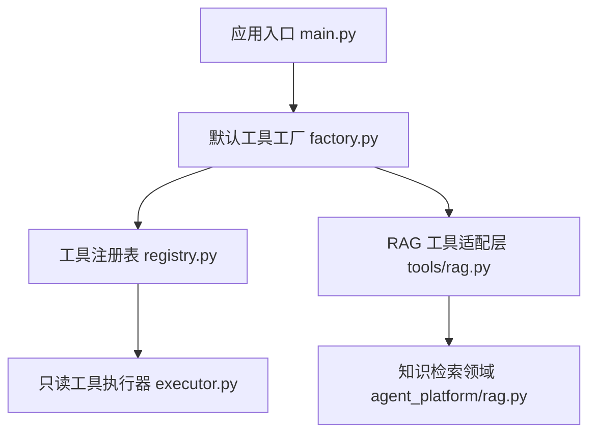
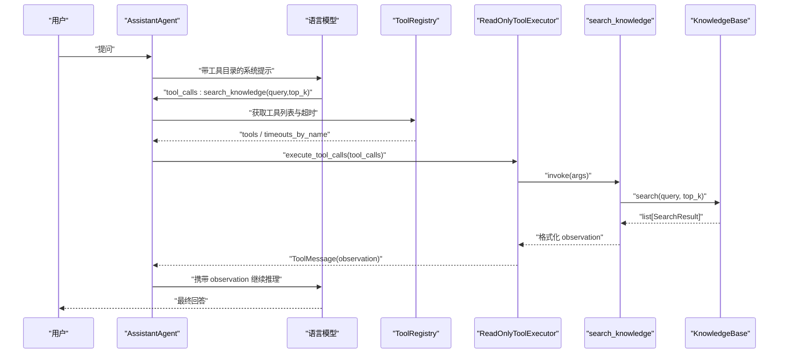
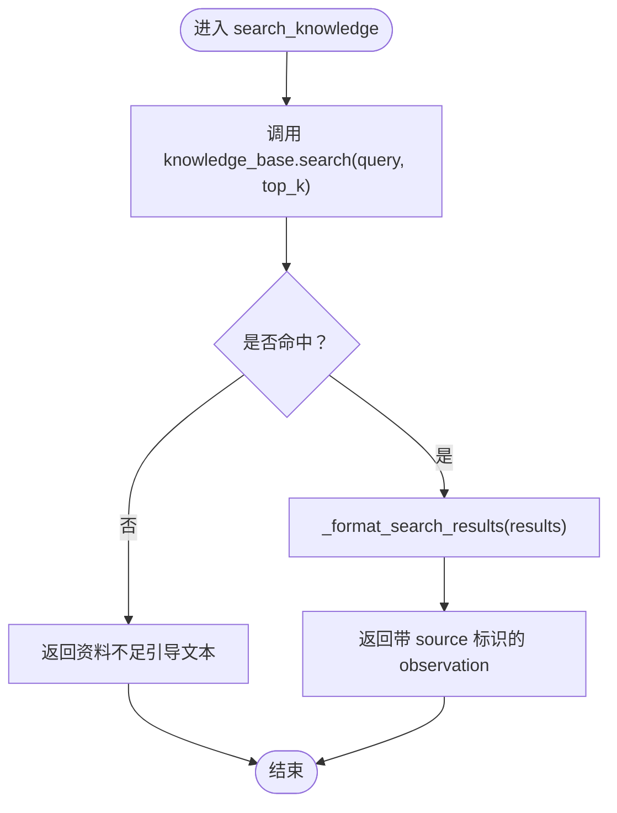
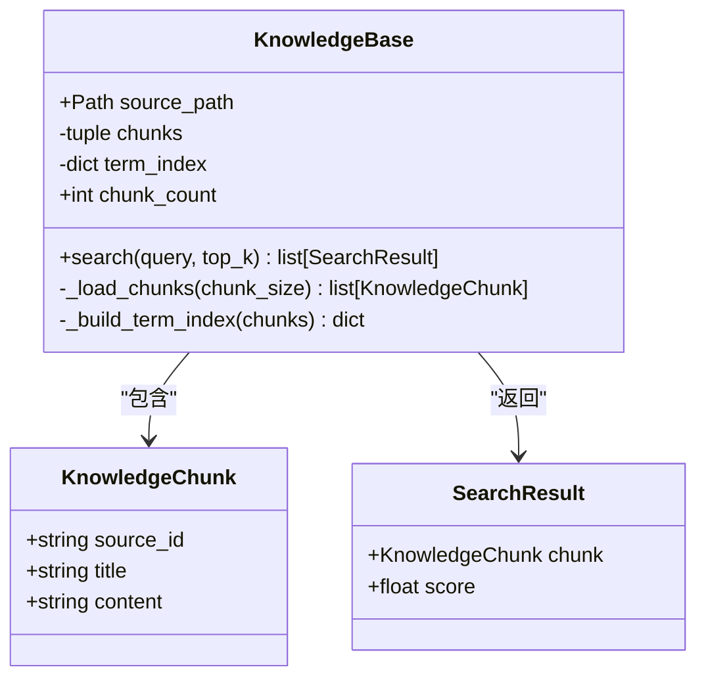
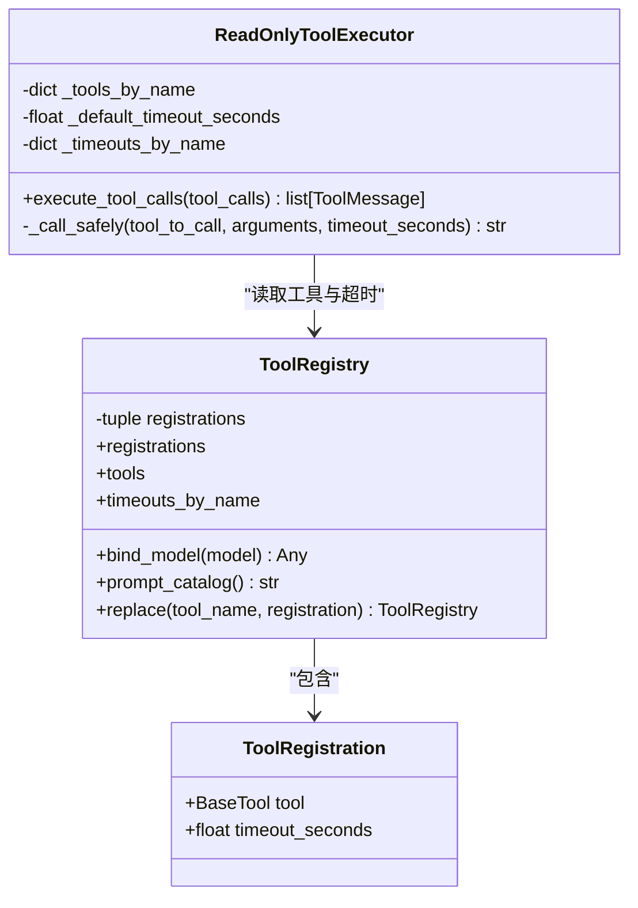
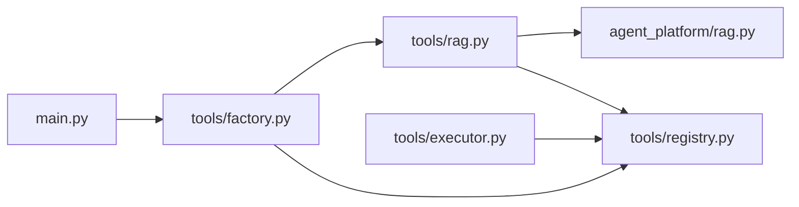
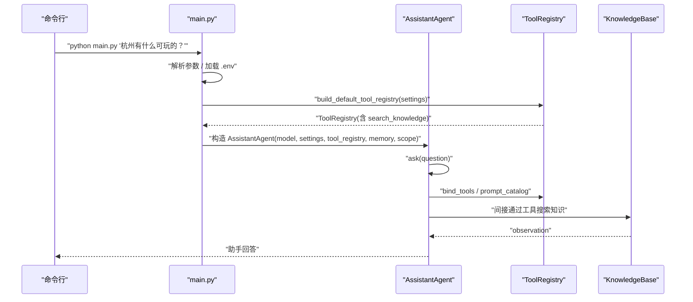

# RAG工具适配层

<cite>
**本文引用的文件**   
- [main.py](file://main.py)
- [README.md](file://README.md)
- [agent_platform/rag.py](file://agent_platform/rag.py)
- [agent_platform/tools/rag.py](file://agent_platform/tools/rag.py)
- [agent_platform/tools/factory.py](file://agent_platform/tools/factory.py)
- [agent_platform/tools/registry.py](file://agent_platform/tools/registry.py)
- [agent_platform/tools/executor.py](file://agent_platform/tools/executor.py)
</cite>

## 目录
1. [引言](#引言)
2. [项目结构](#项目结构)
3. [核心组件](#核心组件)
4. [架构总览](#架构总览)
5. [详细组件分析](#详细组件分析)
6. [依赖关系分析](#依赖关系分析)
7. [性能与配置优化](#性能与配置优化)
8. [Agent 集成与使用示例](#agent-集成与使用示例)
9. [故障排查指南](#故障排查指南)
10. [结论](#结论)

## 引言
本技术文档聚焦于 RAG 工具适配层，目标是说明如何将本地知识库检索服务包装为 LangChain 标准化工具接口，并解释 RAGTool 的设计思路、参数处理、结果格式化、上下文整合方式，以及与底层 KnowledgeBase 的交互机制。同时给出配置选项、性能优化建议、Agent 集成示例和复杂检索场景的处理策略，强调工具适配层的解耦设计与可测试性。

## 项目结构
RAG 能力由“领域实现”和“工具适配层”两层组成：
- 领域实现位于 `agent_platform/rag.py`，负责 Markdown 语料解析、分块、倒排索引构建和词面重合度检索。
- 工具适配层位于 `agent_platform/tools/rag.py`，把 `KnowledgeBase.search` 包装成 LangChain 工具，统一返回模型可读的 observation。
- 工具注册与执行分别由 `tools/registry.py` 和 `tools/executor.py` 提供，默认组合入口在 `tools/factory.py`。
- 应用启动入口 `main.py` 通过 `build_default_tool_registry` 装配 Agent、模型、记忆和工具。

**图表来源**
- [main.py:43-89](file://main.py#L43-L89)
- [agent_platform/tools/factory.py:18-36](file://agent_platform/tools/factory.py#L18-L36)
- [agent_platform/tools/registry.py:27-75](file://agent_platform/tools/registry.py#L27-L75)
- [agent_platform/tools/executor.py:17-43](file://agent_platform/tools/executor.py#L17-L43)
- [agent_platform/tools/rag.py:14-26](file://agent_platform/tools/rag.py#L14-L26)
- [agent_platform/rag.py:42-98](file://agent_platform/rag.py#L42-L98)

**章节来源**
- [README.md:19-65](file://README.md#L19-L65)
- [main.py:43-89](file://main.py#L43-L89)

## 核心组件
- `KnowledgeBase`：纯内存 RAG 领域对象，负责加载 Markdown、切块、建立倒排索引并提供 `search` 查询。
- `SearchResult` / `KnowledgeChunk`：检索结果与最小可引用片段的数据结构。
- `create_rag_tool`：将 `KnowledgeBase` 包装为 LangChain 工具，定义 `search_knowledge(query, top_k)` 的参数契约与 docstring。
- `ToolRegistration` / `ToolRegistry`：工具元数据、名称唯一性校验、模型绑定、Prompt 工具目录生成与替换能力。
- `ReadOnlyToolExecutor`：白名单、超时、异常到 observation 的统一执行器。
- `build_default_tool_registry`：默认工具组合根，注入 `KnowledgeBase` 与天气客户端。

**章节来源**
- [agent_platform/rag.py:25-98](file://agent_platform/rag.py#L25-L98)
- [agent_platform/tools/rag.py:14-35](file://agent_platform/tools/rag.py#L14-L35)
- [agent_platform/tools/registry.py:15-75](file://agent_platform/tools/registry.py#L15-L75)
- [agent_platform/tools/executor.py:17-67](file://agent_platform/tools/executor.py#L17-L67)
- [agent_platform/tools/factory.py:18-36](file://agent_platform/tools/factory.py#L18-L36)

## 架构总览
RAG 工具适配层采用“领域 + 适配层 + 注册表 + 执行器”的分层设计：
- 领域层 `agent_platform/rag.py` 不感知 LangChain；它只暴露 `KnowledgeBase.search`。
- 适配层 `tools/rag.py` 仅做参数转换、空结果引导和结果格式化，保持对 LLM 友好的文本输出。
- 注册表集中管理工具 Schema、超时与 Prompt 目录，避免多处维护不一致。
- 执行器保证单个工具失败不会导致整个 Agent 图崩溃，并把错误信息转为 observation。

**图表来源**
- [main.py:78-89](file://main.py#L78-L89)
- [agent_platform/tools/registry.py:56-75](file://agent_platform/tools/registry.py#L56-L75)
- [agent_platform/tools/executor.py:27-43](file://agent_platform/tools/executor.py#L27-L43)
- [agent_platform/tools/rag.py:17-26](file://agent_platform/tools/rag.py#L17-L26)
- [agent_platform/rag.py:71-98](file://agent_platform/rag.py#L71-L98)

## 详细组件分析

### RAG 工具适配层：`create_rag_tool`
`create_rag_tool` 是 RAG 能力的对外工具入口。其职责包括：
- 接收已构造的 `KnowledgeBase`，避免在工具函数内部重复初始化。
- 使用 `@tool` 装饰器创建 LangChain 工具，函数名为 `search_knowledge`。
- 定义查询参数：
  - `query`：用户自然语言查询。
  - `top_k`：期望返回片段数量，默认 3。
- 调用 `knowledge_base.search`，若未命中则返回引导性文本，提醒模型如实说明资料不足。
- 通过 `_format_search_results` 将 `SearchResult` 列表格式化为带 `[source:...]` 标识的 observation，便于模型引用来源。

**图表来源**
- [agent_platform/tools/rag.py:17-35](file://agent_platform/tools/rag.py#L17-L35)

**章节来源**
- [agent_platform/tools/rag.py:1-35](file://agent_platform/tools/rag.py#L1-L35)

### 领域检索实现：`KnowledgeBase`
`KnowledgeBase` 是纯内存、可复现的知识检索组件，关键特性如下：
- 启动时读取 Markdown 语料，按 `## [source-id] 标题` 解析章节。
- 将每节正文切分为不超过 `chunk_size` 的片段，优先在句末标点处断开。
- 对中文双字词与英文整词建立倒排索引，查询时按词面重合度打分。
- 标题命中额外加权，过滤弱相关候选后取 top_k。
- 提供 `from_default_file` 便捷构造方法，默认从项目内置知识库路径加载。

**图表来源**
- [agent_platform/rag.py:25-98](file://agent_platform/rag.py#L25-L98)

**章节来源**
- [agent_platform/rag.py:1-187](file://agent_platform/rag.py#L1-L187)

### 工具注册与执行：`ToolRegistry` 与 `ReadOnlyToolExecutor`
- `ToolRegistration`：封装一个 LangChain 工具及其可选超时。
- `ToolRegistry`：
  - 固化工具集合，校验工具名唯一。
  - 提供 `tools` 给模型绑定，`timeouts_by_name` 供执行器使用。
  - 动态生成 Prompt 工具目录，避免手工维护。
  - 支持不可变替换，便于测试注入替身。
- `ReadOnlyToolExecutor`：
  - 白名单限制，拒绝未注册工具。
  - 单线程池限时执行，超时或异常转为 observation。
  - 日志打印工具名、参数与 observation，便于调试。

**图表来源**
- [agent_platform/tools/registry.py:15-94](file://agent_platform/tools/registry.py#L15-L94)
- [agent_platform/tools/executor.py:17-67](file://agent_platform/tools/executor.py#L17-L67)

**章节来源**
- [agent_platform/tools/registry.py:1-94](file://agent_platform/tools/registry.py#L1-L94)
- [agent_platform/tools/executor.py:1-67](file://agent_platform/tools/executor.py#L1-L67)

### 默认工具组合：`build_default_tool_registry`
该工厂函数是工具系统的组合根：
- 根据 `AgentSettings` 构造 `KnowledgeBase`，传入 `rag_chunk_size` 与 `rag_top_k`。
- 构造天气客户端（与本 RAG 文档无关，但体现工具组合模式）。
- 将 RAG 工具与天气工具注册进 `ToolRegistry`。
- RAG 工具不设置专用超时，走执行器默认的 0.3s 兜底；网络工具可设置更长超时。

**章节来源**
- [agent_platform/tools/factory.py:1-37](file://agent_platform/tools/factory.py#L1-L37)

## 依赖关系分析
RAG 工具链的关键依赖如下：
- `main.py` 通过 `build_default_tool_registry(settings)` 装配工具。
- `factory.py` 依赖 `rag.KnowledgeBase` 与 `tools.rag.create_rag_tool`。
- `tools.rag` 依赖 `rag.SearchResult`、`rag.KnowledgeBase` 与 `tools.registry.ToolRegistration`。
- `executor.py` 依赖 `registry.ToolRegistry` 与 LangChain 消息类型。
- `registry.py` 依赖 LangChain 的 `BaseTool`。

**图表来源**
- [main.py:60-66](file://main.py#L60-L66)
- [agent_platform/tools/factory.py:10-36](file://agent_platform/tools/factory.py#L10-L36)
- [agent_platform/tools/rag.py:8-11](file://agent_platform/tools/rag.py#L8-L11)
- [agent_platform/tools/executor.py:14-14](file://agent_platform/tools/executor.py#L14-L14)

**章节来源**
- [main.py:60-66](file://main.py#L60-L66)
- [agent_platform/tools/factory.py:10-36](file://agent_platform/tools/factory.py#L10-L36)
- [agent_platform/tools/rag.py:8-11](file://agent_platform/tools/rag.py#L8-L11)
- [agent_platform/tools/executor.py:14-14](file://agent_platform/tools/executor.py#L14-L14)

## 性能与配置优化
- 分块大小 `chunk_size`：
  - 过小会导致片段过短、语义不完整；过大可能超出 observation 长度限制。
  - 默认值来自 `AgentSettings.rag_chunk_size`，建议不低于 80 字符。
- 返回数量 `top_k`：
  - 受 `max_results` 上限约束；过小召回不足，过大增加 LLM 上下文压力。
  - 默认值来自 `AgentSettings.rag_top_k`，建议结合业务验证最佳值。
- 检索算法：
  - 基于中文双字 bigram 与英文整词的词面重合度，标题命中额外加权。
  - 弱相关过滤阈值按最高分的比例计算，避免低质量片段污染上下文。
- 超时策略：
  - RAG 工具无专用超时，走执行器默认值；网络工具可单独配置更长时间。
- 可测试性：
  - `KnowledgeBase.from_default_file` 可通过构造函数注入自定义 `source_path`。
  - `build_default_tool_registry` 支持注入 mock `KnowledgeBase`，便于单元测试。

**章节来源**
- [agent_platform/rag.py:45-64](file://agent_platform/rag.py#L45-L64)
- [agent_platform/rag.py:71-98](file://agent_platform/rag.py#L71-L98)
- [agent_platform/tools/factory.py:25-36](file://agent_platform/tools/factory.py#L25-L36)
- [agent_platform/tools/executor.py:37-40](file://agent_platform/tools/executor.py#L37-L40)

## Agent 集成与使用示例
- CLI 启动：
  - 真实模式：设置 `.env` 中的 `MODEL_API_KEY`，运行 `python main.py "杭州西湖适合怎样安排？"`。
  - Mock 模式：`python main.py --mock`，无需 API Key。
  - 评测模式：`python main.py --evaluate`，运行离线回归套件。
- Agent 装配：
  - `main.py` 中根据 `--mock` 选择 mock 或真实模型。
  - 通过 `build_default_tool_registry(settings)` 获取工具注册表。
  - 使用 `AssistantAgent` 绑定模型、工具、记忆与作用域。
- RAG 工具行为：
  - 当模型决定调用 `search_knowledge` 时，执行器会调用 `KnowledgeBase.search`。
  - 若未命中，返回引导文本，让模型明确说明资料不足。
  - 若命中，返回带 `[source:...]` 的 observation，模型据此作答并引用来源。

**图表来源**
- [main.py:43-89](file://main.py#L43-L89)
- [agent_platform/tools/factory.py:18-36](file://agent_platform/tools/factory.py#L18-L36)
- [agent_platform/tools/registry.py:56-75](file://agent_platform/tools/registry.py#L56-L75)

**章节来源**
- [main.py:43-89](file://main.py#L43-L89)
- [README.md:110-144](file://README.md#L110-L144)

## 故障排查指南
- 知识库文件不存在：
  - 现象：构造 `KnowledgeBase` 时报错。
  - 原因：`source_path` 指向的文件缺失。
  - 处理：检查 `knowledge/knowledge_base.md` 是否存在，或通过 `from_default_file` 确认默认路径。
- 知识库内容为空：
  - 现象：构造时报错提示没有可检索内容。
  - 原因：Markdown 中没有符合 `## [source-id] 标题` 格式的章节。
  - 处理：确保语料包含受控章节头，且正文非空。
- 查询无有效词项：
  - 现象：`search` 返回空列表。
  - 原因：查询无法提取出中文双字或英文整词。
  - 处理：调整查询措辞，或扩展分词规则（需谨慎评估影响）。
- 工具未注册：
  - 现象：执行器返回不允许调用的 observation。
  - 原因：模型幻觉调用未在 `ToolRegistry` 注册的工具。
  - 处理：检查 `build_default_tool_registry` 是否正确注册工具，或使用 mock 替换。
- 工具超时：
  - 现象：执行器返回超时 observation。
  - 原因：工具执行超过指定超时时间。
  - 处理：为网络工具设置更长超时；RAG 工具通常较快，若仍超时需检查底层 IO 或外部依赖。

**章节来源**
- [agent_platform/rag.py:45-64](file://agent_platform/rag.py#L45-L64)
- [agent_platform/rag.py:100-110](file://agent_platform/rag.py#L100-L110)
- [agent_platform/tools/executor.py:31-43](file://agent_platform/tools/executor.py#L31-L43)
- [agent_platform/tools/executor.py:56-67](file://agent_platform/tools/executor.py#L56-L67)

## 结论
RAG 工具适配层通过清晰的领域与适配层分离，实现了以下目标：
- 标准化：将 `KnowledgeBase.search` 包装为 LangChain 工具，统一参数与输出格式。
- 可观测：observation 带 `[source:...]` 标识，便于模型引用来源并提升可信度。
- 可测试：`KnowledgeBase` 与工具注册表均支持注入替身，便于单元测试与集成测试。
- 可维护：工具注册表集中管理 Schema、超时与 Prompt 目录，避免多处维护不一致。
- 可扩展：新增工具只需在 `tools/` 新建适配层并在 `factory.py` 注册，无需修改 Agent 核心逻辑。

在实际使用中，建议结合业务验证 `chunk_size` 与 `top_k`，并根据工具类型合理配置超时；对于复杂检索场景，可在领域层扩展分词、权重或过滤策略，同时在适配层保持对 LLM 友好的输出契约。