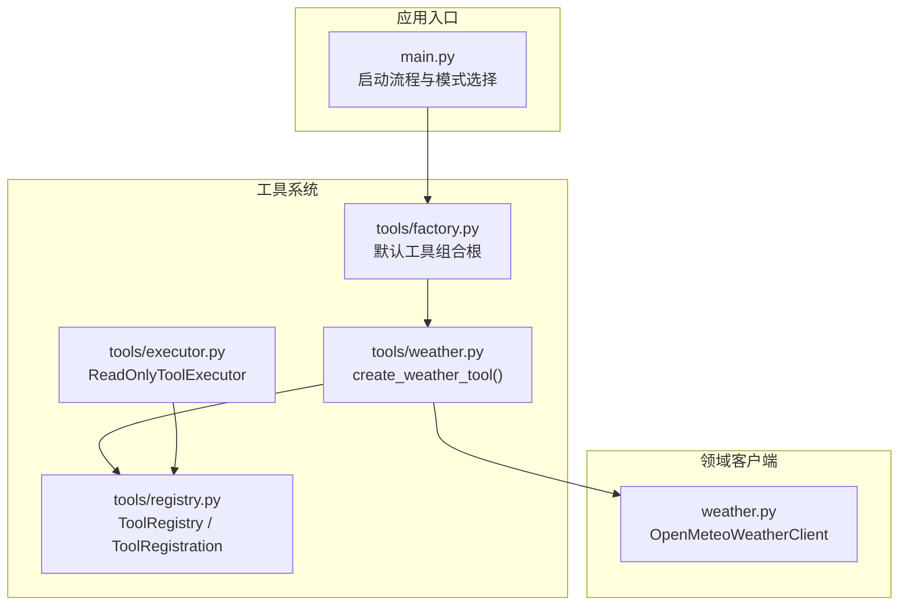
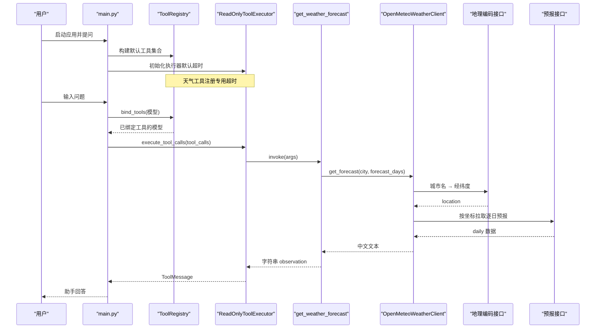
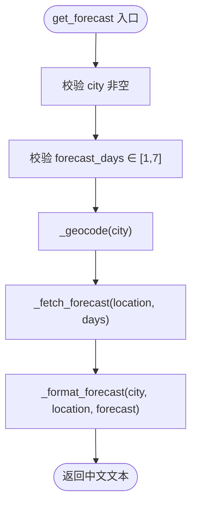
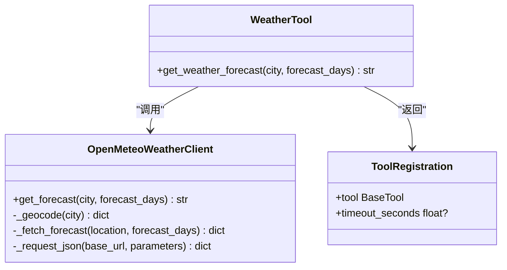
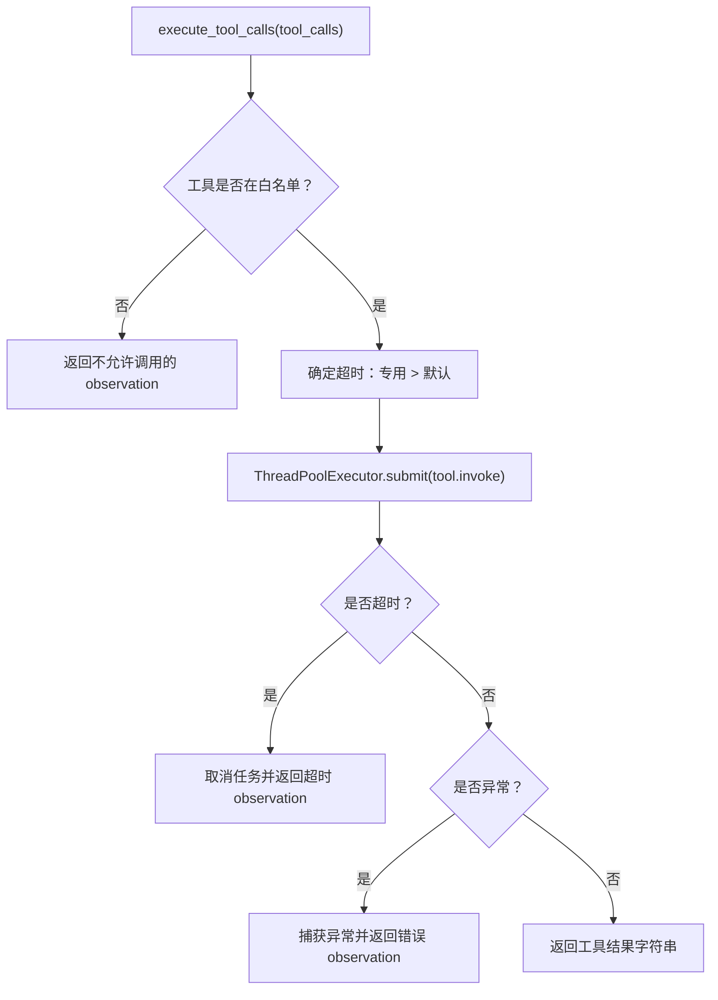
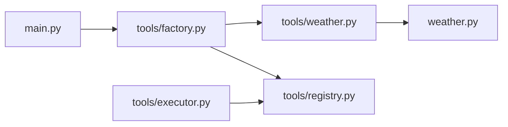

# 天气工具适配层

<cite>
**本文引用的文件**   
- [agent_platform/tools/weather.py](file://agent_platform/tools/weather.py)
- [agent_platform/weather.py](file://agent_platform/weather.py)
- [agent_platform/tools/factory.py](file://agent_platform/tools/factory.py)
- [agent_platform/tools/registry.py](file://agent_platform/tools/registry.py)
- [agent_platform/tools/executor.py](file://agent_platform/tools/executor.py)
- [main.py](file://main.py)
- [README.md](file://README.md)
</cite>

## 目录
1. [引言](#引言)
2. [项目结构](#项目结构)
3. [核心组件](#核心组件)
4. [架构总览](#架构总览)
5. [详细组件分析](#详细组件分析)
6. [依赖关系分析](#依赖关系分析)
7. [性能与超时策略](#性能与超时策略)
8. [错误处理机制](#错误处理机制)
9. [使用示例](#使用示例)
10. [故障排查指南](#故障排查指南)
11. [结论](#结论)

## 引言
本文面向“天气工具适配层”，系统性说明 WeatherTool 如何将 OpenMeteoWeatherClient 封装为 LangChain 标准化工具，并解释地理编码服务集成、天气预报查询的工具化实现、参数校验、API 调用封装、结果格式化、错误处理策略以及完整使用示例。文档同时强调工具适配层的健壮性与用户体验优化，帮助开发者在不理解底层网络细节的前提下，安全、稳定地扩展天气能力。

## 项目结构
天气相关代码分布在领域客户端与工具适配层两个层次：
- 领域客户端：负责与 Open-Meteo 的地理编码和预报接口交互，完成数据获取与基础校验。
- 工具适配层：将无状态客户端包装为 LangChain 工具，并通过注册表与执行器统一接入 Agent 平台。

**图表来源**
- [main.py:43-89](file://main.py#L43-L89)
- [agent_platform/tools/factory.py:18-36](file://agent_platform/tools/factory.py#L18-L36)
- [agent_platform/tools/registry.py:15-94](file://agent_platform/tools/registry.py#L15-L94)
- [agent_platform/tools/executor.py:17-67](file://agent_platform/tools/executor.py#L17-L67)
- [agent_platform/tools/weather.py:13-25](file://agent_platform/tools/weather.py#L13-L25)
- [agent_platform/weather.py:59-131](file://agent_platform/weather.py#L59-L131)

**章节来源**
- [README.md:19-65](file://README.md#L19-L65)
- [main.py:43-89](file://main.py#L43-L89)

## 核心组件
- OpenMeteoWeatherClient：只读客户端，负责城市名到坐标的地理编码、按坐标拉取逐日预报、响应结构与字段完整性校验，并将结果格式化为中文文本。
- create_weather_tool：LangChain 工具适配层，把客户端方法包装为 get_weather_forecast 工具，并注入专用执行超时。
- ToolRegistration / ToolRegistry：集中管理工具对象、名称唯一性、模型绑定、Prompt 工具目录与超时映射。
- ReadOnlyToolExecutor：统一执行工具调用，白名单校验、超时控制与异常收敛，保证图执行不崩溃。
- build_default_tool_registry：默认工具组合根，构造 RAG 与天气工具，并注入配置项（如网络请求超时）。

**章节来源**
- [agent_platform/weather.py:59-131](file://agent_platform/weather.py#L59-L131)
- [agent_platform/tools/weather.py:13-25](file://agent_platform/tools/weather.py#L13-L25)
- [agent_platform/tools/registry.py:15-94](file://agent_platform/tools/registry.py#L15-L94)
- [agent_platform/tools/executor.py:17-67](file://agent_platform/tools/executor.py#L17-L67)
- [agent_platform/tools/factory.py:18-36](file://agent_platform/tools/factory.py#L18-L36)

## 架构总览
天气工具在 Agent 平台中的运行路径如下：
- 启动时通过 main.py 构建 ToolRegistry，其中包含天气工具。
- 模型根据 Prompt 工具目录决定是否调用 get_weather_forecast。
- 执行器从注册表查找工具，按专用或默认超时执行。
- 工具适配层调用 OpenMeteoWeatherClient，后者依次进行地理编码与预报查询，最终返回中文文本 observation。

**图表来源**
- [main.py:43-89](file://main.py#L43-L89)
- [agent_platform/tools/registry.py:56-75](file://agent_platform/tools/registry.py#L56-L75)
- [agent_platform/tools/executor.py:27-67](file://agent_platform/tools/executor.py#L27-L67)
- [agent_platform/tools/weather.py:20-25](file://agent_platform/tools/weather.py#L20-L25)
- [agent_platform/weather.py:67-131](file://agent_platform/weather.py#L67-L131)

## 详细组件分析

### OpenMeteoWeatherClient：地理编码与预报查询
职责边界
- 入参校验：城市名非空、forecast_days 范围 1–7。
- 地理编码：调用 Open-Meteo 地理编码接口，解析城市名为最匹配地点的经纬度。
- 预报查询：按坐标请求逐日天气码、最高温、最低温、最大降水概率。
- 数据校验：Fail Fast 校验响应结构、字段存在性与长度一致性。
- 结果格式化：将逐日数据翻译为中文文本，便于模型直接引用。

关键流程

**图表来源**
- [agent_platform/weather.py:67-78](file://agent_platform/weather.py#L67-L78)
- [agent_platform/weather.py:80-109](file://agent_platform/weather.py#L80-L109)
- [agent_platform/weather.py:134-166](file://agent_platform/weather.py#L134-L166)

地理编码服务集成
- 使用 geocoding-api.open-meteo.com/v1/search，传入 name、count=1、language=zh、format=json。
- 若 results 为空或缺少 latitude/longitude，抛出 WeatherServiceError，提示提供更具体城市名或坐标缺失。

预报查询封装
- 使用 api.open-meteo.com/v1/forecast，传入 latitude、longitude、daily 字段列表、timezone=auto、forecast_days。
- 要求响应包含 daily 字典；否则抛出 WeatherServiceError。

结果格式化
- 提取 time、weather_code、temperature_2m_max/min、precipitation_probability_max。
- 校验五个字段等长；否则抛出 WeatherServiceError。
- 将 WMO 天气码映射为中文描述，未收录的代码保留编号。
- 输出包含来源、地点、时区与逐行预报。

**章节来源**
- [agent_platform/weather.py:18-52](file://agent_platform/weather.py#L18-L52)
- [agent_platform/weather.py:67-131](file://agent_platform/weather.py#L67-L131)
- [agent_platform/weather.py:134-175](file://agent_platform/weather.py#L134-L175)

### WeatherTool 适配层：create_weather_tool
职责边界
- 将 OpenMeteoWeatherClient.get_forecast 包装为 LangChain 工具 get_weather_forecast。
- 暴露 docstring 作为模型可见的使用说明。
- 返回 ToolRegistration，携带专用 timeout_seconds，覆盖执行器默认值。

工具签名与行为
- 参数：city（必填）、forecast_days（可选，默认 1）。
- 返回值：中文文本 observation，供模型直接展示给用户。

**图表来源**
- [agent_platform/tools/weather.py:13-25](file://agent_platform/tools/weather.py#L13-L25)
- [agent_platform/weather.py:59-131](file://agent_platform/weather.py#L59-L131)
- [agent_platform/tools/registry.py:15-24](file://agent_platform/tools/registry.py#L15-L24)

**章节来源**
- [agent_platform/tools/weather.py:1-25](file://agent_platform/tools/weather.py#L1-L25)

### 工具注册与执行：ToolRegistry 与 ReadOnlyToolExecutor
ToolRegistry
- 维护不可变工具集合，确保模型 Schema、Prompt 目录与执行器超时一致。
- 提供 tools、timeouts_by_name、prompt_catalog、bind_model、replace 等方法。
- 校验工具名称唯一性，避免重复注册。

ReadOnlyToolExecutor
- 白名单校验：拒绝未注册工具调用，防止模型幻觉导致任意执行。
- 超时控制：单工具显式配置优先，否则回落到默认超时。
- 异常收敛：工具抛出的任何异常都转为 observation 文本，不让 LangGraph 图崩溃。
- 并发隔离：使用线程池执行单个工具调用，超时后取消等待。

**图表来源**
- [agent_platform/tools/executor.py:27-67](file://agent_platform/tools/executor.py#L27-L67)
- [agent_platform/tools/registry.py:27-54](file://agent_platform/tools/registry.py#L27-L54)

**章节来源**
- [agent_platform/tools/registry.py:15-94](file://agent_platform/tools/registry.py#L15-L94)
- [agent_platform/tools/executor.py:1-67](file://agent_platform/tools/executor.py#L1-L67)

### 默认工具组合根：build_default_tool_registry
职责边界
- 构造 KnowledgeBase 与 OpenMeteoWeatherClient。
- 创建 RAG 工具与天气工具，并注册进 ToolRegistry。
- 注入网络工具超时与 RAG 分块参数。

关键点
- 天气工具使用 settings.network_tool_timeout_seconds 作为专用超时。
- RAG 工具走执行器默认超时（0.3s），因为本地检索耗时可控。

**章节来源**
- [agent_platform/tools/factory.py:1-36](file://agent_platform/tools/factory.py#L1-L36)

## 依赖关系分析
- 工具适配层依赖领域客户端：create_weather_tool 仅依赖 OpenMeteoWeatherClient 的 get_forecast 方法，保持低耦合。
- 工具注册表解耦模型绑定与执行器：ToolRegistry 提供 tools、timeouts_by_name、prompt_catalog，避免三处手工维护不一致。
- 执行器依赖注册表：ReadOnlyToolExecutor 通过 registry.tools 与 registry.timeouts_by_name 获取工具与超时映射。
- 应用入口依赖工厂：main.py 通过 build_default_tool_registry 组装工具集合，再注入 AssistantAgent。

**图表来源**
- [main.py:43-89](file://main.py#L43-L89)
- [agent_platform/tools/factory.py:18-36](file://agent_platform/tools/factory.py#L18-L36)
- [agent_platform/tools/weather.py:13-25](file://agent_platform/tools/weather.py#L13-L25)
- [agent_platform/weather.py:59-131](file://agent_platform/weather.py#L59-L131)
- [agent_platform/tools/registry.py:27-54](file://agent_platform/tools/registry.py#L27-L54)
- [agent_platform/tools/executor.py:17-67](file://agent_platform/tools/executor.py#L17-L67)

**章节来源**
- [agent_platform/tools/factory.py:1-36](file://agent_platform/tools/factory.py#L1-L36)
- [agent_platform/tools/registry.py:27-54](file://agent_platform/tools/registry.py#L27-L54)
- [agent_platform/tools/executor.py:17-67](file://agent_platform/tools/executor.py#L17-L67)

## 性能与超时策略
- 网络请求超时：OpenMeteoWeatherClient 构造函数接受 request_timeout_seconds，默认 3.0 秒，用于 urlopen 的网络层超时。
- 工具执行超时：WeatherTool 通过 ToolRegistration.timeout_seconds 指定专用超时，由 ReadOnlyToolExecutor 以线程池方式限时等待。
- 默认超时：RAG 工具走执行器默认超时（0.3s），天气工具覆盖为更长的网络工具超时。
- Fail Fast：所有网络异常、JSON 解析失败、字段缺失或类型错误均快速失败，避免无效数据进入下游。

建议
- 在网络不稳定环境适当增大 network_tool_timeout_seconds。
- 对高频天气查询可考虑在上层缓存结果，减少外部 API 压力。
- 监控 WeatherServiceError 与工具超时 observation，定位上游限流或网络抖动。

**章节来源**
- [agent_platform/weather.py:62-65](file://agent_platform/weather.py#L62-L65)
- [agent_platform/tools/weather.py:13-25](file://agent_platform/tools/weather.py#L13-L25)
- [agent_platform/tools/executor.py:37-67](file://agent_platform/tools/executor.py#L37-L67)
- [agent_platform/tools/factory.py:30-36](file://agent_platform/tools/factory.py#L30-L36)

## 错误处理机制
统一异常类型
- WeatherServiceError：天气服务无法返回可靠预报时抛出，涵盖网络异常、HTTP/URL 错误、OSError/TimeoutError、JSON 解析失败、非对象响应、error 字段、字段缺失或类型错误、逐日字段长度不一致等。

错误分类与处理策略
- 网络异常：urllib 的 HTTPError、URLError、OSError、TimeoutError 统一转换为 WeatherServiceError。
- API 限流：当 Open-Meteo 返回 error 字段时，读取 reason 并抛出 WeatherServiceError；上层应捕获并提示重试或降级。
- 数据解析错误：UnicodeDecodeError、json.JSONDecodeError 或非 dict 响应抛出 WeatherServiceError。
- 业务校验错误：城市为空、forecast_days 越界、location 缺少坐标、daily 缺失或字段不完整抛出 WeatherServiceError。
- 工具执行错误：ReadOnlyToolExecutor 捕获工具异常并返回 observation，避免图崩溃。

最佳实践
- 上层只需捕获 WeatherServiceError，无需区分底层网络或解析异常。
- 在工具 observation 中明确告知模型“查询失败，不要编造结果”。
- 结合重试与退避策略处理临时性网络抖动与限流。

**章节来源**
- [agent_platform/weather.py:55-57](file://agent_platform/weather.py#L55-L57)
- [agent_platform/weather.py:111-131](file://agent_platform/weather.py#L111-L131)
- [agent_platform/weather.py:134-175](file://agent_platform/weather.py#L134-L175)
- [agent_platform/tools/executor.py:45-67](file://agent_platform/tools/executor.py#L45-L67)

## 使用示例
简单查询
- 场景：用户询问某城市明天天气。
- 步骤：
  - 启动应用，构建 ToolRegistry，包含 get_weather_forecast。
  - 模型根据 Prompt 工具目录决定调用该工具。
  - 工具调用 OpenMeteoWeatherClient，返回中文文本 observation。
  - 模型基于 observation 生成自然语言回答。

复杂场景
- 多日预报：设置 forecast_days 为 3–7，查看温度区间与降水概率趋势。
- 城市歧义：当城市名不够具体时，地理编码可能返回多个候选；当前实现取 count=1 的最匹配结果，必要时提供更具体的城市名。
- 限流与重试：遇到 WeatherServiceError 且 reason 指示限流，可在上层增加指数退避重试。
- 离线体验：使用 --mock 与 --mock-scenario weather 验证工具链路，无需真实网络。

命令行示例
- 离线天气场景：python main.py --mock --mock-scenario weather "杭州明天天气怎么样？"
- 真实模型：python main.py "杭州明天天气怎么样？"

**章节来源**
- [README.md:122-142](file://README.md#L122-L142)
- [main.py:43-89](file://main.py#L43-L89)
- [agent_platform/tools/weather.py:20-25](file://agent_platform/tools/weather.py#L20-L25)
- [agent_platform/weather.py:67-78](file://agent_platform/weather.py#L67-L78)

## 故障排查指南
常见问题与定位
- 城市名无效：检查 _geocode 返回 results 是否为空或缺少坐标；提供更具体城市名。
- 预报数据缺失：检查 _fetch_forecast 返回 daily 是否存在；确认 API 参数正确。
- 字段类型错误：检查 _format_forecast 中 weather_code、temperature、precipitation_probability_max 的类型转换。
- 工具超时：观察 ReadOnlyToolExecutor 的超时 observation，调整 network_tool_timeout_seconds。
- 限流或网络抖动：捕获 WeatherServiceError，记录 reason，实施重试与退避。

诊断要点
- 关注 WeatherServiceError 的 message，通常包含失败原因。
- 检查工具执行日志：[Tool] 执行只读工具 ... 与 [Tool] observation ...。
- 对比 open-meteo 文档，确认 daily 字段与 WMO 天气码映射。

**章节来源**
- [agent_platform/weather.py:80-131](file://agent_platform/weather.py#L80-L131)
- [agent_platform/weather.py:134-175](file://agent_platform/weather.py#L134-L175)
- [agent_platform/tools/executor.py:37-67](file://agent_platform/tools/executor.py#L37-L67)

## 结论
天气工具适配层通过 create_weather_tool 将 OpenMeteoWeatherClient 封装为标准化工具，借助 ToolRegistry 与 ReadOnlyToolExecutor 实现统一的工具目录、超时控制与错误收敛。地理编码与预报查询采用两步法，严格的数据校验与 Fail Fast 策略确保可靠性。通过专用超时与 observation 化错误处理，系统在外部 API 不稳定时仍能保持图执行稳定，提升用户体验。建议在高频场景中引入缓存与重试策略，并结合评测套件持续验证工具链路的正确性与鲁棒性。