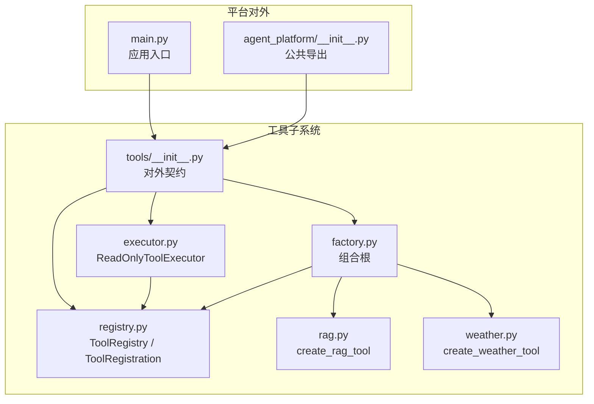
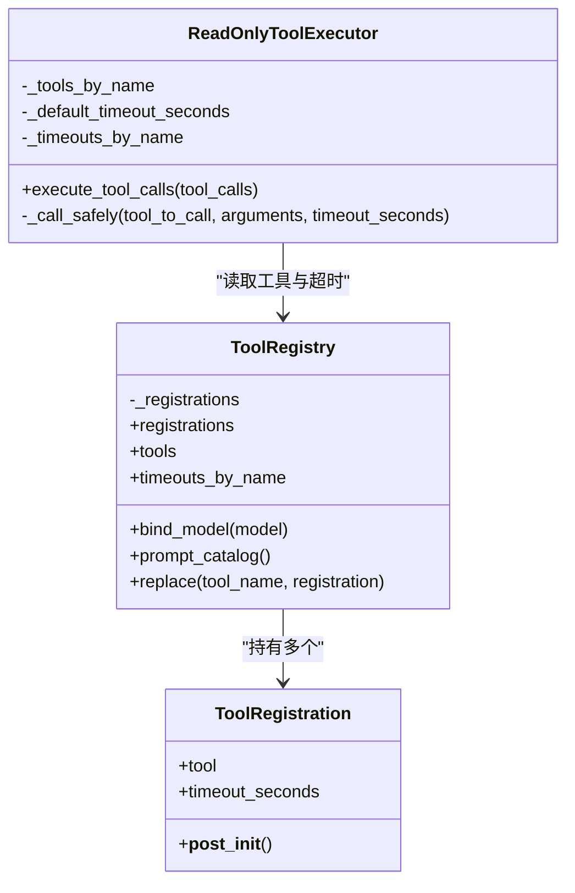
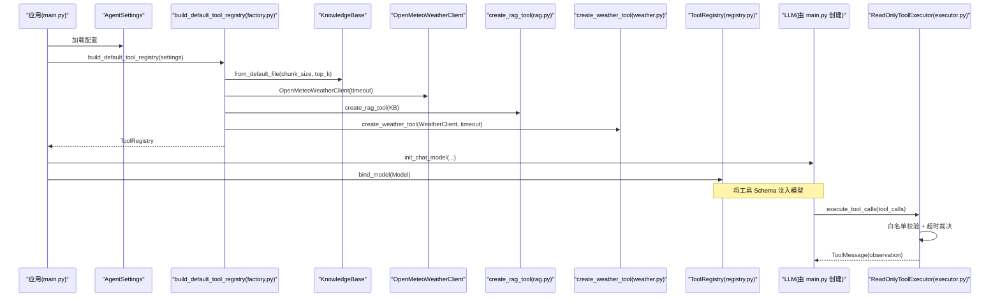
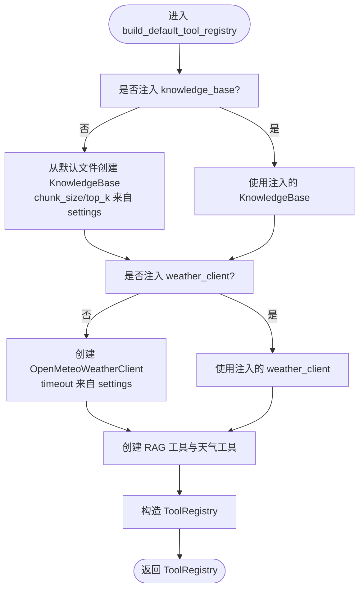
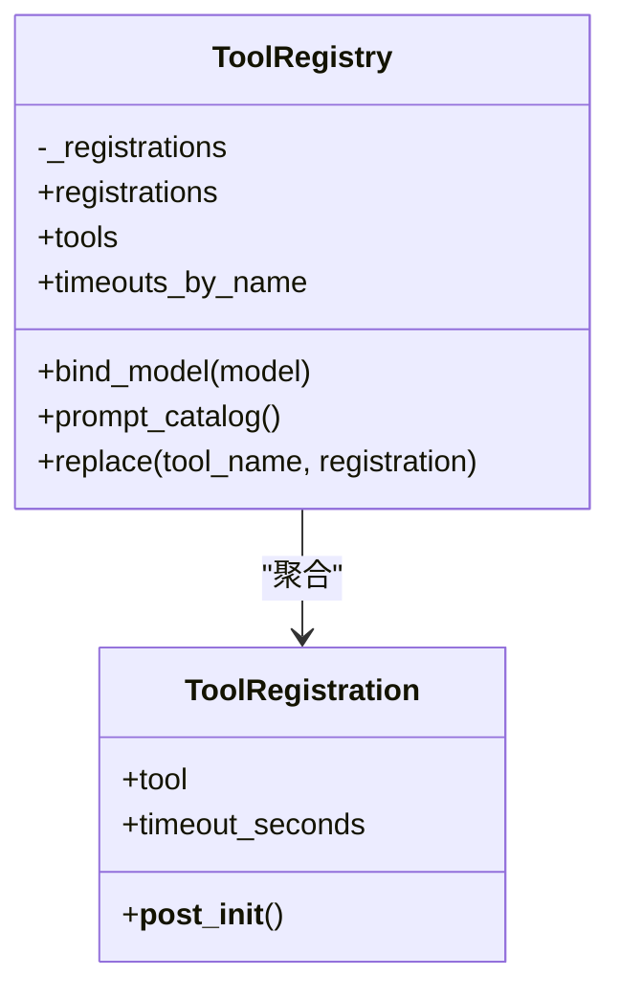
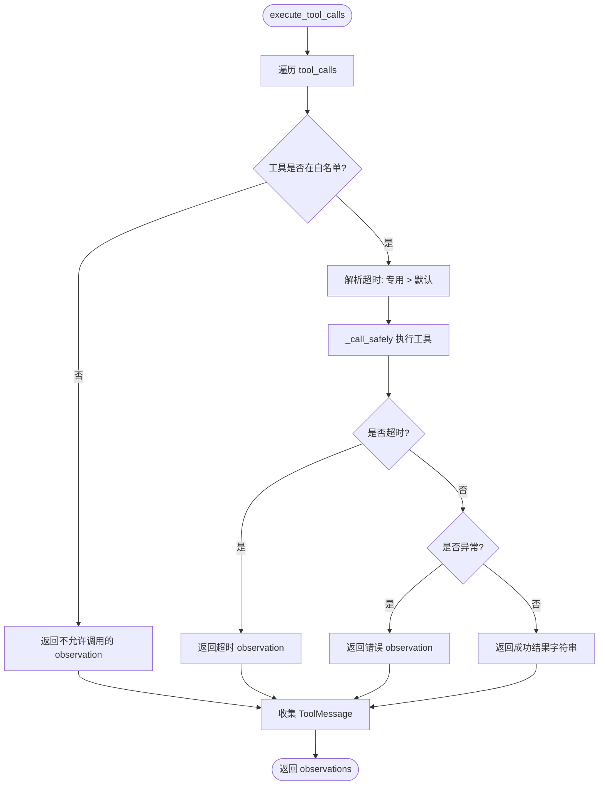
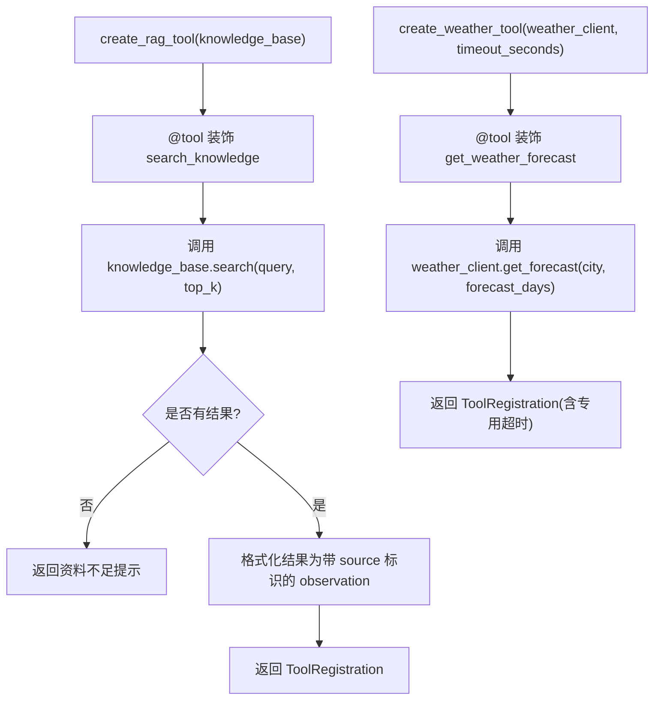
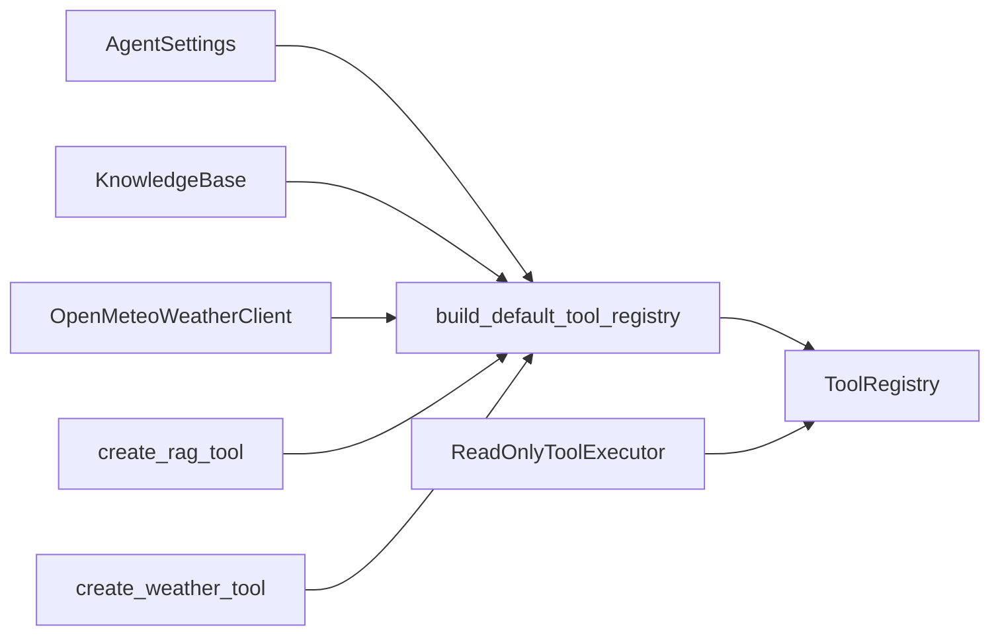

# 工具工厂

<cite>
**本文引用的文件**   
- [factory.py](file://agent_platform/tools/factory.py)
- [registry.py](file://agent_platform/tools/registry.py)
- [executor.py](file://agent_platform/tools/executor.py)
- [rag.py](file://agent_platform/tools/rag.py)
- [weather.py](file://agent_platform/tools/weather.py)
- [tools/__init__.py](file://agent_platform/tools/__init__.py)
- [agent_platform/__init__.py](file://agent_platform/__init__.py)
- [main.py](file://main.py)
</cite>

## 目录
1. [引言](#引言)
2. [项目结构](#项目结构)
3. [核心组件](#核心组件)
4. [架构总览](#架构总览)
5. [详细组件分析](#详细组件分析)
6. [依赖关系分析](#依赖关系分析)
7. [性能与超时策略](#性能与超时策略)
8. [环境差异化配置](#环境差异化配置)
9. [扩展指南：添加新工具](#扩展指南添加新工具)
10. [故障排查](#故障排查)
11. [结论](#结论)

## 引言
本文件面向希望基于“工具工厂”扩展 Agent 能力的开发者，重点说明以下目标：
- 工厂模式在工具系统中的应用方式。
- `build_default_tool_registry` 如何构建默认工具集。
- 工具的依赖注入机制与配置管理。
- 如何通过工厂方法快速创建不同环境下的工具实例（开发、测试、生产）。
- 如何扩展工厂函数以添加新工具到默认集合。
- 工厂方法的可维护性与可扩展性设计要点。

该文档不直接粘贴源码，而是通过“章节来源”和“图示来源”指向具体实现位置，便于读者对照仓库代码阅读。

## 项目结构
工具子系统位于 `agent_platform/tools` 包中，围绕“注册表 + 执行器 + 适配层 + 组合工厂”组织：
- `factory.py`：组合根，负责组装默认工具集。
- `registry.py`：定义不可变工具注册表与单个工具元信息。
- `executor.py`：统一执行工具调用，处理白名单、超时与错误观察。
- `rag.py`、`weather.py`：将领域能力包装为 LangChain 工具并返回注册项。
- `tools/__init__.py`：对外暴露稳定 API，隐藏内部适配函数。
- `agent_platform/__init__.py`：平台级对外导出，包含工具工厂与注册表类型。
- `main.py`：应用启动入口，演示真实与 mock 模式下如何选择工具注册表。

**图示来源**
- [factory.py:1-37](file://agent_platform/tools/factory.py#L1-L37)
- [registry.py:1-94](file://agent_platform/tools/registry.py#L1-L94)
- [executor.py:1-67](file://agent_platform/tools/executor.py#L1-L67)
- [rag.py:1-36](file://agent_platform/tools/rag.py#L1-L36)
- [weather.py:1-26](file://agent_platform/tools/weather.py#L1-L26)
- [tools/__init__.py:1-18](file://agent_platform/tools/__init__.py#L1-L18)
- [agent_platform/__init__.py:1-29](file://agent_platform/__init__.py#L1-L29)
- [main.py:1-95](file://main.py#L1-L95)

**章节来源**
- [factory.py:1-37](file://agent_platform/tools/factory.py#L1-L37)
- [registry.py:1-94](file://agent_platform/tools/registry.py#L1-L94)
- [executor.py:1-67](file://agent_platform/tools/executor.py#L1-L67)
- [rag.py:1-36](file://agent_platform/tools/rag.py#L1-L36)
- [weather.py:1-26](file://agent_platform/tools/weather.py#L1-L26)
- [tools/__init__.py:1-18](file://agent_platform/tools/__init__.py#L1-L18)
- [agent_platform/__init__.py:1-29](file://agent_platform/__init__.py#L1-L29)
- [main.py:1-95](file://main.py#L1-L95)

## 核心组件
本节聚焦工具系统的核心抽象与职责边界：
- `ToolRegistration`：描述一个工具及其运行策略（如专用超时），新增工具只需构造此对象。
- `ToolRegistry`：不可变工具集合，提供模型绑定、Prompt 目录生成、按名替换替身等能力。
- `ReadOnlyToolExecutor`：统一执行工具调用，负责白名单校验、超时裁决与错误观察。
- `create_rag_tool` / `create_weather_tool`：领域适配函数，把领域客户端封装为 LangChain 工具并返回 `ToolRegistration`。
- `build_default_tool_registry`：组合根，装配默认工具集，是扩展点。

**图示来源**
- [registry.py:15-94](file://agent_platform/tools/registry.py#L15-L94)
- [executor.py:17-67](file://agent_platform/tools/executor.py#L17-L67)

**章节来源**
- [registry.py:15-94](file://agent_platform/tools/registry.py#L15-L94)
- [executor.py:17-67](file://agent_platform/tools/executor.py#L17-L67)

## 架构总览
下图展示从应用入口到工具执行的完整流程，以及工厂在其中的作用：

**图示来源**
- [main.py:22-84](file://main.py#L22-L84)
- [factory.py:18-36](file://agent_platform/tools/factory.py#L18-L36)
- [rag.py:14-26](file://agent_platform/tools/rag.py#L14-L26)
- [weather.py:13-25](file://agent_platform/tools/weather.py#L13-L25)
- [registry.py:56-65](file://agent_platform/tools/registry.py#L56-L65)
- [executor.py:27-43](file://agent_platform/tools/executor.py#L27-L43)

## 详细组件分析

### 工厂与默认工具集：`build_default_tool_registry`
- 职责：作为“组合根”，统一构造领域客户端（知识库、天气客户端），经各自适配层包装为 LangChain 工具后注册进 `ToolRegistry`。
- 依赖注入：
  - `knowledge_base`：可选注入；缺省时使用内置语料与默认参数创建。
  - `weather_client`：可选注入；缺省时使用网络客户端与请求超时。
- 工具装配：
  - RAG 工具：无专用超时，走执行器默认值。
  - 天气工具：标记专用超时，覆盖执行器默认值。
- 返回值：不可变的 `ToolRegistry`，供模型绑定、Prompt 目录生成与执行器使用。

**图示来源**
- [factory.py:18-36](file://agent_platform/tools/factory.py#L18-L36)

**章节来源**
- [factory.py:1-37](file://agent_platform/tools/factory.py#L1-L37)

### 工具注册表：`ToolRegistry` 与 `ToolRegistration`
- `ToolRegistration`：
  - 字段：`tool`（LangChain 工具）、`timeout_seconds`（可选专用超时）。
  - 校验：超时必须大于 0。
- `ToolRegistry`：
  - 不可变性：构造时固化为元组，并在构造期检查工具名唯一性。
  - 暴露能力：
    - `tools`：用于模型绑定的工具列表。
    - `timeouts_by_name`：显式配置了专用超时的工具映射。
    - `bind_model`：尝试将工具 Schema 注入模型，不支持则透传。
    - `prompt_catalog`：动态生成模型可见的工具目录。
    - `replace`：返回替换指定工具后的新注册表，便于测试替身注入。

**图示来源**
- [registry.py:15-94](file://agent_platform/tools/registry.py#L15-L94)

**章节来源**
- [registry.py:15-94](file://agent_platform/tools/registry.py#L15-L94)

### 执行器：`ReadOnlyToolExecutor`
- 白名单机制：仅允许已注册工具被调用，拒绝未注册工具调用。
- 超时策略：
  - 单工具显式配置优先。
  - 否则回落到执行器默认超时。
- 错误处理：
  - 超时或异常均转为文本 observation，避免整图崩溃。
- 并发控制：
  - 使用线程池执行工具调用，支持超时取消等待。

**图示来源**
- [executor.py:27-67](file://agent_platform/tools/executor.py#L27-L67)

**章节来源**
- [executor.py:1-67](file://agent_platform/tools/executor.py#L1-L67)

### 领域适配层：RAG 与天气工具
- RAG 工具：
  - 闭包捕获 `KnowledgeBase`，装饰为 LangChain 工具。
  - 未命中时返回引导性文本，提醒模型如实说明资料不足。
- 天气工具：
  - 包装 `OpenMeteoWeatherClient`，声明专用超时。
  - docstring 作为模型可见的使用说明。

**图示来源**
- [rag.py:14-36](file://agent_platform/tools/rag.py#L14-L36)
- [weather.py:13-25](file://agent_platform/tools/weather.py#L13-L25)

**章节来源**
- [rag.py:1-36](file://agent_platform/tools/rag.py#L1-L36)
- [weather.py:1-26](file://agent_platform/tools/weather.py#L1-L26)

## 依赖关系分析
- 工厂依赖：
  - `AgentSettings`：提供 chunk_size、top_k、网络超时等配置。
  - `KnowledgeBase`：本地检索能力。
  - `OpenMeteoWeatherClient`：天气查询能力。
  - `create_rag_tool` / `create_weather_tool`：领域适配函数。
  - `ToolRegistry`：最终产物。
- 执行器依赖：
  - `ToolRegistry`：读取工具与超时映射。
- 对外契约：
  - `tools/__init__.py` 仅导出执行器、注册表类型与工厂函数。
  - `agent_platform/__init__.py` 进一步导出平台级公共 API。

**图示来源**
- [factory.py:10-36](file://agent_platform/tools/factory.py#L10-L36)
- [tools/__init__.py:8-17](file://agent_platform/tools/__init__.py#L8-L17)
- [agent_platform/__init__.py:8-27](file://agent_platform/__init__.py#L8-L27)

**章节来源**
- [factory.py:10-36](file://agent_platform/tools/factory.py#L10-L36)
- [tools/__init__.py:1-18](file://agent_platform/tools/__init__.py#L1-L18)
- [agent_platform/__init__.py:1-29](file://agent_platform/__init__.py#L1-L29)

## 性能与超时策略
- 默认执行超时：执行器默认值为短超时（例如 0.3 秒），适合本地检索等快速操作。
- 专用超时：
  - 天气工具因网络调用耗时不可控，需显式设置专用超时。
  - 若未设置专用超时，则回落到执行器默认值。
- 失败隔离：
  - 工具超时或异常不会向上抛出，而是转换为 observation，保证整体流程稳定。

建议：
- 对 I/O 密集型工具（网络、数据库）务必设置专用超时。
- 对 CPU 密集或不确定耗时的工具，评估是否需要专用超时或降级策略。

**章节来源**
- [executor.py:20-43](file://agent_platform/tools/executor.py#L20-L43)
- [executor.py:45-67](file://agent_platform/tools/executor.py#L45-L67)
- [weather.py:1-5](file://agent_platform/tools/weather.py#L1-L5)

## 环境差异化配置
通过依赖注入与工厂方法，可在不同环境下切换工具实现与配置：
- 生产环境：
  - 使用真实 `KnowledgeBase` 与 `OpenMeteoWeatherClient`。
  - 通过 `AgentSettings` 传入 chunk_size、top_k、网络超时等参数。
- 开发环境：
  - 可注入轻量级或内存版 `KnowledgeBase`。
  - 可注入模拟天气客户端，减少外部依赖。
- 测试环境：
  - 使用 `ToolRegistry.replace` 替换特定工具为替身。
  - 使用 `create_mock_tool_registry`（在评测模块中）构造离线场景。

示例路径（不粘贴代码，仅给出参考位置）：
- 真实模式与 mock 模式的分支选择：[main.py:60-68](file://main.py#L60-L68)
- 替换工具替身：[registry.py:77-93](file://agent_platform/tools/registry.py#L77-L93)
- 评测中的 mock 工具注册表：[evaluation 模块](file://agent_platform/evaluation/__init__.py)

**章节来源**
- [main.py:60-68](file://main.py#L60-L68)
- [registry.py:77-93](file://agent_platform/tools/registry.py#L77-L93)

## 扩展指南：添加新工具
遵循以下步骤扩展默认工具集：

1. 创建领域适配函数：
   - 新建模块或复用现有模式，编写类似 `create_xxx_tool(...)` 的函数。
   - 使用 `@tool` 装饰内层函数，使其成为 LangChain 工具。
   - 返回 `ToolRegistration`，必要时设置 `timeout_seconds`。

2. 在工厂中注册新工具：
   - 打开 `factory.py`，在 `build_default_tool_registry` 中调用新适配函数。
   - 将返回的 `ToolRegistration` 加入 `ToolRegistry` 的构造参数。

3. 暴露对外契约（可选）：
   - 如需对外暴露新工具适配函数，更新 `tools/__init__.py` 的 `__all__`。
   - 同时确保 `agent_platform/__init__.py` 的公共导出保持一致。

4. 验证与测试：
   - 使用 `ToolRegistry.replace` 注入替身进行单元测试。
   - 在 mock 场景中验证 Prompt 目录与模型绑定行为。

关键参考位置：
- 工厂装配点：[factory.py:31-36](file://agent_platform/tools/factory.py#L31-L36)
- 工具适配示例（RAG）：[rag.py:14-26](file://agent_platform/tools/rag.py#L14-L26)
- 工具适配示例（天气）：[weather.py:13-25](file://agent_platform/tools/weather.py#L13-L25)
- 对外契约导出：[tools/__init__.py:8-17](file://agent_platform/tools/__init__.py#L8-L17)
- 平台级导出：[agent_platform/__init__.py:12-27](file://agent_platform/__init__.py#L12-L27)

**章节来源**
- [factory.py:31-36](file://agent_platform/tools/factory.py#L31-L36)
- [rag.py:14-26](file://agent_platform/tools/rag.py#L14-L26)
- [weather.py:13-25](file://agent_platform/tools/weather.py#L13-L25)
- [tools/__init__.py:8-17](file://agent_platform/tools/__init__.py#L8-L17)
- [agent_platform/__init__.py:12-27](file://agent_platform/__init__.py#L12-L27)

## 故障排查
常见问题与定位思路：
- 工具名称重复：
  - 现象：构造 `ToolRegistry` 时报错。
  - 原因：多个工具同名。
  - 解决：调整工具名或在工厂中避免重复注册。
  - 参考：[registry.py:31-36](file://agent_platform/tools/registry.py#L31-L36)
- 工具超时过短：
  - 现象：I/O 工具频繁超时。
  - 原因：未设置专用超时或默认超时过小。
  - 解决：为工具设置专用超时，或增大执行器默认超时。
  - 参考：[executor.py:20-43](file://agent_platform/tools/executor.py#L20-L43)
- 模型无法调用工具：
  - 现象：模型不调用工具或报 schema 不匹配。
  - 原因：未正确绑定工具或工具 description/docstring 缺失。
  - 解决：确保 `ToolRegistry.bind_model` 成功，完善工具 docstring。
  - 参考：[registry.py:56-65](file://agent_platform/tools/registry.py#L56-L65)
- 未注册工具被调用：
  - 现象：模型幻觉调用未注册工具。
  - 原因：白名单拦截。
  - 解决：在工厂中注册该工具，或使用替身替换。
  - 参考：[executor.py:30-43](file://agent_platform/tools/executor.py#L30-L43)

**章节来源**
- [registry.py:31-36](file://agent_platform/tools/registry.py#L31-L36)
- [executor.py:30-43](file://agent_platform/tools/executor.py#L30-L43)
- [registry.py:56-65](file://agent_platform/tools/registry.py#L56-L65)

## 结论
工具工厂通过“组合根 + 注册表 + 执行器 + 适配层”的设计，实现了：
- 明确的依赖注入与配置管理。
- 统一的工具生命周期与执行策略。
- 良好的可维护性与可扩展性：新增工具仅需适配函数与工厂注册。
- 多环境支持：通过注入替身与配置差异，轻松切换开发、测试与生产行为。

建议在扩展时严格遵循工厂契约与注册表约束，合理设置超时策略，并通过替身替换提升测试覆盖率与稳定性。