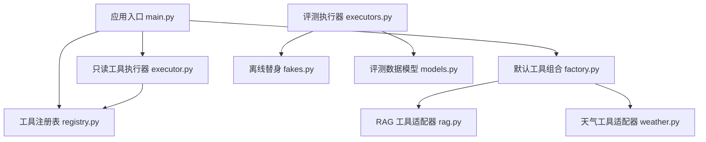
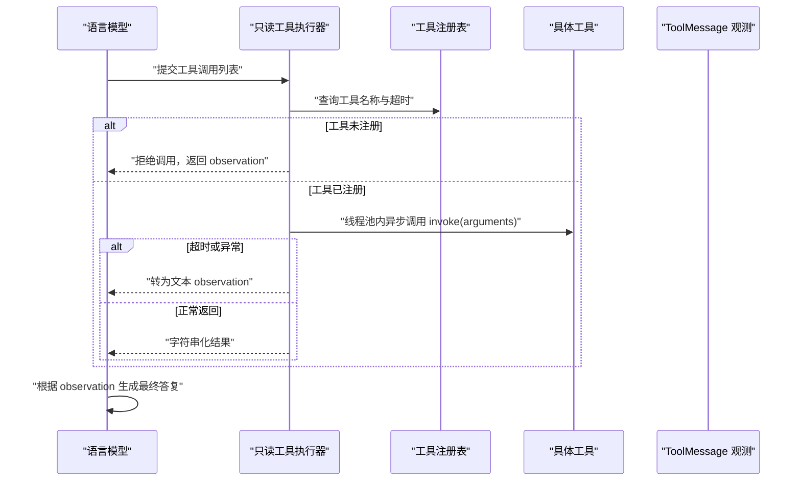
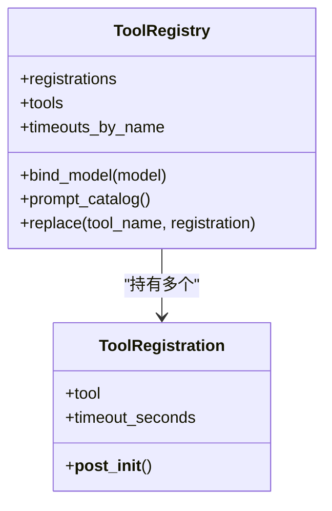
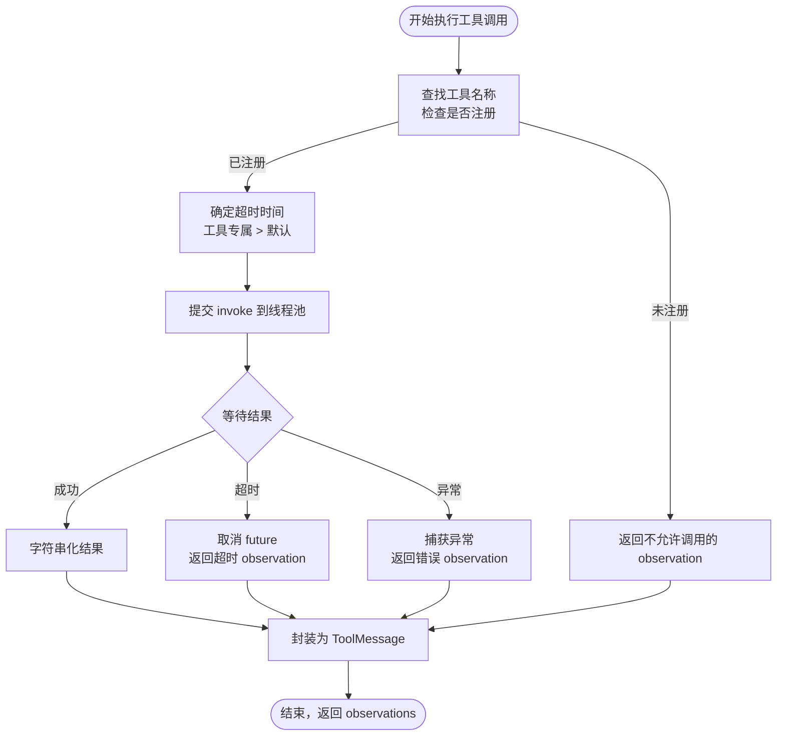
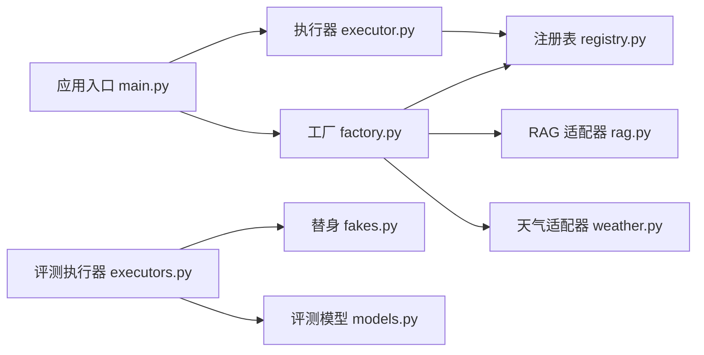
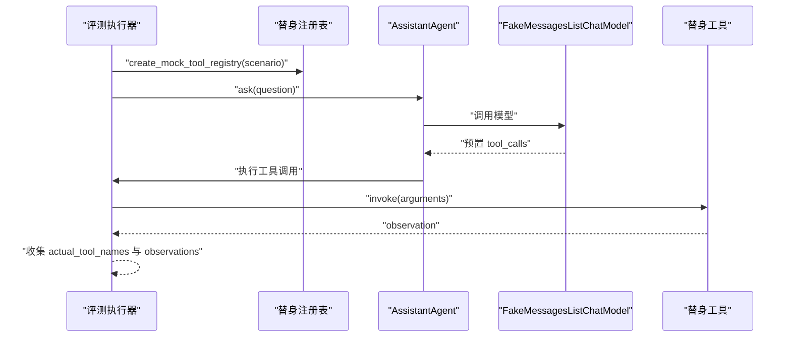

# 工具执行器

<cite>
**本文引用的文件**   
- [executor.py](file://agent_platform/tools/executor.py)
- [registry.py](file://agent_platform/tools/registry.py)
- [factory.py](file://agent_platform/tools/factory.py)
- [rag.py](file://agent_platform/tools/rag.py)
- [weather.py](file://agent_platform/tools/weather.py)
- [main.py](file://main.py)
- [executors.py](file://agent_platform/evaluation/executors.py)
- [fakes.py](file://agent_platform/evaluation/fakes.py)
- [models.py](file://agent_platform/evaluation/models.py)
- [__init__.py](file://agent_platform/__init__.py)
</cite>

## 目录
1. [引言](#引言)
2. [项目结构](#项目结构)
3. [核心组件](#核心组件)
4. [架构总览](#架构总览)
5. [详细组件分析](#详细组件分析)
6. [依赖关系分析](#依赖关系分析)
7. [性能与超时控制](#性能与超时控制)
8. [错误处理与降级策略](#错误处理与降级策略)
9. [结果格式化与流式响应](#结果格式化与流式响应)
10. [可测试性与调试技巧](#可测试性与调试技巧)
11. [自定义执行器与集成示例](#自定义执行器与集成示例)
12. [故障排查指南](#故障排查指南)
13. [结论](#结论)

## 引言
本技术文档围绕“工具执行器”展开，目标是解释工具调用的完整生命周期：从参数解析与白名单校验、异步执行调度、超时控制、异常处理到结果格式化。同时说明执行器的设计模式（重试、降级、监控）、如何适配结构化数据与流式响应，以及面向网络超时、API 限流和服务异常的实践建议。文档还包含评测体系中的可测试性设计与调试技巧，并提供扩展自定义执行器的方法。

## 项目结构
工具执行相关代码集中在 `agent_platform/tools` 子包中，配合评估模块提供离线验证能力；应用入口在 `main.py` 中完成配置加载、模型装配与 Agent 运行。

**图表来源**
- [main.py:43-89](file://main.py#L43-L89)
- [registry.py:27-93](file://agent_platform/tools/registry.py#L27-L93)
- [factory.py:18-36](file://agent_platform/tools/factory.py#L18-L36)
- [rag.py:14-26](file://agent_platform/tools/rag.py#L14-L26)
- [weather.py:13-25](file://agent_platform/tools/weather.py#L13-L25)
- [executor.py:17-66](file://agent_platform/tools/executor.py#L17-L66)
- [executors.py:17-40](file://agent_platform/evaluation/executors.py#L17-L40)
- [fakes.py:28-56](file://agent_platform/evaluation/fakes.py#L28-L56)
- [models.py:12-83](file://agent_platform/evaluation/models.py#L12-L83)

**章节来源**
- [main.py:1-95](file://main.py#L1-L95)
- [__init__.py:1-29](file://agent_platform/__init__.py#L1-L29)

## 核心组件
- 工具注册表：集中管理工具对象、每个工具的超时策略，并生成供模型使用的工具 Schema 和工具目录。
- 默认工具工厂：组装知识库检索工具和天气工具，注入领域客户端，统一注册。
- 只读工具执行器：对模型发起的工具调用进行白名单校验、超时控制和异常兜底，返回统一的 ToolMessage。
- 工具适配器：将领域能力包装为 LangChain 工具，附带 docstring 作为模型可见的使用说明。
- 评测执行器与替身：提供离线场景下的确定性行为，用于回归测试和调试。

**章节来源**
- [registry.py:15-93](file://agent_platform/tools/registry.py#L15-L93)
- [factory.py:18-36](file://agent_platform/tools/factory.py#L18-L36)
- [executor.py:17-66](file://agent_platform/tools/executor.py#L17-L66)
- [rag.py:14-35](file://agent_platform/tools/rag.py#L14-L35)
- [weather.py:13-25](file://agent_platform/tools/weather.py#L13-L25)
- [executors.py:17-40](file://agent_platform/evaluation/executors.py#L17-L40)
- [fakes.py:28-98](file://agent_platform/evaluation/fakes.py#L28-L98)

## 架构总览
工具执行的生命周期由“模型 → 执行器 → 工具 → 观测结果 → 模型”的闭环构成。执行器是安全边界，确保单个工具失败不会导致整体图崩溃。

**图表来源**
- [executor.py:27-66](file://agent_platform/tools/executor.py#L27-L66)
- [registry.py:47-54](file://agent_platform/tools/registry.py#L47-L54)

## 详细组件分析

### 工具注册表
- 职责：维护不可变工具集合、工具名唯一性校验、按工具名的超时映射、绑定模型工具 Schema、生成工具目录、支持替换工具以方便测试。
- 关键设计：
  - 使用冻结数据类表示单个工具及其策略，Fail Fast 校验超时值。
  - 构造时检测重复工具名，避免模型 Schema、Prompt 和执行器不同步。
  - 暴露 tools、timeouts_by_name、prompt_catalog 等属性，供模型、提示词和执行器共享。
  - replace 方法返回新注册表实例，便于单元测试替换特定工具。

**图表来源**
- [registry.py:15-93](file://agent_platform/tools/registry.py#L15-L93)

**章节来源**
- [registry.py:15-93](file://agent_platform/tools/registry.py#L15-L93)

### 默认工具工厂
- 职责：构建当前应用的工具集合，注入知识库与天气客户端，统一注册进 ToolRegistry。
- 关键点：
  - 本地检索工具不设置专用超时，走执行器默认超时。
  - 天气工具标记专用超时，覆盖执行器默认值。
  - 通过可选注入点 knowledge_base 与 weather_client 支持测试替身。

**章节来源**
- [factory.py:18-36](file://agent_platform/tools/factory.py#L18-L36)

### 只读工具执行器
- 职责：依次执行一轮工具调用，把每个结果（含失败说明）封装为 ToolMessage；保证 LangGraph 图不因单个工具故障崩溃。
- 关键流程：
  - 白名单校验：未注册工具直接拒绝，返回明确 observation。
  - 超时决策：单工具显式配置优先，否则回落到执行器默认值。
  - 异步执行：使用 ThreadPoolExecutor(max_workers=1) 包裹工具 invoke，future.result(timeout) 实现超时控制。
  - 异常兜底：超时或异常均转为文本 observation，不向上抛出。
  - 资源清理：finally 中关闭线程池并取消未完成任务。

**图表来源**
- [executor.py:27-66](file://agent_platform/tools/executor.py#L27-L66)

**章节来源**
- [executor.py:17-66](file://agent_platform/tools/executor.py#L17-L66)

### RAG 工具适配器
- 职责：将 KnowledgeBase 搜索能力包装为 LangChain 工具，docstring 作为模型使用说明。
- 关键点：
  - 未命中时返回引导性文本，提醒模型如实说明资料不足而非编造。
  - 结果格式化函数将片段拼接为带来源标识的 observation，便于模型引用证据。

**章节来源**
- [rag.py:14-35](file://agent_platform/tools/rag.py#L14-L35)

### 天气工具适配器
- 职责：将 OpenMeteoWeatherClient 包装为 LangChain 工具，并在注册时标记专用超时。
- 关键点：
  - 网络调用耗时不可控，必须通过 ToolRegistration.timeout_seconds 覆盖执行器默认超时。

**章节来源**
- [weather.py:13-25](file://agent_platform/tools/weather.py#L13-L25)

## 依赖关系分析
- 执行器依赖注册表获取工具对象与超时策略。
- 工厂依赖领域客户端（知识库、天气客户端），并通过适配器创建工具。
- 评测执行器依赖替身模型与替身工具，构造独立 Agent 实例进行断言。
- 应用入口负责装配模型、注册表、记忆与 Agent，并驱动问答循环。

**图表来源**
- [executor.py:17-66](file://agent_platform/tools/executor.py#L17-L66)
- [registry.py:27-93](file://agent_platform/tools/registry.py#L27-L93)
- [factory.py:18-36](file://agent_platform/tools/factory.py#L18-L36)
- [rag.py:14-35](file://agent_platform/tools/rag.py#L14-L35)
- [weather.py:13-25](file://agent_platform/tools/weather.py#L13-L25)
- [executors.py:17-40](file://agent_platform/evaluation/executors.py#L17-L40)
- [fakes.py:28-98](file://agent_platform/evaluation/fakes.py#L28-L98)
- [models.py:12-83](file://agent_platform/evaluation/models.py#L12-L83)
- [main.py:43-89](file://main.py#L43-L89)

**章节来源**
- [main.py:43-89](file://main.py#L43-L89)
- [executors.py:17-40](file://agent_platform/evaluation/executors.py#L17-L40)

## 性能与超时控制
- 执行器采用单工作线程池隔离工具调用，避免阻塞主流程；超时通过 future.result(timeout) 实现。
- 超时策略两级裁决：工具专属超时优先，否则使用执行器默认超时。
- 性能监控可通过评测执行器收集端到端耗时（毫秒），并结合日志输出观察工具执行路径。
- 优化建议：
  - 合理设置默认超时与工具专属超时，区分本地检索与网络调用。
  - 对高频工具考虑缓存或批量接口以减少调用次数。
  - 在评测中统计 duration_ms 分布，识别慢工具与瓶颈。

**章节来源**
- [executor.py:45-66](file://agent_platform/tools/executor.py#L45-L66)
- [executors.py:23-40](file://agent_platform/evaluation/executors.py#L23-L40)

## 错误处理与降级策略
- 白名单防线：未注册工具直接拒绝，防止模型幻觉导致的任意工具调用。
- 超时降级：超时后取消 future，返回明确的超时 observation，让模型说明暂时无法查询。
- 异常降级：捕获工具抛出的异常，转换为错误 observation，避免整张图崩溃。
- 网络与服务异常最佳实践：
  - 为网络工具设置专用超时，避免长时间阻塞。
  - 对 API 限流：在上层客户端实现退避重试（指数退避、抖动），在执行器层面保持失败即 observation。
  - 服务异常：记录错误类型与消息，提示模型不要编造结果，仅基于可用信息回答。

**章节来源**
- [executor.py:27-66](file://agent_platform/tools/executor.py#L27-L66)

## 结果格式化与流式响应
- 结构化数据：工具返回字符串，执行器将其字符串化后封装为 ToolMessage；RAG 工具将搜索结果格式化为带来源标识的文本，便于模型引用。
- 流式响应：当前执行器不支持流式结果；如需支持，可在工具适配器内部聚合流式片段为最终字符串，或在执行器层增加流式回调机制。
- 建议：
  - 对于需要逐步输出的工具，先在工具侧累积结果，再一次性返回，以保证 observation 一致性。
  - 若需实时反馈，可在上层 UI 或日志中展示中间状态，但 ToolMessage 仍保持最终结果。

**章节来源**
- [rag.py:29-35](file://agent_platform/tools/rag.py#L29-L35)
- [executor.py:56-64](file://agent_platform/tools/executor.py#L56-L64)

## 可测试性与调试技巧
- 评测执行器：
  - 使用 OfflineToolCaseExecutor 构造独立 Agent 实例，互不污染，结果可复现。
  - 抽取 ToolMessage 序列作为观测，断言工具名顺序与 observation 内容。
- 替身模型与工具：
  - FakeMessagesListChatModel 预置两段回复，驱动 assistant→tools→assistant 循环。
  - 通过 create_mock_tool_registry 替换特定工具，模拟超时、错误、天气等场景。
- 调试技巧：
  - 启用执行器打印日志，观察工具名称、参数与 observation。
  - 在评测中查看 duration_ms，定位慢路径。
  - 使用 replace 方法替换工具为可控替身，快速验证执行器逻辑。

**图表来源**
- [executors.py:23-40](file://agent_platform/evaluation/executors.py#L23-L40)
- [fakes.py:59-98](file://agent_platform/evaluation/fakes.py#L59-L98)

**章节来源**
- [executors.py:17-40](file://agent_platform/evaluation/executors.py#L17-L40)
- [fakes.py:28-98](file://agent_platform/evaluation/fakes.py#L28-L98)
- [models.py:12-83](file://agent_platform/evaluation/models.py#L12-L83)

## 自定义执行器与集成示例
- 自定义执行器要点：
  - 继承或复用现有执行器思路，实现 execute_tool_calls 契约，返回 ToolMessage 列表。
  - 保持白名单校验、超时控制与异常兜底策略一致。
  - 通过 ToolRegistry 获取工具与超时配置，避免硬编码。
- 集成方式：
  - 在应用入口或 Agent 装配处注入自定义执行器。
  - 使用评测替身替换工具，验证自定义执行器行为。
  - 在日志中输出工具名称、参数与 observation，便于调试。

参考路径：
- 执行器契约与超时控制：[executor.py:27-66](file://agent_platform/tools/executor.py#L27-L66)
- 工具注册与超时映射：[registry.py:47-54](file://agent_platform/tools/registry.py#L47-L54)
- 评测替身替换工具：[fakes.py:28-56](file://agent_platform/evaluation/fakes.py#L28-L56)

**章节来源**
- [executor.py:27-66](file://agent_platform/tools/executor.py#L27-L66)
- [registry.py:47-54](file://agent_platform/tools/registry.py#L47-L54)
- [fakes.py:28-56](file://agent_platform/evaluation/fakes.py#L28-L56)

## 故障排查指南
- 常见问题：
  - 工具未注册：检查 ToolRegistry 是否正确构建，工具名是否重复。
  - 工具超时：确认工具专属超时是否合理，网络工具是否设置了足够超时。
  - 工具异常：查看 observation 中的异常类型与消息，定位上游客户端问题。
  - 评测失败：核对 expected_tool_names 与 expected_observation_contains，确认替身行为是否符合预期。
- 排查步骤：
  - 启用执行器日志，观察工具调用链路与 observation。
  - 使用评测执行器跑离线场景，确认工具编排正确。
  - 替换工具为替身，隔离外部依赖问题。
  - 检查 AgentSettings 配置，确保超时与 RAG 参数合理。

**章节来源**
- [executor.py:27-66](file://agent_platform/tools/executor.py#L27-L66)
- [registry.py:30-36](file://agent_platform/tools/registry.py#L30-L36)
- [executors.py:23-40](file://agent_platform/evaluation/executors.py#L23-L40)

## 结论
该工具执行器通过注册表统一管理工具与超时策略，借助线程池与超时控制实现安全的异步执行，并将所有失败转化为模型可见的 observation，保障系统鲁棒性。结合评测替身与离线执行器，提供了良好的可测试性与调试能力。建议在新增工具时遵循注册表与适配器模式，合理设置超时，并在上层客户端实现限流与退避重试，以获得更稳定的执行体验。