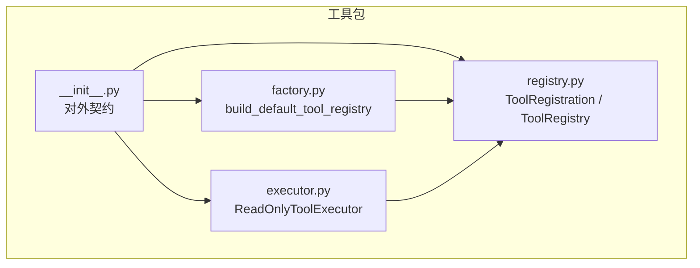
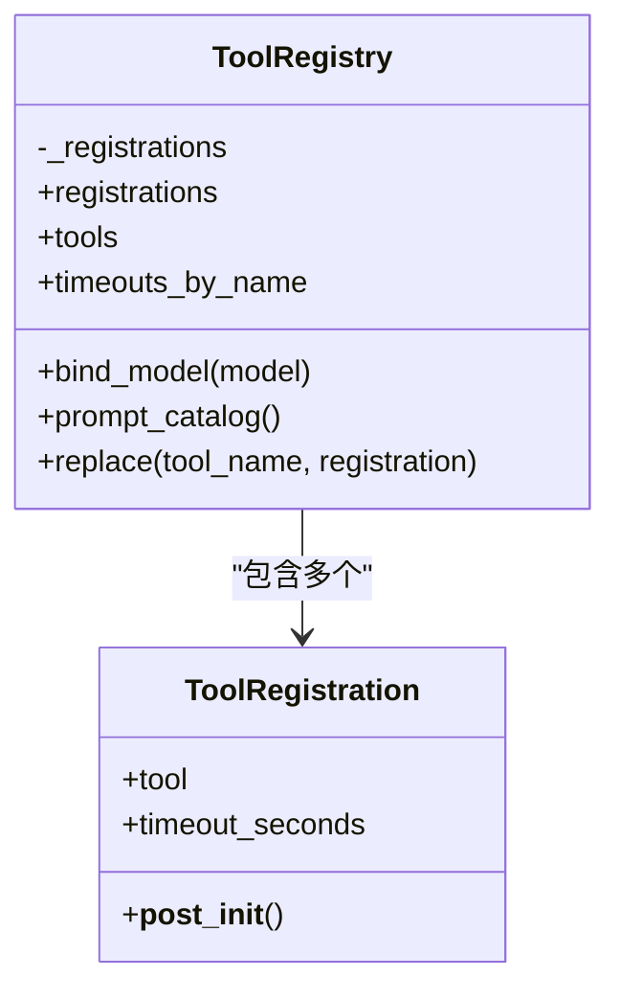
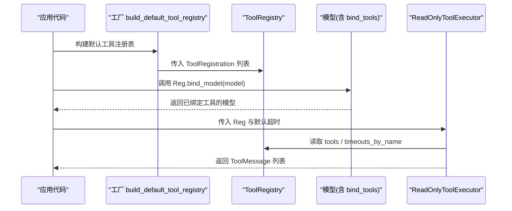
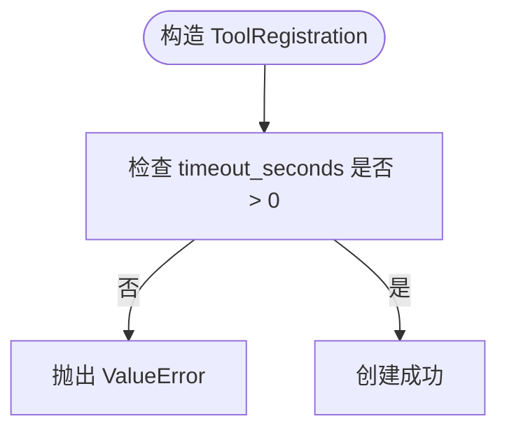
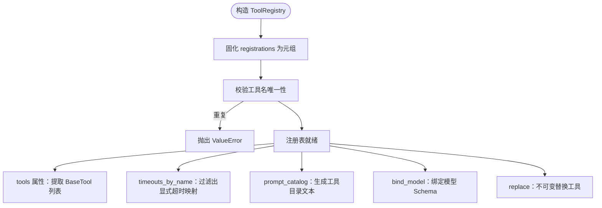
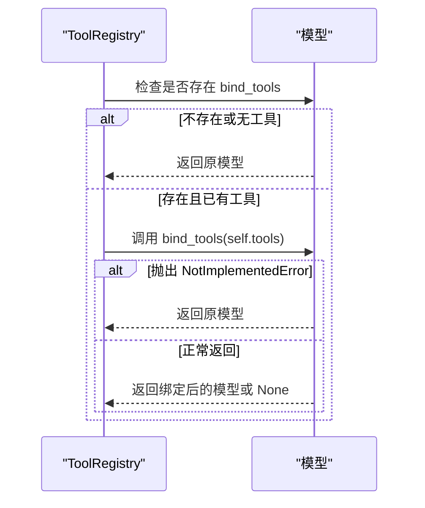
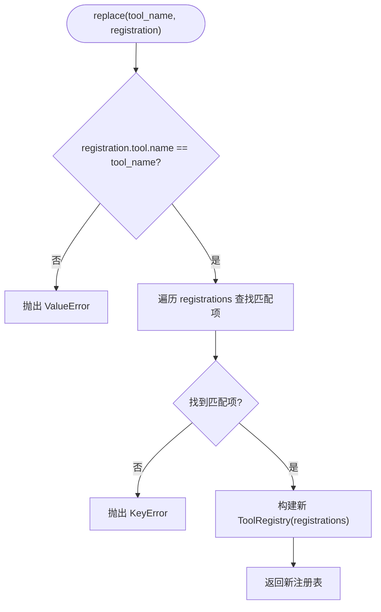
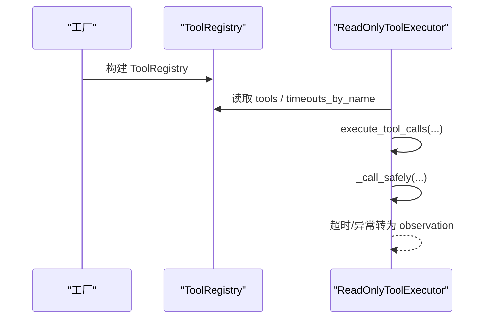
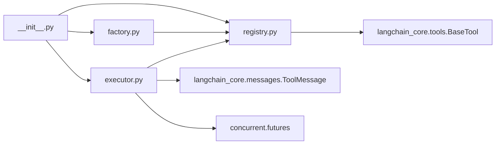

# 工具注册表

<cite>
**本文引用的文件**   
- [registry.py](file://agent_platform/tools/registry.py)
- [executor.py](file://agent_platform/tools/executor.py)
- [factory.py](file://agent_platform/tools/factory.py)
- [__init__.py](file://agent_platform/tools/__init__.py)
</cite>

## 目录
1. [引言](#引言)
2. [项目结构](#项目结构)
3. [核心组件](#核心组件)
4. [架构总览](#架构总览)
5. [详细组件分析](#详细组件分析)
6. [依赖关系分析](#依赖关系分析)
7. [性能与线程安全](#性能与线程安全)
8. [故障排查指南](#故障排查指南)
9. [结论](#结论)
10. [附录：使用示例与测试要点](#附录使用示例与测试要点)

## 引言
本技术文档围绕“工具注册表”展开，重点解释以下目标：
- ToolRegistration 数据类的设计：工具对象封装、超时策略配置与参数验证机制。
- ToolRegistry 类的核心功能：不可变集合设计、工具名唯一性校验、Schema 绑定机制。
- 三个关键属性的作用：tools（LangChain 工具列表）、timeouts_by_name（超时映射）、prompt_catalog（动态工具目录生成）。
- bind_model 方法的模型绑定逻辑与 replace 方法的替换机制。
- 结合工厂与执行器说明如何注册工具、配置超时、绑定模型并进行单元测试。
- 强调 Fail Fast 设计原则与线程安全考虑。

## 项目结构
工具子系统位于 agent_platform/tools 包中，核心文件如下：
- registry.py：定义 ToolRegistration 与 ToolRegistry，集中管理工具、超时策略与工具目录。
- executor.py：ReadOnlyToolExecutor 负责白名单校验、超时控制与错误收敛为 observation。
- factory.py：build_default_tool_registry 作为组合根，组装默认工具并构建 ToolRegistry。
- __init__.py：对外导出 ReadOnlyToolExecutor、ToolRegistration、ToolRegistry 与 build_default_tool_registry。

**图表来源**
- [registry.py:15-93](file://agent_platform/tools/registry.py#L15-L93)
- [executor.py:17-67](file://agent_platform/tools/executor.py#L17-L67)
- [factory.py:18-36](file://agent_platform/tools/factory.py#L18-L36)
- [__init__.py:8-17](file://agent_platform/tools/__init__.py#L8-L17)

**章节来源**
- [registry.py:1-93](file://agent_platform/tools/registry.py#L1-L93)
- [executor.py:1-67](file://agent_platform/tools/executor.py#L1-L67)
- [factory.py:1-37](file://agent_platform/tools/factory.py#L1-L37)
- [__init__.py:1-18](file://agent_platform/tools/__init__.py#L1-L18)

## 核心组件
本节聚焦两个核心类型及其职责边界：
- ToolRegistration：描述一个工具与其运行策略（主要是超时），并在构造时进行参数校验。
- ToolRegistry：维护不可变的工具注册集合，提供 tools、timeouts_by_name、prompt_catalog、bind_model、replace 等能力。

**图表来源**
- [registry.py:15-93](file://agent_platform/tools/registry.py#L15-L93)

**章节来源**
- [registry.py:15-93](file://agent_platform/tools/registry.py#L15-L93)

## 架构总览
工具注册表在系统中承担“单一事实来源”的角色：
- 模型侧通过 bind_model 将工具的 Schema 注入模型，使模型知道可调用工具。
- Prompt 侧通过 prompt_catalog 动态生成工具目录，避免手工维护工具名。
- 执行器侧通过 timeouts_by_name 获取每个工具的专用超时，未配置则回落到默认值。

**图表来源**
- [factory.py:18-36](file://agent_platform/tools/factory.py#L18-L36)
- [registry.py:56-75](file://agent_platform/tools/registry.py#L56-L75)
- [executor.py:20-43](file://agent_platform/tools/executor.py#L20-L43)

**章节来源**
- [factory.py:18-36](file://agent_platform/tools/factory.py#L18-L36)
- [registry.py:27-93](file://agent_platform/tools/registry.py#L27-L93)
- [executor.py:17-67](file://agent_platform/tools/executor.py#L17-L67)

## 详细组件分析

### ToolRegistration：工具与运行策略的不可变记录
- 字段含义
  - tool：LangChain BaseTool 实例，其 docstring/description 会暴露给模型，用于生成工具说明。
  - timeout_seconds：该工具的专用超时秒数；None 表示不覆盖默认超时，由执行器决定。
- 参数验证
  - 若显式设置了 timeout_seconds，必须大于 0，否则抛出 ValueError。
- 设计要点
  - 使用 frozen dataclass，保证创建后不可变，避免运行时被意外修改。
  - 新增工具只需构造 ToolRegistration 并交给 ToolRegistry，无需改动其他模块。

**图表来源**
- [registry.py:15-24](file://agent_platform/tools/registry.py#L15-L24)

**章节来源**
- [registry.py:15-24](file://agent_platform/tools/registry.py#L15-L24)

### ToolRegistry：不可变工具集合与多角色共享入口
- 不可变集合设计
  - 构造时将输入固化为元组，避免后续被外部修改。
  - 构造阶段即校验工具名唯一性，重复名称直接抛出 ValueError（Fail Fast）。
- 关键属性与方法
  - registrations：原始注册记录元组，供需要完整上下文时使用。
  - tools：提取所有 LangChain 工具，供模型 bind_tools 使用。
  - timeouts_by_name：仅包含显式设置超时的工具映射，未设置者由执行器回退到默认值。
  - prompt_catalog：根据每个工具的 description 动态生成工具目录字符串，供系统 Prompt 使用。
  - bind_model：尝试调用模型的 bind_tools 方法，将工具 Schema 注入模型；不支持绑定的替身或空注册表直接透传原模型。
  - replace：以不可变方式替换指定工具，返回新的 ToolRegistry，便于测试注入替身。

**图表来源**
- [registry.py:30-93](file://agent_platform/tools/registry.py#L30-L93)

**章节来源**
- [registry.py:30-93](file://agent_platform/tools/registry.py#L30-L93)

#### bind_model：模型绑定逻辑
- 行为规则
  - 若模型没有 callable 的 bind_tools 方法，或注册表为空，直接返回原模型。
  - 调用 bind_tools(self.tools)，若抛出 NotImplementedError（常见于测试替身），也返回原模型。
  - 若 bind_tools 返回 None，同样返回原模型；否则返回绑定后的新模型。
- 设计意图
  - 对真实模型完成 Schema 注入；对测试替身保持兼容，避免测试因缺少实现而失败。

**图表来源**
- [registry.py:56-65](file://agent_platform/tools/registry.py#L56-L65)

**章节来源**
- [registry.py:56-65](file://agent_platform/tools/registry.py#L56-L65)

#### replace：不可变替换机制
- 行为规则
  - 校验 replacement 的 tool.name 与目标 tool_name 一致，不一致抛出 ValueError。
  - 遍历现有 registrations，找到匹配项后用新 registration 替换，标记 replaced。
  - 若未找到匹配项，抛出 KeyError。
  - 最终构造新的 ToolRegistry 返回，原实例保持不变。
- 设计意图
  - 支持测试场景下用替身替换真实工具，同时保持不可变语义，避免并发或副作用问题。

**图表来源**
- [registry.py:77-93](file://agent_platform/tools/registry.py#L77-L93)

**章节来源**
- [registry.py:77-93](file://agent_platform/tools/registry.py#L77-L93)

### 工厂与执行器的协作
- 工厂 build_default_tool_registry
  - 负责从配置与可选依赖（知识库、天气客户端）构建默认工具集合并返回 ToolRegistry。
  - 典型用法：RAG 工具不设置专用超时，走执行器默认；天气工具设置网络专用超时。
- 执行器 ReadOnlyToolExecutor
  - 从 registry.tools 构建白名单映射，从 registry.timeouts_by_name 读取专用超时。
  - 执行工具调用时采用两级超时裁决：单工具显式配置优先，否则回落到默认超时。
  - 将未注册工具、超时、异常统一转换为 observation 文本，避免 LangGraph 图崩溃。

**图表来源**
- [factory.py:18-36](file://agent_platform/tools/factory.py#L18-L36)
- [executor.py:20-67](file://agent_platform/tools/executor.py#L20-L67)

**章节来源**
- [factory.py:18-36](file://agent_platform/tools/factory.py#L18-L36)
- [executor.py:17-67](file://agent_platform/tools/executor.py#L17-L67)

## 依赖关系分析
- 内部依赖
  - executor.py 依赖 registry.py 提供的 ToolRegistry。
  - factory.py 依赖 registry.py 的 ToolRegistry，并通过 create_rag_tool/create_weather_tool 适配领域工具。
  - __init__.py 对外导出核心类型与工厂函数，形成稳定契约。
- 外部依赖
  - langchain_core.tools.BaseTool：工具抽象基类。
  - langchain_core.messages.ToolMessage：执行结果的消息载体。
  - concurrent.futures.ThreadPoolExecutor：用于工具调用的超时控制。

**图表来源**
- [registry.py:9-12](file://agent_platform/tools/registry.py#L9-L12)
- [executor.py:8-14](file://agent_platform/tools/executor.py#L8-L14)
- [factory.py:10-15](file://agent_platform/tools/factory.py#L10-L15)
- [__init__.py:8-17](file://agent_platform/tools/__init__.py#L8-L17)

**章节来源**
- [registry.py:9-12](file://agent_platform/tools/registry.py#L9-L12)
- [executor.py:8-14](file://agent_platform/tools/executor.py#L8-L14)
- [factory.py:10-15](file://agent_platform/tools/factory.py#L10-L15)
- [__init__.py:8-17](file://agent_platform/tools/__init__.py#L8-L17)

## 性能与线程安全
- 不可变性提升安全性
  - ToolRegistration 使用 frozen dataclass，ToolRegistry 内部使用 tuple 存储，避免运行时被修改，天然线程安全。
- 构造期校验减少运行时开销
  - 工具名唯一性校验在构造阶段完成，避免运行期出现重复键导致的歧义。
- 执行器超时控制
  - 使用 ThreadPoolExecutor(max_workers=1) 包装工具调用，配合 future.result(timeout=...) 实现超时控制。
  - 超时或异常均转为 observation 文本，避免整体流程崩溃。
- 资源释放
  - 执行完成后调用 shutdown(wait=False, cancel_futures=True) 及时释放线程池资源。

**章节来源**
- [registry.py:15-36](file://agent_platform/tools/registry.py#L15-L36)
- [executor.py:45-67](file://agent_platform/tools/executor.py#L45-L67)

## 故障排查指南
- 工具名重复
  - 现象：构造 ToolRegistry 时抛出 ValueError，提示重复的工具名。
  - 原因：传入的 ToolRegistration 列表中 tool.name 有重复。
  - 处理：检查工厂或自定义注册逻辑，确保每个工具名唯一。
- 替换工具名不一致
  - 现象：调用 replace 时抛出 ValueError，提示替换工具名与目标不一致。
  - 原因：replacement 的 tool.name 与传入的 tool_name 不同。
  - 处理：确保两者一致后再调用 replace。
- 替换目标不存在
  - 现象：调用 replace 时抛出 KeyError，提示未注册工具。
  - 原因：当前注册表中不存在该 tool_name。
  - 处理：确认工具已在注册表中，或使用正确的工具名。
- 模型不支持绑定
  - 现象：bind_model 返回原模型，未发生绑定。
  - 原因：模型没有 bind_tools 方法，或该方法抛出 NotImplementedError。
  - 处理：在测试中使用具备 bind_tools 实现的替身，或在业务代码中判断返回值。
- 工具未注册
  - 现象：执行器返回 observation 提示不允许调用某工具。
  - 原因：模型生成了未注册的 tool_name。
  - 处理：扩展 ToolRegistry 注册该工具，或调整 Prompt 限制模型只能调用已注册工具。
- 超时配置无效
  - 现象：工具未按预期超时。
  - 原因：ToolRegistration.timeout_seconds 未设置或 <= 0；或执行器默认超时配置不当。
  - 处理：为 ToolRegistration 设置正数超时，并确保执行器 default_timeout_seconds > 0。

**章节来源**
- [registry.py:22-36](file://agent_platform/tools/registry.py#L22-L36)
- [registry.py:77-93](file://agent_platform/tools/registry.py#L77-L93)
- [executor.py:20-43](file://agent_platform/tools/executor.py#L20-L43)

## 结论
工具注册表通过 ToolRegistration 与 ToolRegistry 的组合，实现了：
- 工具对象的统一封装与参数校验。
- 不可变集合与 Fail Fast 校验，确保工具名唯一性与运行期稳定性。
- 面向模型的 Schema 绑定与面向 Prompt 的动态工具目录生成。
- 面向执行器的超时映射与默认超时回退机制。
- 面向测试的不可变替换能力，便于 Mock 与集成测试。

该设计将模型、Prompt、执行器三处对工具集的依赖统一到单一注册表，从根本上避免了多处手工维护导致的不一致问题。

## 附录：使用示例与测试要点
以下为实践建议与测试要点（不展示具体代码内容，仅提供路径参考）：

- 注册工具与配置超时
  - 在工厂中通过 create_rag_tool/create_weather_tool 构建工具，并以 ToolRegistration 形式传入 ToolRegistry。
  - RAG 工具可不设置专用超时，走执行器默认；天气工具设置网络专用超时。
  - 参考路径：[factory.py:18-36](file://agent_platform/tools/factory.py#L18-L36)

- 绑定模型
  - 调用 ToolRegistry.bind_model(model)，将工具 Schema 注入模型。
  - 若模型不支持绑定或返回 None，将得到原模型。
  - 参考路径：[registry.py:56-65](file://agent_platform/tools/registry.py#L56-L65)

- 生成工具目录
  - 使用 ToolRegistry.prompt_catalog() 生成模型可见的工具目录文本。
  - 参考路径：[registry.py:67-75](file://agent_platform/tools/registry.py#L67-L75)

- 替换工具（测试）
  - 使用 ToolRegistry.replace(tool_name, new_registration) 替换指定工具，返回新注册表。
  - 注意 tool_name 与 replacement.tool.name 必须一致。
  - 参考路径：[registry.py:77-93](file://agent_platform/tools/registry.py#L77-L93)

- 执行工具调用
  - 使用 ReadOnlyToolExecutor.execute_tool_calls(...) 执行一轮工具调用，返回 ToolMessage 列表。
  - 未注册工具、超时、异常均转为 observation 文本。
  - 参考路径：[executor.py:27-67](file://agent_platform/tools/executor.py#L27-L67)

- 单元测试建议
  - 校验 ToolRegistration 超时参数合法性（<=0 应抛错）。
  - 校验 ToolRegistry 构造时工具名唯一性（重复应抛错）。
  - 校验 replace 的参数一致性（不一致抛错）与目标不存在（抛 KeyError）。
  - 校验 bind_model 对不支持绑定的替身的兼容性（返回原模型）。
  - 校验执行器对未注册工具、超时、异常的 observation 输出。
  - 参考路径：[registry.py:22-93](file://agent_platform/tools/registry.py#L22-L93), [executor.py:20-67](file://agent_platform/tools/executor.py#L20-L67)