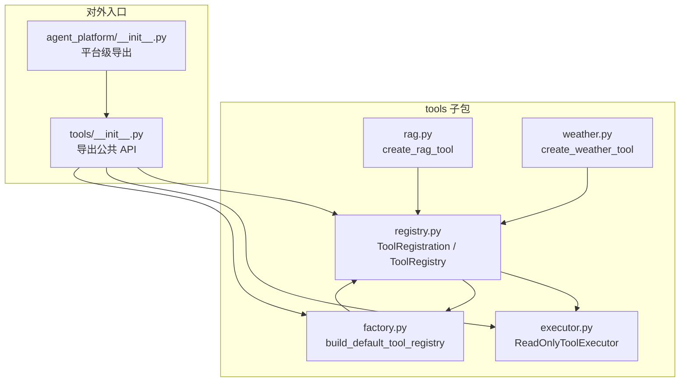
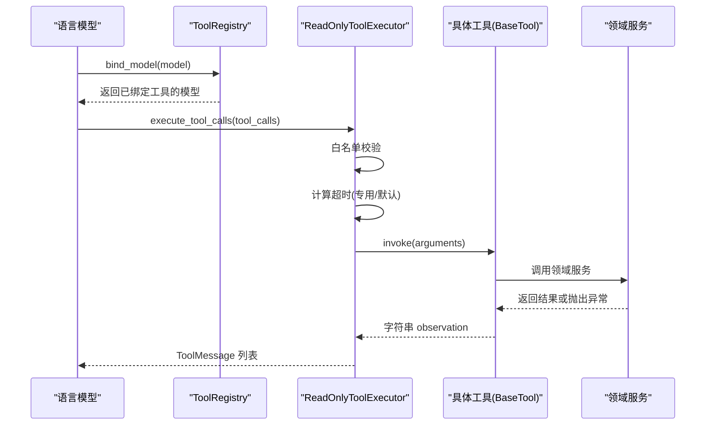
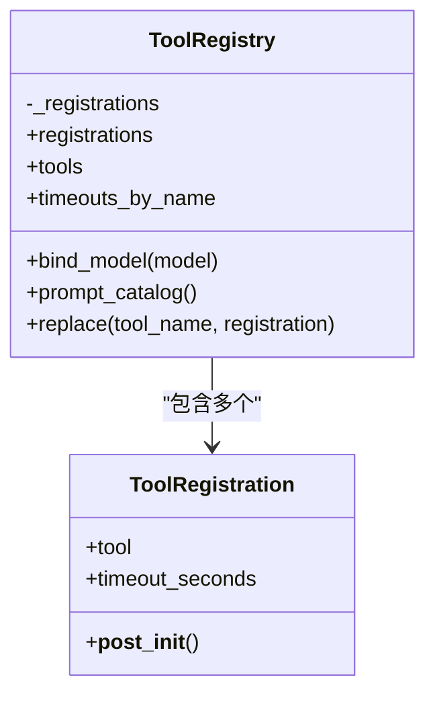
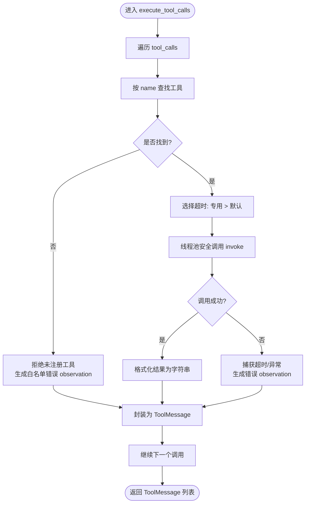
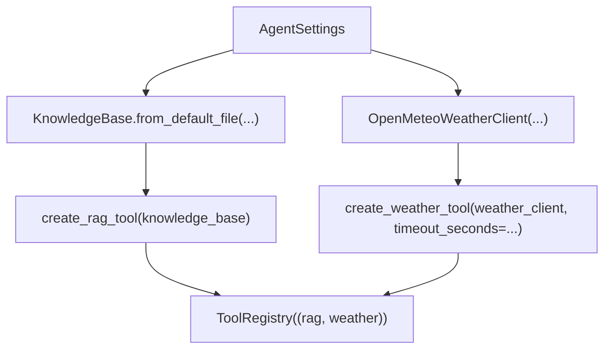
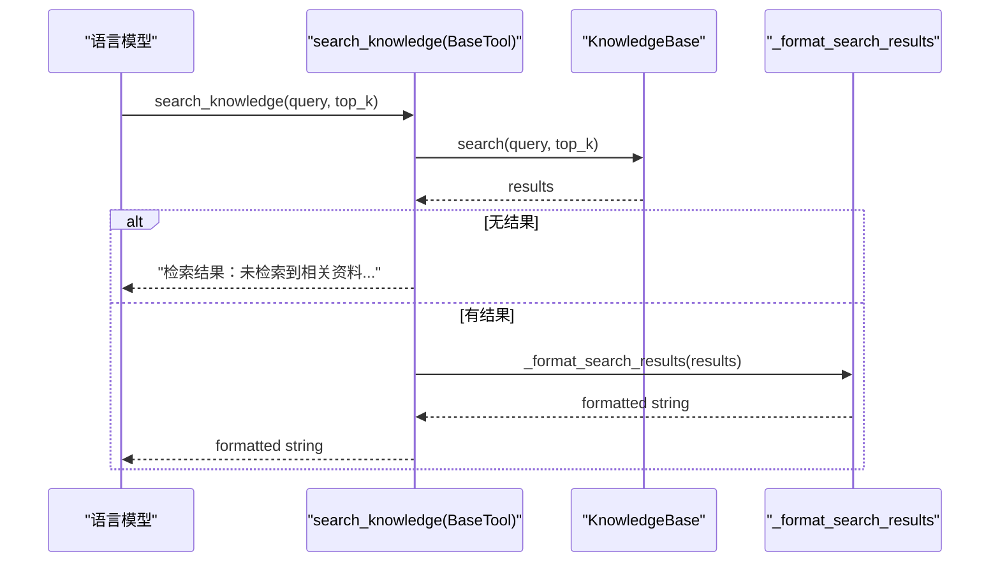
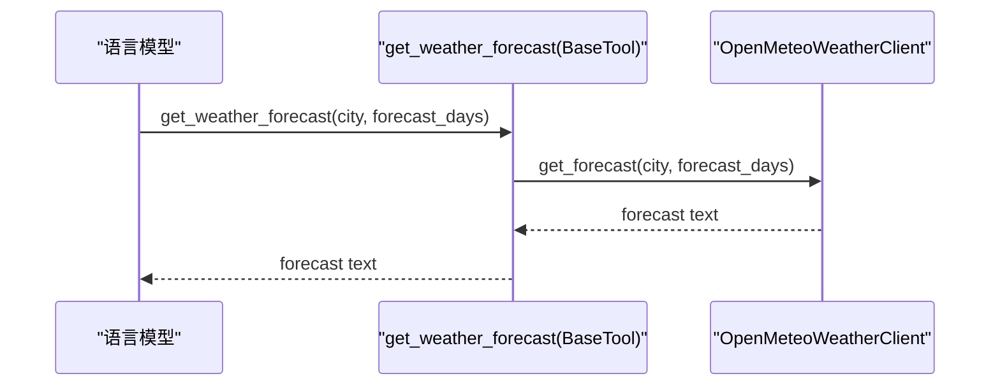
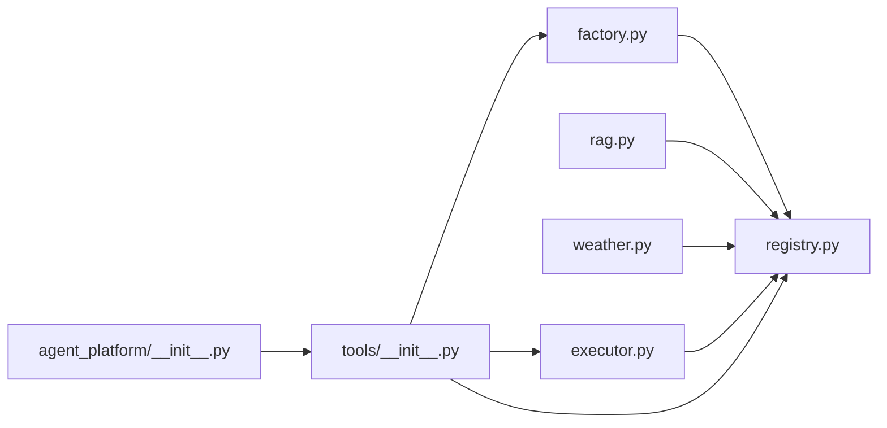

# 工具系统

<cite>
**本文引用的文件**   
- [agent_platform/__init__.py](file://agent_platform/__init__.py)
- [agent_platform/tools/__init__.py](file://agent_platform/tools/__init__.py)
- [agent_platform/tools/registry.py](file://agent_platform/tools/registry.py)
- [agent_platform/tools/executor.py](file://agent_platform/tools/executor.py)
- [agent_platform/tools/factory.py](file://agent_platform/tools/factory.py)
- [agent_platform/tools/rag.py](file://agent_platform/tools/rag.py)
- [agent_platform/tools/weather.py](file://agent_platform/tools/weather.py)
- [README.md](file://README.md)
</cite>

## 目录
1. [引言](#引言)
2. [项目结构](#项目结构)
3. [核心组件](#核心组件)
4. [架构总览](#架构总览)
5. [详细组件分析](#详细组件分析)
6. [依赖关系分析](#依赖关系分析)
7. [性能与可靠性考虑](#性能与可靠性考虑)
8. [扩展新工具的完整指南](#扩展新工具的完整指南)
9. [故障排查指南](#故障排查指南)
10. [结论](#结论)

## 引言
本文件面向工具系统的开发者与维护者，系统性说明 ToolRegistry 的设计原理、工具注册与 Schema 绑定机制、生命周期管理、白名单执行策略、超时控制、错误处理与结果格式化，并深入解析 RAG 与天气工具的适配层实现。文档同时给出工厂模式在默认工具集构建中的应用方式，以及新增工具的完整流程、测试方法与常见问题解决方案。

## 项目结构
工具系统位于 `agent_platform/tools` 子包中，围绕“注册表 + 执行器 + 领域适配层 + 组合工厂”组织代码：

**图表来源**
- [agent_platform/tools/registry.py:15-94](file://agent_platform/tools/registry.py#L15-L94)
- [agent_platform/tools/executor.py:17-67](file://agent_platform/tools/executor.py#L17-L67)
- [agent_platform/tools/factory.py:18-36](file://agent_platform/tools/factory.py#L18-L36)
- [agent_platform/tools/rag.py:14-35](file://agent_platform/tools/rag.py#L14-L35)
- [agent_platform/tools/weather.py:13-25](file://agent_platform/tools/weather.py#L13-L25)
- [agent_platform/tools/__init__.py:8-17](file://agent_platform/tools/__init__.py#L8-L17)
- [agent_platform/__init__.py:8-13](file://agent_platform/__init__.py#L8-L13)

**章节来源**
- [README.md:19-32](file://README.md#L19-L32)
- [agent_platform/tools/__init__.py:1-17](file://agent_platform/tools/__init__.py#L1-L17)
- [agent_platform/__init__.py:1-29](file://agent_platform/__init__.py#L1-L29)

## 核心组件
- ToolRegistration：描述一个工具及其运行策略（名称、Schema、说明、可选专用超时）。
- ToolRegistry：不可变工具集合，集中提供模型 Schema 绑定、Prompt 工具目录、超时映射和替换能力。
- ReadOnlyToolExecutor：只读工具执行器，负责白名单校验、超时控制、异常捕获与结果格式化。
- 工厂 build_default_tool_registry：组合根，统一构造默认工具集。
- 领域适配层 create_rag_tool / create_weather_tool：将领域服务包装为标准化工具接口。

**章节来源**
- [agent_platform/tools/registry.py:15-94](file://agent_platform/tools/registry.py#L15-L94)
- [agent_platform/tools/executor.py:17-67](file://agent_platform/tools/executor.py#L17-L67)
- [agent_platform/tools/factory.py:18-36](file://agent_platform/tools/factory.py#L18-L36)
- [agent_platform/tools/rag.py:14-35](file://agent_platform/tools/rag.py#L14-L35)
- [agent_platform/tools/weather.py:13-25](file://agent_platform/tools/weather.py#L13-L25)

## 架构总览
工具系统通过 ToolRegistry 作为单一事实源，被以下三处共享：
- 模型 bind_tools：注入工具 Schema，让模型知道可调用哪些工具。
- Prompt 工具目录：动态生成模型可见的工具清单。
- 执行器：基于白名单执行工具，并统一处理超时与错误。

**图表来源**
- [agent_platform/tools/registry.py:56-75](file://agent_platform/tools/registry.py#L56-L75)
- [agent_platform/tools/executor.py:27-67](file://agent_platform/tools/executor.py#L27-L67)

**章节来源**
- [README.md:50-63](file://README.md#L50-L63)
- [agent_platform/tools/registry.py:27-75](file://agent_platform/tools/registry.py#L27-L75)
- [agent_platform/tools/executor.py:17-67](file://agent_platform/tools/executor.py#L17-L67)

## 详细组件分析

### ToolRegistry 设计原理
ToolRegistry 是不可变工具集合，保证模型 Schema、Prompt 目录和执行器白名单三者一致，避免手工维护导致的不一致。

- 工具注册与唯一性校验
  - 构造时固化注册项为元组，检查工具名重复，失败快速报错。
- Schema 绑定
  - 暴露 tools 属性供模型 bind_tools；bind_model 方法兼容不支持绑定的替身。
- Prompt 工具目录
  - prompt_catalog 从工具 description 动态生成模型可见目录，无需硬编码。
- 生命周期管理
  - replace 返回新注册表实例，用于测试替换工具，保持原注册表不可变。
- 超时策略
  - timeouts_by_name 提供显式配置超时的工具映射，供执行器优先使用。

**图表来源**
- [agent_platform/tools/registry.py:15-94](file://agent_platform/tools/registry.py#L15-L94)

**章节来源**
- [agent_platform/tools/registry.py:15-94](file://agent_platform/tools/registry.py#L15-L94)

### 工具执行器工作流程
ReadOnlyToolExecutor 是 Agent 与具体工具之间的隔离层，负责：
- 白名单校验：仅允许注册表中的工具被调用。
- 超时控制：单工具专用超时优先，否则回落到执行器默认超时。
- 错误处理：任何异常都转为文本 observation，不向上抛出，避免 LangGraph 图崩溃。
- 结果格式化：统一封装为 ToolMessage，包含 content、tool_call_id、name。

**图表来源**
- [agent_platform/tools/executor.py:27-67](file://agent_platform/tools/executor.py#L27-L67)

**章节来源**
- [agent_platform/tools/executor.py:17-67](file://agent_platform/tools/executor.py#L17-L67)

### 工厂模式与默认工具集构建
build_default_tool_registry 是工具系统的组合根：
- 根据配置构造 KnowledgeBase 与 OpenMeteoWeatherClient。
- 通过 create_rag_tool 与 create_weather_tool 创建 ToolRegistration。
- 组装为 ToolRegistry，供模型绑定、Prompt 目录与执行器共用。

**图表来源**
- [agent_platform/tools/factory.py:18-36](file://agent_platform/tools/factory.py#L18-L36)

**章节来源**
- [agent_platform/tools/factory.py:1-37](file://agent_platform/tools/factory.py#L1-L37)

### RAG 工具适配层
RAG 适配层将领域服务 KnowledgeBase.search 包装为 LangChain 工具：
- 参数：query、top_k。
- 行为：检索知识库，若未命中则返回引导性提示，要求模型如实说明资料不足。
- 输出：格式化带 [source:...] 标识的 observation，便于模型引用来源。

**图表来源**
- [agent_platform/tools/rag.py:14-35](file://agent_platform/tools/rag.py#L14-L35)

**章节来源**
- [agent_platform/tools/rag.py:1-36](file://agent_platform/tools/rag.py#L1-L36)

### 天气工具适配层
天气适配层将 OpenMeteoWeatherClient.get_forecast 包装为 LangChain 工具：
- 参数：city、forecast_days。
- 行为：直接委托给天气客户端获取预报。
- 超时：注册时标记专用超时，覆盖执行器默认值，以应对网络延迟。

**图表来源**
- [agent_platform/tools/weather.py:13-25](file://agent_platform/tools/weather.py#L13-L25)

**章节来源**
- [agent_platform/tools/weather.py:1-26](file://agent_platform/tools/weather.py#L1-L26)

## 依赖关系分析
工具系统内部依赖清晰，耦合点集中在注册表与执行器：

**图表来源**
- [agent_platform/tools/factory.py:18-36](file://agent_platform/tools/factory.py#L18-L36)
- [agent_platform/tools/rag.py:14-35](file://agent_platform/tools/rag.py#L14-L35)
- [agent_platform/tools/weather.py:13-25](file://agent_platform/tools/weather.py#L13-L25)
- [agent_platform/tools/executor.py:17-67](file://agent_platform/tools/executor.py#L17-L67)
- [agent_platform/tools/__init__.py:8-17](file://agent_platform/tools/__init__.py#L8-L17)
- [agent_platform/__init__.py:8-13](file://agent_platform/__init__.py#L8-L13)

**章节来源**
- [agent_platform/tools/__init__.py:1-17](file://agent_platform/tools/__init__.py#L1-L17)
- [agent_platform/__init__.py:1-29](file://agent_platform/__init__.py#L1-L29)

## 性能与可靠性考虑
- 白名单机制：仅允许注册表中的工具被执行，防止模型幻觉调用未授权工具。
- 超时控制：
  - 单工具专用超时优先，适用于网络请求等不确定耗时场景。
  - 默认超时兜底，适用于本地检索等快速操作。
- 错误隔离：所有异常转换为 observation，避免 LangGraph 图整体失败。
- 线程池执行：使用 ThreadPoolExecutor 对 BaseTool.invoke 进行限时等待，确保超时可控。
- 不可变注册表：构造后不可变，减少并发竞争与状态漂移风险。

[本节为通用指导，不直接分析具体文件]

## 扩展新工具的完整指南

### 步骤一：定义领域服务
- 新建领域服务类或函数，封装业务逻辑（例如查询外部 API、访问数据库等）。
- 确保服务具备稳定的输入输出契约，便于后续包装为标准化工具。

[本节为通用指导，不直接分析具体文件]

### 步骤二：编写适配层
- 在 tools 目录下新建适配模块（如 my_tool.py），使用 @tool 装饰器将内层函数注册为 LangChain 工具。
- 函数的 docstring 即为模型可见的使用说明，应明确何时调用、传入什么参数、返回什么内容。
- 返回值为字符串 observation，必要时格式化来源标识以便模型引用。

参考路径：
- [agent_platform/tools/rag.py:14-35](file://agent_platform/tools/rag.py#L14-L35)
- [agent_platform/tools/weather.py:13-25](file://agent_platform/tools/weather.py#L13-L25)

**章节来源**
- [agent_platform/tools/rag.py:1-36](file://agent_platform/tools/rag.py#L1-L36)
- [agent_platform/tools/weather.py:1-26](file://agent_platform/tools/weather.py#L1-L26)

### 步骤三：注册工具
- 在 tools/factory.py 的 build_default_tool_registry 中，调用适配层函数创建 ToolRegistration。
- 如需专用超时，传入 timeout_seconds；否则走执行器默认超时。
- 将 ToolRegistration 加入 ToolRegistry 构造参数。

参考路径：
- [agent_platform/tools/factory.py:18-36](file://agent_platform/tools/factory.py#L18-L36)

**章节来源**
- [agent_platform/tools/factory.py:1-37](file://agent_platform/tools/factory.py#L1-L37)

### 步骤四：验证与测试
- 单元测试：使用 ToolRegistry.replace 替换工具为替身，验证白名单、超时与错误处理。
- 集成测试：通过 EvaluationRunner 与 OfflineToolCaseExecutor 运行回归案例，覆盖命中、未命中、超时、错误等场景。
- 模型绑定：确认 ToolRegistry.bind_model 能正确注入 Schema，且 prompt_catalog 生成正确的工具目录。

参考路径：
- [agent_platform/tools/registry.py:56-93](file://agent_platform/tools/registry.py#L56-L93)
- [README.md:98-108](file://README.md#L98-L108)

**章节来源**
- [agent_platform/tools/registry.py:56-93](file://agent_platform/tools/registry.py#L56-L93)
- [README.md:98-108](file://README.md#L98-L108)

## 故障排查指南
- 工具名称重复
  - 现象：构造 ToolRegistry 时报错。
  - 原因：注册表中存在同名工具。
  - 解决：检查 factory 注册逻辑，确保每个工具名唯一。
  - 参考路径：[agent_platform/tools/registry.py:30-36](file://agent_platform/tools/registry.py#L30-L36)

- 替换工具失败
  - 现象：调用 replace 报 KeyError 或 ValueError。
  - 原因：目标工具不存在或替换工具名不一致。
  - 解决：确认 tool_name 与 replacement.tool.name 一致，并确保目标工具已注册。
  - 参考路径：[agent_platform/tools/registry.py:77-93](file://agent_platform/tools/registry.py#L77-L93)

- 未注册工具被调用
  - 现象：执行器返回白名单错误 observation。
  - 原因：模型调用了未在注册表中的工具。
  - 解决：检查模型输出与注册表一致性，或在 factory 中补充该工具。
  - 参考路径：[agent_platform/tools/executor.py:31-36](file://agent_platform/tools/executor.py#L31-L36)

- 工具超时
  - 现象：返回“工具超时” observation。
  - 原因：工具执行超过专用或默认超时阈值。
  - 解决：调整 timeout_seconds 或优化领域服务性能。
  - 参考路径：[agent_platform/tools/executor.py:56-64](file://agent_platform/tools/executor.py#L56-L64)

- 工具异常
  - 现象：返回“工具错误” observation。
  - 原因：领域服务抛出异常。
  - 解决：修复领域服务错误，或在适配层增加健壮性处理。
  - 参考路径：[agent_platform/tools/executor.py:63-64](file://agent_platform/tools/executor.py#L63-L64)

- RAG 未命中
  - 现象：返回“检索结果：未检索到相关资料...”
  - 原因：知识库中没有匹配内容。
  - 解决：扩充知识库或调整检索参数（如 top_k）。
  - 参考路径：[agent_platform/tools/rag.py:20-24](file://agent_platform/tools/rag.py#L20-L24)

**章节来源**
- [agent_platform/tools/registry.py:30-36](file://agent_platform/tools/registry.py#L30-L36)
- [agent_platform/tools/registry.py:77-93](file://agent_platform/tools/registry.py#L77-L93)
- [agent_platform/tools/executor.py:31-36](file://agent_platform/tools/executor.py#L31-L36)
- [agent_platform/tools/executor.py:56-64](file://agent_platform/tools/executor.py#L56-L64)
- [agent_platform/tools/rag.py:20-24](file://agent_platform/tools/rag.py#L20-L24)

## 结论
工具系统通过 ToolRegistry 统一管理工具 Schema、Prompt 目录与执行策略，结合 ReadOnlyToolExecutor 的白名单、超时与错误处理机制，实现了稳定可靠的工具执行环境。RAG 与天气工具的适配层展示了如何将领域服务包装为标准化工具接口，而工厂模式提供了清晰的组合根，便于扩展与维护。遵循本文档的扩展指南与故障排查建议，开发者可以快速添加新工具并保障系统稳定性。

[本节为总结性内容，不直接分析具体文件]