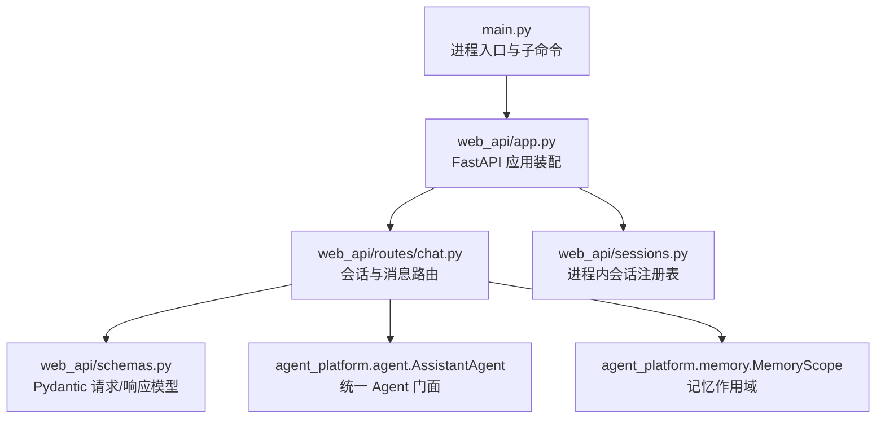
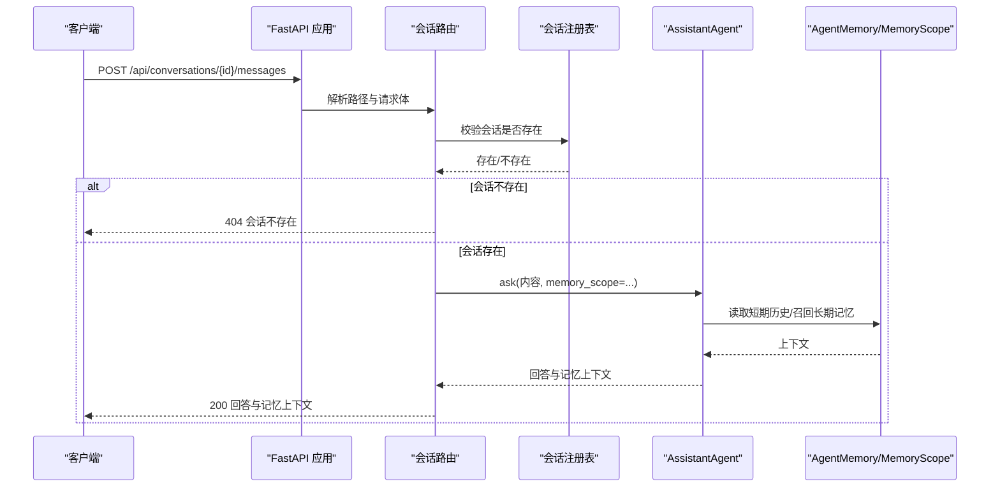
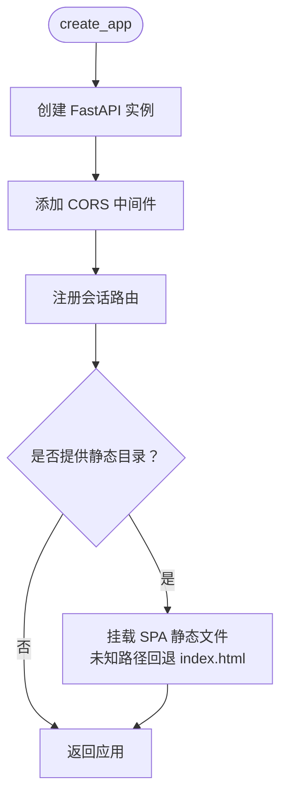
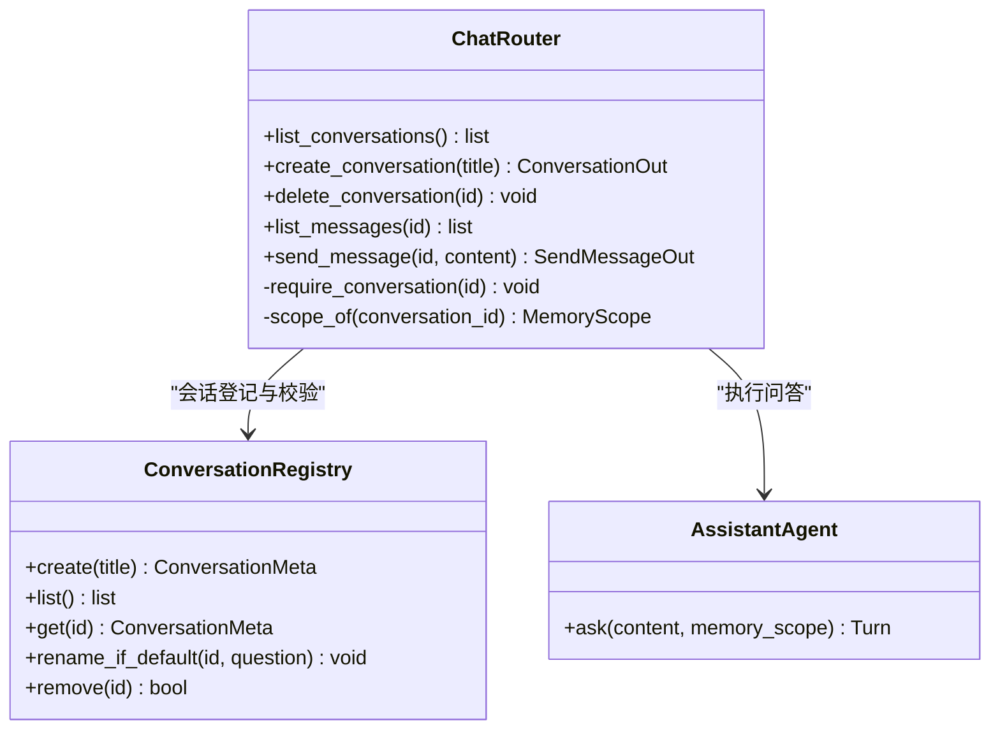
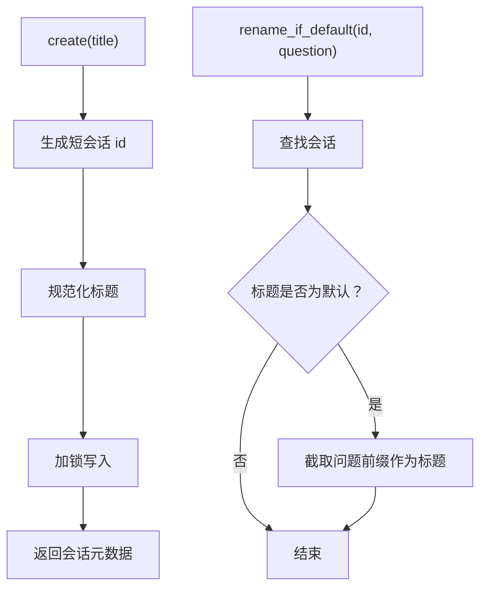
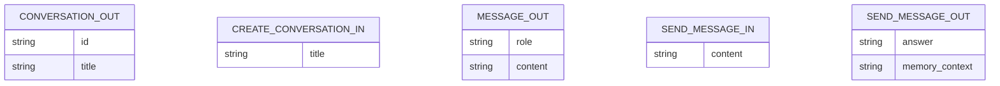
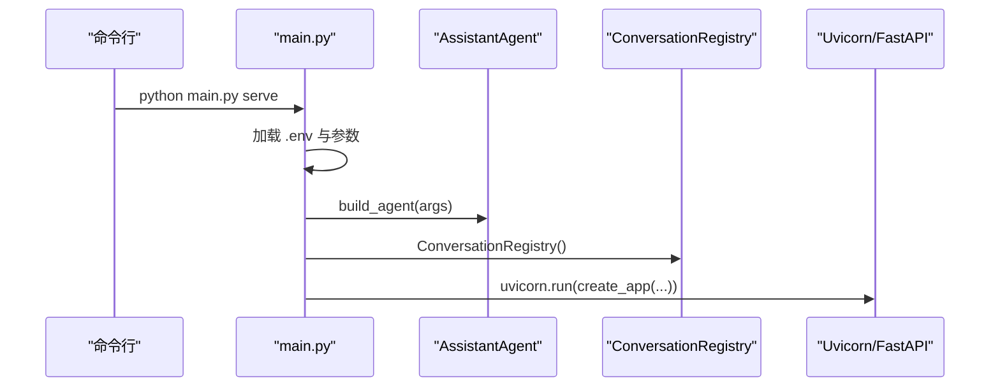
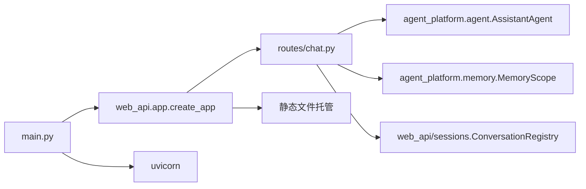

# Web API 系统

<cite>
**本文引用的文件**   
- [main.py](file://main.py)
- [README.md](file://README.md)
- [web_api/app.py](file://web_api/app.py)
- [web_api/routes/chat.py](file://web_api/routes/chat.py)
- [web_api/schemas.py](file://web_api/schemas.py)
- [web_api/sessions.py](file://web_api/sessions.py)
</cite>

## 目录
1. [简介](#简介)
2. [项目结构](#项目结构)
3. [核心组件](#核心组件)
4. [架构总览](#架构总览)
5. [详细组件分析](#详细组件分析)
6. [依赖关系分析](#依赖关系分析)
7. [性能与并发特性](#性能与并发特性)
8. [故障排查指南](#故障排查指南)
9. [结论](#结论)
10. [附录：API 定义](#附录api-定义)

## 简介
本仓库的 Web API 系统基于 FastAPI，为 LangChain/LangGraph Agent 提供多会话聊天能力。后端通过统一的 `AssistantAgent` 调用模型与工具，结合短期记忆（会话窗口）与长期记忆（用户偏好），对外暴露会话创建、消息收发等接口；可选托管前端构建产物，形成完整的对话界面体验。

该文档聚焦 Web API 层的设计、数据流、错误处理与扩展方式，帮助开发者快速理解并安全地集成或二次开发。

## 项目结构
Web API 相关代码集中在 `web_api/` 目录，由入口脚本 `main.py` 装配并启动：

**图表来源**
- [main.py:111-125](file://main.py#L111-L125)
- [web_api/app.py:38-58](file://web_api/app.py#L38-L58)
- [web_api/routes/chat.py:24-77](file://web_api/routes/chat.py#L24-L77)
- [web_api/sessions.py:24-61](file://web_api/sessions.py#L24-L61)
- [web_api/schemas.py:1-37](file://web_api/schemas.py#L1-L37)

**章节来源**
- [main.py:1-154](file://main.py#L1-L154)
- [README.md:46-57](file://README.md#L46-L57)

## 核心组件
- **应用装配器**：负责创建 FastAPI 实例、挂载 CORS、注册路由、可选托管 SPA 静态资源。
- **会话路由**：实现会话 CRUD 与消息发送，将业务逻辑委托给 `AssistantAgent` 与 `ConversationRegistry`。
- **会话注册表**：进程内保存会话 id 到元数据的映射，提供线程安全的增删改查与自动命名。
- **数据模型**：使用 Pydantic 统一校验请求与响应结构，避免在路由中重复判空。
- **入口装配**：`main.py` 根据子命令构造 Agent、注入会话注册表并启动 Uvicorn。

**章节来源**
- [web_api/app.py:1-59](file://web_api/app.py#L1-L59)
- [web_api/routes/chat.py:1-89](file://web_api/routes/chat.py#L1-L89)
- [web_api/sessions.py:1-62](file://web_api/sessions.py#L1-L62)
- [web_api/schemas.py:1-37](file://web_api/schemas.py#L1-L37)
- [main.py:111-125](file://main.py#L111-L125)

## 架构总览
Web API 采用“薄路由 + 领域服务”的分层思路：路由只负责参数校验、会话存在性检查与结果序列化，核心推理与记忆访问交给 `AssistantAgent` 与 `AgentMemory`。

**图表来源**
- [web_api/routes/chat.py:69-77](file://web_api/routes/chat.py#L69-L77)
- [web_api/sessions.py:46-50](file://web_api/sessions.py#L46-L50)
- [main.py:111-125](file://main.py#L111-L125)

## 详细组件分析

### 应用装配器：FastAPI 应用与静态托管
- 创建 FastAPI 实例并启用 CORS，便于本地 Vite 开发服务器跨域访问。
- 通过闭包注入 `AssistantAgent` 与 `ConversationRegistry`，避免全局单例，提升可测试性。
- 当存在前端构建目录时，挂载 SPA 静态文件并提供 404 回退到 `index.html`，保证前端路由刷新可用。

**图表来源**
- [web_api/app.py:38-58](file://web_api/app.py#L38-L58)

**章节来源**
- [web_api/app.py:1-59](file://web_api/app.py#L1-L59)

### 会话路由：CRUD 与消息收发
- 会话列表、创建、删除与消息查询均基于 `ConversationRegistry` 进行权限与存在性校验。
- 消息发送会先尝试按首条问题自动重命名默认标题，再调用 `AssistantAgent.ask`。
- 返回的消息仅包含人类消息与最终 AI 回复，过滤掉带工具调用的中间消息，降低前端复杂度。

**图表来源**
- [web_api/routes/chat.py:24-89](file://web_api/routes/chat.py#L24-L89)
- [web_api/sessions.py:24-61](file://web_api/sessions.py#L24-L61)

**章节来源**
- [web_api/routes/chat.py:1-89](file://web_api/routes/chat.py#L1-L89)

### 会话注册表：进程内会话状态
- 使用字典存储会话 id 到元数据的映射，并用读写锁保证并发安全。
- 支持默认标题、自动命名、幂等删除等操作。
- 当前为进程内实现，未来替换为数据库实现时，路由层无需修改。

**图表来源**
- [web_api/sessions.py:31-56](file://web_api/sessions.py#L31-L56)

**章节来源**
- [web_api/sessions.py:1-62](file://web_api/sessions.py#L1-L62)

### 数据模型：Pydantic 校验契约
- 会话输出包含 id 与 title。
- 新建会话允许省略标题，服务端给出默认名。
- 消息输入限制长度，防止空转模型；输出包含回答与长期记忆上下文摘要。

**图表来源**
- [web_api/schemas.py:6-36](file://web_api/schemas.py#L6-L36)

**章节来源**
- [web_api/schemas.py:1-37](file://web_api/schemas.py#L1-L37)

### 入口装配：CLI 子命令与 Web 服务启动
- `serve` 子命令加载 `.env`，构造 Agent 与会话注册表，并通过 Uvicorn 启动 FastAPI。
- 前端构建产物存在时一并托管；否则仅提供 `/api` 接口。
- 评测子命令独立运行离线回归套件，不进入 Web 流程。

**图表来源**
- [main.py:128-149](file://main.py#L128-L149)
- [web_api/app.py:38-58](file://web_api/app.py#L38-L58)

**章节来源**
- [main.py:1-154](file://main.py#L1-L154)

## 依赖关系分析
- 路由层依赖：
  - `AssistantAgent`：统一封装模型调用、工具执行与记忆组合。
  - `MemoryScope`：决定短期会话与长期记忆的隔离边界。
  - `ConversationRegistry`：管理会话生命周期。
- 应用层依赖：
  - FastAPI、CORS、静态文件托管。
  - 可选前端构建目录用于 SPA 托管。
- 外部依赖：
  - Uvicorn 作为 ASGI 服务器。
  - 模型提供方（OpenAI 或其他兼容接口）由环境变量配置。

**图表来源**
- [web_api/routes/chat.py:11-21](file://web_api/routes/chat.py#L11-L21)
- [web_api/app.py:16-19](file://web_api/app.py#L16-L19)
- [main.py:111-125](file://main.py#L111-L125)

**章节来源**
- [web_api/routes/chat.py:1-89](file://web_api/routes/chat.py#L1-L89)
- [web_api/app.py:1-59](file://web_api/app.py#L1-L59)
- [main.py:1-154](file://main.py#L1-L154)

## 性能与并发特性
- 同步路由函数由 FastAPI 放入线程池执行，避免阻塞事件循环。
- 会话注册表使用读写锁保护进程内字典，确保并发安全。
- 短期记忆按 `MemoryScope` 串行化同一会话的完整问答过程，避免并发覆盖；不同会话可并发执行。
- 长期记忆按用户维度共享，跨会话召回偏好与约束。

建议：
- 在高并发场景下，优先评估 `ConversationRegistry` 与 `AgentMemory` 的持久化方案。
- 对长耗时模型调用，考虑引入异步任务队列与超时控制。
- 对前端展示的历史消息，保持服务端过滤工具中间态，减少传输体积。

[本节为通用指导，不直接分析具体文件]

## 故障排查指南
- 会话 404：
  - 现象：访问某会话消息或发送消息时报 404。
  - 原因：会话未在注册表中登记或被删除。
  - 处理：先调用创建会话接口，确认返回 id 后再使用该 id 发消息。
  - 参考位置：[web_api/routes/chat.py:39-43](file://web_api/routes/chat.py#L39-L43)、[web_api/sessions.py:46-50](file://web_api/sessions.py#L46-L50)

- 模型未配置：
  - 现象：真实模式启动时报错提示缺少 API Key。
  - 原因：未设置 `MODEL_API_KEY` 环境变量。
  - 处理：复制示例环境文件并填写必要字段，或使用 `--mock` 离线体验。
  - 参考位置：[main.py:26-44](file://main.py#L26-L44)

- 前端路由刷新 404：
  - 现象：刷新前端页面出现 404。
  - 原因：静态文件未正确挂载或路径不匹配。
  - 处理：确保传入有效的静态目录，且路由注册顺序让 `/api` 优先匹配。
  - 参考位置：[web_api/app.py:25-35](file://web_api/app.py#L25-L35)、[web_api/app.py:55-58](file://web_api/app.py#L55-L58)

- 消息为空被拒绝：
  - 现象：发送空消息被校验失败。
  - 原因：请求体 `content` 长度小于最小值。
  - 处理：确保客户端传递非空文本。
  - 参考位置：[web_api/schemas.py:26-29](file://web_api/schemas.py#L26-L29)

**章节来源**
- [web_api/routes/chat.py:39-43](file://web_api/routes/chat.py#L39-L43)
- [web_api/sessions.py:46-50](file://web_api/sessions.py#L46-L50)
- [main.py:26-44](file://main.py#L26-L44)
- [web_api/app.py:25-35](file://web_api/app.py#L25-L35)
- [web_api/app.py:55-58](file://web_api/app.py#L55-L58)
- [web_api/schemas.py:26-29](file://web_api/schemas.py#L26-L29)

## 结论
Web API 系统以 FastAPI 为核心，围绕 `AssistantAgent` 提供简洁稳定的会话与消息接口。通过进程内会话注册表与 Agent 记忆子系统，实现了短期会话隔离与长期记忆共享。整体设计强调低耦合、易替换与可扩展：路由层职责清晰，数据模型统一校验，外部依赖通过构造函数注入，便于测试与演进。

## 附录：API 定义
- 基础路径：`/api/conversations`
- 会话列表：GET `/api/conversations`
  - 响应：会话 id 与标题数组
- 创建会话：POST `/api/conversations`
  - 请求体：可选标题
  - 响应：新会话 id 与标题
- 删除会话：DELETE `/api/conversations/{conversation_id}`
  - 行为：移除会话登记并清理短期历史
- 获取消息：GET `/api/conversations/{conversation_id}/messages`
  - 响应：用户消息与助手最终回复
- 发送消息：POST `/api/conversations/{conversation_id}/messages`
  - 请求体：非空文本
  - 响应：回答与长期记忆上下文

**章节来源**
- [web_api/routes/chat.py:44-77](file://web_api/routes/chat.py#L44-L77)
- [web_api/schemas.py:6-36](file://web_api/schemas.py#L6-L36)