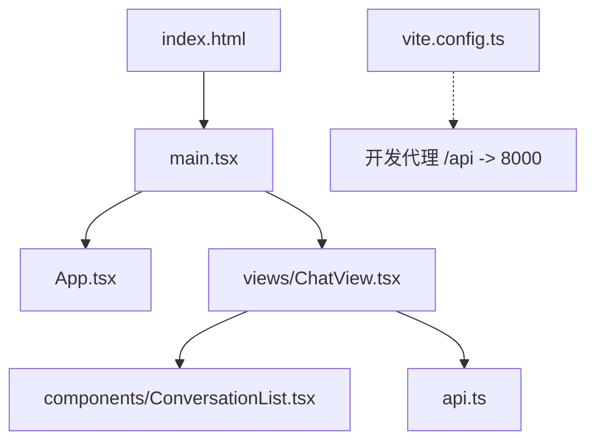
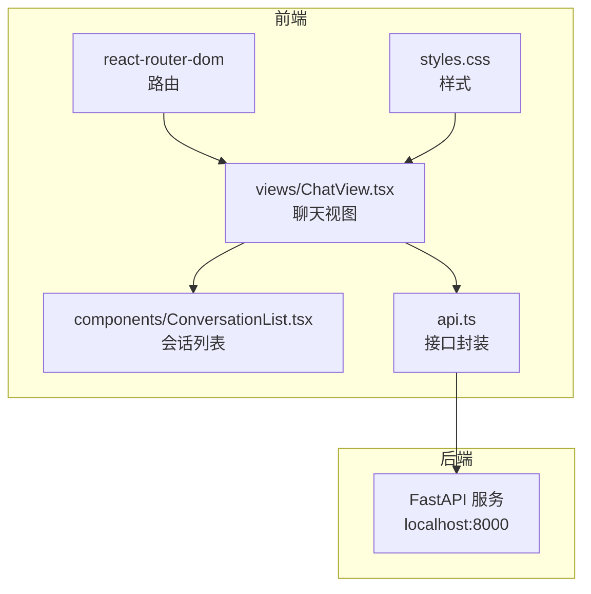
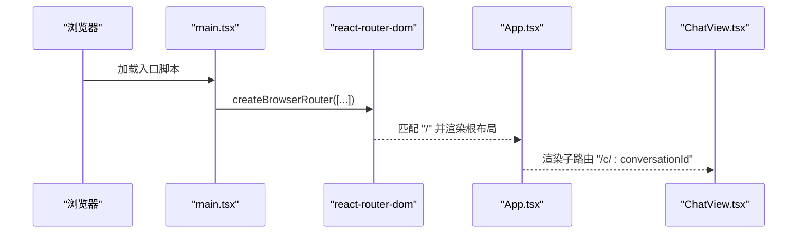
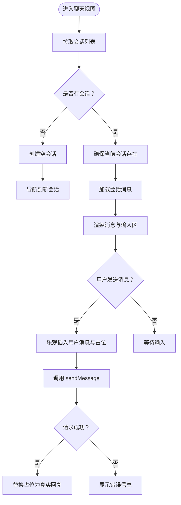
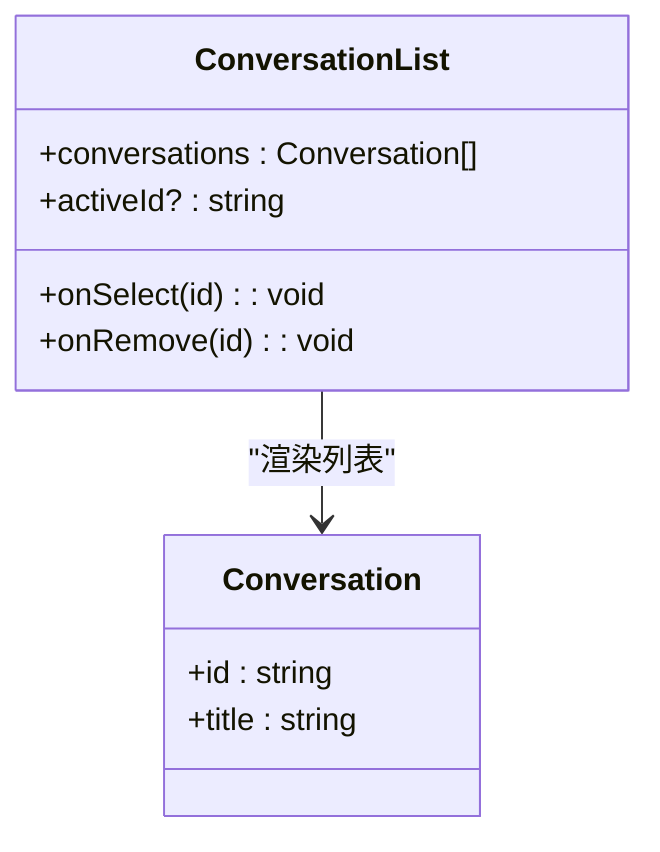
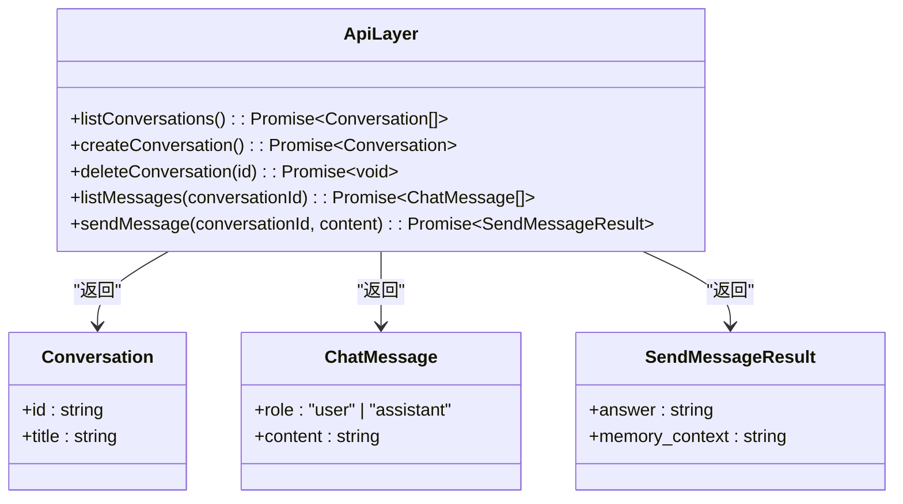
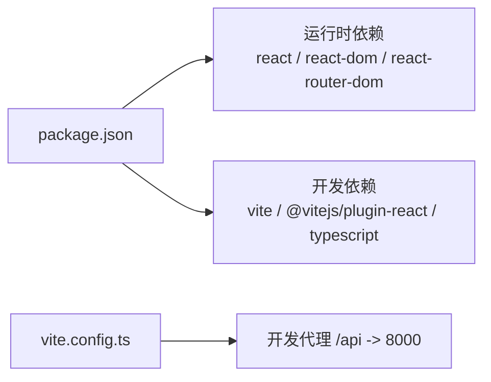

# 前端 React 应用

<cite>
**本文引用的文件**   
- [web_ui/src/main.tsx](file://web_ui/src/main.tsx)
- [web_ui/src/App.tsx](file://web_ui/src/App.tsx)
- [web_ui/src/views/ChatView.tsx](file://web_ui/src/views/ChatView.tsx)
- [web_ui/src/components/ConversationList.tsx](file://web_ui/src/components/ConversationList.tsx)
- [web_ui/src/api.ts](file://web_ui/src/api.ts)
- [web_ui/vite.config.ts](file://web_ui/vite.config.ts)
- [web_ui/package.json](file://web_ui/package.json)
- [web_ui/index.html](file://web_ui/index.html)
- [web_ui/src/styles.css](file://web_ui/src/styles.css)
</cite>

## 目录
1. [简介](#简介)
2. [项目结构](#项目结构)
3. [核心组件](#核心组件)
4. [架构总览](#架构总览)
5. [详细组件分析](#详细组件分析)
6. [依赖关系分析](#依赖关系分析)
7. [性能与体验优化](#性能与体验优化)
8. [故障排查指南](#故障排查指南)
9. [结论](#结论)

## 简介
本仓库的前端是一个基于 React、TypeScript、Vite 和 react-router-dom 的聊天界面，用于与后端 FastAPI 服务交互。它提供会话列表管理、消息历史加载、发送消息以及展示长期记忆召回上下文等能力。开发模式下通过 Vite 代理将 `/api` 请求转发到本地 8000 端口的后端；生产模式由后端直接托管构建产物。

## 项目结构
前端位于 `web_ui` 目录，采用按功能划分的目录组织方式：
- `src/main.tsx`：应用入口，创建路由并挂载根组件。
- `src/App.tsx`：根布局组件，当前仅作为路由出口。
- `src/views/ChatView.tsx`：聊天主视图，负责会话切换、消息流与输入交互。
- `src/components/ConversationList.tsx`：侧边栏会话列表组件。
- `src/api.ts`：统一的后端接口封装，定义数据模型与 HTTP 调用。
- `vite.config.ts`：Vite 配置，包含开发代理。
- `package.json`：依赖与脚本。
- `index.html`：HTML 模板。
- `src/styles.css`：全局样式与布局。

**图表来源**
- [web_ui/index.html:1-13](file://web_ui/index.html#L1-L13)
- [web_ui/src/main.tsx:1-26](file://web_ui/src/main.tsx#L1-L26)
- [web_ui/src/App.tsx:1-7](file://web_ui/src/App.tsx#L1-L7)
- [web_ui/src/views/ChatView.tsx:1-176](file://web_ui/src/views/ChatView.tsx#L1-L176)
- [web_ui/src/components/ConversationList.tsx:1-37](file://web_ui/src/components/ConversationList.tsx#L1-L37)
- [web_ui/src/api.ts:1-48](file://web_ui/src/api.ts#L1-L48)
- [web_ui/vite.config.ts:1-14](file://web_ui/vite.config.ts#L1-L14)

**章节来源**
- [web_ui/index.html:1-13](file://web_ui/index.html#L1-L13)
- [web_ui/src/main.tsx:1-26](file://web_ui/src/main.tsx#L1-L26)
- [web_ui/src/App.tsx:1-7](file://web_ui/src/App.tsx#L1-L7)
- [web_ui/src/views/ChatView.tsx:1-176](file://web_ui/src/views/ChatView.tsx#L1-L176)
- [web_ui/src/components/ConversationList.tsx:1-37](file://web_ui/src/components/ConversationList.tsx#L1-L37)
- [web_ui/src/api.ts:1-48](file://web_ui/src/api.ts#L1-L48)
- [web_ui/vite.config.ts:1-14](file://web_ui/vite.config.ts#L1-L14)

## 核心组件
- 应用入口与路由：在入口文件中创建浏览器路由，定义根路径与聊天页面路径，并将根布局与聊天视图组合。
- 根布局：当前仅渲染子路由出口，便于后续扩展全局导航或鉴权逻辑。
- 聊天视图：维护会话列表、消息状态、输入内容与发送状态；处理新建、删除、切换会话与发送消息；支持乐观更新与错误回退。
- 会话列表：展示会话标题，支持点击切换与悬停删除。
- API 层：集中封装所有后端接口，定义会话与消息的数据模型，并提供统一的请求函数以处理响应体与错误。

**章节来源**
- [web_ui/src/main.tsx:1-26](file://web_ui/src/main.tsx#L1-L26)
- [web_ui/src/App.tsx:1-7](file://web_ui/src/App.tsx#L1-L7)
- [web_ui/src/views/ChatView.tsx:1-176](file://web_ui/src/views/ChatView.tsx#L1-L176)
- [web_ui/src/components/ConversationList.tsx:1-37](file://web_ui/src/components/ConversationList.tsx#L1-L37)
- [web_ui/src/api.ts:1-48](file://web_ui/src/api.ts#L1-L48)

## 架构总览
前端采用“视图 + 组件 + API 层”的分层结构：
- 视图层（Views）：承载页面级逻辑与用户交互。
- 组件层（Components）：复用 UI 片段，如会话列表。
- API 层：屏蔽网络细节，向上暴露类型安全的接口方法。
- 路由层：使用 react-router-dom 管理页面与参数。
- 构建与开发：Vite 提供热更新与开发代理，打包后由后端托管。

**图表来源**
- [web_ui/src/main.tsx:1-26](file://web_ui/src/main.tsx#L1-L26)
- [web_ui/src/views/ChatView.tsx:1-176](file://web_ui/src/views/ChatView.tsx#L1-L176)
- [web_ui/src/components/ConversationList.tsx:1-37](file://web_ui/src/components/ConversationList.tsx#L1-L37)
- [web_ui/src/api.ts:1-48](file://web_ui/src/api.ts#L1-L48)
- [web_ui/src/styles.css:1-222](file://web_ui/src/styles.css#L1-L222)

## 详细组件分析

### 应用入口与路由
- 入口文件创建浏览器路由，定义根路径 `/` 与聊天路径 `/c/:conversationId`，并通过 `<Outlet />` 渲染子路由。
- 根布局组件目前只返回路由出口，为后续添加全局导航或登录态预留扩展点。

**图表来源**
- [web_ui/src/main.tsx:1-26](file://web_ui/src/main.tsx#L1-L26)
- [web_ui/src/App.tsx:1-7](file://web_ui/src/App.tsx#L1-L7)

**章节来源**
- [web_ui/src/main.tsx:1-26](file://web_ui/src/main.tsx#L1-L26)
- [web_ui/src/App.tsx:1-7](file://web_ui/src/App.tsx#L1-L7)

### 聊天视图 ChatView
职责与行为：
- 初始化时拉取会话列表；若为空则自动创建一个会话，并导航到该会话。
- 根据 URL 中的 `conversationId` 加载对应会话的消息历史。
- 支持新建会话、删除会话、切换会话。
- 发送消息时进行乐观更新：先插入用户消息与“思考中”占位，收到响应后替换占位；若失败则显示错误信息。
- 使用 ref 跟踪活跃会话 ID，避免异步响应污染其他会话的消息流。
- 新消息到达时自动滚动到底部。

**图表来源**
- [web_ui/src/views/ChatView.tsx:1-176](file://web_ui/src/views/ChatView.tsx#L1-L176)
- [web_ui/src/api.ts:1-48](file://web_ui/src/api.ts#L1-L48)

**章节来源**
- [web_ui/src/views/ChatView.tsx:1-176](file://web_ui/src/views/ChatView.tsx#L1-L176)

### 会话列表组件 ConversationList
职责与行为：
- 接收会话数组、当前激活会话 ID、选择回调与删除回调。
- 渲染每个会话项，高亮当前会话。
- 点击整行触发切换会话；悬停显示删除按钮，阻止事件冒泡以避免误触切换。

**图表来源**
- [web_ui/src/components/ConversationList.tsx:1-37](file://web_ui/src/components/ConversationList.tsx#L1-L37)
- [web_ui/src/api.ts:1-48](file://web_ui/src/api.ts#L1-L48)

**章节来源**
- [web_ui/src/components/ConversationList.tsx:1-37](file://web_ui/src/components/ConversationList.tsx#L1-L37)

### API 层 api.ts
职责与行为：
- 定义会话与消息的数据模型，包括角色枚举、内容字段与发送结果结构。
- 提供统一的 `request<T>` 函数，设置 JSON 头、处理非 2xx 响应、兼容 204 No Content。
- 暴露会话与消息相关的方法：列出会话、创建会话、删除会话、列出消息、发送消息。

**图表来源**
- [web_ui/src/api.ts:1-48](file://web_ui/src/api.ts#L1-L48)

**章节来源**
- [web_ui/src/api.ts:1-48](file://web_ui/src/api.ts#L1-L48)

### 样式与布局 styles.css
- 两栏布局：左侧固定宽度侧栏，右侧自适应聊天区域。
- 侧栏：深色背景，会话列表可滚动，当前会话高亮，悬停显示删除按钮。
- 聊天区：气泡样式区分用户与助手消息，支持长文本换行与滚动。
- 输入区：多行文本框与发送按钮，禁用态与悬停态样式。

**章节来源**
- [web_ui/src/styles.css:1-222](file://web_ui/src/styles.css#L1-L222)

## 依赖关系分析
- 运行时依赖：React、ReactDOM、react-router-dom。
- 开发依赖：Vite、@vitejs/plugin-react、TypeScript、类型声明包。
- 构建脚本：dev、build、preview。
- 开发代理：Vite 将 `/api` 请求代理到 `http://localhost:8000`。

**图表来源**
- [web_ui/package.json:1-24](file://web_ui/package.json#L1-L24)
- [web_ui/vite.config.ts:1-14](file://web_ui/vite.config.ts#L1-L14)

**章节来源**
- [web_ui/package.json:1-24](file://web_ui/package.json#L1-L24)
- [web_ui/vite.config.ts:1-14](file://web_ui/vite.config.ts#L1-L14)

## 性能与体验优化
- 乐观更新：发送消息后立即插入用户消息与占位，提升感知速度；成功后替换占位，失败时回退为错误提示。
- 会话切换隔离：使用 ref 记录活跃会话 ID，避免异步响应污染其他会话的消息流。
- 滚动优化：新消息到达时平滑滚动到底部，提升阅读体验。
- 路由驱动状态：会话切换由 URL 参数驱动，减少不必要的状态同步开销。
- 条件渲染：仅在存在会话时加载消息，避免无效请求。

[本节为通用指导，不直接分析具体文件]

## 故障排查指南
常见问题与定位思路：
- 无法连接后端
  - 检查开发模式下 Vite 代理是否生效，确认 `/api` 请求被转发到 `http://localhost:8000`。
  - 确认后端服务已启动且端口为 8000。
- 接口报错
  - API 层对非 2xx 响应抛出错误，查看控制台错误信息与状态码。
  - 204 No Content 会被视为无响应体，不会尝试解析 JSON。
- 消息未更新或错乱
  - 检查活跃会话 ID 是否与当前 URL 一致，避免异步响应写入旧会话。
  - 切换会话时会清空消息列表并重新拉取，确认 URL 参数是否正确。
- 样式异常
  - 检查全局样式是否引入，确认 CSS 类名与组件结构匹配。

**章节来源**
- [web_ui/src/api.ts:18-28](file://web_ui/src/api.ts#L18-L28)
- [web_ui/src/views/ChatView.tsx:88-115](file://web_ui/src/views/ChatView.tsx#L88-L115)
- [web_ui/vite.config.ts:4-12](file://web_ui/vite.config.ts#L4-L12)

## 结论
该前端应用以清晰的层次结构与类型安全的数据模型为基础，提供了完整的聊天交互流程。通过路由驱动与会话隔离策略，保证了多会话场景下的稳定性；乐观更新与滚动优化提升了用户体验。开发代理简化了前后端联调，生产环境可由后端直接托管静态资源。整体代码简洁、职责明确，易于扩展与维护。