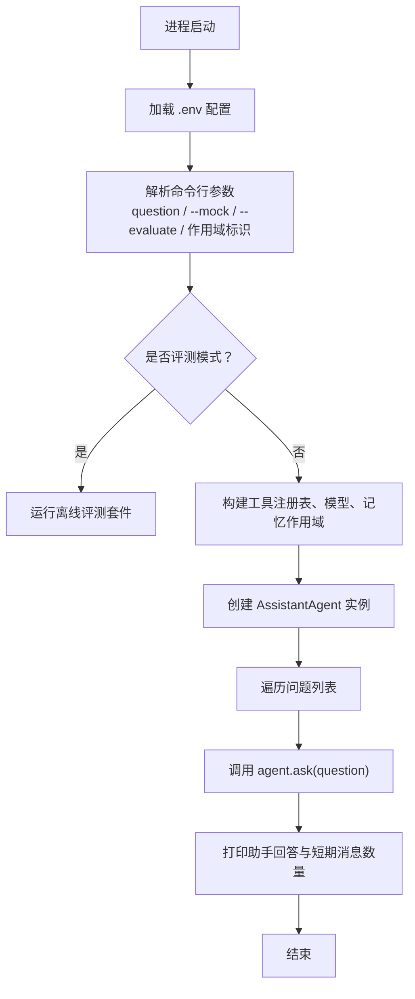
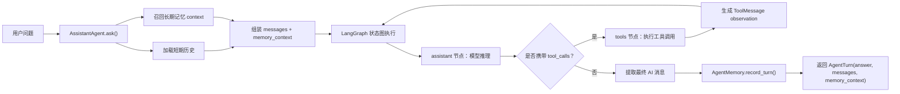
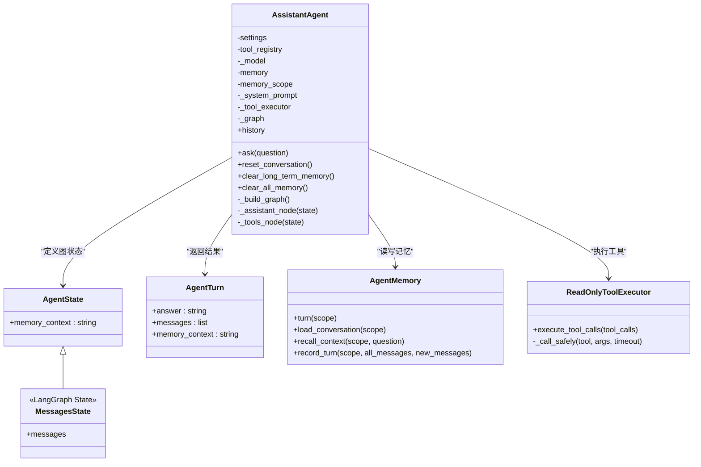
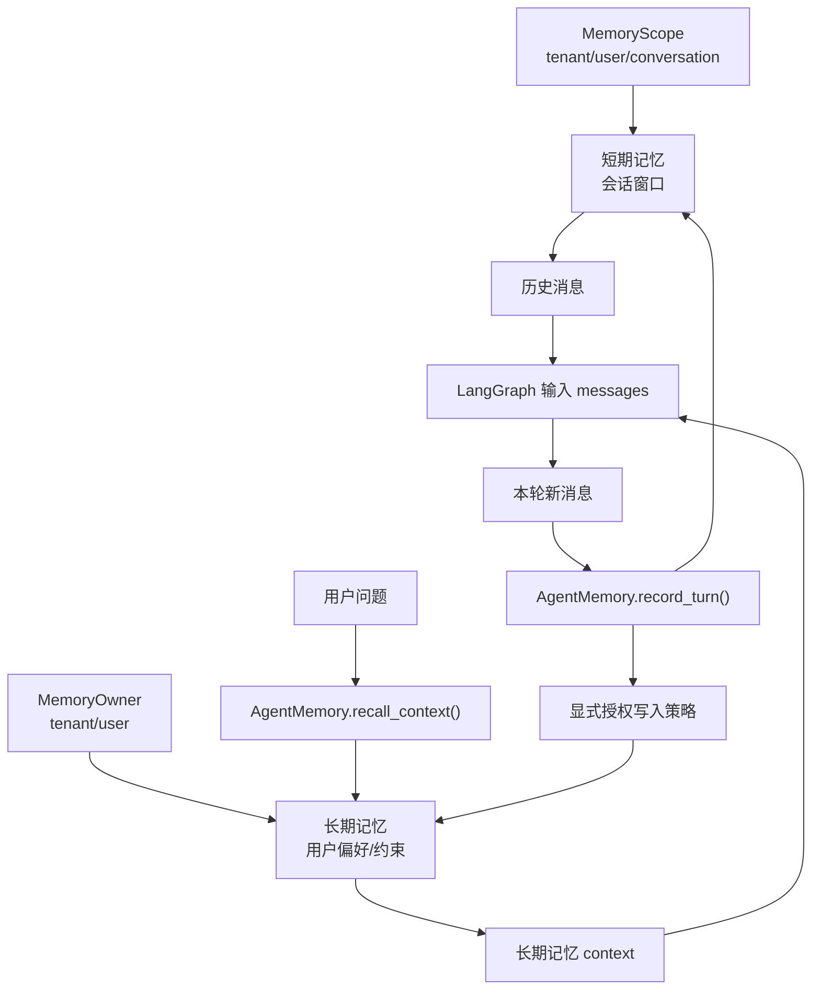
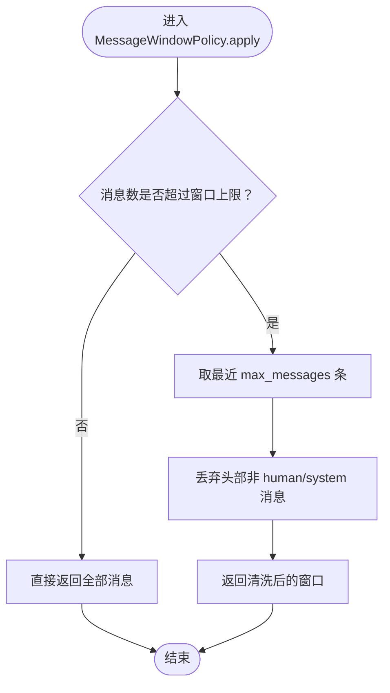
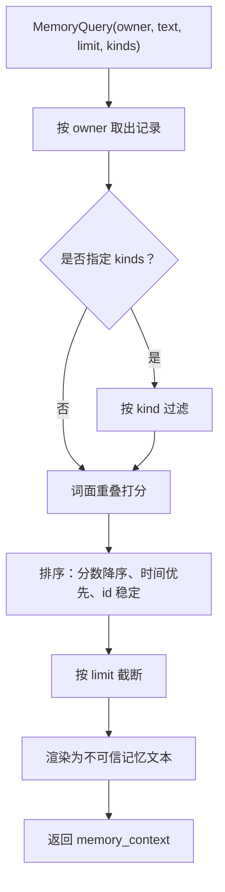
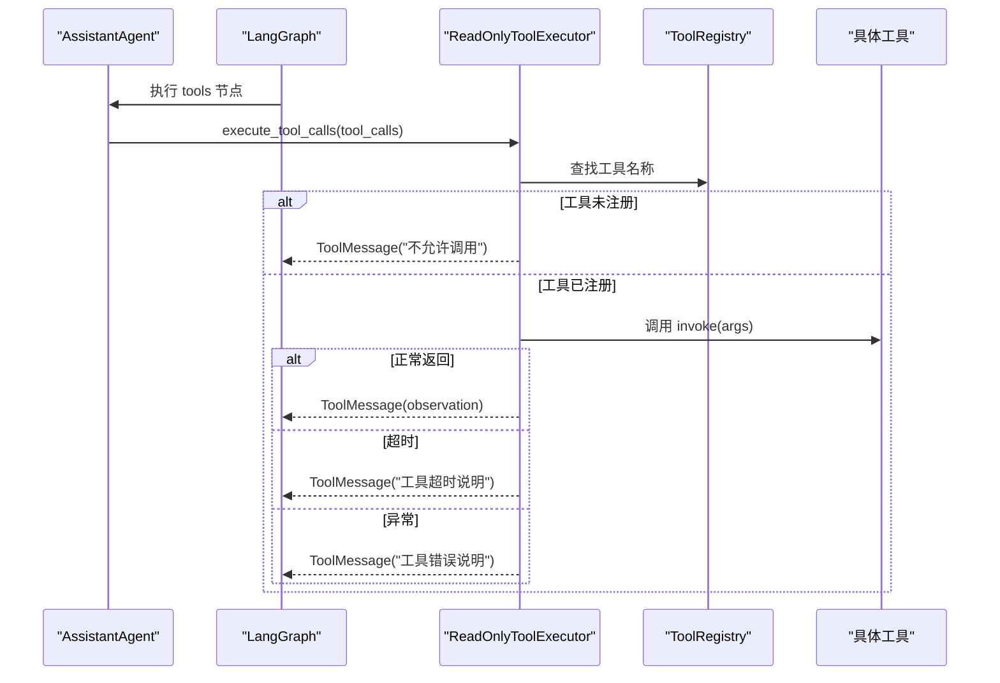
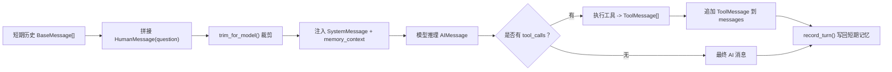
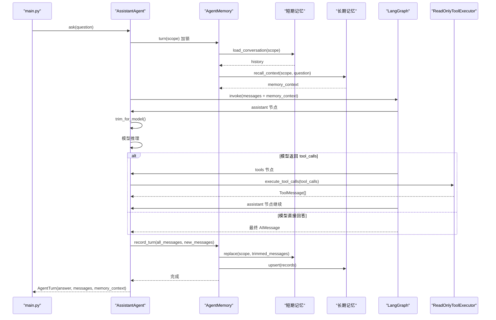

# 数据流设计

<cite>
**本文引用的文件**   
- [main.py](file://main.py)
- [agent.py](file://agent_platform/agent.py)
- [service.py](file://agent_platform/memory/service.py)
- [short_term.py](file://agent_platform/memory/short_term.py)
- [long_term.py](file://agent_platform/memory/long_term.py)
- [models.py](file://agent_platform/memory/models.py)
- [executor.py](file://agent_platform/tools/executor.py)
- [registry.py](file://agent_platform/tools/registry.py)
- [factory.py](file://agent_platform/tools/factory.py)
- [config.py](file://agent_platform/config.py)
- [README.md](file://README.md)
</cite>

## 目录
1. [引言](#引言)
2. [项目结构与入口](#项目结构与入口)
3. [核心组件与职责](#核心组件与职责)
4. [端到端数据流总览](#端到端数据流总览)
5. [LangGraph 状态图与 AgentState](#langgraph-状态图与-agentstate)
6. [短期记忆与长期记忆的数据流转](#短期记忆与长期记忆的数据流转)
7. [工具调用与错误处理](#工具调用与错误处理)
8. [消息序列化与跨组件转换](#消息序列化与跨组件转换)
9. [关键时序图](#关键时序图)
10. [一致性、并发与性能考量](#一致性并发与性能考量)
11. [故障排查指南](#故障排查指南)
12. [结论](#结论)

## 引言
本文面向 Agent Platform 的数据流设计，目标是完整描述从用户输入到最终答案返回的链路：用户问题 → `AssistantAgent.ask()` → 加载短期历史 → 召回长期记忆 → LangGraph 状态图执行 → 工具调用 → 记忆更新 → 答案返回。文档同时解释 `AgentState` 在 LangGraph 中的状态传递机制，重点说明 `messages` 和 `memory_context` 字段的作用，并给出消息在不同组件间的转换、序列化方式、错误处理策略和数据一致性保证。

## 项目结构与入口
应用启动入口位于顶层 `main.py`，负责解析命令行参数、加载 `.env`、选择真实模型或离线 mock、构造工具注册表、记忆作用域和 `AssistantAgent`，然后逐条问题驱动问答。

**图表来源**
- [main.py:43-90](file://main.py#L43-L90)

**章节来源**
- [main.py:1-95](file://main.py#L1-L95)
- [README.md:19-48](file://README.md#L19-L48)

## 核心组件与职责
- `AssistantAgent`：编排模型、工具注册表、记忆门面和 LangGraph 状态图；对外暴露 `ask()` 作为一轮问答入口。
- `AgentMemory`：短期会话、长期召回和写入策略的组合门面，提供按作用域的串行化访问。
- `InMemoryShortTermMemory`：进程内短期消息窗口，支持裁剪、覆盖、清空。
- `InMemoryLongTermMemory`：进程内长期记忆实现，按用户归属隔离，支持 upsert、检索、清理。
- `ReadOnlyToolExecutor`：统一执行工具调用，将未注册、超时、异常转换为模型可见的 observation。
- `ToolRegistry`：集中管理工具、超时策略与供模型阅读的工具目录，避免 Schema、Prompt 和执行器漂移。
- `AgentSettings`：集中放置系统 Prompt、记忆窗口、RAG、网络工具超时等运行参数。

**章节来源**
- [agent.py:1-142](file://agent_platform/agent.py#L1-L142)
- [service.py:1-141](file://agent_platform/memory/service.py#L1-L141)
- [short_term.py:1-67](file://agent_platform/memory/short_term.py#L1-L67)
- [long_term.py:1-83](file://agent_platform/memory/long_term.py#L1-L83)
- [executor.py:1-67](file://agent_platform/tools/executor.py#L1-L67)
- [registry.py:1-94](file://agent_platform/tools/registry.py#L1-L94)
- [config.py:1-48](file://agent_platform/config.py#L1-L48)

## 端到端数据流总览
下图展示一次问答中数据的整体流向：用户问题进入 `AssistantAgent.ask()`，先读取短期历史并召回长期记忆，再驱动 LangGraph 循环；若模型发起工具调用，则进入工具执行节点，把 observation 写回消息流，直到模型直接回复为止；最后由 `AgentMemory.record_turn()` 写回短期窗口并提取长期记忆。

**图表来源**
- [agent.py:84-142](file://agent_platform/agent.py#L84-L142)
- [service.py:77-90](file://agent_platform/memory/service.py#L77-L90)
- [executor.py:27-43](file://agent_platform/tools/executor.py#L27-L43)

**章节来源**
- [agent.py:84-142](file://agent_platform/agent.py#L84-L142)
- [service.py:77-90](file://agent_platform/memory/service.py#L77-L90)

## LangGraph 状态图与 AgentState
`AssistantAgent._build_graph()` 使用 LangGraph 的 `StateGraph` 构建一个两节点图：`assistant` 和 `tools`。起点为 `START`，`assistant` 通过 `tools_condition` 判断是否需要进入 `tools`；如果不需要工具调用，则直接结束。

`AgentState` 继承自 LangChain/LangGraph 的 `MessagesState`，新增 `memory_context` 字段用于临时注入长期记忆上下文。该字段仅参与模型推理输入，不会作为普通对话消息被写回短期历史。

**图表来源**
- [agent.py:20-118](file://agent_platform/agent.py#L20-L118)

**章节来源**
- [agent.py:20-118](file://agent_platform/agent.py#L20-L118)

### AgentState 字段语义
- `messages`：继承自 `MessagesState`，承载完整的对话消息序列，包括人类提问、AI 回复、工具调用和工具观测结果。它是图内状态的核心载体，也是短期记忆持久化的基础。
- `memory_context`：本轮从长期记忆中召回的用户偏好、约束或档案片段，渲染为不可信文本块后注入模型。它不是普通对话消息，因此不会写入短期历史，也不会被当作事实依据。

**章节来源**
- [agent.py:20-24](file://agent_platform/agent.py#L20-L24)
- [service.py:108-140](file://agent_platform/memory/service.py#L108-L140)

## 短期记忆与长期记忆的数据流转
短期记忆按 `MemoryScope(tenant_id, user_id, conversation_id)` 隔离，表示一次会话的消息窗口；长期记忆按 `MemoryOwner(tenant_id, user_id)` 隔离，表示同一用户的跨会话偏好、约束或档案。

**图表来源**
- [models.py:27-54](file://agent_platform/memory/models.py#L27-L54)
- [service.py:67-90](file://agent_platform/memory/service.py#L67-L90)
- [short_term.py:41-67](file://agent_platform/memory/short_term.py#L41-L67)
- [long_term.py:20-66](file://agent_platform/memory/long_term.py#L20-L66)

**章节来源**
- [models.py:18-120](file://agent_platform/memory/models.py#L18-L120)
- [service.py:24-105](file://agent_platform/memory/service.py#L24-L105)
- [short_term.py:17-67](file://agent_platform/memory/short_term.py#L17-L67)
- [long_term.py:20-83](file://agent_platform/memory/long_term.py#L20-L83)

### 短期记忆裁剪策略
短期记忆采用 `MessageWindowPolicy`，默认保留最近若干条消息，并保证窗口不从孤立的 AI 或 ToolMessage 开始。这样可避免模型收到没有对应 `tool_call` 的工具结果，从而减少推理失败。

**图表来源**
- [short_term.py:17-38](file://agent_platform/memory/short_term.py#L17-L38)

**章节来源**
- [short_term.py:17-38](file://agent_platform/memory/short_term.py#L17-L38)

### 长期记忆召回与渲染
长期记忆召回流程分为四步：按 owner 取出候选集、可选类型过滤、词面重叠打分、排序截断。若无直接命中但存在记录，则回退到最新记忆，确保用户偏好仍有机会被模型看到。召回结果会被渲染为带 `<remembered_user_data>` 外壳的不可信文本，防止尖括号逃逸和指令注入。

**图表来源**
- [long_term.py:37-66](file://agent_platform/memory/long_term.py#L37-L66)
- [service.py:108-140](file://agent_platform/memory/service.py#L108-L140)

**章节来源**
- [long_term.py:37-66](file://agent_platform/memory/long_term.py#L37-L66)
- [service.py:108-140](file://agent_platform/memory/service.py#L108-L140)

## 工具调用与错误处理
工具调用由 `ReadOnlyToolExecutor.execute_tool_calls()` 统一处理。每个工具调用都会检查白名单、应用专用或默认超时、捕获异常，并把结果封装为 `ToolMessage`。未注册工具会被拒绝；超时或异常不会向上抛出，而是变成模型可见的 observation，让模型向用户说明查询失败或资料不足。

**图表来源**
- [executor.py:27-66](file://agent_platform/tools/executor.py#L27-L66)
- [registry.py:27-65](file://agent_platform/tools/registry.py#L27-L65)

**章节来源**
- [executor.py:1-67](file://agent_platform/tools/executor.py#L1-L67)
- [registry.py:15-94](file://agent_platform/tools/registry.py#L15-L94)

## 消息序列化与跨组件转换
消息在系统中以 LangChain 的 `BaseMessage` 子类形式流转，主要包括：
- `HumanMessage`：用户问题。
- `SystemMessage`：系统提示，包含工具目录和安全约束。
- `AIMessage`：模型回复，可能携带 `tool_calls`。
- `ToolMessage`：工具执行结果 observation。

关键转换点如下：
1. `AssistantAgent.ask()` 将短期历史与当前问题拼接为 `input_messages`，并附带 `memory_context` 驱动图执行。
2. `_assistant_node()` 在送入模型前调用 `memory.trim_for_model()` 裁剪消息，控制 token 成本；同时将 `memory_context` 作为低权限 `HumanMessage` 注入，不提升为 `SystemMessage`。
3. `_tools_node()` 将模型返回的 `tool_calls` 交给 `ReadOnlyToolExecutor`，得到 `ToolMessage` 列表并写回消息流。
4. `AgentMemory.record_turn()` 用全量消息覆盖短期窗口，并对新增消息执行长期记忆提取策略。

**图表来源**
- [agent.py:91-141](file://agent_platform/agent.py#L91-L141)
- [service.py:63-90](file://agent_platform/memory/service.py#L63-L90)

**章节来源**
- [agent.py:91-141](file://agent_platform/agent.py#L91-L141)
- [service.py:63-90](file://agent_platform/memory/service.py#L63-L90)

## 关键时序图
下面展示一次完整问答的关键步骤顺序，包括短期历史加载、长期记忆召回、LangGraph 执行、工具调用、记忆更新和答案返回。

**图表来源**
- [main.py:86-90](file://main.py#L86-L90)
- [agent.py:84-142](file://agent_platform/agent.py#L84-L142)
- [service.py:51-90](file://agent_platform/memory/service.py#L51-L90)
- [executor.py:27-43](file://agent_platform/tools/executor.py#L27-L43)

**章节来源**
- [main.py:86-90](file://main.py#L86-L90)
- [agent.py:84-142](file://agent_platform/agent.py#L84-L142)
- [service.py:51-90](file://agent_platform/memory/service.py#L51-L90)
- [executor.py:27-43](file://agent_platform/tools/executor.py#L27-L43)

## 一致性、并发与性能考量
- 并发安全：`AgentMemory.turn(scope)` 使用每作用域 `RLock` 串行化同一会话的读—执行—写流程，避免并发请求互相覆盖短期历史；不同 `scope` 可并发执行。
- 短期窗口一致性：`InMemoryShortTermMemory.replace()` 在锁内裁剪并覆盖消息，保证返回值与存储一致。
- 长期记忆幂等性：`InMemoryLongTermMemory.upsert()` 使用确定性 id 覆盖重复内容，避免累积。
- 性能优化：
  - 短期记忆裁剪控制 token 成本，避免过长历史导致模型推理昂贵。
  - 长期记忆检索在锁内拷贝候选集，锁外打分，缩小临界区。
  - 工具执行使用单线程池限时等待，避免单个慢工具阻塞整张图。
- 配置校验：`AgentSettings`、`MemorySettings`、`ToolRegistration` 等均采用 Fail Fast 校验，尽早发现误配。

**章节来源**
- [service.py:51-57](file://agent_platform/memory/service.py#L51-L57)
- [short_term.py:54-61](file://agent_platform/memory/short_term.py#L54-L61)
- [long_term.py:31-66](file://agent_platform/memory/long_term.py#L31-L66)
- [executor.py:45-66](file://agent_platform/tools/executor.py#L45-L66)
- [config.py:30-47](file://agent_platform/config.py#L30-L47)

## 故障排查指南
- 模型调用失败：`_assistant_node()` 捕获异常并返回一条带有错误信息的 `AIMessage`，使图正常收尾而不是崩溃。排查时关注模型 API Key、Base URL、温度、超时和重试配置。
- 工具未注册：`ReadOnlyToolExecutor` 会拒绝未注册工具，返回“不允许调用”的 observation。排查工具是否在 `ToolRegistry` 中注册，以及名称是否唯一。
- 工具超时：执行器按工具专用超时或默认超时限制执行；超时后返回说明文本，让模型告知用户暂时无法查询。排查网络工具超时、HTTP 客户端超时和后端响应时间。
- 工具异常：工具抛出的异常会被捕获并转为 observation，避免整张图崩溃。排查工具实现中的业务异常、参数校验和网络请求异常。
- 记忆作用域泄露：注入共享 `AgentMemory` 时必须显式传入 `memory_scope`，否则构造函数会报错。排查多租户、多用户或多会话场景下的 scope 配置。
- 短期窗口异常开头：`MessageWindowPolicy` 会丢弃孤立 AI/Tool 消息，但若窗口过短可能导致上下文不足。排查 `max_history_messages` 配置和历史消息结构。

**章节来源**
- [agent.py:132-141](file://agent_platform/agent.py#L132-L141)
- [executor.py:27-66](file://agent_platform/tools/executor.py#L27-L66)
- [registry.py:30-36](file://agent_platform/tools/registry.py#L30-L36)
- [short_term.py:25-38](file://agent_platform/memory/short_term.py#L25-L38)
- [agent.py:47-49](file://agent_platform/agent.py#L47-L49)

## 结论
Agent Platform 的数据流围绕 `AssistantAgent.ask()` 展开，通过 `AgentMemory` 协调短期会话窗口与长期用户记忆，借助 LangGraph 的状态图实现模型与工具的往返协作。`AgentState` 的 `messages` 承载完整对话流，`memory_context` 提供低权限、不可信的长期记忆注入。工具执行层通过白名单、超时和异常转换保证鲁棒性，记忆层通过作用域隔离、窗口裁剪和显式授权写入保证一致性与安全性。整体架构清晰、可扩展性强，便于替换模型、工具和记忆后端，同时保持 Agent 编排不变。