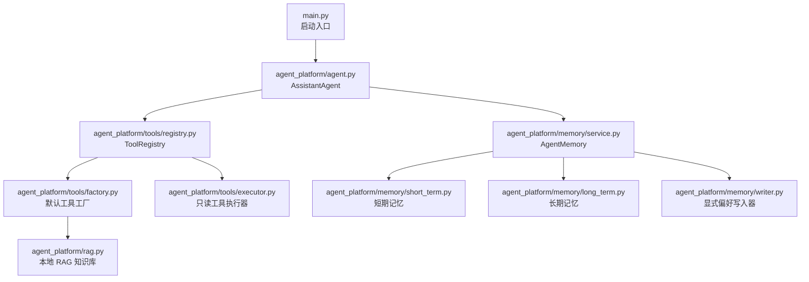
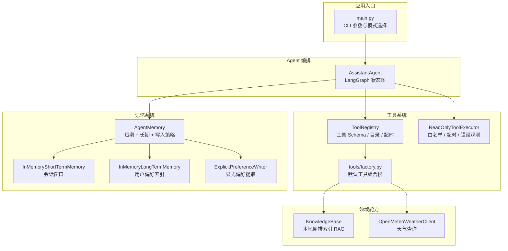
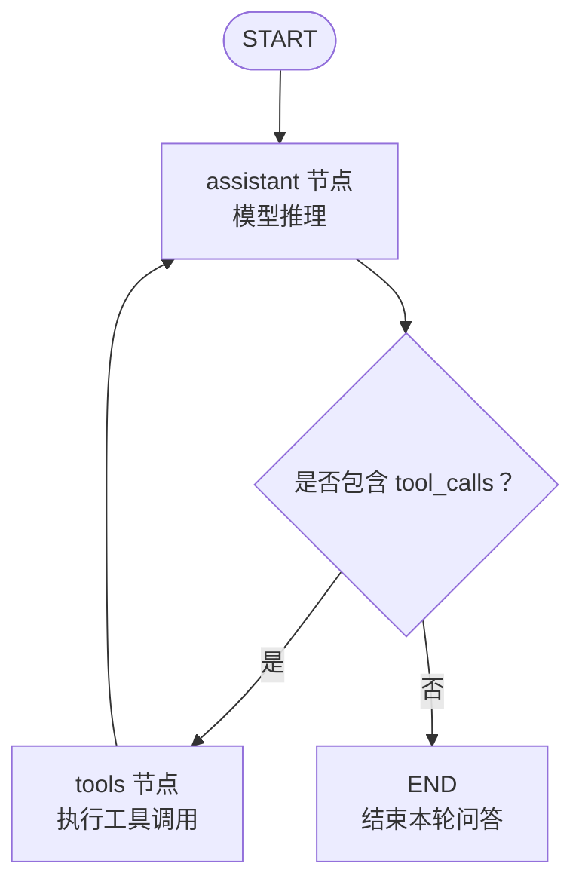
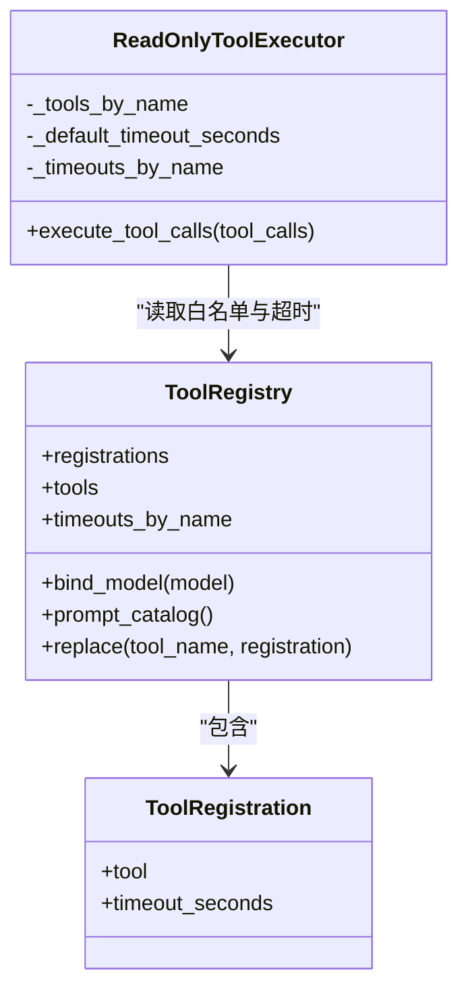
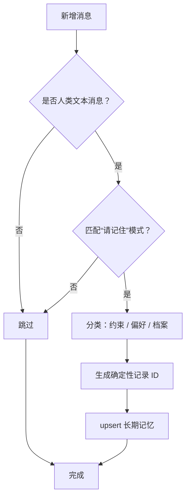
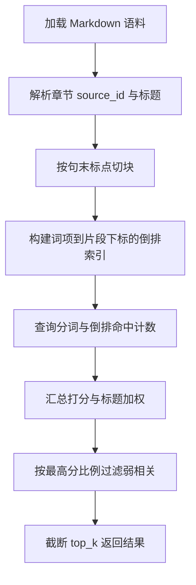
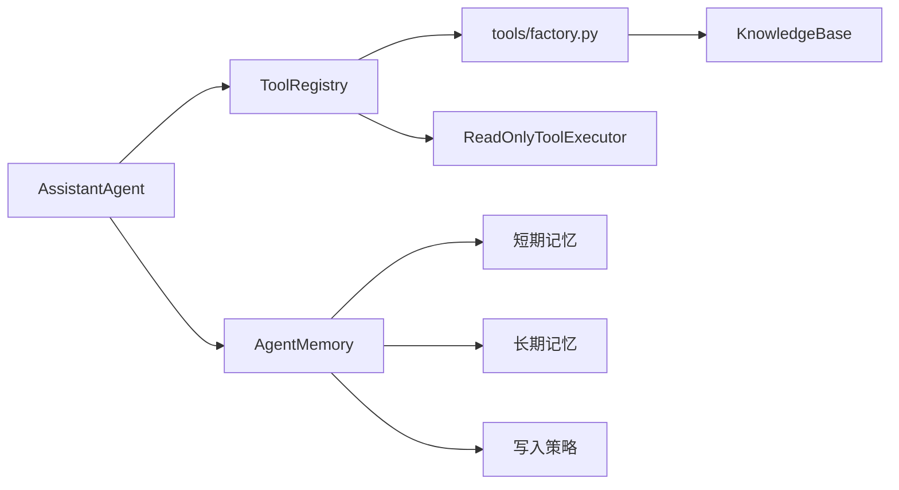

# 整体架构概览

<cite>
**本文引用的文件**   
- [main.py](file://main.py)
- [README.md](file://README.md)
- [requirements.txt](file://requirements.txt)
- [agent_platform/agent.py](file://agent_platform/agent.py)
- [agent_platform/tools/registry.py](file://agent_platform/tools/registry.py)
- [agent_platform/tools/factory.py](file://agent_platform/tools/factory.py)
- [agent_platform/tools/executor.py](file://agent_platform/tools/executor.py)
- [agent_platform/memory/service.py](file://agent_platform/memory/service.py)
- [agent_platform/memory/short_term.py](file://agent_platform/memory/short_term.py)
- [agent_platform/memory/long_term.py](file://agent_platform/memory/long_term.py)
- [agent_platform/memory/writer.py](file://agent_platform/memory/writer.py)
- [agent_platform/rag.py](file://agent_platform/rag.py)
</cite>

## 目录
1. [引言](#引言)
2. [项目结构](#项目结构)
3. [核心组件](#核心组件)
4. [架构总览](#架构总览)
5. [详细组件分析](#详细组件分析)
6. [依赖关系分析](#依赖关系分析)
7. [性能与可扩展性](#性能与可扩展性)
8. [故障排查指南](#故障排查指南)
9. [结论](#结论)

## 引言
本文件为 Agent Platform 的整体架构概览，面向希望快速理解系统高层设计、模块边界和调用关系的读者。平台以 LangChain + LangGraph 为核心编排能力，围绕三个关键角色展开：

- **AssistantAgent**：应用层入口，负责组合模型、工具注册表、记忆门面，并驱动 LangGraph 状态图完成多轮对话编排。
- **ToolRegistry**：工具系统的唯一事实来源，集中管理工具 Schema、超时策略和模型可见的工具目录。
- **AgentMemory**：短期会话窗口、长期偏好召回与写入策略的组合门面，提供并发安全的“读—执行—写”串行化边界。

此外，RAG 检索、天气查询等具体能力通过工具适配层接入；记忆系统采用进程内存储，便于开发调试与可替换扩展。

## 项目结构
仓库采用按功能域划分的模块化结构：

**图表来源**
- [main.py:43-88](file://main.py#L43-L88)
- [agent_platform/agent.py:35-65](file://agent_platform/agent.py#L35-L65)
- [agent_platform/tools/registry.py:27-65](file://agent_platform/tools/registry.py#L27-L65)
- [agent_platform/tools/factory.py:18-36](file://agent_platform/tools/factory.py#L18-L36)
- [agent_platform/tools/executor.py:17-43](file://agent_platform/tools/executor.py#L17-L43)
- [agent_platform/memory/service.py:24-49](file://agent_platform/memory/service.py#L24-L49)
- [agent_platform/memory/short_term.py:41-67](file://agent_platform/memory/short_term.py#L41-L67)
- [agent_platform/memory/long_term.py:20-66](file://agent_platform/memory/long_term.py#L20-L66)
- [agent_platform/memory/writer.py:37-64](file://agent_platform/memory/writer.py#L37-L64)
- [agent_platform/rag.py:42-98](file://agent_platform/rag.py#L42-L98)

**章节来源**
- [README.md:19-48](file://README.md#L19-L48)
- [main.py:1-20](file://main.py#L1-L20)

## 核心组件
### AssistantAgent：对话编排与应用层入口
AssistantAgent 是用户与平台交互的顶层对象。它接收外部注入的模型、设置、工具注册表、记忆门面与作用域，并在内部构建 LangGraph 状态图，实现“助手节点 ↔ 工具节点”的多轮循环。

职责划分：
- 绑定模型与工具 Schema，保证 Prompt 工具目录、模型可用工具和执行器白名单来自同一注册表。
- 加载短期历史、召回长期记忆，构造带系统提示和不可信记忆上下文的输入。
- 驱动 LangGraph 执行，直到模型不再发起工具调用。
- 将本轮消息写回短期窗口，并通过写入器提取长期偏好。
- 暴露 `ask`、`history`、`reset_conversation`、`clear_long_term_memory`、`clear_all_memory` 等稳定接口。

关键行为路径：
- 初始化时构建 `_tool_executor`、`_system_prompt` 与 `_graph`。
- `ask` 方法在记忆作用域锁内串行执行，避免并发覆盖短期历史。
- 最终答案取最后一条不带工具调用的 AI 消息。

**章节来源**
- [agent_platform/agent.py:35-108](file://agent_platform/agent.py#L35-L108)

### ToolRegistry：工具系统的唯一事实来源
ToolRegistry 集中维护工具注册信息，确保以下三方一致性：
- 模型侧：通过 `bind_model` 把工具 Schema 注入模型。
- Prompt 侧：通过 `prompt_catalog` 生成模型可见的工具目录。
- 执行侧：通过 `timeouts_by_name` 提供工具级超时配置。

设计要点：
- 注册项 `ToolRegistration` 包含工具对象与可选超时。
- 构造时校验工具名唯一性，运行期注册表不可变。
- 支持 `replace` 返回新注册表，用于 mock 与测试替换。

**章节来源**
- [agent_platform/tools/registry.py:15-93](file://agent_platform/tools/registry.py#L15-L93)

### AgentMemory：记忆门面与并发安全边界
AgentMemory 是短期记忆、长期记忆与写入策略的统一入口。它不直接关心底层存储细节，而是通过 Protocol 抽象组合不同实现。

职责划分：
- 短期记忆：按会话作用域隔离消息窗口，支持裁剪、覆盖、清空。
- 长期记忆：按用户维度跨会话召回偏好与约束，支持 upsert、检索、清理。
- 写入策略：仅保存用户明确授权的记忆内容，防止指令注入或数据膨胀。
- 并发控制：对每个 `MemoryScope` 加锁，串行化完整“读历史 → 执行 Agent → 写历史”流程。

关键行为：
- `in_memory` 工厂创建本地开发默认实现。
- `recall_context` 将召回结果渲染为带防注入外壳的 Prompt 片段。
- `record_turn` 全量覆盖短期窗口，并按新消息提取长期记录。

**章节来源**
- [agent_platform/memory/service.py:24-105](file://agent_platform/memory/service.py#L24-L105)

## 架构总览
下图展示 Agent Platform 的高层组件关系与主要数据流向：

**图表来源**
- [main.py:43-88](file://main.py#L43-L88)
- [agent_platform/agent.py:35-65](file://agent_platform/agent.py#L35-L65)
- [agent_platform/tools/registry.py:27-65](file://agent_platform/tools/registry.py#L27-L65)
- [agent_platform/tools/factory.py:18-36](file://agent_platform/tools/factory.py#L18-L36)
- [agent_platform/tools/executor.py:17-43](file://agent_platform/tools/executor.py#L17-L43)
- [agent_platform/memory/service.py:24-49](file://agent_platform/memory/service.py#L24-L49)
- [agent_platform/memory/short_term.py:41-67](file://agent_platform/memory/short_term.py#L41-L67)
- [agent_platform/memory/long_term.py:20-66](file://agent_platform/memory/long_term.py#L20-L66)
- [agent_platform/memory/writer.py:37-64](file://agent_platform/memory/writer.py#L37-L64)
- [agent_platform/rag.py:42-98](file://agent_platform/rag.py#L42-L98)

## 详细组件分析

### AssistantAgent 与 LangGraph 状态图引擎
AssistantAgent 使用 LangGraph 的 `StateGraph` 定义两个核心节点：

- **assistant 节点**：组装系统提示、短期上下文与长期记忆上下文，调用模型生成下一步。如果模型返回工具调用，则进入 tools 节点；否则结束。
- **tools 节点**：执行上一条 AI 消息携带的全部工具调用，将 observation 写回消息流，再回到 assistant 节点继续推理。

流转逻辑：
1. 从 START 进入 assistant。
2. assistant 调用模型，根据 `tools_condition` 判断是否包含工具调用。
3. 若有工具调用，进入 tools 节点执行；若无，直接进入 END。
4. tools 节点执行完成后，无条件回到 assistant，形成多轮编排。

**图表来源**
- [agent_platform/agent.py:110-141](file://agent_platform/agent.py#L110-L141)

**章节来源**
- [agent_platform/agent.py:110-141](file://agent_platform/agent.py#L110-L141)

### 工具系统：注册、装配与执行
工具系统由三层组成：

1. **注册层**：`ToolRegistry` 集中管理工具对象、名称唯一性与超时策略。
2. **装配层**：`build_default_tool_registry` 作为组合根，构造 RAG 工具与天气工具，并注入到注册表。
3. **执行层**：`ReadOnlyToolExecutor` 负责白名单校验、超时控制与异常降级，把失败转为模型可见的 observation。

**图表来源**
- [agent_platform/tools/registry.py:15-93](file://agent_platform/tools/registry.py#L15-L93)
- [agent_platform/tools/executor.py:17-67](file://agent_platform/tools/executor.py#L17-L67)

**章节来源**
- [agent_platform/tools/registry.py:1-93](file://agent_platform/tools/registry.py#L1-L93)
- [agent_platform/tools/factory.py:1-37](file://agent_platform/tools/factory.py#L1-L37)
- [agent_platform/tools/executor.py:1-67](file://agent_platform/tools/executor.py#L1-L67)

### 记忆系统：短期窗口、长期偏好与写入策略
记忆系统分为三个协作部分：

- **短期记忆**：按 `MemoryScope` 隔离会话消息，支持窗口裁剪，避免从孤立 AI 或工具消息开始。
- **长期记忆**：按用户维度存储偏好与约束，支持词面重叠打分与最新记忆回退。
- **写入策略**：仅保存用户明确授权的“请记住...”类内容，过滤疑似注入，并使用确定性 ID 实现幂等覆盖。

**图表来源**
- [agent_platform/memory/writer.py:37-94](file://agent_platform/memory/writer.py#L37-L94)

**章节来源**
- [agent_platform/memory/short_term.py:1-67](file://agent_platform/memory/short_term.py#L1-L67)
- [agent_platform/memory/long_term.py:1-83](file://agent_platform/memory/long_term.py#L1-L83)
- [agent_platform/memory/writer.py:1-100](file://agent_platform/memory/writer.py#L1-L100)
- [agent_platform/memory/service.py:51-105](file://agent_platform/memory/service.py#L51-L105)

### RAG 检索模块：本地倒排索引
RAG 模块是一个纯内存、无外部依赖的知识检索组件：

- 启动时解析 `knowledge/knowledge_base.md`，按章节切块。
- 对中文双字词与英文整词建立倒排索引。
- 查询时按词面重合度打分，标题命中加权，过滤弱相关后返回 top_k。

**图表来源**
- [agent_platform/rag.py:42-98](file://agent_platform/rag.py#L42-L98)
- [agent_platform/rag.py:100-187](file://agent_platform/rag.py#L100-L187)

**章节来源**
- [agent_platform/rag.py:1-187](file://agent_platform/rag.py#L1-L187)

## 依赖关系分析
从运行时依赖看，AssistantAgent 处于上层应用层，依赖稳定的工具与记忆边界；工具与记忆子系统之间解耦，RAG 与天气客户端作为领域能力被工具装配层组合。

**图表来源**
- [agent_platform/agent.py:35-65](file://agent_platform/agent.py#L35-L65)
- [agent_platform/tools/factory.py:18-36](file://agent_platform/tools/factory.py#L18-L36)
- [agent_platform/memory/service.py:24-49](file://agent_platform/memory/service.py#L24-L49)

**章节来源**
- [agent_platform/agent.py:35-65](file://agent_platform/agent.py#L35-L65)
- [agent_platform/tools/factory.py:1-37](file://agent_platform/tools/factory.py#L1-L37)
- [agent_platform/memory/service.py:1-49](file://agent_platform/memory/service.py#L1-L49)

## 性能与可扩展性

### 技术栈选择：LangChain + LangGraph 的优势
- **LangChain**：统一模型抽象与工具协议，使 AssistantAgent 可以灵活绑定不同后端模型与工具。
- **LangGraph**：提供声明式状态图与条件边，天然适合“助手 ↔ 工具”多轮编排，避免手写 while 循环与状态机。
- **组合根与注册表**：通过 `ToolRegistry` 与 `build_default_tool_registry`，保证模型 Schema、Prompt 目录与执行器白名单一致，降低漂移风险。

**章节来源**
- [requirements.txt:1-5](file://requirements.txt#L1-L5)
- [agent_platform/agent.py:110-118](file://agent_platform/agent.py#L110-L118)
- [agent_platform/tools/registry.py:27-65](file://agent_platform/tools/registry.py#L27-L65)
- [agent_platform/tools/factory.py:18-36](file://agent_platform/tools/factory.py#L18-L36)

### 为什么采用进程内存储而非外部数据库
当前短期记忆与长期记忆均采用进程内实现：

- **短期记忆**：基于字典按 `MemoryScope` 隔离消息，线程安全，适合单进程开发与演示。
- **长期记忆**：基于字典按 `MemoryOwner` 隔离记录，支持 upsert、检索与清理，但进程重启后丢失。
- **优势**：零外部依赖、启动快、易于替换；生产环境可通过实现相同契约替换为 SQLite、Redis 或向量库。

这种设计降低了初期部署复杂度，同时保持扩展性：Agent、ToolRegistry 与图结构无需因存储后端变化而改动。

**章节来源**
- [agent_platform/memory/short_term.py:41-67](file://agent_platform/memory/short_term.py#L41-L67)
- [agent_platform/memory/long_term.py:20-66](file://agent_platform/memory/long_term.py#L20-L66)
- [README.md:67-96](file://README.md#L67-L96)

## 故障排查指南

### 模型调用失败
现象：assistant 节点抛出异常，但最终仍返回一条降级消息。

处理逻辑：
- assistant 节点捕获模型调用异常，返回包含错误类型的 AIMessage。
- 图不会因此崩溃，仍可正常结束。

建议排查：
- 检查 `.env` 中模型 API Key、模型名与 Base URL。
- 确认网络可达与模型服务可用性。
- 观察日志中的 `[LangGraph] 正在执行 assistant 节点` 与降级消息内容。

**章节来源**
- [agent_platform/agent.py:120-137](file://agent_platform/agent.py#L120-L137)
- [main.py:22-40](file://main.py#L22-L40)

### 工具未注册或白名单拒绝
现象：模型尝试调用未注册工具，执行器返回不允许调用的 observation。

处理逻辑：
- `ReadOnlyToolExecutor` 通过工具名查找执行器，未找到则返回白名单拒绝消息。
- 该消息作为 observation 返回给模型，由模型向用户说明无法调用。

建议排查：
- 确认工具已在 `build_default_tool_registry` 中注册。
- 检查工具名称是否与注册表一致。
- 如需新增工具，优先在 `tools/factory.py` 注册，不要绕过注册表。

**章节来源**
- [agent_platform/tools/executor.py:27-43](file://agent_platform/tools/executor.py#L27-L43)
- [agent_platform/tools/factory.py:18-36](file://agent_platform/tools/factory.py#L18-L36)

### 工具超时或异常
现象：工具执行超时或抛出异常，observation 显示工具错误或超时。

处理逻辑：
- 执行器使用线程池执行工具调用，并设置超时。
- 超时或异常均转为文本 observation，不向上抛出。
- 单工具超时优先使用注册表专用超时，否则回落到默认超时。

建议排查：
- 调整 `network_tool_timeout_seconds` 或工具级超时。
- 检查外部依赖（如天气接口）是否响应缓慢。
- 观察 `[Tool] 执行只读工具` 与 `[Tool] observation` 日志。

**章节来源**
- [agent_platform/tools/executor.py:45-67](file://agent_platform/tools/executor.py#L45-L67)
- [agent_platform/tools/factory.py:31-36](file://agent_platform/tools/factory.py#L31-L36)

### 长期记忆未生效
现象：用户保存偏好后，后续对话未召回相关记忆。

可能原因：
- 用户消息未以“请记住”开头，未被写入器识别。
- 内容超长或被判定为疑似注入。
- 长期记忆为进程内实现，进程重启后丢失。

建议排查：
- 使用明确授权句式，例如“请记住我喜欢慢节奏行程”。
- 检查写入器过滤规则与字符长度限制。
- 确认当前为进程内长期记忆，必要时替换为持久化实现。

**章节来源**
- [agent_platform/memory/writer.py:37-94](file://agent_platform/memory/writer.py#L37-L94)
- [agent_platform/memory/long_term.py:20-66](file://agent_platform/memory/long_term.py#L20-L66)
- [README.md:75-96](file://README.md#L75-L96)

## 结论
Agent Platform 通过 AssistantAgent、ToolRegistry 与 AgentMemory 三个核心组件，实现了清晰的应用层编排、统一的工具管理与安全的记忆边界。LangGraph 的状态图引擎让“助手 ↔ 工具”的多轮对话具备可声明、可观测、可恢复的特性；工具系统与记忆系统通过稳定契约解耦，便于替换与扩展。

在当前阶段，RAG 与长期记忆采用进程内实现，有利于快速验证与本地开发；未来可按契约替换为更强大的检索与持久化方案。整体架构兼顾了可维护性、可扩展性与可测试性，适合作为通用 Agent 平台的演进基线。