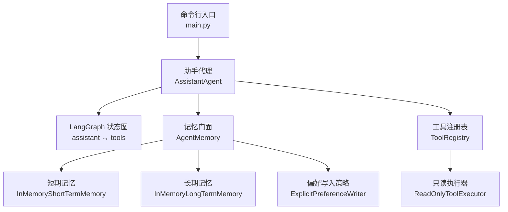
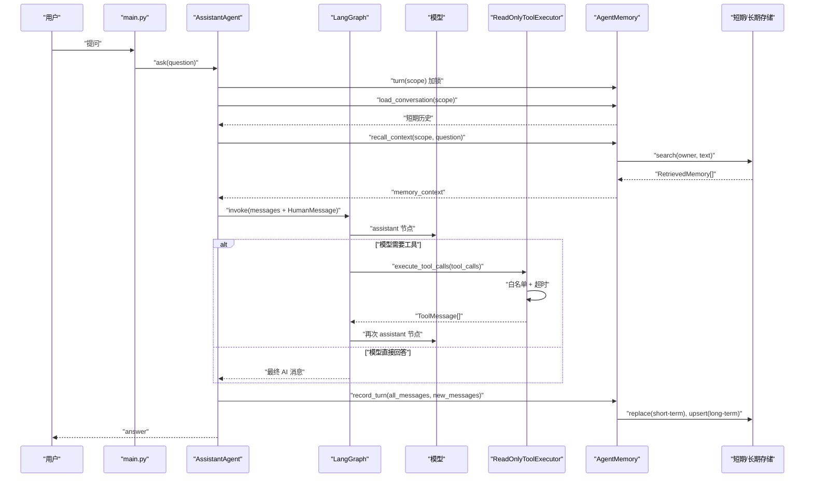
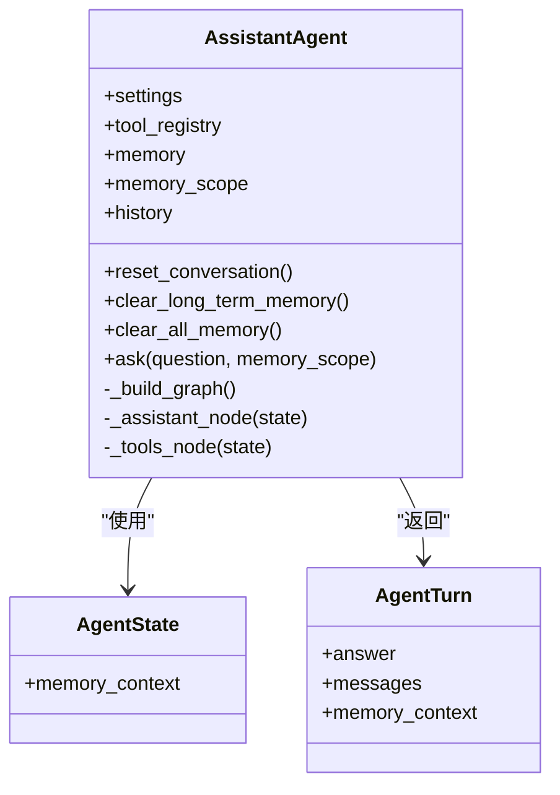
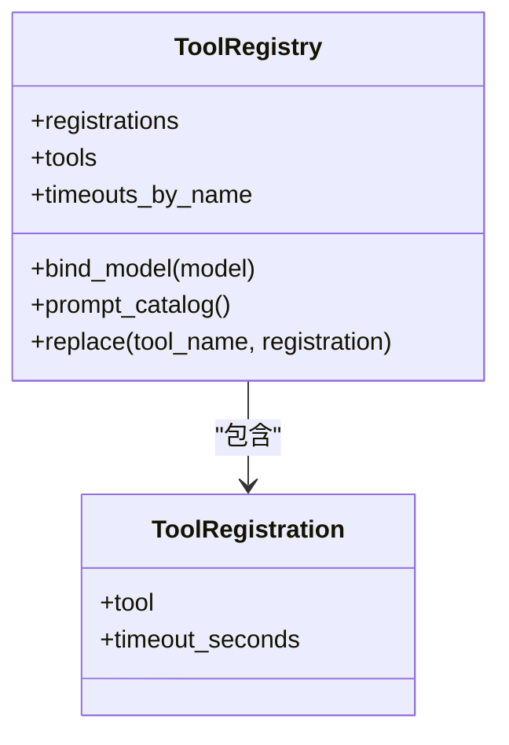
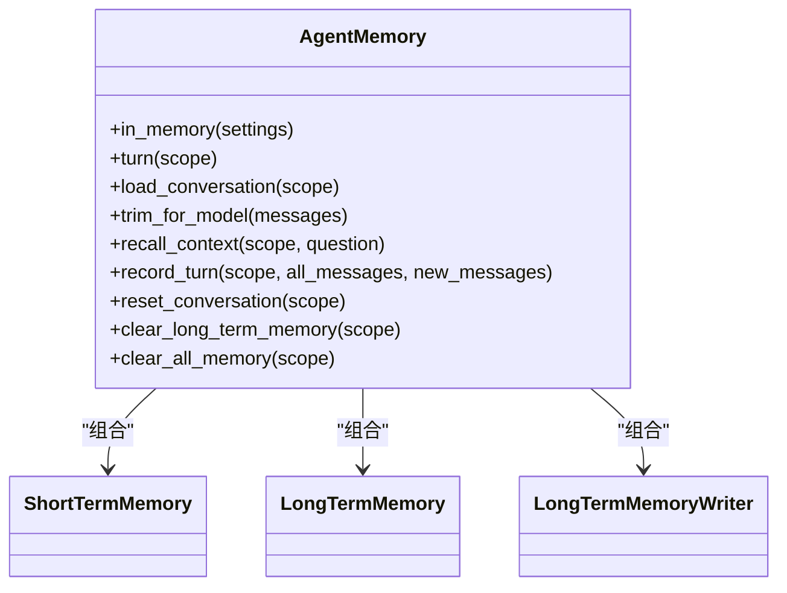
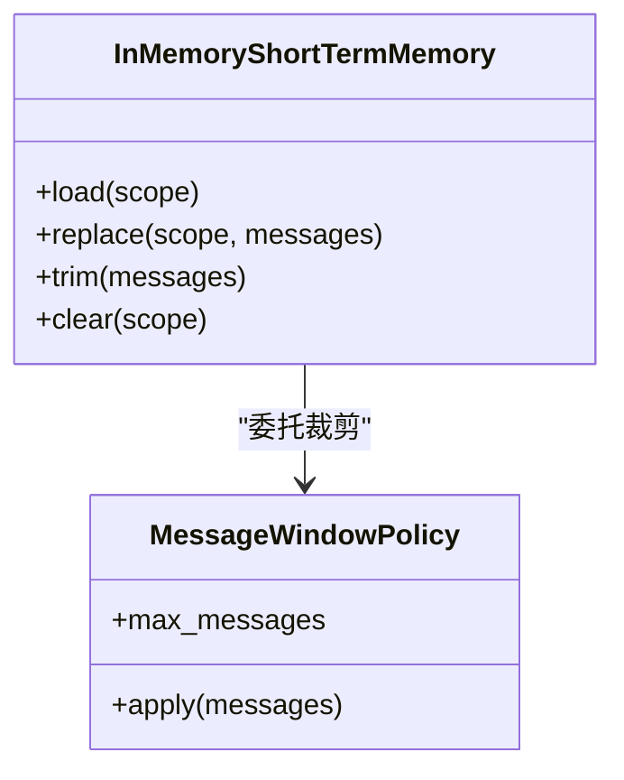
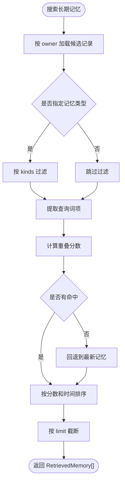
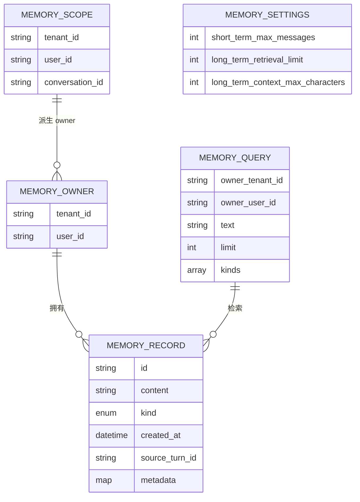
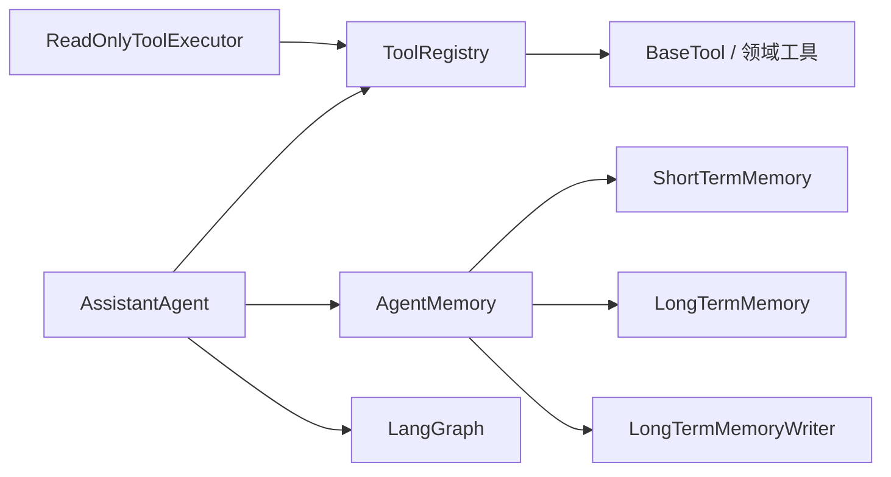

# 架构设计

<cite>
**本文引用的文件**   
- [main.py](file://main.py)
- [README.md](file://README.md)
- [agent_platform/agent.py](file://agent_platform/agent.py)
- [agent_platform/tools/registry.py](file://agent_platform/tools/registry.py)
- [agent_platform/tools/factory.py](file://agent_platform/tools/factory.py)
- [agent_platform/tools/executor.py](file://agent_platform/tools/executor.py)
- [agent_platform/memory/service.py](file://agent_platform/memory/service.py)
- [agent_platform/memory/models.py](file://agent_platform/memory/models.py)
- [agent_platform/memory/short_term.py](file://agent_platform/memory/short_term.py)
- [agent_platform/memory/long_term.py](file://agent_platform/memory/long_term.py)
</cite>

## 目录
1. [引言](#引言)
2. [项目结构](#项目结构)
3. [核心组件](#核心组件)
4. [架构总览](#架构总览)
5. [详细组件分析](#详细组件分析)
6. [依赖关系分析](#依赖关系分析)
7. [性能与可扩展性](#性能与可扩展性)
8. [故障排查指南](#故障排查指南)
9. [结论](#结论)

## 引言
本设计文档面向 Agent Platform，说明其基于 LangGraph 的状态图引擎如何实现多轮对话编排，并解释 ToolRegistry、AgentMemory 等核心组件的职责、交互关系与安全边界。文档重点描述从用户输入到 AssistantAgent.ask()、工具调用、记忆更新和最终答案返回的完整数据流；同时总结注册表模式、门面模式和策略模式在系统中的体现，以及进程内记忆、工具白名单等技术决策的权衡。

## 项目结构
Agent Platform 将模型编排、工具管理、记忆系统和评测能力拆分为独立模块：
- 应用入口 main.py 负责加载配置、选择真实或离线模式、组装 Agent 并驱动问答循环。
- agent_platform/agent.py 实现 LangGraph 状态图，串联模型、工具执行器和记忆门面。
- tools 子包通过 ToolRegistry 集中管理工具 Schema、Prompt 目录和执行器超时。
- memory 子包提供短期消息窗口、长期偏好召回和写入策略，并通过 AgentMemory 门面暴露统一接口。
- evaluation 子包用于离线回归测试，可注入替身模型与工具。

**图表来源**
- [main.py:43-89](file://main.py#L43-L89)
- [agent_platform/agent.py:35-141](file://agent_platform/agent.py#L35-L141)
- [agent_platform/tools/registry.py:27-93](file://agent_platform/tools/registry.py#L27-L93)
- [agent_platform/tools/executor.py:17-67](file://agent_platform/tools/executor.py#L17-L67)
- [agent_platform/memory/service.py:24-105](file://agent_platform/memory/service.py#L24-L105)
- [agent_platform/memory/short_term.py:41-67](file://agent_platform/memory/short_term.py#L41-L67)
- [agent_platform/memory/long_term.py:20-71](file://agent_platform/memory/long_term.py#L20-L71)

**章节来源**
- [README.md:19-48](file://README.md#L19-L48)
- [main.py:1-95](file://main.py#L1-L95)

## 核心组件
- AssistantAgent：应用层编排者，负责会话作用域加锁、历史加载、长期记忆召回、LangGraph 图执行、结果提取和记忆写回。
- ToolRegistry：工具注册表，集中维护工具对象、唯一名称、Prompt 目录、模型绑定和替换能力。
- ReadOnlyToolExecutor：工具执行器，提供白名单校验、超时控制和错误降级，保证单个工具失败不破坏整体图。
- AgentMemory：记忆门面，组合短期记忆、长期记忆和写入策略，提供 turn 串行化、会话裁剪、上下文召回和持久化封装。
- InMemoryShortTermMemory：进程内短期消息窗口，按会话隔离并提供窗口裁剪策略。
- InMemoryLongTermMemory：进程内长期记忆，按用户归属跨会话召回，使用轻量词面重叠打分。
- ExplicitPreferenceWriter：显式授权偏好写入策略，仅保存用户明确授权的偏好或约束。

**章节来源**
- [agent_platform/agent.py:20-141](file://agent_platform/agent.py#L20-L141)
- [agent_platform/tools/registry.py:15-93](file://agent_platform/tools/registry.py#L15-L93)
- [agent_platform/tools/executor.py:17-67](file://agent_platform/tools/executor.py#L17-L67)
- [agent_platform/memory/service.py:24-105](file://agent_platform/memory/service.py#L24-L105)
- [agent_platform/memory/short_term.py:17-67](file://agent_platform/memory/short_term.py#L17-L67)
- [agent_platform/memory/long_term.py:20-83](file://agent_platform/memory/long_term.py#L20-L83)

## 架构总览
Agent Platform 采用“编排 + 注册表 + 门面”的分层架构：
- 编排层：AssistantAgent 通过 LangGraph 定义 assistant 与 tools 两个节点，形成“模型生成 → 工具执行 → 再次模型生成”的多轮循环。
- 工具层：ToolRegistry 作为单一事实源，向模型暴露工具 Schema，向 Prompt 暴露工具目录，向执行器暴露白名单和超时映射。
- 记忆层：AgentMemory 作为对外门面，屏蔽短期窗口裁剪、长期记忆召回和写入策略细节，并通过作用域锁保证并发安全。

**图表来源**
- [main.py:78-89](file://main.py#L78-L89)
- [agent_platform/agent.py:84-141](file://agent_platform/agent.py#L84-L141)
- [agent_platform/memory/service.py:51-90](file://agent_platform/memory/service.py#L51-L90)
- [agent_platform/tools/executor.py:27-43](file://agent_platform/tools/executor.py#L27-L43)

## 详细组件分析

### AssistantAgent：LangGraph 多轮编排
AssistantAgent 是平台的应用层入口，承担以下职责：
- 构造时绑定模型工具 Schema、构建系统 Prompt、创建只读执行器和编译 LangGraph 状态图。
- ask() 方法以 MemoryScope 为粒度串行化一轮问答，读取短期历史、召回长期记忆、驱动图执行、写回记忆并提取最终答案。
- _build_graph() 定义 assistant 与 tools 节点，借助 tools_condition 判断是否需要工具执行。
- _assistant_node() 负责消息裁剪、系统提示注入、长期记忆上下文注入和模型调用异常降级。
- _tools_node() 统一执行所有 tool_calls，并将 observation 写回消息流。

**图表来源**
- [agent_platform/agent.py:20-141](file://agent_platform/agent.py#L20-L141)

**章节来源**
- [agent_platform/agent.py:35-141](file://agent_platform/agent.py#L35-L141)

### ToolRegistry：注册表模式
ToolRegistry 是工具系统的单一事实源，体现注册表模式：
- 集中维护 ToolRegistration 列表，确保工具名唯一且不可变。
- 提供 tools 给模型 bind_tools()，prompt_catalog() 给系统 Prompt 渲染工具目录，timeouts_by_name 给执行器做超时映射。
- replace() 返回新注册表实例，便于测试注入替身而不污染生产注册表。

**图表来源**
- [agent_platform/tools/registry.py:15-93](file://agent_platform/tools/registry.py#L15-L93)

**章节来源**
- [agent_platform/tools/registry.py:1-94](file://agent_platform/tools/registry.py#L1-L94)
- [agent_platform/tools/factory.py:18-36](file://agent_platform/tools/factory.py#L18-L36)

### ReadOnlyToolExecutor：白名单与超时控制
ReadOnlyToolExecutor 体现安全边界和错误降级：
- 白名单机制：仅允许已注册工具被调用，未注册工具返回“不允许调用”的 observation，防止模型幻觉执行任意工具。
- 超时控制：单工具显式超时优先，否则回落到默认超时；超时或异常均转为文本 observation，避免整张图崩溃。
- 线程池隔离：使用 ThreadPoolExecutor 限制等待时间，取消未完成任务并关闭执行器。

**图表来源**
- [agent_platform/tools/executor.py:27-67](file://agent_platform/tools/executor.py#L27-L67)

**章节来源**
- [agent_platform/tools/executor.py:1-67](file://agent_platform/tools/executor.py#L1-L67)

### AgentMemory：门面模式与并发安全
AgentMemory 作为记忆子系统门面，组合短期、长期和写入策略：
- in_memory() 工厂提供本地开发默认实现，便于快速验证。
- turn(scope) 使用 RLock 串行化同一会话的完整读—执行—写流程，避免并发覆盖短期历史。
- recall_context() 检索长期记忆并以不可信数据块形式注入模型，字符预算受控。
- record_turn() 全量覆盖短期窗口，并按 writer 策略提取长期记忆记录进行 upsert。

**图表来源**
- [agent_platform/memory/service.py:24-105](file://agent_platform/memory/service.py#L24-L105)

**章节来源**
- [agent_platform/memory/service.py:1-141](file://agent_platform/memory/service.py#L1-L141)

### 短期记忆：窗口策略与进程内实现
InMemoryShortTermMemory 与 MessageWindowPolicy 分离关注点：
- MessageWindowPolicy 按最大消息数裁剪，并保证窗口不从孤立的 AI 或 ToolMessage 开始，避免模型因缺少 tool_call 报错。
- InMemoryShortTermMemory 按 MemoryScope 隔离消息，提供 load、replace、trim、clear 等操作，内部加锁保证并发安全。

**图表来源**
- [agent_platform/memory/short_term.py:17-67](file://agent_platform/memory/short_term.py#L17-L67)

**章节来源**
- [agent_platform/memory/short_term.py:1-67](file://agent_platform/memory/short_term.py#L1-L67)

### 长期记忆：进程内实现与召回策略
InMemoryLongTermMemory 提供按 owner 隔离的进程内长期记忆：
- upsert() 支持确定性 id 的幂等覆盖，避免重复保存累积。
- search() 先按 owner 取出候选集，再按类型过滤、词面重叠打分、最新优先排序，最后按 limit 截断。
- 分词逻辑独立于 RAG，英文整词、中文双字 bigram 混合匹配，无命中时回退到最新记忆。

**图表来源**
- [agent_platform/memory/long_term.py:37-66](file://agent_platform/memory/long_term.py#L37-L66)

**章节来源**
- [agent_platform/memory/long_term.py:1-83](file://agent_platform/memory/long_term.py#L1-L83)

### 数据模型：作用域、记录与设置
记忆域的数据模型定义了隔离边界和运行时参数：
- MemoryScope：三级隔离（租户、用户、会话），用于短期消息窗口。
- MemoryOwner：两级隔离（租户、用户），用于长期记忆归属。
- MemoryRecord：一条可跨会话召回的用户记忆，包含内容、类型、元数据和溯源信息。
- MemoryQuery：检索请求，支持 owner、text、limit、kinds。
- MemorySettings：短期窗口大小、长期召回条数和字符预算等运行参数。

**图表来源**
- [agent_platform/memory/models.py:18-120](file://agent_platform/memory/models.py#L18-L120)

**章节来源**
- [agent_platform/memory/models.py:1-120](file://agent_platform/memory/models.py#L1-L120)

## 依赖关系分析
- AssistantAgent 依赖 ToolRegistry、AgentMemory 和 LangGraph；不直接依赖具体工具实现或存储后端。
- ToolRegistry 依赖 BaseTool 和 LangChain 工具抽象，由 factory.py 组合领域客户端（RAG、天气）后注册。
- AgentMemory 依赖三个 Protocol（ShortTermMemory、LongTermMemory、LongTermMemoryWriter），默认实现为进程内版本。
- 工具执行器依赖 ToolRegistry 提供的白名单和超时映射，不感知业务领域。

**图表来源**
- [agent_platform/agent.py:35-65](file://agent_platform/agent.py#L35-L65)
- [agent_platform/tools/factory.py:18-36](file://agent_platform/tools/factory.py#L18-L36)
- [agent_platform/memory/service.py:24-49](file://agent_platform/memory/service.py#L24-L49)
- [agent_platform/tools/executor.py:17-25](file://agent_platform/tools/executor.py#L17-L25)

**章节来源**
- [agent_platform/agent.py:35-65](file://agent_platform/agent.py#L35-L65)
- [agent_platform/tools/factory.py:1-37](file://agent_platform/tools/factory.py#L1-L37)
- [agent_platform/memory/service.py:1-49](file://agent_platform/memory/service.py#L1-L49)
- [agent_platform/tools/executor.py:1-25](file://agent_platform/tools/executor.py#L1-L25)

## 性能与可扩展性
- 短期记忆窗口裁剪：通过 MessageWindowPolicy 控制送入模型的 token 数量，避免过长上下文导致成本上升和延迟增加。
- 长期记忆召回预算：long_term_context_max_characters 限制注入 Prompt 的记忆长度，防止大段用户数据影响模型响应。
- 工具超时分级：单工具专用超时优先，否则回落到默认超时，平衡网络工具稳定性与用户体验。
- 进程内记忆优缺点：
  - 优点：零外部依赖、开发调试简单、并发通过 RLock 保护。
  - 缺点：进程重启丢失、无法跨进程共享、扩展性受限；生产环境应替换为 SQLite、Redis 或向量库。
- 可扩展点：
  - 新增工具只需在 factory.py 注册适配层，无需修改 Agent 或图结构。
  - 替换长期记忆实现只需实现 LongTermMemory 契约，保持 Agent 和 ToolRegistry 不变。

[本节为通用指导，不直接分析具体文件]

## 故障排查指南
- 模型调用失败：assistant 节点捕获异常并返回降级消息，图继续收尾；检查模型配置、API Key 和网络连通性。
- 工具未注册：执行器白名单拒绝未注册工具，返回“不允许调用” observation；确认工具已在 ToolRegistry 中注册。
- 工具超时：执行器返回超时 observation；检查网络工具超时配置和后端服务可用性。
- 短期历史异常：若窗口从孤立 AI 或 ToolMessage 开始，可能导致模型报错；检查消息序列完整性与窗口裁剪策略。
- 长期记忆未召回：确认 MemoryScope.owner 正确、writer 仅保存显式授权内容、检索文本与记忆内容存在词面重叠。

**章节来源**
- [agent_platform/agent.py:120-141](file://agent_platform/agent.py#L120-L141)
- [agent_platform/tools/executor.py:27-67](file://agent_platform/tools/executor.py#L27-L67)
- [agent_platform/memory/short_term.py:25-38](file://agent_platform/memory/short_term.py#L25-L38)
- [agent_platform/memory/service.py:108-141](file://agent_platform/memory/service.py#L108-L141)

## 结论
Agent Platform 通过 AssistantAgent 编排 LangGraph 状态图，结合 ToolRegistry 的工具注册表模式和 AgentMemory 的门面模式，实现了多轮对话的可扩展、可测试和安全可控的架构。进程内记忆适合开发与演示，生产环境可通过契约替换为持久化存储；工具白名单和超时控制保障了系统在模型幻觉和外部依赖不稳定时的鲁棒性。未来可在长期记忆引入向量检索、在工具层扩展更多领域能力，同时保持现有稳定边界不变。