# 架构设计

<cite>
**本文引用的文件**   
- [main.py](file://main.py)
- [web_api/app.py](file://web_api/app.py)
- [web_api/routes/chat.py](file://web_api/routes/chat.py)
- [web_api/schemas.py](file://web_api/schemas.py)
- [web_api/sessions.py](file://web_api/sessions.py)
- [web_ui/src/views/ChatView.tsx](file://web_ui/src/views/ChatView.tsx)
- [web_ui/src/api.ts](file://web_ui/src/api.ts)
- [web_ui/package.json](file://web_ui/package.json)
- [agent_platform/agent.py](file://agent_platform/agent.py)
- [agent_platform/tools/registry.py](file://agent_platform/tools/registry.py)
- [agent_platform/tools/factory.py](file://agent_platform/tools/factory.py)
- [agent_platform/tools/executor.py](file://agent_platform/tools/executor.py)
- [agent_platform/memory/service.py](file://agent_platform/memory/service.py)
- [agent_platform/memory/models.py](file://agent_platform/memory/models.py)
- [agent_platform/memory/short_term.py](file://agent_platform/memory/short_term.py)
- [agent_platform/memory/long_term.py](file://agent_platform/memory/long_term.py)
</cite>

## 更新摘要
**变更内容**   
- 将 main.py 重构为子命令架构，支持 chat、evaluate、serve 三种模式
- 新增 web_api 模块，实现 FastAPI RESTful API 服务
- 新增 web_ui 模块，提供 React + TypeScript 前端聊天界面
- 扩展架构图表以反映新的混合架构模式
- 更新数据流说明以包含 Web 端交互流程

## 目录
1. [引言](#引言)
2. [项目结构](#项目结构)
3. [核心组件](#核心组件)
4. [架构总览](#架构总览)
5. [详细组件分析](#详细组件分析)
6. [依赖关系分析](#依赖关系分析)
7. [性能与可扩展性](#性能与可扩展性)
8. [故障排查指南](#故障排查指南)
9. [结论](#结论)

## 引言
本设计文档面向 Agent Platform，说明其基于 LangGraph 的状态图引擎如何实现多轮对话编排，并解释 ToolRegistry、AgentMemory 等核心组件的职责、交互关系与安全边界。随着架构演进，平台已从纯 CLI 应用发展为支持 Web 界面的混合架构，同时保留命令行工具能力。文档重点描述从用户输入到 AssistantAgent.ask()、工具调用、记忆更新和最终答案返回的完整数据流；同时总结注册表模式、门面模式和策略模式在系统中的体现，以及进程内记忆、工具白名单等技术决策的权衡。

## 项目结构
Agent Platform 采用混合架构，同时支持命令行和 Web 两种交互方式：
- **应用入口** main.py 重构为子命令架构，支持 chat（CLI 问答）、evaluate（离线评测）、serve（Web 服务）三种模式
- **Web API 层** web_api 模块提供 FastAPI RESTful 接口，处理会话管理和消息路由
- **Web UI 层** web_ui 模块使用 React + TypeScript 构建现代化聊天界面
- **核心引擎** agent_platform 包保持原有架构，实现 LangGraph 状态图、工具管理、记忆系统
- **工具层** tools 子包通过 ToolRegistry 集中管理工具 Schema、Prompt 目录和执行器超时
- **记忆层** memory 子包提供短期消息窗口、长期偏好召回和写入策略

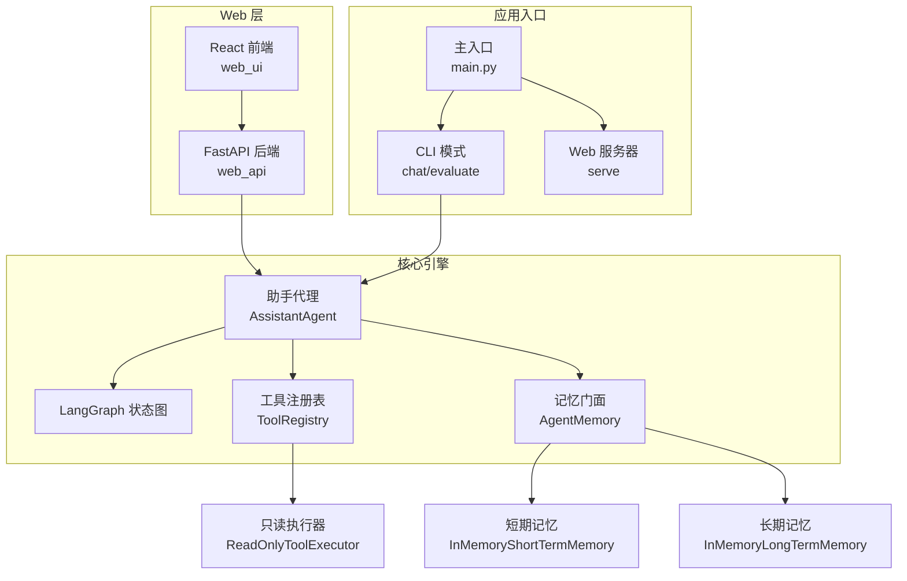

**图表来源**
- [main.py:1-154](file://main.py#L1-L154)
- [web_api/app.py:1-59](file://web_api/app.py#L1-L59)
- [web_ui/src/views/ChatView.tsx:1-176](file://web_ui/src/views/ChatView.tsx#L1-L176)
- [agent_platform/agent.py:35-141](file://agent_platform/agent.py#L35-L141)

**章节来源**
- [main.py:1-154](file://main.py#L1-L154)
- [web_api/app.py:1-59](file://web_api/app.py#L1-L59)
- [web_ui/package.json:1-24](file://web_ui/package.json#L1-L24)

## 核心组件
- **AssistantAgent**：应用层编排者，负责会话作用域加锁、历史加载、长期记忆召回、LangGraph 图执行、结果提取和记忆写回
- **ToolRegistry**：工具注册表，集中维护工具对象、唯一名称、Prompt 目录、模型绑定和替换能力
- **ReadOnlyToolExecutor**：工具执行器，提供白名单校验、超时控制和错误降级，保证单个工具失败不破坏整体图
- **AgentMemory**：记忆门面，组合短期记忆、长期记忆和写入策略，提供 turn 串行化、会话裁剪、上下文召回和持久化封装
- **ConversationRegistry**：Web 端会话注册表，管理会话元数据（标题、ID），提供线程安全的 CRUD 操作
- **SPAStaticFiles**：单页应用静态文件托管器，支持前端路由回退机制
- **InMemoryShortTermMemory**：进程内短期消息窗口，按会话隔离并提供窗口裁剪策略
- **InMemoryLongTermMemory**：进程内长期记忆，按用户归属跨会话召回，使用轻量词面重叠打分

**章节来源**
- [agent_platform/agent.py:20-141](file://agent_platform/agent.py#L20-L141)
- [web_api/sessions.py:24-62](file://web_api/sessions.py#L24-L62)
- [web_api/app.py:25-36](file://web_api/app.py#L25-L36)

## 架构总览
Agent Platform 采用"编排 + 注册表 + 门面"的分层架构，同时支持 CLI 和 Web 两种访问方式：
- **编排层**：AssistantAgent 通过 LangGraph 定义 assistant 与 tools 两个节点，形成"模型生成 → 工具执行 → 再次模型生成"的多轮循环
- **工具层**：ToolRegistry 作为单一事实源，向模型暴露工具 Schema，向 Prompt 暴露工具目录，向执行器暴露白名单和超时映射
- **记忆层**：AgentMemory 作为对外门面，屏蔽短期窗口裁剪、长期记忆召回和写入策略细节，并通过作用域锁保证并发安全
- **Web 层**：FastAPI 提供 RESTful API，React 前端提供现代化聊天界面，支持多会话管理

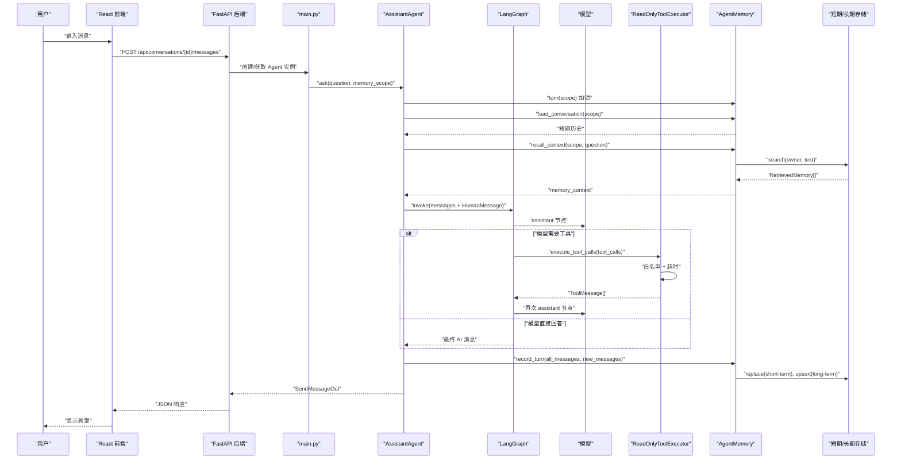

**图表来源**
- [web_ui/src/views/ChatView.tsx:88-115](file://web_ui/src/views/ChatView.tsx#L88-L115)
- [web_api/routes/chat.py:69-75](file://web_api/routes/chat.py#L69-L75)
- [main.py:111-125](file://main.py#L111-L125)
- [agent_platform/agent.py:84-141](file://agent_platform/agent.py#L84-L141)

## 详细组件分析

### main.py：子命令架构入口
main.py 重构为子命令架构，统一管理 CLI 和 Web 服务的启动流程：
- **build_agent()**：统一装配模型、工具注册表与记忆，供 chat 与 serve 子命令复用
- **build_parser()**：构造 argparse 解析器，注册 chat、evaluate、serve 三个子命令及其参数
- **run_chat()**：CLI 问答模式，同一 Agent 实例内的多个问题共享短期会话窗口与长期记忆
- **run_server()**：Web 服务模式，延迟导入 uvicorn 和 web_api，避免非 Web 模式依赖额外包
- **main()**：主入口函数，加载配置、解析子命令、分发到对应处理器

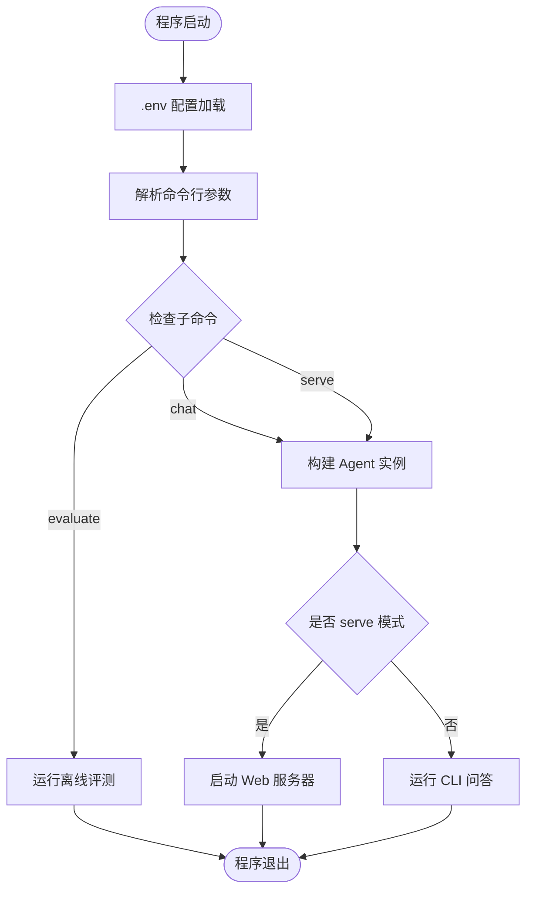

**图表来源**
- [main.py:128-154](file://main.py#L128-L154)

**章节来源**
- [main.py:1-154](file://main.py#L1-L154)

### web_api：FastAPI Web 服务
web_api 模块提供完整的 RESTful API 服务：
- **create_app()**：应用装配工厂，注入 AssistantAgent 与会话注册表，挂载路由和静态文件
- **SPAStaticFiles**：自定义静态文件处理器，支持 SPA 路由回退到 index.html
- **CORS 中间件**：开发环境允许 Vite 开发服务器跨域访问
- **会话管理**：通过 ConversationRegistry 管理会话生命周期

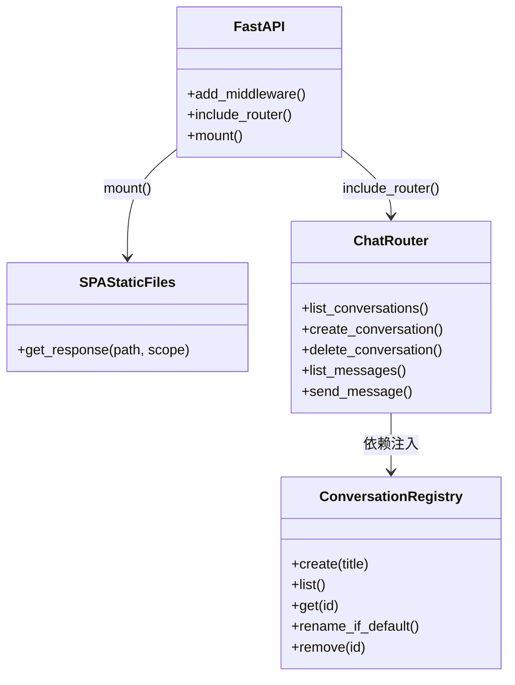

**图表来源**
- [web_api/app.py:38-59](file://web_api/app.py#L38-L59)
- [web_api/routes/chat.py:24-77](file://web_api/routes/chat.py#L24-L77)
- [web_api/sessions.py:24-62](file://web_api/sessions.py#L24-L62)

**章节来源**
- [web_api/app.py:1-59](file://web_api/app.py#L1-L59)
- [web_api/routes/chat.py:1-89](file://web_api/routes/chat.py#L1-L89)

### web_ui：React 前端界面
web_ui 模块使用 React + TypeScript 构建现代化聊天界面：
- **ChatView**：主视图组件，管理会话列表、消息流和用户输入
- **ConversationList**：侧边栏组件，展示可管理的会话列表
- **api.ts**：HTTP 客户端封装，统一处理与后端的 API 调用
- **路由管理**：使用 react-router-dom 管理多会话路由

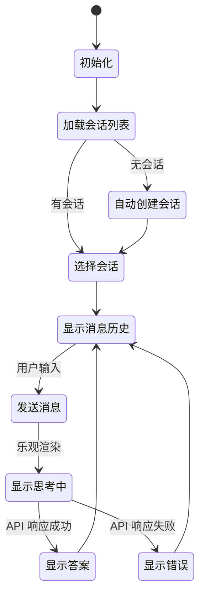

**图表来源**
- [web_ui/src/views/ChatView.tsx:25-55](file://web_ui/src/views/ChatView.tsx#L25-L55)
- [web_ui/src/views/ChatView.tsx:88-115](file://web_ui/src/views/ChatView.tsx#L88-L115)

**章节来源**
- [web_ui/src/views/ChatView.tsx:1-176](file://web_ui/src/views/ChatView.tsx#L1-L176)
- [web_ui/src/components/ConversationList.tsx:1-37](file://web_ui/src/components/ConversationList.tsx#L1-L37)
- [web_ui/src/api.ts:1-48](file://web_ui/src/api.ts#L1-L48)

### AssistantAgent：LangGraph 多轮编排
AssistantAgent 是平台的应用层入口，承担以下职责：
- 构造时绑定模型工具 Schema、构建系统 Prompt、创建只读执行器和编译 LangGraph 状态图
- ask() 方法以 MemoryScope 为粒度串行化一轮问答，读取短期历史、召回长期记忆、驱动图执行、写回记忆并提取最终答案
- _build_graph() 定义 assistant 与 tools 节点，借助 tools_condition 判断是否需要工具执行
- _assistant_node() 负责消息裁剪、系统提示注入、长期记忆上下文注入和模型调用异常降级
- _tools_node() 统一执行所有 tool_calls，并将 observation 写回消息流

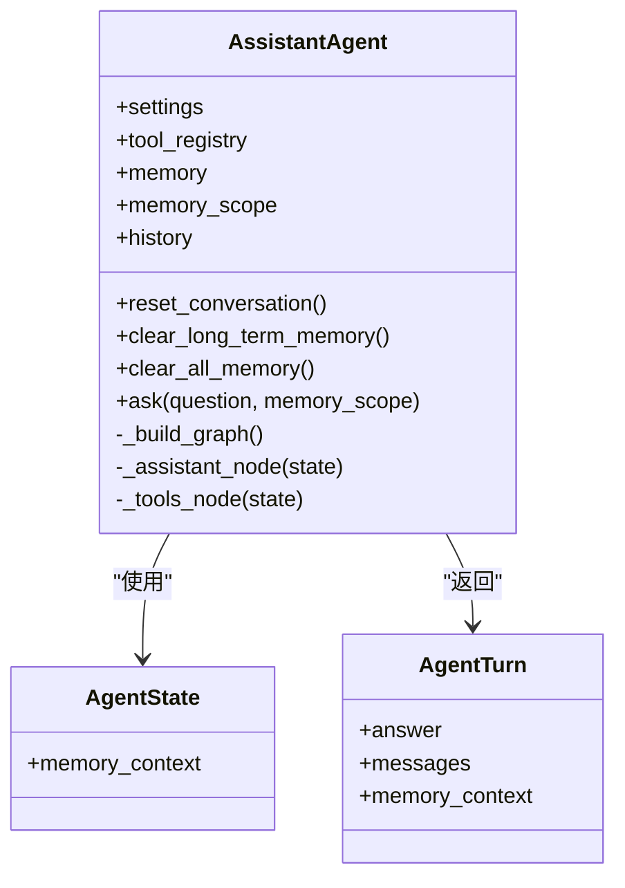

**图表来源**
- [agent_platform/agent.py:20-141](file://agent_platform/agent.py#L20-L141)

**章节来源**
- [agent_platform/agent.py:35-141](file://agent_platform/agent.py#L35-L141)

### ToolRegistry：注册表模式
ToolRegistry 是工具系统的单一事实源，体现注册表模式：
- 集中维护 ToolRegistration 列表，确保工具名唯一且不可变
- 提供 tools 给模型 bind_tools()，prompt_catalog() 给系统 Prompt 渲染工具目录，timeouts_by_name 给执行器做超时映射
- replace() 返回新注册表实例，便于测试注入替身而不污染生产注册表

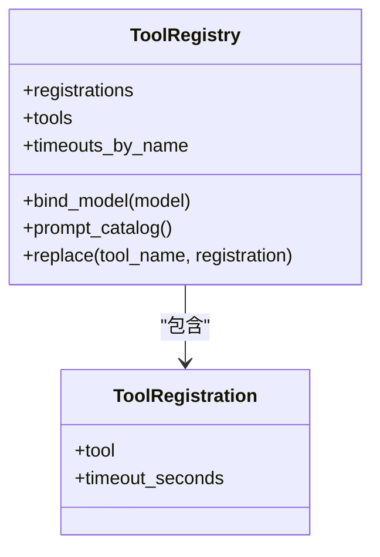

**图表来源**
- [agent_platform/tools/registry.py:15-93](file://agent_platform/tools/registry.py#L15-L93)

**章节来源**
- [agent_platform/tools/registry.py:1-94](file://agent_platform/tools/registry.py#L1-L94)
- [agent_platform/tools/factory.py:18-36](file://agent_platform/tools/factory.py#L18-L36)

### ReadOnlyToolExecutor：白名单与超时控制
ReadOnlyToolExecutor 体现安全边界和错误降级：
- 白名单机制：仅允许已注册工具被调用，未注册工具返回"不允许调用"的 observation，防止模型幻觉执行任意工具
- 超时控制：单工具显式超时优先，否则回落到默认超时；超时或异常均转为文本 observation，避免整张图崩溃
- 线程池隔离：使用 ThreadPoolExecutor 限制等待时间，取消未完成任务并关闭执行器

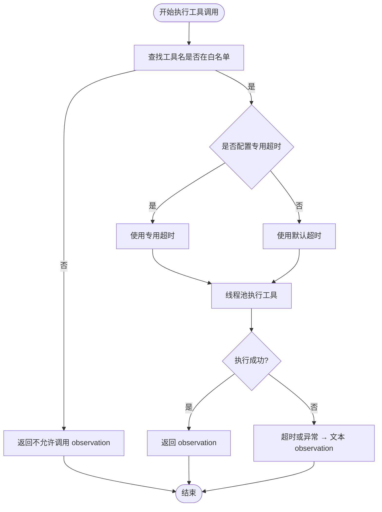

**图表来源**
- [agent_platform/tools/executor.py:27-67](file://agent_platform/tools/executor.py#L27-L67)

**章节来源**
- [agent_platform/tools/executor.py:1-67](file://agent_platform/tools/executor.py#L1-L67)

### AgentMemory：门面模式与并发安全
AgentMemory 作为记忆子系统门面，组合短期、长期和写入策略：
- in_memory() 工厂提供本地开发默认实现，便于快速验证
- turn(scope) 使用 RLock 串行化同一会话的完整读—执行—写流程，避免并发覆盖短期历史
- recall_context() 检索长期记忆并以不可信数据块形式注入模型，字符预算受控
- record_turn() 全量覆盖短期窗口，并按 writer 策略提取长期记忆记录进行 upsert

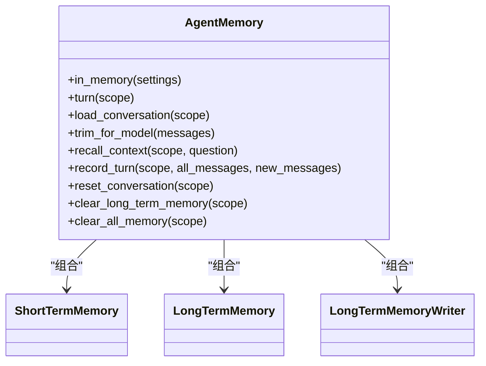

**图表来源**
- [agent_platform/memory/service.py:24-105](file://agent_platform/memory/service.py#L24-L105)

**章节来源**
- [agent_platform/memory/service.py:1-141](file://agent_platform/memory/service.py#L1-L141)

### 会话管理：ConversationRegistry
ConversationRegistry 是 Web 端会话管理的核心组件：
- 线程安全的进程内会话登记，使用 RLock 保证并发安全
- 支持会话创建、查询、删除和自动命名功能
- 与 AgentMemory 的 scope 锁配合支撑并发请求
- 会话 ID 使用 UUID 前缀，短号便于 URL 展示

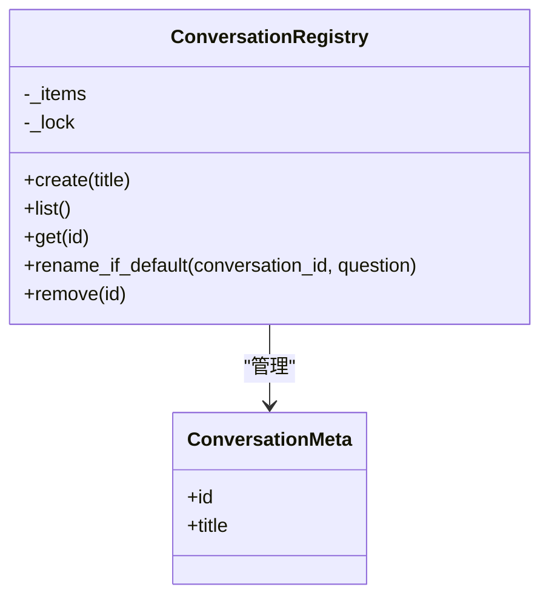

**图表来源**
- [web_api/sessions.py:16-62](file://web_api/sessions.py#L16-L62)

**章节来源**
- [web_api/sessions.py:1-62](file://web_api/sessions.py#L1-L62)

### 短期记忆：窗口策略与进程内实现
InMemoryShortTermMemory 与 MessageWindowPolicy 分离关注点：
- MessageWindowPolicy 按最大消息数裁剪，并保证窗口不从孤立的 AI 或 ToolMessage 开始，避免模型因缺少 tool_call 报错
- InMemoryShortTermMemory 按 MemoryScope 隔离消息，提供 load、replace、trim、clear 等操作，内部加锁保证并发安全

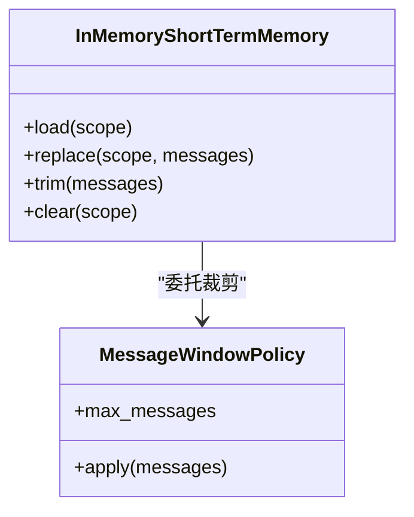

**图表来源**
- [agent_platform/memory/short_term.py:17-67](file://agent_platform/memory/short_term.py#L17-L67)

**章节来源**
- [agent_platform/memory/short_term.py:1-67](file://agent_platform/memory/short_term.py#L1-L67)

### 长期记忆：进程内实现与召回策略
InMemoryLongTermMemory 提供按 owner 隔离的进程内长期记忆：
- upsert() 支持确定性 id 的幂等覆盖，避免重复保存累积
- search() 先按 owner 取出候选集，再按类型过滤、词面重叠打分、最新优先排序，最后按 limit 截断
- 分词逻辑独立于 RAG，英文整词、中文双字 bigram 混合匹配，无命中时回退到最新记忆

**图表来源**
- [agent_platform/memory/long_term.py:37-66](file://agent_platform/memory/long_term.py#L37-L66)

**章节来源**
- [agent_platform/memory/long_term.py:1-83](file://agent_platform/memory/long_term.py#L1-L83)

### 数据模型：作用域、记录与设置
记忆域的数据模型定义了隔离边界和运行时参数：
- MemoryScope：三级隔离（租户、用户、会话），用于短期消息窗口
- MemoryOwner：两级隔离（租户、用户），用于长期记忆归属
- MemoryRecord：一条可跨会话召回的用户记忆，包含内容、类型、元数据和溯源信息
- MemoryQuery：检索请求，支持 owner、text、limit、kinds
- MemorySettings：短期窗口大小、长期召回条数和字符预算等运行参数

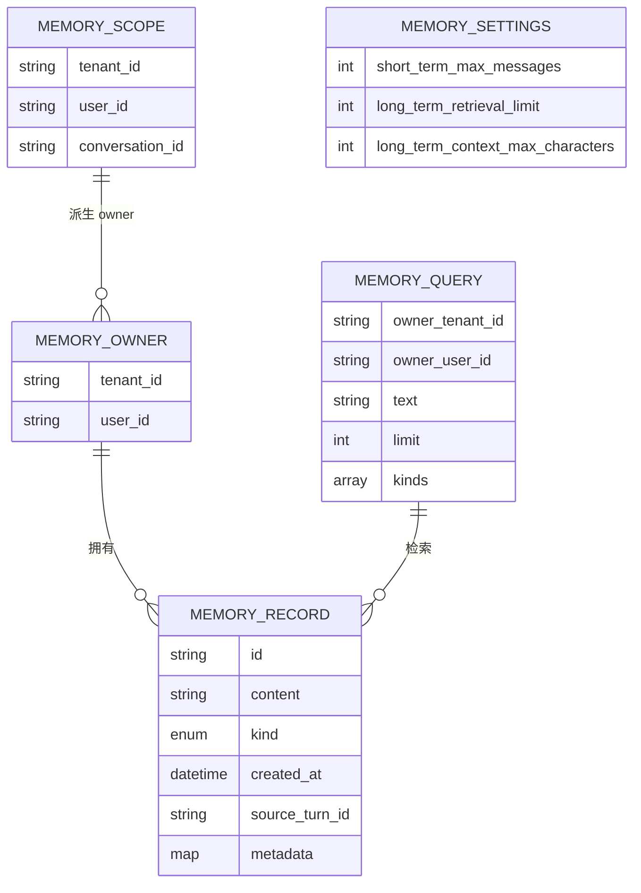

**图表来源**
- [agent_platform/memory/models.py:18-120](file://agent_platform/memory/models.py#L18-L120)

**章节来源**
- [agent_platform/memory/models.py:1-120](file://agent_platform/memory/models.py#L1-L120)

## 依赖关系分析
- **AssistantAgent** 依赖 ToolRegistry、AgentMemory 和 LangGraph；不直接依赖具体工具实现或存储后端
- **ToolRegistry** 依赖 BaseTool 和 LangChain 工具抽象，由 factory.py 组合领域客户端（RAG、天气）后注册
- **AgentMemory** 依赖三个 Protocol（ShortTermMemory、LongTermMemory、LongTermMemoryWriter），默认实现为进程内版本
- **web_api** 依赖 AssistantAgent 和 ConversationRegistry，通过依赖注入解耦
- **web_ui** 依赖 web_api 提供的 RESTful API，通过 api.ts 统一封装 HTTP 调用
- **main.py** 作为统一入口，根据子命令决定启动 CLI 还是 Web 服务

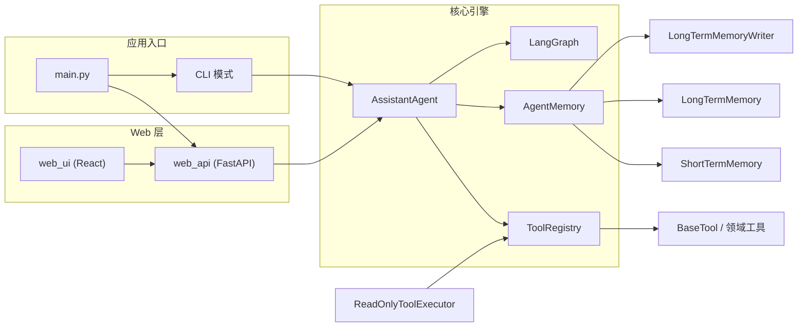

**图表来源**
- [main.py:16-20](file://main.py#L16-L20)
- [web_api/app.py:16-19](file://web_api/app.py#L16-L19)
- [web_ui/src/api.ts:30-47](file://web_ui/src/api.ts#L30-L47)

**章节来源**
- [main.py:1-154](file://main.py#L1-L154)
- [web_api/app.py:1-59](file://web_api/app.py#L1-L59)
- [web_ui/src/api.ts:1-48](file://web_ui/src/api.ts#L1-L48)

## 性能与可扩展性
- **短期记忆窗口裁剪**：通过 MessageWindowPolicy 控制送入模型的 token 数量，避免过长上下文导致成本上升和延迟增加
- **长期记忆召回预算**：long_term_context_max_characters 限制注入 Prompt 的记忆长度，防止大段用户数据影响模型响应
- **工具超时分级**：单工具专用超时优先，否则回落到默认超时，平衡网络工具稳定性与用户体验
- **进程内记忆优缺点**：
  - 优点：零外部依赖、开发调试简单、并发通过 RLock 保护
  - 缺点：进程重启丢失、无法跨进程共享、扩展性受限；生产环境应替换为 SQLite、Redis 或向量库
- **Web 服务性能**：FastAPI 异步框架，同步 def 路由由事件循环线程池执行，不会阻塞主事件循环
- **前端优化**：React 组件使用 hooks 管理状态，乐观渲染提升用户体验，路由切换避免不必要的重渲染
- **可扩展点**：
  - 新增工具只需在 factory.py 注册适配层，无需修改 Agent 或图结构
  - 替换长期记忆实现只需实现 LongTermMemory 契约，保持 Agent 和 ToolRegistry 不变
  - Web API 可通过添加新路由扩展功能，不影响现有接口
  - 前端组件可按需拆分，支持多页面应用扩展

## 故障排查指南
- **模型调用失败**：assistant 节点捕获异常并返回降级消息，图继续收尾；检查模型配置、API Key 和网络连通性
- **工具未注册**：执行器白名单拒绝未注册工具，返回"不允许调用" observation；确认工具已在 ToolRegistry 中注册
- **工具超时**：执行器返回超时 observation；检查网络工具超时配置和后端服务可用性
- **短期历史异常**：若窗口从孤立 AI 或 ToolMessage 开始，可能导致模型报错；检查消息序列完整性与窗口裁剪策略
- **长期记忆未召回**：确认 MemoryScope.owner 正确、writer 仅保存显式授权内容、检索文本与记忆内容存在词面重叠
- **Web API 404 错误**：检查会话是否存在，确认客户端使用的 conversation_id 有效
- **前端路由问题**：确认 SPAStaticFiles 正确配置，index.html 可正常回退
- **CORS 跨域问题**：开发环境检查 Vite 开发服务器地址是否在允许的 origins 列表中
- **会话状态不同步**：检查 ConversationRegistry 的线程安全性，确认前端状态与后端一致

**章节来源**
- [agent_platform/agent.py:120-141](file://agent_platform/agent.py#L120-L141)
- [agent_platform/tools/executor.py:27-67](file://agent_platform/tools/executor.py#L27-L67)
- [agent_platform/memory/short_term.py:25-38](file://agent_platform/memory/short_term.py#L25-L38)
- [agent_platform/memory/service.py:108-141](file://agent_platform/memory/service.py#L108-L141)
- [web_api/routes/chat.py:39-43](file://web_api/routes/chat.py#L39-L43)

## 结论
Agent Platform 通过 AssistantAgent 编排 LangGraph 状态图，结合 ToolRegistry 的工具注册表模式和 AgentMemory 的门面模式，实现了多轮对话的可扩展、可测试和安全可控的架构。随着架构演进，平台已成功从纯 CLI 应用发展为支持 Web 界面的混合架构，同时保留了命令行工具的便捷性。

新的混合架构具有以下优势：
- **多模态访问**：CLI 适合开发和自动化场景，Web 界面适合日常使用和演示
- **模块化设计**：Web API 和 Web UI 作为独立模块，可单独部署和维护
- **向后兼容**：原有的 CLI 功能和核心引擎保持不变，确保现有集成不受影响
- **可扩展性**：新的架构为未来功能扩展提供了更好的基础，如多用户认证、会话持久化等

进程内记忆适合开发与演示，生产环境可通过契约替换为持久化存储；工具白名单和超时控制保障了系统在模型幻觉和外部依赖不稳定时的鲁棒性。未来可在长期记忆引入向量检索、在工具层扩展更多领域能力，同时保持现有稳定边界不变。Web 层的引入也为平台的商业化和企业级应用奠定了坚实基础。