# AgentMemory 记忆门面

<cite>
**本文引用的文件**   
- [agent_platform/memory/__init__.py](file://agent_platform/memory/__init__.py)
- [agent_platform/memory/contracts.py](file://agent_platform/memory/contracts.py)
- [agent_platform/memory/models.py](file://agent_platform/memory/models.py)
- [agent_platform/memory/short_term.py](file://agent_platform/memory/short_term.py)
- [agent_platform/memory/long_term.py](file://agent_platform/memory/long_term.py)
- [agent_platform/memory/service.py](file://agent_platform/memory/service.py)
</cite>

## 目录
1. [简介](#简介)
2. [项目结构](#项目结构)
3. [核心组件](#核心组件)
4. [架构总览](#架构总览)
5. [详细组件分析](#详细组件分析)
6. [依赖关系分析](#依赖关系分析)
7. [性能与可扩展性](#性能与可扩展性)
8. [故障排查指南](#故障排查指南)
9. [结论](#结论)
10. [附录：使用示例与替换实现](#附录使用示例与替换实现)

## 简介
AgentMemory 是记忆子系统对外的唯一门面，负责统一协调短期会话窗口、长期用户记忆以及从对话中抽取可持久化记忆的写入策略。它通过 Protocol 契约解耦具体存储实现，使系统可以无缝替换为 SQLite、Redis 或向量数据库等后端；同时提供进程内默认实现，便于本地开发与演示。

该文档重点说明：
- 门面模式如何简化短期与长期记忆的访问
- MemoryScope 作用域机制的设计与使用场景
- turn() 上下文管理器如何保证对话操作的原子性与线程安全
- load_conversation()、recall_context()、record_turn() 等核心方法的职责与流程
- trim_for_model() 的窗口裁剪策略
- clear_* 系列方法的清理逻辑
- 如何通过自定义 LongTermMemoryWriter 和 LongTermMemory 实现持久化扩展

## 项目结构
记忆子系统采用分层组织，单向依赖方向为：models → contracts → short_term / long_term / writer → service（门面）。包入口对外暴露稳定的 API，内部实现细节被隐藏。

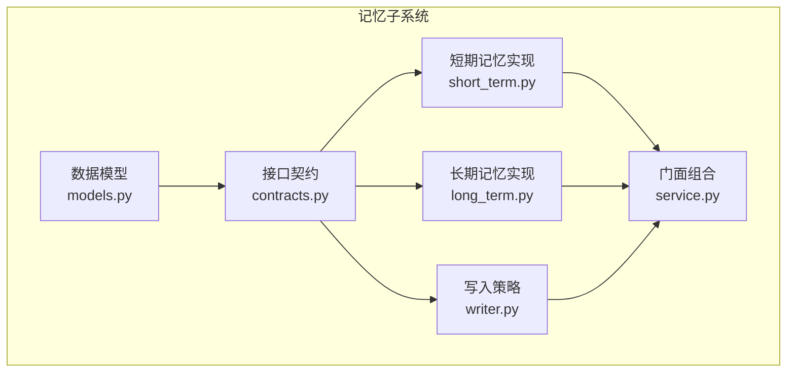

**图表来源**
- [agent_platform/memory/models.py:1-120](file://agent_platform/memory/models.py#L1-L120)
- [agent_platform/memory/contracts.py:1-59](file://agent_platform/memory/contracts.py#L1-L59)
- [agent_platform/memory/short_term.py:1-67](file://agent_platform/memory/short_term.py#L1-L67)
- [agent_platform/memory/long_term.py:1-83](file://agent_platform/memory/long_term.py#L1-L83)
- [agent_platform/memory/service.py:1-141](file://agent_platform/memory/service.py#L1-L141)

**章节来源**
- [agent_platform/memory/__init__.py:1-41](file://agent_platform/memory/__init__.py#L1-L41)

## 核心组件
- 数据模型
  - MemoryKind：长期记忆的语义类型（偏好、约束、档案、摘要预留）
  - MemoryOwner：长期记忆的归属边界（租户 + 用户）
  - MemoryScope：一次对话的完整作用域（租户 + 用户 + 会话），并派生出 owner
  - MemoryRecord：一条可跨会话召回的记忆条目
  - MemoryQuery：长期记忆检索请求
  - RetrievedMemory：检索结果及分数
  - MemorySettings：门面运行参数（短期窗口大小、召回条数、字符预算）
- 接口契约
  - ShortTermMemory：按会话保存 LangChain 消息窗口
  - LongTermMemory：跨短期窗口、按用户隔离的结构化记忆存储
  - LongTermMemoryWriter：从一轮新增消息中提取可持久化记忆
- 默认实现
  - InMemoryShortTermMemory：进程内短期消息窗口，带 RLock 并发保护
  - MessageWindowPolicy：按数量裁剪，避免窗口以孤立 AI/Tool 消息开头
  - InMemoryLongTermMemory：进程内长期记忆，基于词面重叠打分
- 门面
  - AgentMemory：组合三个契约，提供统一的会话管理与记忆操作入口

**章节来源**
- [agent_platform/memory/models.py:18-120](file://agent_platform/memory/models.py#L18-L120)
- [agent_platform/memory/contracts.py:17-59](file://agent_platform/memory/contracts.py#L17-L59)
- [agent_platform/memory/short_term.py:17-67](file://agent_platform/memory/short_term.py#L17-L67)
- [agent_platform/memory/long_term.py:20-83](file://agent_platform/memory/long_term.py#L20-L83)
- [agent_platform/memory/service.py:24-106](file://agent_platform/memory/service.py#L24-L106)

## 架构总览
AgentMemory 作为门面，屏蔽了短期与长期记忆的差异，向上层暴露简洁一致的 API。其关键设计点包括：
- 依赖倒置：仅依赖 ShortTermMemory、LongTermMemory、LongTermMemoryWriter 三个 Protocol
- 作用域隔离：短期按 tenant+user+conversation 三级隔离；长期按 tenant+user 两级隔离
- 线程安全：通过 RLock 保护并发读写，turn() 串行化同一会话的完整读—执行—写流程
- 可替换性：in_memory() 工厂提供默认实现，生产环境可按契约替换为持久化后端

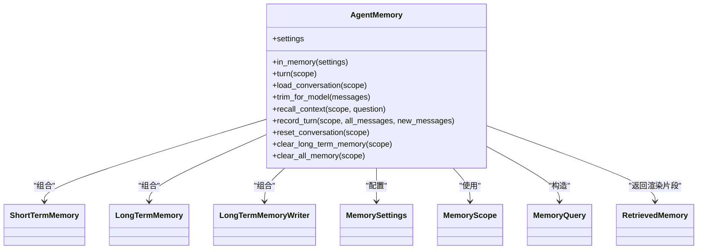

**图表来源**
- [agent_platform/memory/service.py:24-106](file://agent_platform/memory/service.py#L24-L106)
- [agent_platform/memory/contracts.py:17-59](file://agent_platform/memory/contracts.py#L17-L59)
- [agent_platform/memory/models.py:40-120](file://agent_platform/memory/models.py#L40-L120)

## 详细组件分析

### 门面类 AgentMemory
AgentMemory 是记忆子系统的统一入口，负责：
- 组合短期、长期与写入策略
- 提供会话级原子操作（turn）
- 封装短期窗口裁剪、长期记忆召回与渲染
- 提供多种清理方法，覆盖不同清理范围

关键方法与职责：
- in_memory(settings)：创建默认进程内实现
- turn(scope)：上下文管理器，确保同一会话的完整流程串行执行
- load_conversation(scope)：加载短期历史
- trim_for_model(messages)：按窗口策略裁剪消息
- recall_context(scope, question)：召回长期记忆并渲染为 Prompt 片段
- record_turn(scope, all_messages, new_messages)：更新短期窗口并持久化值得保存的记忆
- reset_conversation(scope)：仅清空短期历史
- clear_long_term_memory(scope)：删除当前用户的长期记忆
- clear_all_memory(scope)：同时清空短期与长期记忆

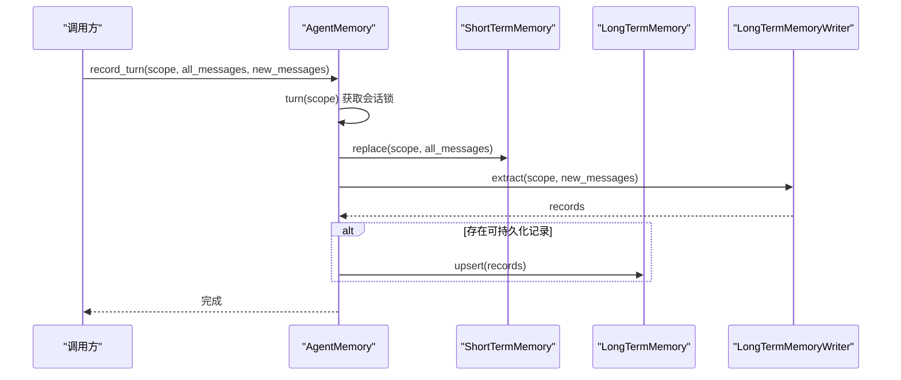

**图表来源**
- [agent_platform/memory/service.py:77-90](file://agent_platform/memory/service.py#L77-L90)
- [agent_platform/memory/contracts.py:17-59](file://agent_platform/memory/contracts.py#L17-L59)

**章节来源**
- [agent_platform/memory/service.py:24-106](file://agent_platform/memory/service.py#L24-L106)

### 作用域管理 MemoryScope
MemoryScope 表示一次对话使用的完整记忆作用域，包含：
- tenant_id：租户标识
- user_id：用户标识
- conversation_id：会话标识

特性：
- 构造时校验各字段非空
- 提供 owner 属性派生长期记忆归属（去掉 conversation 一级）
- 提供 local() 便捷方法用于本地演示

使用场景：
- 短期记忆按三级作用域隔离，避免不同会话互相污染
- 长期记忆按 owner（tenant+user）隔离，支持跨会话召回

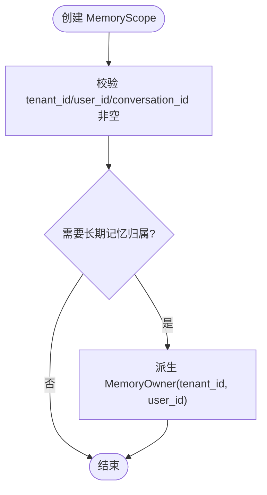

**图表来源**
- [agent_platform/memory/models.py:27-59](file://agent_platform/memory/models.py#L27-L59)

**章节来源**
- [agent_platform/memory/models.py:27-59](file://agent_platform/memory/models.py#L27-L59)

### 上下文管理器 turn()
turn() 通过 RLock 实现会话级串行化：
- 首次遇到某个 scope 时创建专属锁
- 后续对该 scope 的所有操作在同一个锁下串行执行
- 保证同一会话的“读—执行—写”流程不被并发覆盖

线程安全要点：
- _scope_locks_guard 保护 _scope_locks 字典的并发访问
- 每个 MemoryScope 对应一个 RLock，避免全局锁竞争
- record_turn()、reset_conversation()、clear_all_memory() 等方法在 turn() 上下文中执行，确保原子性

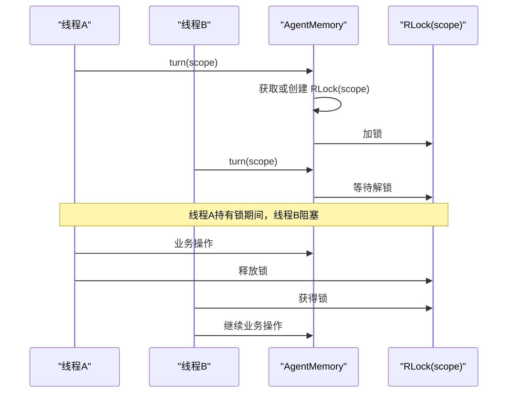

**图表来源**
- [agent_platform/memory/service.py:51-57](file://agent_platform/memory/service.py#L51-L57)

**章节来源**
- [agent_platform/memory/service.py:51-57](file://agent_platform/memory/service.py#L51-L57)

### 核心方法详解

#### load_conversation()
- 职责：加载指定会话的短期历史消息
- 行为：直接委托 ShortTermMemory.load(scope)
- 适用场景：对话开始时恢复短期窗口

**章节来源**
- [agent_platform/memory/service.py:59-61](file://agent_platform/memory/service.py#L59-L61)

#### recall_context()
- 职责：根据当前问题召回长期记忆，渲染为防注入的 Prompt 片段
- 流程：
  1. 构造 MemoryQuery(owner=scope.owner, text=question, limit=settings.long_term_retrieval_limit)
  2. 调用 LongTermMemory.search(query)
  3. 将 RetrievedMemory 列表渲染为带 <remembered_user_data> 外壳的文本
- 安全设计：渲染时对内容中的尖括号进行转义，防止伪造闭合标签逃逸边界；长度受字符预算限制

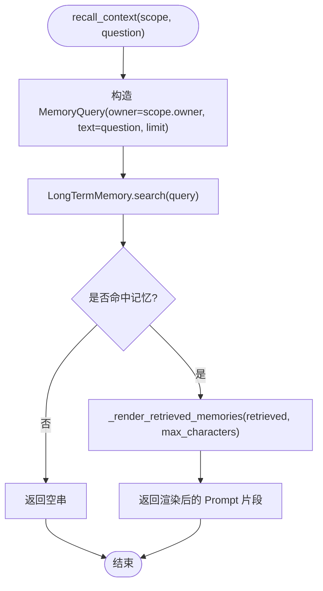

**图表来源**
- [agent_platform/memory/service.py:67-75](file://agent_platform/memory/service.py#L67-L75)
- [agent_platform/memory/service.py:108-141](file://agent_platform/memory/service.py#L108-L141)

**章节来源**
- [agent_platform/memory/service.py:67-75](file://agent_platform/memory/service.py#L67-L75)
- [agent_platform/memory/service.py:108-141](file://agent_platform/memory/service.py#L108-L141)

#### record_turn()
- 职责：保存真实会话消息，并提取值得持久化的长期记忆
- 流程：
  1. 进入 turn(scope) 上下文，确保原子性
  2. 调用 ShortTermMemory.replace(scope, all_messages)，内部会先按窗口策略裁剪
  3. 调用 LongTermMemoryWriter.extract(scope, new_messages) 提取可持久化记录
  4. 若存在记录，调用 LongTermMemory.upsert(records) 幂等写入

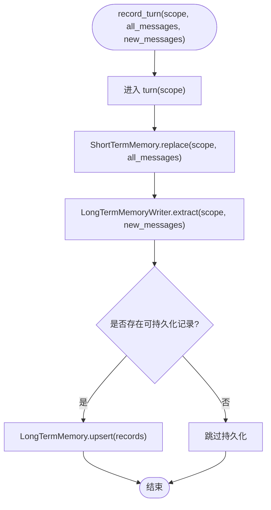

**图表来源**
- [agent_platform/memory/service.py:77-90](file://agent_platform/memory/service.py#L77-L90)

**章节来源**
- [agent_platform/memory/service.py:77-90](file://agent_platform/memory/service.py#L77-L90)

#### trim_for_model()
- 职责：按窗口策略裁剪送入模型的消息序列，控制 token 成本
- 行为：委托 ShortTermMemory.trim(messages)
- 策略：由 MessageWindowPolicy.apply() 实现，保留最近 N 条消息，并确保窗口不从孤立的 AI/Tool 消息开始

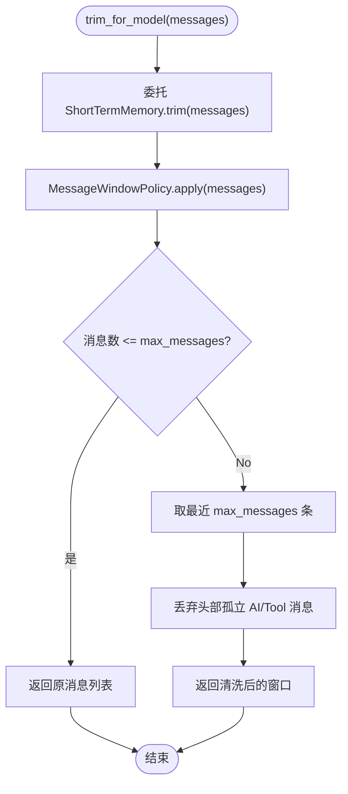

**图表来源**
- [agent_platform/memory/service.py:63-65](file://agent_platform/memory/service.py#L63-L65)
- [agent_platform/memory/short_term.py:17-38](file://agent_platform/memory/short_term.py#L17-L38)

**章节来源**
- [agent_platform/memory/service.py:63-65](file://agent_platform/memory/service.py#L63-L65)
- [agent_platform/memory/short_term.py:17-38](file://agent_platform/memory/short_term.py#L17-L38)

#### clear_* 系列方法
- reset_conversation(scope)：仅清空短期历史，不影响长期记忆
- clear_long_term_memory(scope)：删除当前用户跨会话的全部长期记忆
- clear_all_memory(scope)：同时清空短期历史与当前用户的长期记忆

这些方法均遵循最小权限原则，按需选择清理范围，避免误删其他作用域的数据。

**章节来源**
- [agent_platform/memory/service.py:92-105](file://agent_platform/memory/service.py#L92-L105)

### 短期记忆与窗口裁剪
- MessageWindowPolicy：按数量裁剪，避免窗口以孤立 AI/Tool 消息开头
- InMemoryShortTermMemory：进程内存储，按会话作用域隔离，使用 RLock 保证并发安全

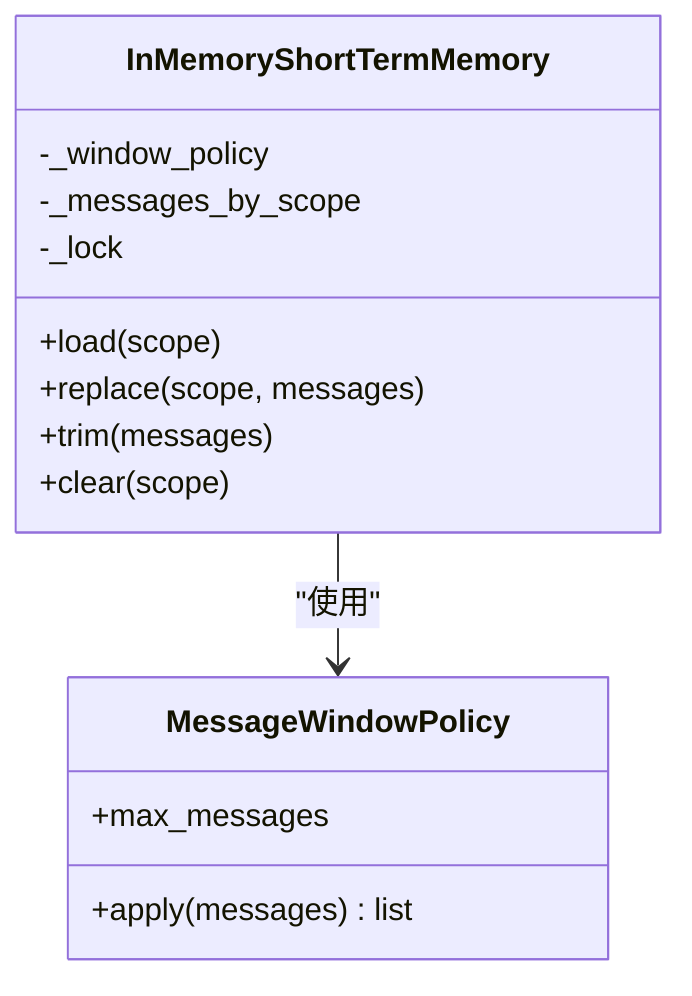

**图表来源**
- [agent_platform/memory/short_term.py:17-67](file://agent_platform/memory/short_term.py#L17-L67)

**章节来源**
- [agent_platform/memory/short_term.py:17-67](file://agent_platform/memory/short_term.py#L17-L67)

### 长期记忆与检索
- InMemoryLongTermMemory：进程内存储，按 owner 隔离，支持 upsert、search、clear_owner
- 检索策略：词面重叠打分（中文双字 bigram / 英文整词），无命中时回退到最新记忆
- 排序规则：分数降序，同分时新记忆优先，最后按 limit 截断

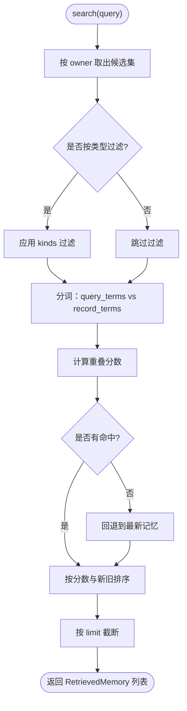

**图表来源**
- [agent_platform/memory/long_term.py:37-66](file://agent_platform/memory/long_term.py#L37-L66)

**章节来源**
- [agent_platform/memory/long_term.py:20-83](file://agent_platform/memory/long_term.py#L20-L83)

## 依赖关系分析
- 门面依赖契约：AgentMemory 仅依赖 ShortTermMemory、LongTermMemory、LongTermMemoryWriter 三个 Protocol，不耦合具体实现
- 默认实现依赖模型：InMemoryShortTermMemory、InMemoryLongTermMemory 依赖 models.py 中的数据模型
- 外部可见 API：__init__.py 暴露稳定白名单，内部实现细节被隐藏

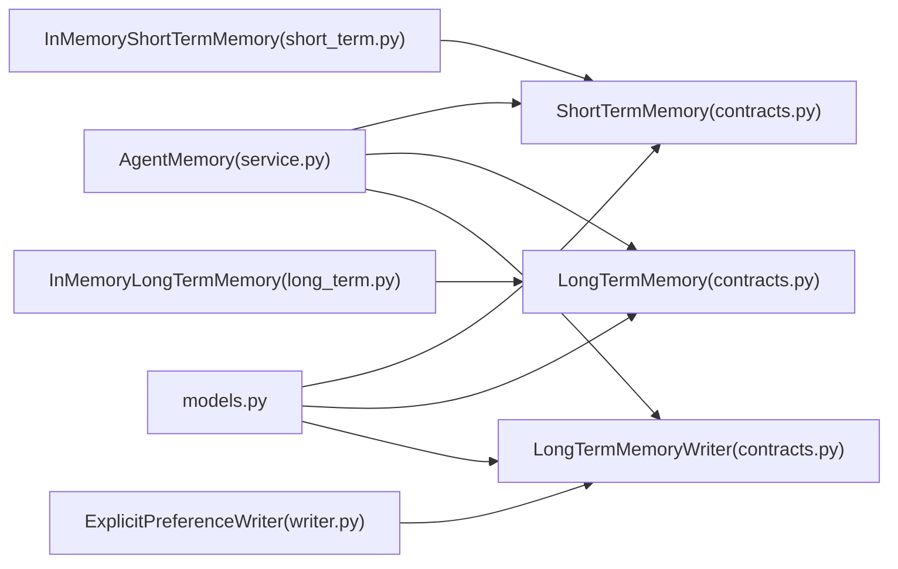

**图表来源**
- [agent_platform/memory/service.py:1-22](file://agent_platform/memory/service.py#L1-L22)
- [agent_platform/memory/contracts.py:1-59](file://agent_platform/memory/contracts.py#L1-L59)
- [agent_platform/memory/short_term.py:1-15](file://agent_platform/memory/short_term.py#L1-L15)
- [agent_platform/memory/long_term.py:1-15](file://agent_platform/memory/long_term.py#L1-L15)

**章节来源**
- [agent_platform/memory/__init__.py:1-41](file://agent_platform/memory/__init__.py#L1-L41)

## 性能与可扩展性
- 窗口裁剪：MessageWindowPolicy 按固定阈值裁剪，时间复杂度 O(N)，空间复杂度 O(K)（K 为窗口大小）
- 长期检索：词面重叠打分，时间复杂度 O(M×T)（M 为候选记录数，T 为分词开销），适合进程内快速检索
- 并发安全：RLock 粒度为会话级别，避免全局锁竞争，提升吞吐
- 可扩展性：通过替换 LongTermMemory 与 LongTermMemoryWriter，可接入向量库、SQL 存储或远程服务

[本节为通用指导，不涉及具体文件分析]

## 故障排查指南
- 作用域为空导致构造失败：检查 MemoryScope 与 MemoryOwner 的必填字段是否为空
- 短期窗口异常：确认 MessageWindowPolicy.max_messages >= 1，且窗口不以孤立 AI/Tool 消息开头
- 长期记忆未命中：检查 query.text 是否有效，或尝试放宽 kinds 过滤条件
- 并发覆盖问题：确保在 record_turn()、reset_conversation()、clear_all_memory() 中使用 turn(scope) 上下文
- 渲染注入风险：确认 _render_retrieved_memories() 已对尖括号进行转义，且字符预算设置合理

**章节来源**
- [agent_platform/memory/models.py:34-49](file://agent_platform/memory/models.py#L34-L49)
- [agent_platform/memory/short_term.py:20-23](file://agent_platform/memory/short_term.py#L20-L23)
- [agent_platform/memory/service.py:108-141](file://agent_platform/memory/service.py#L108-L141)

## 结论
AgentMemory 通过门面模式与 Protocol 契约，将短期会话窗口与长期用户记忆解耦，并提供清晰的 API 与线程安全的会话管理。其默认实现便于本地开发，同时支持在生产环境中替换为持久化后端。通过 MemoryScope 的作用域隔离与 turn() 的原子性保障，系统能够在多租户、多用户、多会话场景下保持数据一致性与安全性。

[本节为总结性内容，不涉及具体文件分析]

## 附录：使用示例与替换实现

### 基本用法示例
以下示例展示如何使用 AgentMemory 进行会话管理与记忆操作（不展示具体代码内容，仅提供步骤说明）：
- 初始化门面：使用 in_memory(settings) 创建默认实现
- 定义作用域：创建 MemoryScope(tenant_id, user_id, conversation_id)
- 加载历史：调用 load_conversation(scope)
- 裁剪消息：调用 trim_for_model(messages)
- 召回上下文：调用 recall_context(scope, question)
- 记录轮次：调用 record_turn(scope, all_messages, new_messages)
- 清理数据：根据需要调用 reset_conversation()、clear_long_term_memory()、clear_all_memory()

**章节来源**
- [agent_platform/memory/service.py:41-49](file://agent_platform/memory/service.py#L41-L49)
- [agent_platform/memory/service.py:59-105](file://agent_platform/memory/service.py#L59-L105)

### 替换默认实现以支持持久化存储
- 实现 LongTermMemory 契约：提供 upsert、search、clear_owner 方法，可对接 SQLite、Redis 或向量库
- 实现 LongTermMemoryWriter 契约：实现 extract(scope, new_messages)，从新增消息中提取可持久化记忆
- 组装门面：传入自定义的 short_term、long_term、writer 与 settings，替代默认实现

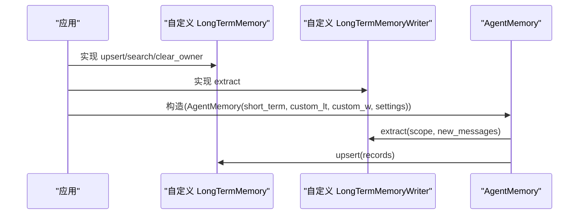

**图表来源**
- [agent_platform/memory/contracts.py:37-59](file://agent_platform/memory/contracts.py#L37-L59)
- [agent_platform/memory/service.py:27-49](file://agent_platform/memory/service.py#L27-L49)

**章节来源**
- [agent_platform/memory/contracts.py:37-59](file://agent_platform/memory/contracts.py#L37-L59)
- [agent_platform/memory/service.py:27-49](file://agent_platform/memory/service.py#L27-L49)