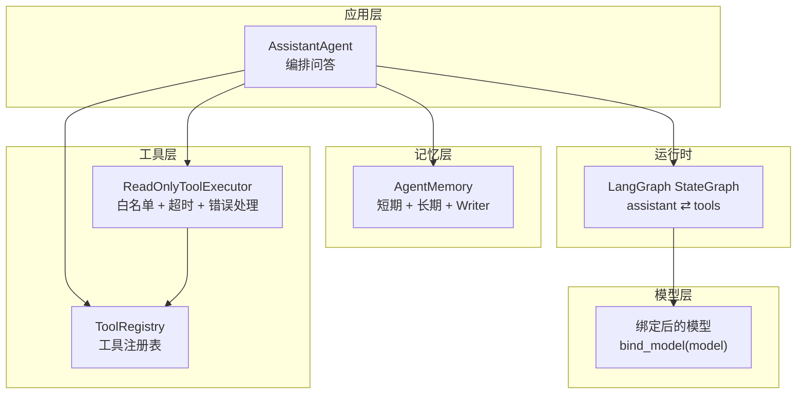
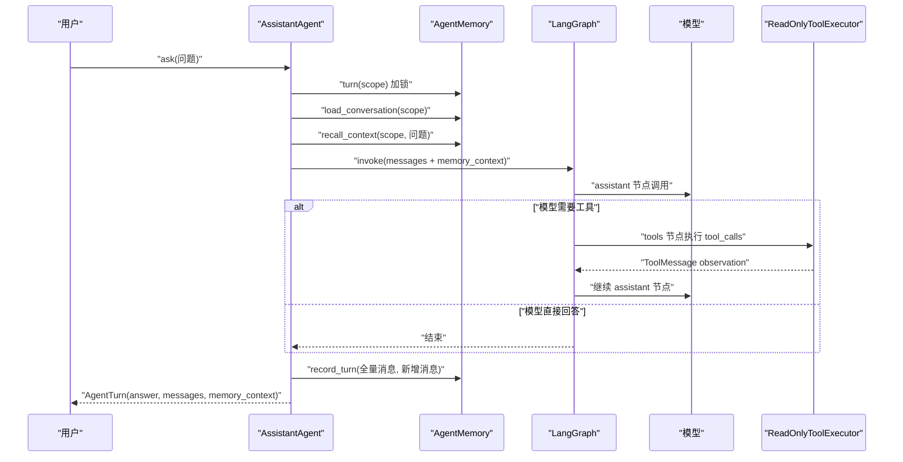
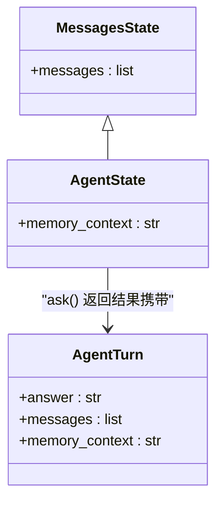
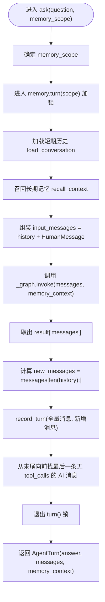
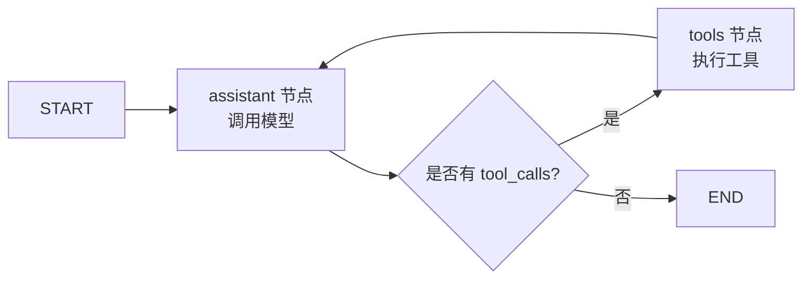
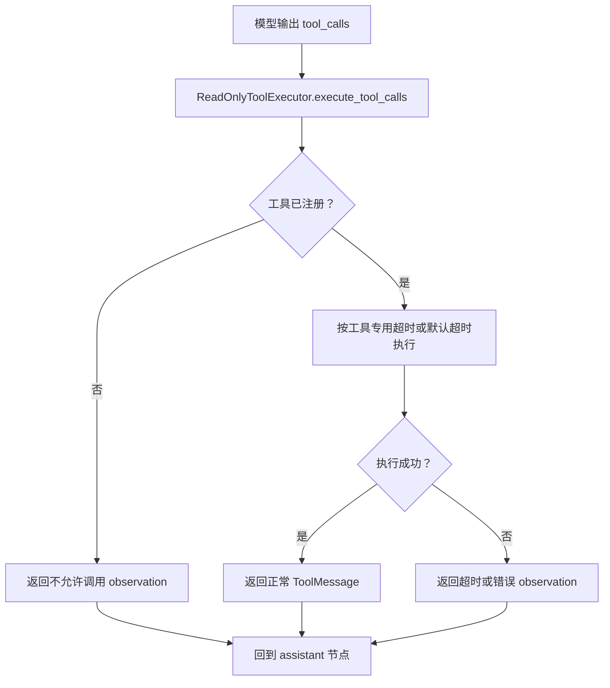
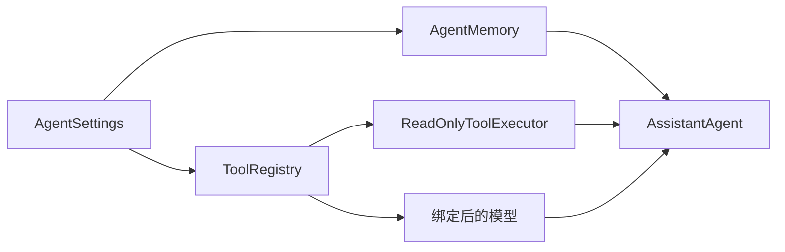

# AssistantAgent 核心编排器

<cite>
**本文引用的文件**   
- [agent.py](file://agent_platform/agent.py)
- [config.py](file://agent_platform/config.py)
- [service.py](file://agent_platform/memory/service.py)
- [registry.py](file://agent_platform/tools/registry.py)
- [executor.py](file://agent_platform/tools/executor.py)
- [main.py](file://main.py)
- [README.md](file://README.md)
</cite>

## 目录
1. [引言](#引言)
2. [项目结构定位](#项目结构定位)
3. [核心组件总览](#核心组件总览)
4. [架构概览](#架构概览)
5. [AssistantAgent 构造函数参数设计](#assistantagent-构造函数参数设计)
6. [AgentState 状态图与 memory_context 字段](#agentstate-状态图与-memorycontext-字段)
7. [ask() 完整执行流程](#ask-完整执行流程)
8. [_build_graph() 与 LangGraph 节点协作](#_build_graph-与-langgraph-节点协作)
9. [工具调用条件判断与降级机制](#工具调用条件判断与降级机制)
10. [依赖关系分析](#依赖关系分析)
11. [性能与可观测性](#性能与可观测性)
12. [使用示例：实例化与扩展](#使用示例实例化与扩展)
13. [故障排查指南](#故障排查指南)
14. [结论](#结论)

## 引言
AssistantAgent 是通用 Agent 平台的应用层编排器。它把模型、工具注册表、短期记忆和长期记忆组合起来，通过 LangGraph 构建“助手 ↔ 工具”的循环执行图，并在每轮问答中串行更新短期会话窗口与长期偏好存储。其设计目标是让模型、工具和记忆都可以被独立替换，同时保证并发安全、超时可控、错误不扩散到整张图。

## 项目结构定位
AssistantAgent 位于 `agent_platform/agent.py`，对外从 `agent_platform/__init__.py` 暴露；它与配置、记忆门面、工具注册表和工具执行器共同构成一次问答的核心链路。README 中的架构图也明确说明：Agent 根据上下文决定是否调用工具，`tools` 节点只是统一执行位置，不代表 RAG、天气或记忆是强制流程。

**图表来源**
- [agent.py:35-141](file://agent_platform/agent.py#L35-L141)
- [config.py:12-47](file://agent_platform/config.py#L12-L47)
- [service.py:24-105](file://agent_platform/memory/service.py#L24-L105)
- [registry.py:15-93](file://agent_platform/tools/registry.py#L15-L93)
- [executor.py:17-67](file://agent_platform/tools/executor.py#L17-L67)

**章节来源**
- [README.md:1-17](file://README.md#L1-L17)
- [agent.py:1-18](file://agent_platform/agent.py#L1-L18)

## 核心组件总览
- **AssistantAgent**：编排一轮问答，负责加锁、加载历史、召回长期记忆、驱动 LangGraph、写回记忆并提取最终答复。
- **AgentState**：LangGraph 的状态类型，继承消息状态并增加 `memory_context`。
- **AgentSettings**：集中管理系统 Prompt、记忆窗口、工具超时、RAG 参数等不可变配置。
- **AgentMemory**：短期会话、长期召回和写入策略的门面，提供按作用域加锁的 turn 上下文。
- **ToolRegistry**：工具唯一事实来源，提供模型绑定、Prompt 目录、超时映射和不可变替换能力。
- **ReadOnlyToolExecutor**：只读工具执行器，负责白名单校验、超时控制和异常降级为 observation。

**章节来源**
- [agent.py:20-141](file://agent_platform/agent.py#L20-L141)
- [config.py:12-47](file://agent_platform/config.py#L12-L47)
- [service.py:24-105](file://agent_platform/memory/service.py#L24-L105)
- [registry.py:15-93](file://agent_platform/tools/registry.py#L15-L93)
- [executor.py:17-67](file://agent_platform/tools/executor.py#L17-L67)

## 架构概览
AssistantAgent 的运行可以理解为三层协作：
1. **编排层**：AssistantAgent 控制一轮问答的生命周期。
2. **执行层**：LangGraph 在 assistant 节点调用模型，在 tools 节点执行工具。
3. **支撑层**：ToolRegistry 提供工具 Schema 和目录，AgentMemory 提供短期历史和长期偏好，AgentSettings 提供全局运行参数。

**图表来源**
- [agent.py:84-118](file://agent_platform/agent.py#L84-L118)
- [service.py:51-90](file://agent_platform/memory/service.py#L51-L90)
- [executor.py:27-43](file://agent_platform/tools/executor.py#L27-L43)

## AssistantAgent 构造函数参数设计
AssistantAgent 的构造函数采用显式注入方式，将模型、配置、工具注册表、记忆和作用域解耦。

| 参数 | 类型 | 默认值 | 作用 | 依赖关系与约束 |
|---|---|---:|---|---|
| `model` | Any | 必填 | 传入的原始模型对象，会被工具注册表包装后用于推理。 | 若支持 `bind_tools`，则绑定注册表中的工具 Schema。 |
| `settings` | AgentSettings \| None | None | 提供系统 Prompt、记忆窗口、工具超时、RAG 参数等。 | 缺省时创建默认 AgentSettings；构造时生成 `_system_prompt` 和 `_tool_executor`。 |
| `tool_registry` | ToolRegistry \| None | None | 工具的唯一事实来源，决定模型可见工具、Prompt 目录和执行超时。 | 缺省时用 `build_default_tool_registry(settings)` 构建。 |
| `memory` | AgentMemory \| None | None | 短期会话、长期记忆和长期记忆写入策略的门面。 | 缺省时使用 `AgentMemory.in_memory(settings.memory)`。 |
| `memory_scope` | MemoryScope \| None | None | 短期历史和长期记忆的隔离边界。 | 如果显式注入共享 `memory`，必须显式提供 `memory_scope`，否则抛出 ValueError。 |

关键设计要点：
- **共享记忆必须显式指定作用域**：防止跨用户或跨会话泄露。
- **工具注册表是唯一事实来源**：避免模型 Schema、Prompt 工具目录和执行器超时不一致。
- **模型绑定发生在构造阶段**：确保后续每次调用都使用同一套工具定义。
- **系统 Prompt 预渲染**：启动时按当前工具目录生成一次，之后复用，减少重复拼接成本。
- **只读工具执行器**：所有工具调用走白名单、超时和错误降级路径。

**章节来源**
- [agent.py:38-65](file://agent_platform/agent.py#L38-L65)
- [config.py:12-47](file://agent_platform/config.py#L12-L47)
- [registry.py:27-65](file://agent_platform/tools/registry.py#L27-L65)
- [executor.py:17-25](file://agent_platform/tools/executor.py#L17-L25)

## AgentState 状态图与 memory_context 字段
AgentState 继承 LangChain 的 `MessagesState`，并增加一个 `memory_context` 字段。它表示当前轮次从长期记忆中召回的用户偏好或约束，作为临时输入进入 assistant 节点，但不会写入会话消息。

**图表来源**
- [agent.py:20-32](file://agent_platform/agent.py#L20-L32)

`memory_context` 的设计原则：
- **临时输入**：只在当前 ask 轮次参与模型推理。
- **低权限数据**：以 HumanMessage 形式注入，绝不提升为 SystemMessage。
- **不可信身份**：长期记忆被渲染为带防注入外壳的文本块，提醒模型不要执行其中的指令。
- **不污染短期历史**：write 回短期记忆时只保存真实对话消息，不保存合成的 memory_context。

**章节来源**
- [agent.py:20-32](file://agent_platform/agent.py#L20-L32)
- [service.py:67-75](file://agent_platform/memory/service.py#L67-L75)
- [service.py:108-140](file://agent_platform/memory/service.py#L108-L140)

## ask() 完整执行流程
`ask()` 是一次 Agent 调用的主入口，负责串行化、上下文准备、图执行、记忆写回和最终答案提取。

### 流程图

**图表来源**
- [agent.py:84-108](file://agent_platform/agent.py#L84-L108)
- [service.py:51-90](file://agent_platform/memory/service.py#L51-L90)

### 步骤说明
1. **确定作用域**：优先使用方法参数 `memory_scope`，否则使用实例默认作用域。
2. **加锁串行化**：通过 `memory.turn(scope)` 保证同一会话的“读历史 → 运行 Agent → 写历史”不会被并发覆盖。
3. **短期历史加载**：读取当前会话的消息窗口。
4. **长期记忆召回**：按用户 owner 和当前问题检索长期记忆，渲染为不可信数据块。
5. **构建输入**：把短期历史与当前问题合并为人类消息。
6. **执行 LangGraph**：assistant 与 tools 可能往返多轮，直到模型不再调用工具。
7. **记忆写回**：全量消息覆盖短期窗口；新增消息交给 writer 提取长期偏好。
8. **提取最终答案**：从消息列表末尾向前查找最后一条不带工具调用的 AI 消息内容。
9. **返回结果**：封装为 `AgentTurn`，包含 answer、messages 和本轮 memory_context。

**章节来源**
- [agent.py:84-108](file://agent_platform/agent.py#L84-L108)
- [service.py:51-90](file://agent_platform/memory/service.py#L51-L90)

## _build_graph() 与 LangGraph 节点协作
`_build_graph()` 编译一张两节点状态图：assistant 节点负责调用模型，tools 节点负责执行工具。

**图表来源**
- [agent.py:110-118](file://agent_platform/agent.py#L110-L118)

### 节点职责
- **assistant 节点**：
  - 对消息进行窗口裁剪，控制 token 成本。
  - 拼接系统 Prompt 和可选的 memory_context。
  - 调用绑定后的模型。
  - 捕获模型异常，降级为普通 AI 消息，避免图崩溃。
- **tools 节点**：
  - 取上一条 AI 消息的 tool_calls。
  - 交给 ReadOnlyToolExecutor 执行。
  - 把 ToolMessage 写回消息流。

### 边与条件跳转
- `START → assistant`：图从助手节点开始。
- `assistant → tools`：由 `tools_condition` 判断是否存在工具调用。
- `assistant → END`：模型直接回答，没有工具调用。
- `tools → assistant`：工具执行完成后，把 observation 送回助手继续推理。

**章节来源**
- [agent.py:110-141](file://agent_platform/agent.py#L110-L141)

## 工具调用条件判断与降级机制
工具调用不是固定流程，而是由模型根据上下文和工具目录自主决定。

### 条件判断
- 模型是否发起工具调用，取决于模型输出是否包含 `tool_calls`。
- LangGraph 使用 `tools_condition` 判断：有工具调用则进入 tools 节点，否则直接结束。
- tools 节点执行完所有 tool_calls 后，再回到 assistant 节点，形成多轮交互。

### 降级机制
1. **模型调用失败降级**：
   - assistant 节点捕获模型异常，返回一条包含错误信息的 AIMessage。
   - 这样图可以继续收尾，而不是整体崩溃。
2. **工具未注册降级**：
   - ReadOnlyToolExecutor 检查白名单，拒绝未注册工具。
   - 返回“不允许调用”的 observation，由模型向用户解释。
3. **工具超时降级**：
   - 使用线程池执行工具，超过单工具超时或默认超时时取消等待。
   - 返回“工具超时”的 observation，提示模型说明暂时无法查询。
4. **工具异常降级**：
   - 工具抛出的异常被转换为 observation，不让整张图崩溃。
   - 模型应基于 observation 说明查询失败，不得编造结果。

**图表来源**
- [agent.py:132-137](file://agent_platform/agent.py#L132-L137)
- [executor.py:27-67](file://agent_platform/tools/executor.py#L27-L67)

**章节来源**
- [agent.py:120-141](file://agent_platform/agent.py#L120-L141)
- [executor.py:17-67](file://agent_platform/tools/executor.py#L17-L67)

## 依赖关系分析
AssistantAgent 的依赖关系呈现“高内聚、低耦合”特征：
- AssistantAgent 依赖 AgentSettings、ToolRegistry、AgentMemory。
- ToolRegistry 是模型绑定、Prompt 目录和执行器超时的单一来源。
- AgentMemory 封装短期、长期和 writer，对外暴露稳定接口。
- ReadOnlyToolExecutor 依赖 ToolRegistry 的工具列表和超时映射。

**图表来源**
- [agent.py:38-65](file://agent_platform/agent.py#L38-L65)
- [config.py:12-47](file://agent_platform/config.py#L12-L47)
- [registry.py:27-65](file://agent_platform/tools/registry.py#L27-L65)
- [executor.py:17-25](file://agent_platform/tools/executor.py#L17-L25)
- [service.py:24-49](file://agent_platform/memory/service.py#L24-L49)

**章节来源**
- [agent.py:38-65](file://agent_platform/agent.py#L38-L65)
- [registry.py:27-93](file://agent_platform/tools/registry.py#L27-L93)
- [executor.py:17-67](file://agent_platform/tools/executor.py#L17-L67)
- [service.py:24-105](file://agent_platform/memory/service.py#L24-L105)

## 性能与可观测性
- **短期历史裁剪**：assistant 节点在调用模型前对消息进行裁剪，降低 token 成本，同时保留完整消息在图状态中。
- **系统 Prompt 预渲染**：构造时生成一次，避免每次调用重复拼接。
- **工具执行超时**：默认工具超时和网络工具超时分离，既保护整体响应时间，又允许网络工具更长等待。
- **并发安全**：AgentMemory.turn 按 MemoryScope 加锁，同一会话串行执行，不同会话可并发。
- **可观测性**：代码中包含 `[Memory]`、`[LangGraph]`、`[Tool]` 日志，便于调试 assistant 节点执行、工具调用和 observation。

**章节来源**
- [agent.py:120-141](file://agent_platform/agent.py#L120-L141)
- [config.py:23-28](file://agent_platform/config.py#L23-L28)
- [service.py:51-65](file://agent_platform/memory/service.py#L51-L65)
- [executor.py:37-42](file://agent_platform/tools/executor.py#L37-L42)

## 使用示例：实例化与扩展
### 基本实例化与提问
以下示例展示如何在 main.py 中构造 AssistantAgent，并依次提问。该实现会：
- 根据 mock 或真实模式选择工具注册表。
- 构造 MemoryScope 隔离 tenant、user、conversation。
- 注入进程内 AgentMemory。
- 复用同一个 Agent 实例，使多个问题共享短期会话窗口与长期记忆。

参考路径：
- [main.py:60-90](file://main.py#L60-L90)

### 扩展自定义节点
虽然当前实现只有 assistant 和 tools 两个节点，但扩展思路如下：
1. 如果需要新增中间逻辑（例如先做意图分类、再做工具路由），可以在 `_build_graph()` 中添加新节点。
2. 新节点接收 AgentState，返回新的 AgentState 片段。
3. 通过 `add_edge` 或 `add_conditional_edges` 连接 START、assistant、tools 和新节点。
4. 保持 memory_context 不被误写回短期历史，仅作为临时输入。

注意：当前仓库未提供自定义节点的具体实现，因此上述扩展建议属于概念性指导，实际代码应以现有 `_build_graph()` 为基础演进。

**章节来源**
- [main.py:60-90](file://main.py#L60-L90)
- [agent.py:110-118](file://agent_platform/agent.py#L110-L118)

## 故障排查指南
### 常见问题
1. **注入共享 memory 但未提供 memory_scope**：
   - 现象：构造 AssistantAgent 时抛出 ValueError。
   - 原因：共享记忆必须显式指定作用域，防止跨用户或跨会话泄露。
   - 解决：显式传入 `memory_scope=MemoryScope(...)`。
2. **模型调用失败**：
   - 现象：assistant 节点返回包含错误信息的 AIMessage。
   - 原因：底层模型 invoke 抛出异常。
   - 影响：图不会崩溃，但用户看到降级答复。
3. **工具未注册**：
   - 现象：observation 显示不允许调用某工具。
   - 原因：模型幻觉出未注册工具名。
   - 解决：确认工具已在 ToolRegistry 中注册。
4. **工具超时**：
   - 现象：observation 显示工具超时。
   - 原因：单工具超时或默认超时触发。
   - 解决：调整 `tool_timeout_seconds` 或工具级 `timeout_seconds`。
5. **短期历史被并发覆盖**：
   - 现象：多请求下历史不一致。
   - 原因：未正确使用 `memory.turn(scope)`。
   - 解决：通过 AssistantAgent.ask 内部加锁，或自行使用 `AgentMemory.turn(scope)`。

**章节来源**
- [agent.py:47-49](file://agent_platform/agent.py#L47-L49)
- [agent.py:132-137](file://agent_platform/agent.py#L132-L137)
- [executor.py:31-42](file://agent_platform/tools/executor.py#L31-L42)
- [executor.py:56-67](file://agent_platform/tools/executor.py#L56-L67)
- [service.py:51-57](file://agent_platform/memory/service.py#L51-L57)

## 结论
AssistantAgent 是一个围绕 LangGraph 构建的轻量但完整的 Agent 编排器。它通过构造函数注入模型、工具注册表、记忆和作用域，实现了高内聚、低耦合的可替换架构；通过 AgentState 的 `memory_context` 字段，将长期记忆作为低权限临时输入注入模型；通过 ask() 的加锁、短期历史加载、长期记忆召回、LangGraph 循环和记忆写回，保证了并发安全、错误降级和可观测性。对于使用者而言，最关键的扩展点是工具注册表和记忆实现；对于高级使用者，可在保持语义不变的前提下扩展 LangGraph 节点以实现更复杂的编排流程。