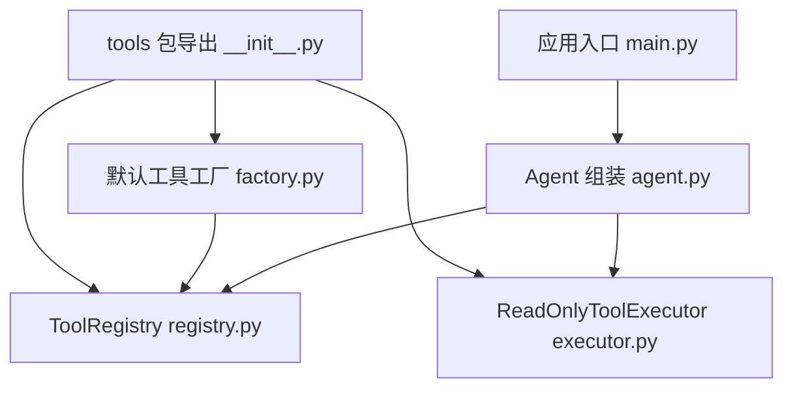
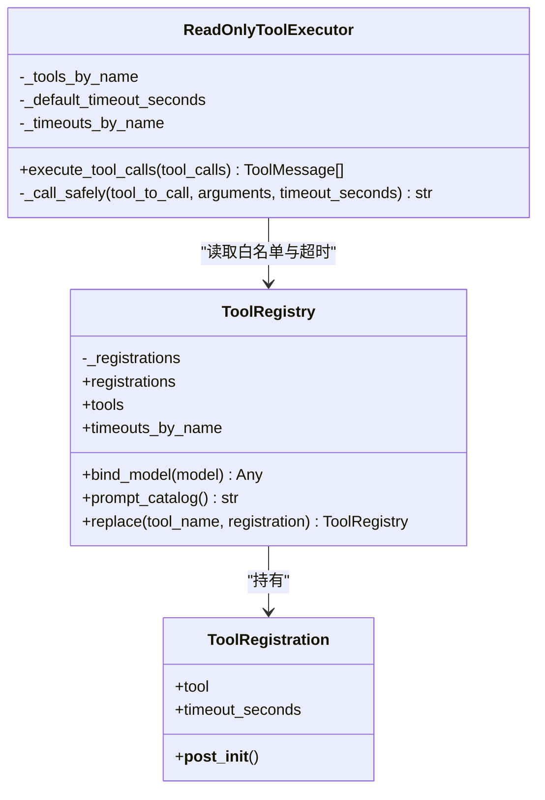
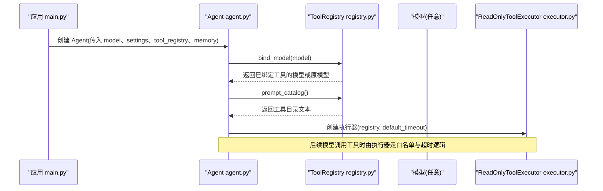
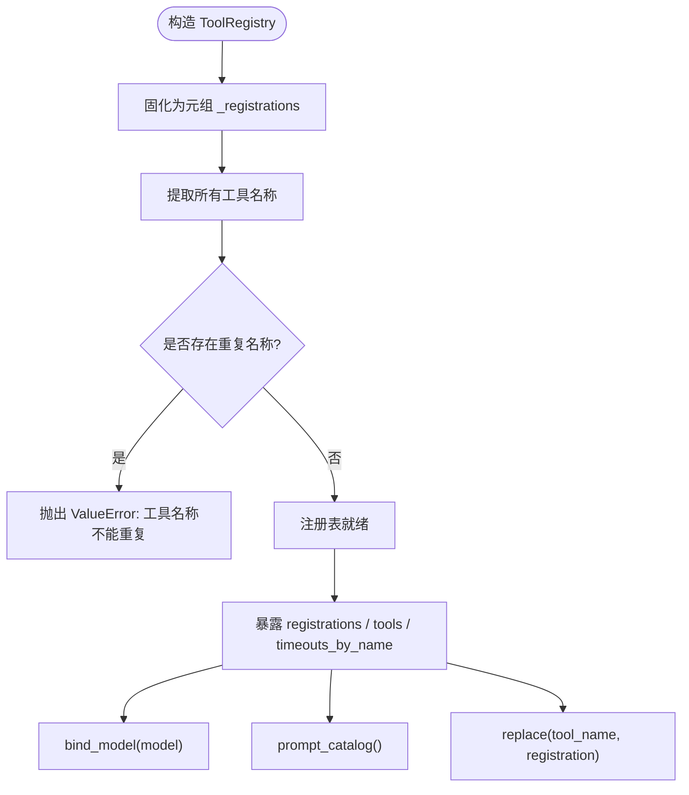
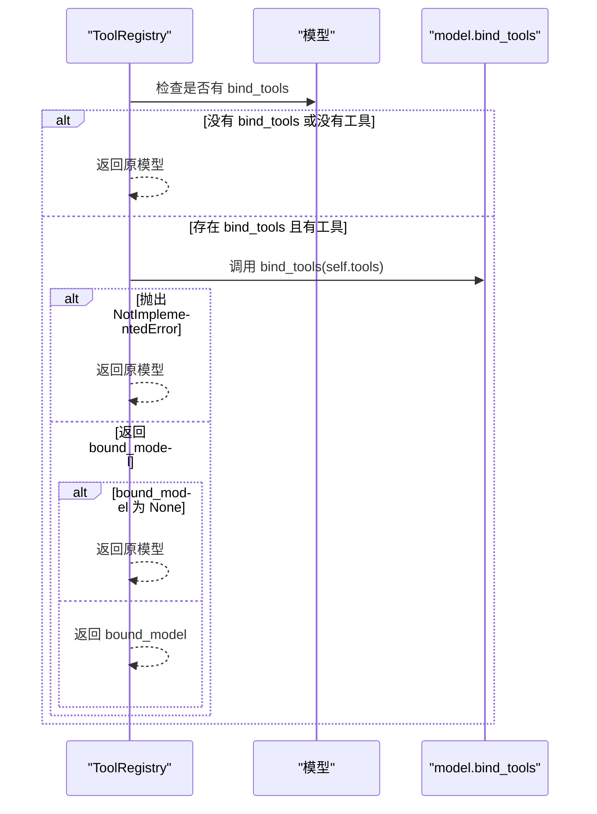
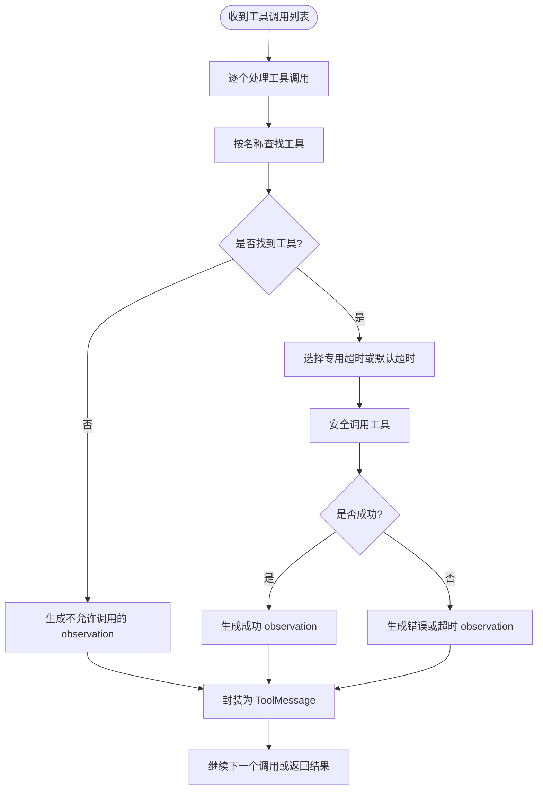
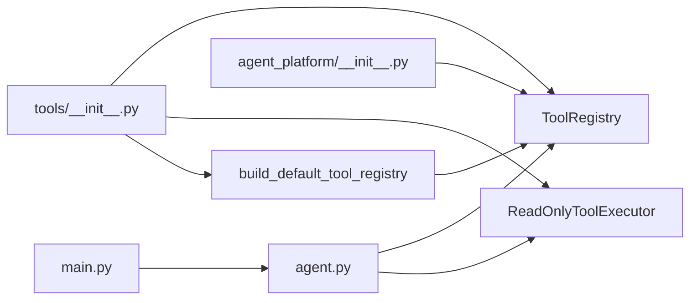

# ToolRegistry 工具注册表

<cite>
**本文引用的文件**   
- [registry.py](file://agent_platform/tools/registry.py)
- [executor.py](file://agent_platform/tools/executor.py)
- [factory.py](file://agent_platform/tools/factory.py)
- [__init__.py（tools）](file://agent_platform/tools/__init__.py)
- [__init__.py（包入口）](file://agent_platform/agent_platform/__init__.py)
- [main.py](file://main.py)
- [agent.py](file://agent_platform/agent.py)
</cite>

## 目录
1. [引言](#引言)
2. [项目结构定位](#项目结构定位)
3. [核心组件总览](#核心组件总览)
4. [架构总览](#架构总览)
5. [详细组件分析](#详细组件分析)
6. [依赖关系分析](#依赖关系分析)
7. [性能与并发特性](#性能与并发特性)
8. [错误处理策略](#错误处理策略)
9. [使用示例：注册自定义工具与扩展现有注册表](#使用示例注册自定义工具与扩展现有注册表)
10. [故障排查指南](#故障排查指南)
11. [结论](#结论)

## 引言
ToolRegistry 是 Agent 平台中“工具注册表”的核心类型，负责集中管理 LangChain 工具、工具超时策略以及供模型读取的工具目录。它的设计目标是让“模型绑定的工具 Schema”“系统提示词中的工具目录”“执行器的白名单与超时配置”三者共享同一份事实来源，避免手工维护导致的不一致。

本文围绕以下目标展开：
- 解释 ToolRegistry 的不可变设计、白名单机制和线程安全边界。
- 说明 bind_model() 如何将工具 Schema 注入模型。
- 说明 prompt_catalog() 如何生成模型可见的工具描述。
- 说明 ReadOnlyToolExecutor 如何通过白名单拒绝未注册工具调用。
- 给出注册自定义工具和扩展默认注册表的实践路径。
- 总结错误处理策略与常见问题的排查方法。

## 项目结构定位
ToolRegistry 位于 tools 子包中，作为工具系统的组合根与公共契约的一部分对外暴露。其关键位置如下：
- 工具注册表实现：[registry.py](file://agent_platform/tools/registry.py)
- 工具执行器（白名单、超时、错误观察）：[executor.py](file://agent_platform/tools/executor.py)
- 默认工具组合工厂：[factory.py](file://agent_platform/tools/factory.py)
- tools 包的对外导出白名单：[tools/__init__.py](file://agent_platform/tools/__init__.py)
- agent_platform 包对外统一导出：[agent_platform/__init__.py](file://agent_platform/agent_platform/__init__.py)
- 应用启动入口装配 ToolRegistry：[main.py](file://main.py)
- Agent 组装并绑定模型、Prompt、执行器：[agent.py](file://agent_platform/agent.py)

**图表来源**
- [main.py:62-66](file://main.py#L62-L66)
- [agent.py:38-65](file://agent_platform/agent.py#L38-L65)
- [factory.py:18-36](file://agent_platform/tools/factory.py#L18-L36)
- [registry.py:27-93](file://agent_platform/tools/registry.py#L27-L93)
- [executor.py:17-43](file://agent_platform/tools/executor.py#L17-L43)
- [tools/__init__.py:8-17](file://agent_platform/tools/__init__.py#L8-L17)

**章节来源**
- [registry.py:1-93](file://agent_platform/tools/registry.py#L1-L93)
- [executor.py:1-67](file://agent_platform/tools/executor.py#L1-L67)
- [factory.py:1-37](file://agent_platform/tools/factory.py#L1-L37)
- [tools/__init__.py:1-18](file://agent_platform/tools/__init__.py#L1-L18)
- [agent_platform/__init__.py:1-28](file://agent_platform/agent_platform/__init__.py#L1-L28)
- [main.py:1-95](file://main.py#L1-L95)
- [agent.py:38-65](file://agent_platform/agent.py#L38-L65)

## 核心组件总览
- ToolRegistration：一个工具及其运行策略的数据类，包含 LangChain BaseTool 对象和可选的专用超时秒数。构造时校验超时必须大于 0。
- ToolRegistry：不可变的工具集合，提供工具列表、按名映射的超时字典、模型绑定、Prompt 目录生成和替换工具返回新注册表的能力。
- ReadOnlyToolExecutor：基于 ToolRegistry 的工具执行器，负责白名单校验、超时控制、异常捕获，并将结果封装为 ToolMessage。
- build_default_tool_registry：默认工具组合工厂，将知识库检索工具与天气工具注册到 ToolRegistry。

**图表来源**
- [registry.py:15-93](file://agent_platform/tools/registry.py#L15-L93)
- [executor.py:17-67](file://agent_platform/tools/executor.py#L17-L67)

**章节来源**
- [registry.py:15-93](file://agent_platform/tools/registry.py#L15-L93)
- [executor.py:17-67](file://agent_platform/tools/executor.py#L17-L67)

## 架构总览
ToolRegistry 在系统中扮演“单一事实来源”的角色：
- 模型侧：通过 bind_model() 将工具的 Schema 注入模型，使模型能发起结构化工具调用。
- Prompt 侧：通过 prompt_catalog() 动态生成工具目录，写入系统提示词，让模型知道可用工具及用途。
- 执行侧：ReadOnlyToolExecutor 从 ToolRegistry 获取白名单与超时配置，确保只有预注册工具可被调用，且失败不会导致整个图崩溃。

**图表来源**
- [main.py:62-84](file://main.py#L62-L84)
- [agent.py:38-65](file://agent_platform/agent.py#L38-L65)
- [registry.py:56-75](file://agent_platform/tools/registry.py#L56-L75)
- [executor.py:17-43](file://agent_platform/tools/executor.py#L17-L43)

## 详细组件分析

### ToolRegistration：工具与运行策略
ToolRegistration 是一个不可变数据类，用于封装一个 LangChain 工具与其运行策略。关键字段包括：
- tool：LangChain BaseTool 实例，其 docstring 会被模型视为使用说明。
- timeout_seconds：该工具的专用超时秒数；None 表示回落到执行器默认超时。

构造时的验证规则：
- 如果显式设置了超时，则必须大于 0，否则抛出 ValueError。

这种设计使得每个工具都可以拥有独立的超时策略，同时保持注册表整体不可变，避免运行期意外修改。

**章节来源**
- [registry.py:15-24](file://agent_platform/tools/registry.py#L15-L24)

### ToolRegistry：不可变工具注册表
ToolRegistry 的核心职责是集中管理工具集合，并提供三类能力：
1. 暴露工具列表与超时映射
   - registrations：原始注册项元组。
   - tools：用于模型 bind_tools() 的 BaseTool 元组。
   - timeouts_by_name：仅包含显式设置超时的工具名称到秒数的映射。
2. 绑定模型
   - bind_model(model)：若模型支持 bind_tools 且有工具，则调用 bind_tools(self.tools)，否则直接返回原模型。
3. 生成 Prompt 工具目录
   - prompt_catalog()：遍历注册项，拼接 name 与 description，形成模型可读的工具清单。
4. 测试友好的替换能力
   - replace(tool_name, registration)：返回一个新 ToolRegistry，其中指定工具被替换；若目标不存在或未命名匹配，抛出异常。

构造阶段还会检查工具名称唯一性，重复名称会立即抛出 ValueError，属于 Fail Fast 策略。

**图表来源**
- [registry.py:30-36](file://agent_platform/tools/registry.py#L30-L36)
- [registry.py:38-54](file://agent_platform/tools/registry.py#L38-L54)
- [registry.py:56-65](file://agent_platform/tools/registry.py#L56-L65)
- [registry.py:67-75](file://agent_platform/tools/registry.py#L67-L75)
- [registry.py:77-93](file://agent_platform/tools/registry.py#L77-L93)

**章节来源**
- [registry.py:27-93](file://agent_platform/tools/registry.py#L27-L93)

### Schema 绑定过程：bind_model()
bind_model() 的工作流程如下：
1. 检测模型是否具备 callable 的 bind_tools 属性。
2. 如果没有工具或模型不支持绑定，直接返回原模型。
3. 尝试调用 bind_tools(self.tools)。
4. 若模型实现抛出不支持的 NotImplementedError，则退回原模型。
5. 若返回值为 None，也退回原模型；否则返回绑定后的模型。

这一设计保证：
- 真实模型可以接收工具 Schema，从而在回复中发起结构化工具调用。
- 测试替身即使声明了 bind_tools 但未实现，也不会破坏流程。
- 无工具场景下，模型行为保持不变。

**图表来源**
- [registry.py:56-65](file://agent_platform/tools/registry.py#L56-L65)

**章节来源**
- [registry.py:56-65](file://agent_platform/tools/registry.py#L56-L65)

### 白名单验证机制：ReadOnlyToolExecutor
ReadOnlyToolExecutor 在执行工具调用时采用严格的白名单机制：
- 初始化时从 registry.tools 构建按名称索引的工具字典。
- execute_tool_calls() 对每个工具调用请求：
  - 根据 name 查找工具；若未找到，直接返回“不允许调用”的观察文本。
  - 若找到，则根据 timeouts_by_name 决定专用超时，否则使用默认超时。
  - 调用工具并捕获超时或异常，将其转换为模型可见的 observation 文本。
  - 最终将每条结果封装为 ToolMessage。

这确保了：
- 模型幻觉产生的未注册工具不会被执行。
- 单个工具失败不会导致整个 Agent 图崩溃。
- 超时可控，网络型工具可配置更长超时。

**图表来源**
- [executor.py:20-43](file://agent_platform/tools/executor.py#L20-L43)
- [executor.py:45-67](file://agent_platform/tools/executor.py#L45-L67)

**章节来源**
- [executor.py:17-67](file://agent_platform/tools/executor.py#L17-L67)

### prompt_catalog()：生成工具描述供系统提示词使用
prompt_catalog() 的作用是将当前注册表中的工具以人类可读的方式输出，供系统提示词使用：
- 若无工具，返回“当前没有可调用工具”。
- 若有工具，遍历每个 ToolRegistration，取 tool.name 与 tool.description（若为空则用“无说明。”），去除多余空白后拼接成“- 工具名：说明”的行。
- 将所有行用换行符连接成一个字符串。

这样，系统提示词无需手工维护工具名与说明，避免与注册表不同步。

**章节来源**
- [registry.py:67-75](file://agent_platform/tools/registry.py#L67-L75)

### 默认工具组合：build_default_tool_registry
默认工具组合工厂负责：
- 根据 settings 构建 KnowledgeBase 与 OpenMeteoWeatherClient。
- 使用 create_rag_tool 与 create_weather_tool 适配为 LangChain 工具。
- 将工具注册到 ToolRegistry，并为网络型工具设置专用超时。

这是新增工具的推荐入口：新增领域工具应在此处显式注册，确保模型、Prompt 和执行器共用同一份工具集合。

**章节来源**
- [factory.py:1-37](file://agent_platform/tools/factory.py#L1-L37)

## 依赖关系分析
ToolRegistry 与周边模块的关系如下：
- tools/__init__.py 导出 ToolRegistration、ToolRegistry、ReadOnlyToolExecutor 与 build_default_tool_registry，构成 tools 包的稳定契约。
- agent_platform/__init__.py 再次向上层暴露 ToolRegistry 等符号，便于外部导入。
- main.py 根据参数选择 mock 或真实模型，并装配 ToolRegistry。
- agent.py 在构造时：
  - 使用 ToolRegistry.bind_model() 绑定模型。
  - 使用 ToolRegistry.prompt_catalog() 生成系统提示词。
  - 使用 ReadOnlyToolExecutor 执行工具调用。

**图表来源**
- [tools/__init__.py:8-17](file://agent_platform/tools/__init__.py#L8-L17)
- [agent_platform/__init__.py:8-28](file://agent_platform/agent_platform/__init__.py#L8-L28)
- [main.py:62-84](file://main.py#L62-L84)
- [agent.py:38-65](file://agent_platform/agent.py#L38-L65)
- [factory.py:18-36](file://agent_platform/tools/factory.py#L18-L36)

**章节来源**
- [tools/__init__.py:1-18](file://agent_platform/tools/__init__.py#L1-L18)
- [agent_platform/__init__.py:1-28](file://agent_platform/agent_platform/__init__.py#L1-L28)
- [main.py:62-84](file://main.py#L62-L84)
- [agent.py:38-65](file://agent_platform/agent.py#L38-L65)
- [factory.py:18-36](file://agent_platform/tools/factory.py#L18-L36)

## 性能与并发特性
- 注册表不可变：ToolRegistry 构造时将注册项固化为元组，避免运行期修改带来的竞争条件。
- 执行器并发：ReadOnlyToolExecutor 使用 ThreadPoolExecutor(max_workers=1) 包装工具调用，以便实现超时等待。由于单工作线程，同一轮工具调用串行执行，避免了多线程竞争；但每次调用都会创建新的线程池并在 finally 中关闭，注意在高并发场景下的开销。
- 超时策略：
  - 工具级专用超时优先于执行器默认超时。
  - 默认超时在构造执行器时校验必须大于 0。
- 时间复杂度：
  - 构造 ToolRegistry：O(n) 扫描工具名称并去重检查。
  - prompt_catalog()：O(n) 遍历注册项。
  - execute_tool_calls()：O(k) 处理 k 个工具调用，内部调用工具可能耗时。

优化建议：
- 若高频调用工具，考虑复用线程池或调整执行器实现以减少线程创建开销。
- 对于大量工具场景，可在注册阶段缓存更高效的索引结构，但需权衡不可变性与内存占用。

**章节来源**
- [registry.py:30-36](file://agent_platform/tools/registry.py#L30-L36)
- [executor.py:20-25](file://agent_platform/tools/executor.py#L20-L25)
- [executor.py:45-67](file://agent_platform/tools/executor.py#L45-L67)

## 错误处理策略
- ToolRegistration 构造：
  - 超时小于等于 0 时抛出 ValueError。
- ToolRegistry 构造：
  - 工具名称重复时抛出 ValueError。
- ToolRegistry.replace：
  - 替换工具名不匹配时抛出 ValueError。
  - 目标工具不存在时抛出 KeyError。
- ToolRegistry.bind_model：
  - 模型不支持 bind_tools 或返回 None 时，退回原模型。
  - 模型实现抛出不支持的 NotImplementedError 时，退回原模型。
- ReadOnlyToolExecutor：
  - 默认超时小于等于 0 时抛出 ValueError。
  - 未注册工具调用：返回“不允许调用”的 observation。
  - 工具调用超时：返回“工具超时”的 observation。
  - 工具调用异常：返回“工具错误”的 observation，不向上抛出。

这些策略共同保证了：
- 注册阶段的错误尽早暴露（Fail Fast）。
- 运行期工具调用失败不会导致整个 Agent 图崩溃。
- 模型始终能看到清晰的失败原因，从而向用户说明查询失败或暂时无法查询。

**章节来源**
- [registry.py:22-24](file://agent_platform/tools/registry.py#L22-L24)
- [registry.py:33-36](file://agent_platform/tools/registry.py#L33-L36)
- [registry.py:77-93](file://agent_platform/tools/registry.py#L77-L93)
- [registry.py:56-65](file://agent_platform/tools/registry.py#L56-L65)
- [executor.py:20-25](file://agent_platform/tools/executor.py#L20-L25)
- [executor.py:27-43](file://agent_platform/tools/executor.py#L27-L43)
- [executor.py:45-67](file://agent_platform/tools/executor.py#L45-L67)

## 使用示例：注册自定义工具与扩展现有注册表

### 注册自定义工具
推荐步骤：
1. 使用 LangChain 的 BaseTool 或其装饰器创建一个工具函数，并确保其 docstring 清晰描述用途与参数。
2. 将该工具封装为 ToolRegistration，必要时设置 timeout_seconds。
3. 在默认工具组合工厂中注册该工具，或通过 replace() 在测试中替换现有工具。

参考路径：
- 工具注册数据结构与约束：[registry.py:15-24](file://agent_platform/tools/registry.py#L15-L24)
- 默认工具组合工厂：[factory.py:18-36](file://agent_platform/tools/factory.py#L18-L36)

### 扩展现有的工具注册表
有两种方式：
- 在 build_default_tool_registry() 中添加新的 ToolRegistration，使其成为默认工具集的一部分。
- 在测试中使用 ToolRegistry.replace() 替换某个工具，返回新注册表，不影响生产环境。

参考路径：
- 替换工具并返回新注册表：[registry.py:77-93](file://agent_platform/tools/registry.py#L77-L93)
- 默认工具组合工厂：[factory.py:18-36](file://agent_platform/tools/factory.py#L18-L36)

### 在 Agent 中使用 ToolRegistry
- 应用入口 main.py 根据参数选择 mock 或真实模型，并装配 ToolRegistry。
- Agent 构造时：
  - 使用 ToolRegistry.bind_model() 绑定模型。
  - 使用 ToolRegistry.prompt_catalog() 生成系统提示词。
  - 使用 ReadOnlyToolExecutor 执行工具调用。

参考路径：
- 应用入口装配：[main.py:62-84](file://main.py#L62-L84)
- Agent 组装与绑定：[agent.py:38-65](file://agent_platform/agent.py#L38-L65)

**章节来源**
- [registry.py:15-24](file://agent_platform/tools/registry.py#L15-L24)
- [registry.py:77-93](file://agent_platform/tools/registry.py#L77-L93)
- [factory.py:18-36](file://agent_platform/tools/factory.py#L18-L36)
- [main.py:62-84](file://main.py#L62-L84)
- [agent.py:38-65](file://agent_platform/agent.py#L38-L65)

## 故障排查指南
常见问题与定位方法：
- 工具名称重复
  - 现象：构造 ToolRegistry 时报错。
  - 原因：多个 ToolRegistration 使用了相同的 tool.name。
  - 解决：检查 factory.py 或自定义注册代码，确保工具名唯一。
  - 参考：[registry.py:33-36](file://agent_platform/tools/registry.py#L33-L36)
- 工具超时配置无效
  - 现象：工具执行超时或未按预期超时。
  - 原因：timeout_seconds 未设置或设置为非正数；或执行器默认超时过小。
  - 解决：在 ToolRegistration 中设置合理的 timeout_seconds，或在执行器构造时调整默认超时。
  - 参考：[registry.py:22-24](file://agent_platform/tools/registry.py#L22-L24)、[executor.py:20-25](file://agent_platform/tools/executor.py#L20-L25)
- 模型未获得工具 Schema
  - 现象：模型无法发起工具调用。
  - 原因：模型不支持 bind_tools 或 ToolRegistry 中没有工具。
  - 解决：确认模型实现 bind_tools，或确保 ToolRegistry 已注册工具。
  - 参考：[registry.py:56-65](file://agent_platform/tools/registry.py#L56-L65)
- 未注册工具被调用
  - 现象：出现“不允许调用”的 observation。
  - 原因：模型幻觉生成了未在注册表中注册的工具名。
  - 解决：检查 Prompt 与工具目录一致性，确保只允许注册工具。
  - 参考：[executor.py:27-43](file://agent_platform/tools/executor.py#L27-L43)
- 替换工具失败
  - 现象：replace() 抛出 KeyError 或 ValueError。
  - 原因：目标工具不存在或替换工具名不一致。
  - 解决：确认 tool_name 与 registration.tool.name 一致，且目标工具确实存在。
  - 参考：[registry.py:77-93](file://agent_platform/tools/registry.py#L77-L93)

**章节来源**
- [registry.py:22-24](file://agent_platform/tools/registry.py#L22-L24)
- [registry.py:33-36](file://agent_platform/tools/registry.py#L33-L36)
- [registry.py:56-65](file://agent_platform/tools/registry.py#L56-L65)
- [registry.py:77-93](file://agent_platform/tools/registry.py#L77-L93)
- [executor.py:20-25](file://agent_platform/tools/executor.py#L20-L25)
- [executor.py:27-43](file://agent_platform/tools/executor.py#L27-L43)

## 结论
ToolRegistry 通过不可变设计、统一的工具 Schema 绑定、动态 Prompt 目录生成与严格的白名单执行机制，为 Agent 平台提供了稳定、可测试、可扩展的工具管理能力。结合 ReadOnlyToolExecutor 的错误与超时处理，系统在模型幻觉、网络延迟与工具异常等场景下仍能保持稳定。新增工具应通过默认工具组合工厂进行注册，测试场景可使用 replace() 替换工具，确保模型、Prompt 与执行器三方始终同步。