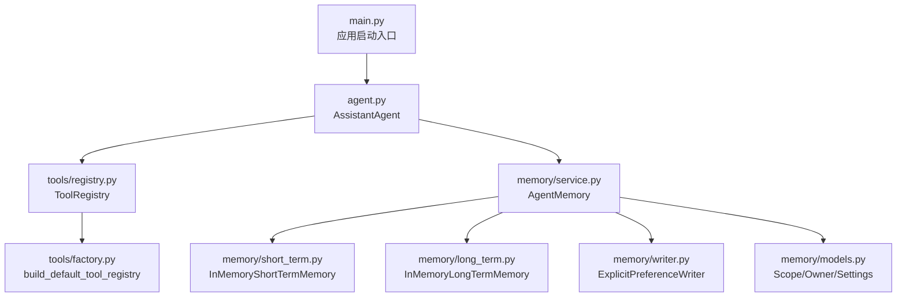
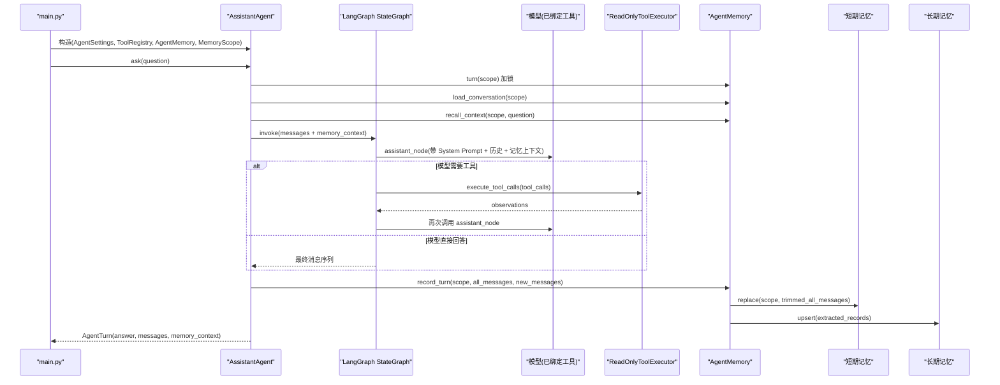
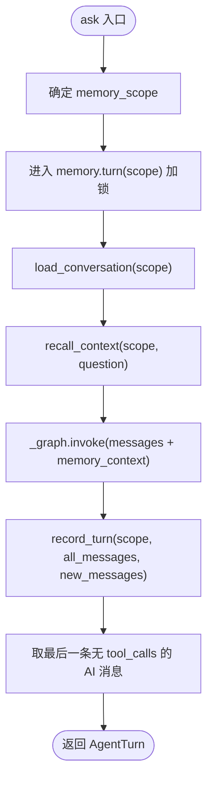
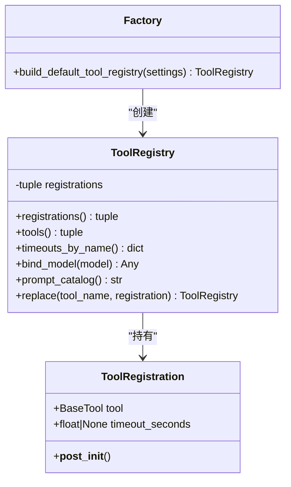
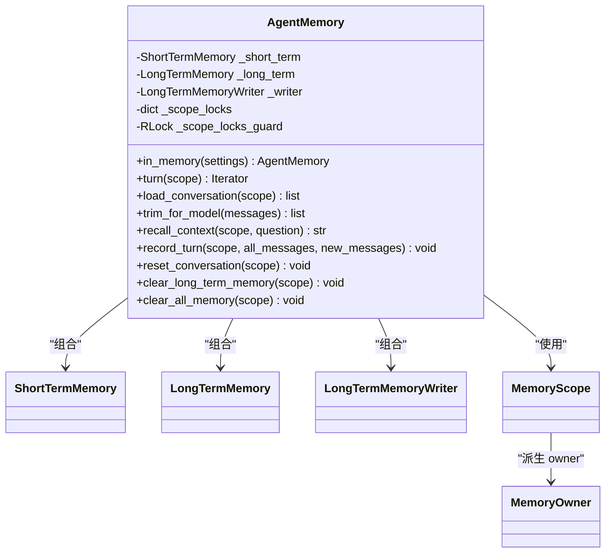
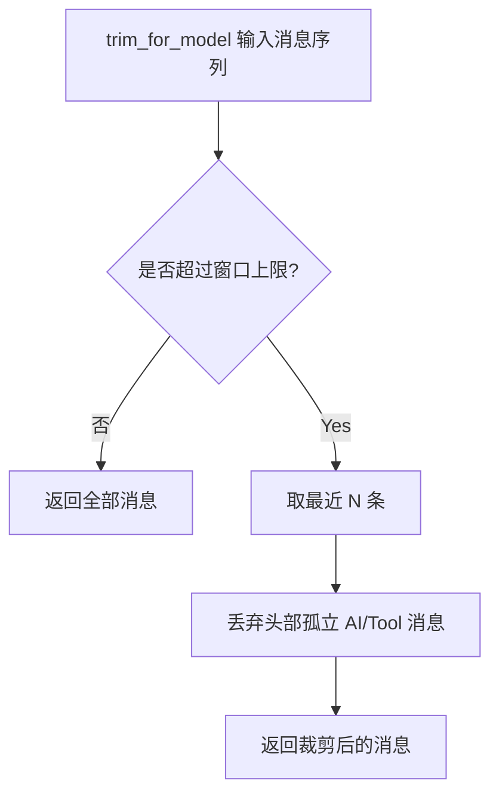
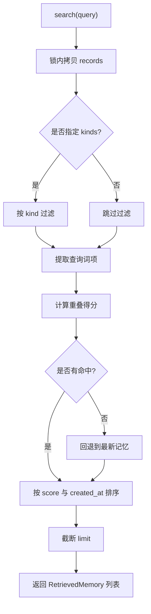
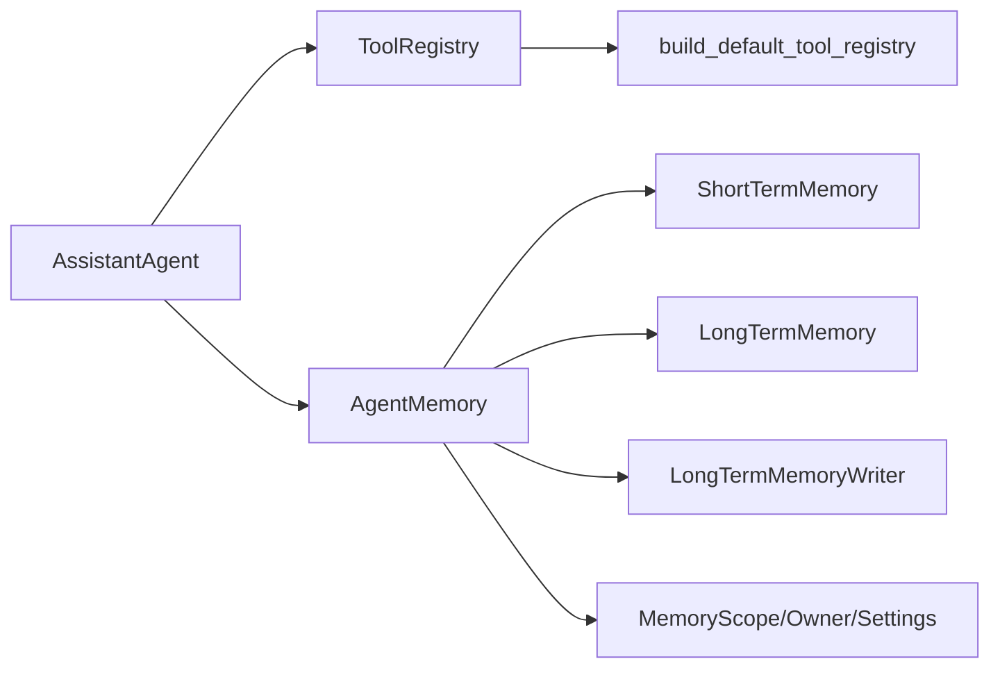

# 核心组件详解

<cite>
**本文引用的文件**   
- [agent.py](file://agent_platform/agent.py)
- [registry.py](file://agent_platform/tools/registry.py)
- [factory.py](file://agent_platform/tools/factory.py)
- [service.py](file://agent_platform/memory/service.py)
- [models.py](file://agent_platform/memory/models.py)
- [short_term.py](file://agent_platform/memory/short_term.py)
- [long_term.py](file://agent_platform/memory/long_term.py)
- [writer.py](file://agent_platform/memory/writer.py)
- [main.py](file://main.py)
- [README.md](file://README.md)
</cite>

## 目录
1. [引言](#引言)
2. [项目结构](#项目结构)
3. [核心组件总览](#核心组件总览)
4. [架构总览](#架构总览)
5. [AssistantAgent 详解](#assistantagent-详解)
6. [ToolRegistry 与工具注册机制](#toolregistry-与工具注册机制)
7. [AgentMemory 门面与记忆协调](#agentmemory-门面与记忆协调)
8. [短期记忆与长期记忆实现](#短期记忆与长期记忆实现)
9. [生命周期管理](#生命周期管理)
10. [依赖关系分析](#依赖关系分析)
11. [性能与可扩展性](#性能与可扩展性)
12. [使用示例与扩展点](#使用示例与扩展点)
13. [故障排查指南](#故障排查指南)
14. [结论](#结论)

## 引言
本文件面向 Agent Platform 的核心组件，重点围绕以下目标展开：
- 深入解析 `AssistantAgent` 的构造参数、状态管理、对话流程控制。
- 说明 `ToolRegistry` 的设计模式，包括工具注册、Schema 绑定、执行器白名单与超时策略。
- 解释 `AgentMemory` 门面如何协调短期记忆与长期记忆，包括作用域管理与线程安全。
- 梳理各组件从初始化到销毁的生命周期。
- 提供可操作的代码示例路径和扩展点接入方式，帮助开发者在不破坏稳定边界的前提下扩展工具、记忆或评测能力。

## 项目结构
Agent Platform 将工具、记忆、评测与 Agent 编排解耦，形成清晰的分层与组合边界：
- `agent_platform/agent.py`：LangGraph 编排、模型绑定、记忆组合与一轮问答主流程。
- `agent_platform/tools/`：工具注册表、默认工厂、执行器与领域工具适配层。
- `agent_platform/memory/`：记忆契约、短期窗口、长期存储、偏好写入策略与门面服务。
- `main.py`：应用启动入口，支持真实模型、离线 mock 与评测三种运行模式。
- `README.md`：模块职责、架构图、安装与运行说明。

**图表来源**
- [main.py:43-89](file://main.py#L43-L89)
- [agent.py:35-141](file://agent_platform/agent.py#L35-L141)
- [registry.py:27-93](file://agent_platform/tools/registry.py#L27-L93)
- [factory.py:18-36](file://agent_platform/tools/factory.py#L18-L36)
- [service.py:24-105](file://agent_platform/memory/service.py#L24-L105)
- [short_term.py:41-67](file://agent_platform/memory/short_term.py#L41-L67)
- [long_term.py:20-71](file://agent_platform/memory/long_term.py#L20-L71)
- [writer.py:37-64](file://agent_platform/memory/writer.py#L37-L64)
- [models.py:27-120](file://agent_platform/memory/models.py#L27-L120)

**章节来源**
- [README.md:19-48](file://README.md#L19-L48)
- [main.py:1-20](file://main.py#L1-L20)

## 核心组件总览
- `AssistantAgent`：应用层 Agent，负责模型调用、工具路由、短期历史与长期记忆上下文组装，以及 LangGraph 图执行。
- `ToolRegistry`：不可变工具集合，集中维护工具 Schema、Prompt 目录、执行器超时映射，并提供替换能力。
- `AgentMemory`：记忆子系统门面，统一暴露会话加载、裁剪、召回、写入、清空等接口，并封装作用域锁。
- 短期记忆：按会话隔离的消息窗口，支持窗口裁剪与并发安全。
- 长期记忆：按用户隔离的偏好/约束存储，支持 upsert、检索、清理。
- 偏好写入器：保守提取“请记住”类显式授权内容，生成确定性 id 避免重复累积。

**章节来源**
- [agent.py:35-141](file://agent_platform/agent.py#L35-L141)
- [registry.py:15-93](file://agent_platform/tools/registry.py#L15-L93)
- [service.py:24-105](file://agent_platform/memory/service.py#L24-L105)
- [short_term.py:17-67](file://agent_platform/memory/short_term.py#L17-L67)
- [long_term.py:20-83](file://agent_platform/memory/long_term.py#L20-L83)
- [writer.py:30-100](file://agent_platform/memory/writer.py#L30-L100)

## 架构总览
Agent 通过 LangGraph 驱动“助手节点”和“工具节点”循环，直到模型直接回答；记忆系统则在每轮前后分别读取短期历史、召回长期记忆，并在完成后写回短期窗口与长期偏好。

**图表来源**
- [main.py:78-90](file://main.py#L78-L90)
- [agent.py:84-141](file://agent_platform/agent.py#L84-L141)
- [service.py:51-90](file://agent_platform/memory/service.py#L51-L90)

## AssistantAgent 详解
`AssistantAgent` 是平台的应用层入口，承担以下职责：
- 接收外部注入的模型、设置、工具注册表、记忆门面与作用域。
- 在构造时绑定工具 Schema、渲染系统 Prompt、创建只读工具执行器与 LangGraph 图。
- 在 `ask` 中串行化一轮问答，处理短期历史、长期记忆上下文、图执行与结果写回。
- 提供历史查看、会话重置、长期记忆清理等便捷方法。

### 构造函数参数与校验
- `model`：任意模型对象，需支持 `bind_tools` 以便绑定工具 Schema。
- `settings`：`AgentSettings`，包含 RAG、网络工具超时、记忆配置等。
- `tool_registry`：可选；未传入则通过 `build_default_tool_registry(settings)` 构建默认工具集。
- `memory`：可选；若传入共享记忆实例，必须同时传入 `memory_scope`，否则抛出异常，防止跨用户数据泄露。
- `memory_scope`：可选；缺省时使用本地作用域。

关键行为：
- 工具注册表用于绑定模型、生成 Prompt 工具目录、构造执行器。
- 系统 Prompt 在构造时渲染一次，复用实例期间不再变化。
- 图编译后缓存于 `_graph`，避免重复构建。

**章节来源**
- [agent.py:38-65](file://agent_platform/agent.py#L38-L65)

### 状态管理与对话流程
- `AgentState`：继承 LangGraph 的 `MessagesState`，增加 `memory_context` 字段，作为临时输入，不写入会话消息。
- `AgentTurn`：封装一轮问答的可观测结果，包含最终答案、完整消息序列与本轮长期记忆上下文。
- `ask` 流程：
  1. 以 `memory_scope` 或实例默认作用域为基准。
  2. 进入 `memory.turn(scope)` 加锁，确保同一会话串行执行。
  3. 加载短期历史，召回长期记忆上下文。
  4. 调用图执行，直到模型不再调用工具。
  5. 写回短期窗口，并通过 writer 提取长期记忆记录。
  6. 取最后一条不带工具调用的 AI 消息作为最终答案。

**图表来源**
- [agent.py:84-108](file://agent_platform/agent.py#L84-L108)

### 图节点与降级策略
- `_assistant_node`：
  - 对历史消息进行窗口裁剪，控制 token 成本。
  - 拼接 System Prompt 与长期记忆上下文（作为 HumanMessage，不提升权限）。
  - 调用模型；若模型调用失败，降级为普通 AI 消息，让图正常收尾。
- `_tools_node`：
  - 执行上一条 AI 消息携带的全部工具调用，把 observation 写回消息流。

**章节来源**
- [agent.py:110-141](file://agent_platform/agent.py#L110-L141)

## ToolRegistry 与工具注册机制
`ToolRegistry` 是工具系统的唯一事实来源，保证模型 Schema、Prompt 工具目录与执行器超时三者一致。

### 设计要点
- `ToolRegistration`：封装一个 LangChain 工具及其超时策略，构造时校验超时大于 0。
- `ToolRegistry`：
  - 构造时将注册列表固化为元组，Fail Fast 校验工具名唯一。
  - 提供 `tools`、`timeouts_by_name`、`prompt_catalog`、`bind_model`、`replace` 等方法。
  - 不可变设计避免运行期漂移；`replace` 返回新实例，便于测试替换。

### 工具注册与 Schema 绑定
- `bind_model`：尝试调用模型的 `bind_tools(self.tools)`；若模型不支持或未注册工具，则透传原模型。
- `prompt_catalog`：根据工具的 description 动态生成模型可见的工具目录，无需手工维护。
- `timeouts_by_name`：为执行器提供每个工具的专用超时映射。

### 默认工具工厂
`build_default_tool_registry(settings)` 是组合根：
- 构造知识库与天气客户端（可注入替身）。
- 创建 RAG 工具与天气工具，并注册进 `ToolRegistry`。
- 天气工具通常设置更长超时，RAG 工具走执行器默认超时。

**图表来源**
- [registry.py:15-93](file://agent_platform/tools/registry.py#L15-L93)
- [factory.py:18-36](file://agent_platform/tools/factory.py#L18-L36)

**章节来源**
- [registry.py:15-93](file://agent_platform/tools/registry.py#L15-L93)
- [factory.py:1-36](file://agent_platform/tools/factory.py#L1-L36)

## AgentMemory 门面与记忆协调
`AgentMemory` 是记忆子系统的对外唯一入口，组合短期记忆、长期记忆与偏好写入器，屏蔽底层实现差异。

### 门面职责
- 会话加载与裁剪：`load_conversation`、`trim_for_model`。
- 长期记忆召回：`recall_context`，按用户与问题检索，渲染为带防注入外壳的 Prompt 片段。
- 回合写回：`record_turn`，覆盖短期窗口，并仅保存 writer 认为值得记录的长期记忆。
- 会话与长期记忆清理：`reset_conversation`、`clear_long_term_memory`、`clear_all_memory`。
- 作用域锁：`turn(scope)` 为同一会话串行化完整读写流程，避免并发覆盖。

### 作用域与线程安全
- `MemoryScope`：三级隔离（tenant_id、user_id、conversation_id），短期窗口按完整作用域隔离。
- `MemoryOwner`：两级隔离（tenant_id、user_id），长期记忆按用户归属，跨会话召回。
- 线程安全：
  - `AgentMemory` 使用 `RLock` 管理每个 scope 的锁，并通过守卫锁分配。
  - 短期记忆内部也使用 `RLock` 保护消息字典。
  - 长期记忆内部同样使用 `RLock` 保护记录字典。

**图表来源**
- [service.py:24-105](file://agent_platform/memory/service.py#L24-L105)
- [models.py:27-59](file://agent_platform/memory/models.py#L27-L59)

**章节来源**
- [service.py:1-141](file://agent_platform/memory/service.py#L1-L141)
- [models.py:27-120](file://agent_platform/memory/models.py#L27-L120)

## 短期记忆与长期记忆实现
### 短期记忆
- `MessageWindowPolicy`：按最大消息数裁剪，并确保窗口不从孤立的 AI 或 Tool 消息开始，避免模型因找不到对应 tool_call 报错。
- `InMemoryShortTermMemory`：进程内存储，按 `MemoryScope` 隔离消息列表，所有读写均加锁。

**图表来源**
- [short_term.py:17-38](file://agent_platform/memory/short_term.py#L17-L38)

**章节来源**
- [short_term.py:1-67](file://agent_platform/memory/short_term.py#L1-L67)

### 长期记忆
- `InMemoryLongTermMemory`：进程内存储，按 `MemoryOwner` 隔离记录字典，支持 upsert、search、clear_owner。
- 检索算法：
  1. 按 owner 取出候选集。
  2. 可选按记忆类型过滤。
  3. 词面重叠打分：中文双字 bigram / 英文整词。
  4. 若无命中则回退到最新记忆。
  5. 按分数降序、时间戳降序排序，截断 limit。

**图表来源**
- [long_term.py:37-66](file://agent_platform/memory/long_term.py#L37-L66)

**章节来源**
- [long_term.py:1-83](file://agent_platform/memory/long_term.py#L1-L83)

### 偏好写入器
- `ExplicitPreferenceWriter`：仅识别以“请记住”开头的显式授权消息，分类为约束/偏好/档案，生成确定性 id，避免重复累积。
- 防护机制：
  - 忽略疑似提示注入关键词。
  - 单条记忆长度限制。
  - 规范化空白字符，保证正则匹配与 id 生成稳定。

**章节来源**
- [writer.py:1-100](file://agent_platform/memory/writer.py#L1-L100)

## 生命周期管理
### 初始化阶段
- `main.py`：
  - 加载 `.env` 配置。
  - 解析命令行参数，选择 mock 或真实模型。
  - 构建工具注册表（mock 或默认）。
  - 构造 `MemoryScope`。
  - 构造 `AssistantAgent`，注入模型、设置、工具注册表、记忆门面与作用域。
- `AssistantAgent.__init__`：
  - 校验共享记忆与作用域。
  - 构建或复用工具注册表。
  - 绑定模型工具 Schema。
  - 初始化记忆门面与作用域。
  - 渲染系统 Prompt。
  - 创建只读工具执行器。
  - 编译 LangGraph 图。

### 运行阶段
- `ask`：
  - 加锁串行化一轮问答。
  - 加载短期历史，召回长期记忆。
  - 驱动图执行，直到模型直接回答。
  - 写回短期窗口与长期记忆。
  - 返回最终答案与可观测结果。

### 销毁阶段
- Python 垃圾回收会释放对象引用；由于所有存储均为进程内数据结构，进程退出即丢失数据。
- 若使用外部持久化后端（未来扩展），应在应用关闭时显式 flush/close。

**章节来源**
- [main.py:43-90](file://main.py#L43-L90)
- [agent.py:38-65](file://agent_platform/agent.py#L38-L65)
- [agent.py:84-108](file://agent_platform/agent.py#L84-L108)

## 依赖关系分析
- `AssistantAgent` 依赖：
  - `ToolRegistry`：提供工具 Schema、Prompt 目录、执行器超时。
  - `AgentMemory`：提供会话与长期记忆的统一访问。
  - LangGraph：驱动助手与工具节点循环。
- `ToolRegistry` 依赖：
  - LangChain `BaseTool`：工具抽象。
  - `Factory`：默认工具组合。
- `AgentMemory` 依赖：
  - `ShortTermMemory`、`LongTermMemory`、`LongTermMemoryWriter`：契约组合。
  - `MemoryScope`、`MemoryOwner`、`MemorySettings`：数据模型。

**图表来源**
- [agent.py:35-141](file://agent_platform/agent.py#L35-L141)
- [registry.py:27-93](file://agent_platform/tools/registry.py#L27-L93)
- [factory.py:18-36](file://agent_platform/tools/factory.py#L18-L36)
- [service.py:24-105](file://agent_platform/memory/service.py#L24-L105)
- [models.py:27-120](file://agent_platform/memory/models.py#L27-L120)

**章节来源**
- [README.md:50-63](file://README.md#L50-L63)
- [README.md:67-96](file://README.md#L67-L96)

## 性能与可扩展性
- 短期窗口裁剪：减少 token 成本，避免无关消息影响模型判断。
- 长期记忆检索：轻量分词与词面重叠打分，适合开发环境；生产可替换为向量库。
- 线程安全：多处使用 `RLock`，保证并发请求下数据一致性。
- 可扩展点：
  - 新增工具：在 `tools/factory.py` 注册，无需修改 Agent 或 Prompt。
  - 替换记忆后端：实现 `LongTermMemory` 契约并注入 `AgentMemory`。
  - 自定义写入策略：替换 `LongTermMemoryWriter`，调整偏好提取规则。

[本节为通用指导，不直接分析具体文件]

## 使用示例与扩展点
### 基本使用路径
- 真实模型：
  - 配置 `.env` 中的 `MODEL_API_KEY`。
  - 运行 `python main.py "杭州西湖适合怎样安排？"`。
- Mock 模式：
  - 运行 `python main.py --mock`。
  - 指定场景：`python main.py --mock --mock-scenario weather "杭州明天天气怎么样？"`。
- 评测模式：
  - 运行 `python main.py --evaluate`。

**章节来源**
- [README.md:110-144](file://README.md#L110-L144)
- [main.py:22-40](file://main.py#L22-L40)
- [main.py:43-90](file://main.py#L43-L90)

### 扩展工具
- 新建领域工具适配层（例如 `tools/new_domain.py`）。
- 在 `tools/factory.py` 的 `build_default_tool_registry` 中注册该工具。
- 工具 docstring 会自动进入模型可见目录，无需修改 `AgentSettings.system_prompt`。

**章节来源**
- [README.md:50-63](file://README.md#L50-L63)
- [factory.py:18-36](file://agent_platform/tools/factory.py#L18-L36)

### 扩展记忆
- 实现 `LongTermMemory` 契约（如 SQLite、Redis、向量库）。
- 通过 `AgentMemory.in_memory` 之外的组合方式注入新实现。
- 保持 `MemoryScope` 与 `MemoryOwner` 的隔离语义不变。

**章节来源**
- [README.md:67-96](file://README.md#L67-L96)
- [service.py:24-49](file://agent_platform/memory/service.py#L24-L49)

## 故障排查指南
- 模型调用失败：
  - 现象：`_assistant_node` 捕获异常并降级为普通 AI 消息。
  - 排查：检查模型配置、API Key、网络连通性与超时设置。
- 工具调用错误：
  - 现象：工具执行抛出异常，观察 execution 日志。
  - 排查：确认工具注册表是否正确绑定，检查工具超时与白名单。
- 记忆作用域泄露：
  - 现象：共享 `AgentMemory` 未传入 `memory_scope` 导致跨用户串数据。
  - 排查：构造 `AssistantAgent` 时显式传入 `memory_scope`。
- 短期窗口异常：
  - 现象：窗口从孤立 AI/Tool 消息开始，模型报错。
  - 排查：检查 `MessageWindowPolicy.apply` 逻辑，确保窗口头为 human/system。

**章节来源**
- [agent.py:120-141](file://agent_platform/agent.py#L120-L141)
- [short_term.py:25-38](file://agent_platform/memory/short_term.py#L25-L38)
- [agent.py:47-49](file://agent_platform/agent.py#L47-L49)

## 结论
Agent Platform 通过清晰的组件边界与组合模式，实现了工具、记忆与 Agent 编排的解耦：
- `AssistantAgent` 聚焦对话流程控制与图执行。
- `ToolRegistry` 统一工具 Schema、Prompt 目录与执行器超时，避免漂移。
- `AgentMemory` 门面协调短期与长期记忆，提供作用域与线程安全保障。
- 短期记忆与长期记忆实现可独立替换，扩展点明确。
- 生命周期管理贯穿初始化、运行与销毁，便于在生产环境中扩展持久化与监控。

开发者可在不破坏稳定边界的前提下，按需扩展工具、记忆与评测能力，逐步演进为更强大的智能体平台。