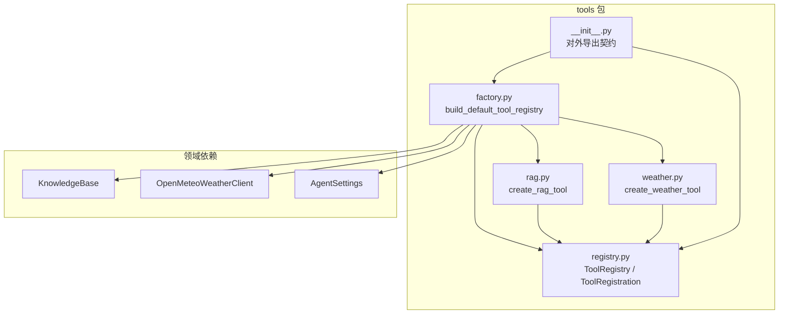
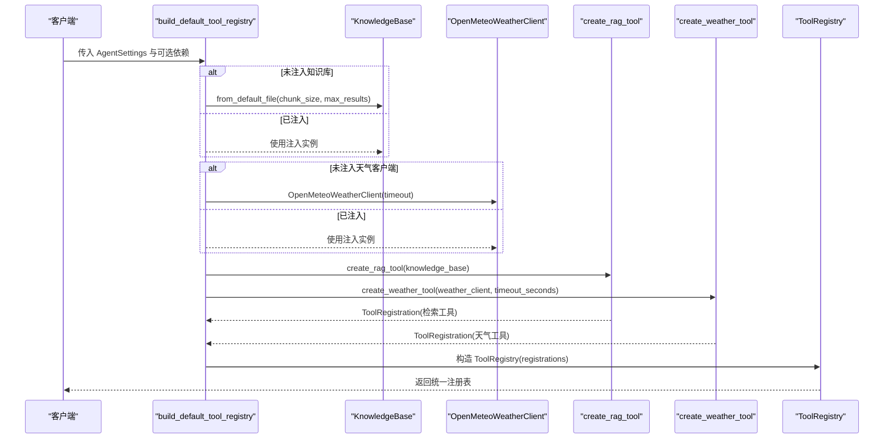
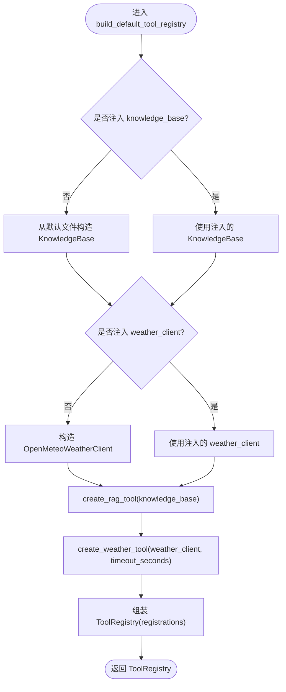
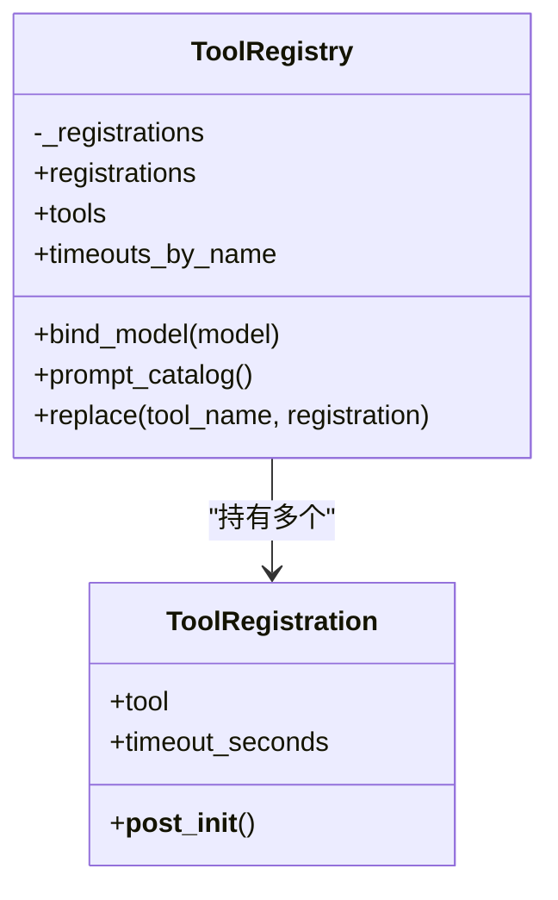
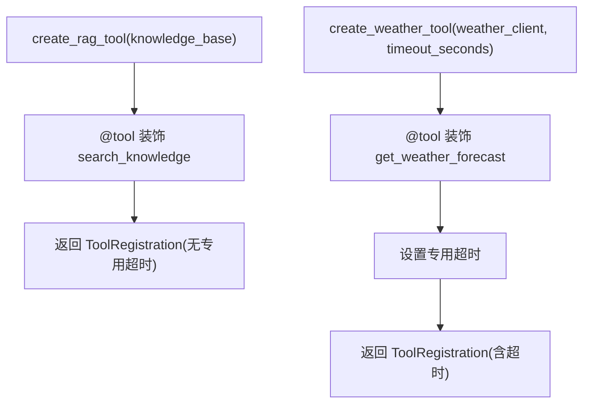
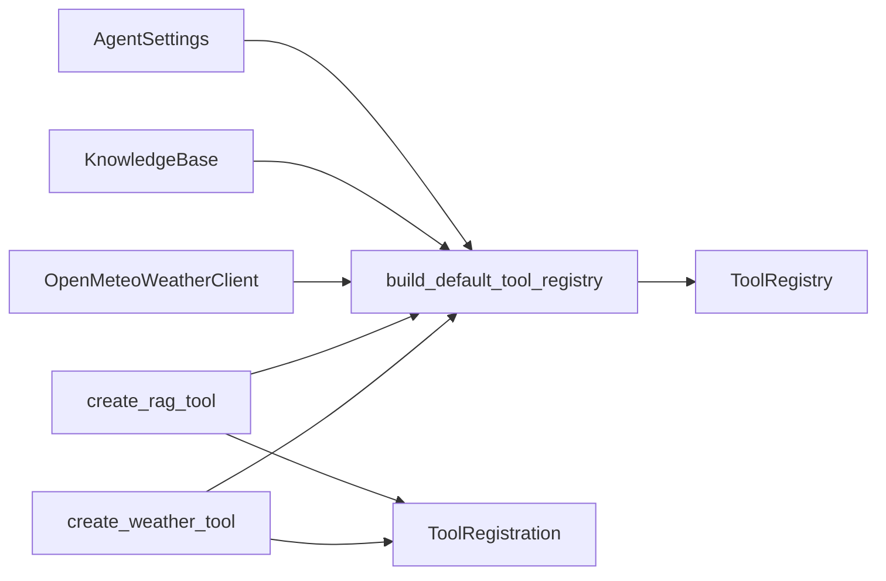

# 工厂模式

<cite>
**本文引用的文件**   
- [agent_platform/tools/factory.py](file://agent_platform/tools/factory.py)
- [agent_platform/tools/registry.py](file://agent_platform/tools/registry.py)
- [agent_platform/tools/__init__.py](file://agent_platform/tools/__init__.py)
- [agent_platform/tools/rag.py](file://agent_platform/tools/rag.py)
- [agent_platform/tools/weather.py](file://agent_platform/tools/weather.py)
</cite>

## 目录
1. [引言](#引言)
2. [项目结构](#项目结构)
3. [核心组件](#核心组件)
4. [架构总览](#架构总览)
5. [详细组件分析](#详细组件分析)
6. [依赖关系分析](#依赖关系分析)
7. [性能与超时策略](#性能与超时策略)
8. [故障排查指南](#故障排查指南)
9. [结论](#结论)

## 引言
本文围绕“工厂模式”在工具系统中的实现展开，重点解释 `build_default_tool_registry` 函数如何作为组合根，集中创建和配置默认工具集，封装复杂的初始化逻辑。通过统一的对象创建接口，客户端代码无需关心知识库、天气客户端等底层依赖的构造细节；同时，该工厂为依赖注入和测试替身替换提供了清晰的扩展点。

## 项目结构
工具子系统位于 `agent_platform/tools` 下，采用“适配层 + 注册表 + 工厂”的分层组织：
- 适配层：将领域能力包装为 LangChain 工具（RAG、天气）。
- 注册表：统一维护工具集合、执行超时策略以及供模型读取的工具目录。
- 工厂：组合根，负责构建默认工具集并暴露给上层使用。

**图表来源**
- [agent_platform/tools/factory.py:1-36](file://agent_platform/tools/factory.py#L1-L36)
- [agent_platform/tools/registry.py:15-93](file://agent_platform/tools/registry.py#L15-L93)
- [agent_platform/tools/rag.py:14-26](file://agent_platform/tools/rag.py#L14-L26)
- [agent_platform/tools/weather.py:13-25](file://agent_platform/tools/weather.py#L13-L25)
- [agent_platform/tools/__init__.py:1-17](file://agent_platform/tools/__init__.py#L1-L17)

**章节来源**
- [agent_platform/tools/__init__.py:1-17](file://agent_platform/tools/__init__.py#L1-L17)

## 核心组件
- 工厂函数 `build_default_tool_registry`：组合根，负责根据配置构建默认工具集，支持可选依赖注入。
- 工具注册表 `ToolRegistry`：不可变工具集合，提供模型绑定、Prompt 目录生成、超时映射与替身替换能力。
- 工具注册项 `ToolRegistration`：描述单个工具及其运行策略（如超时）。
- 工具适配层：
  - `create_rag_tool`：将本地知识库检索包装为 LangChain 工具。
  - `create_weather_tool`：将天气查询包装为 LangChain 工具，并标记网络专用超时。

**章节来源**
- [agent_platform/tools/factory.py:18-36](file://agent_platform/tools/factory.py#L18-L36)
- [agent_platform/tools/registry.py:15-93](file://agent_platform/tools/registry.py#L15-L93)
- [agent_platform/tools/rag.py:14-26](file://agent_platform/tools/rag.py#L14-L26)
- [agent_platform/tools/weather.py:13-25](file://agent_platform/tools/weather.py#L13-L25)

## 架构总览
下图展示工厂模式在工具系统中的职责分工与数据流向：客户端调用工厂获取统一注册表，注册表向模型暴露工具 Schema，并向执行器提供超时策略。

**图表来源**
- [agent_platform/tools/factory.py:18-36](file://agent_platform/tools/factory.py#L18-L36)
- [agent_platform/tools/rag.py:14-26](file://agent_platform/tools/rag.py#L14-L26)
- [agent_platform/tools/weather.py:13-25](file://agent_platform/tools/weather.py#L13-L25)
- [agent_platform/tools/registry.py:30-45](file://agent_platform/tools/registry.py#L30-L45)

## 详细组件分析

### 工厂函数 `build_default_tool_registry`
- 职责
  - 接收应用配置 `AgentSettings`，按需构造领域客户端（知识库、天气客户端）。
  - 调用各工具的适配函数，生成 `ToolRegistration`。
  - 将工具注册项汇总到 `ToolRegistry`，形成统一入口。
- 设计要点
  - 可选参数 `knowledge_base`、`weather_client` 作为依赖注入点，便于单元测试替换为 mock。
  - 对网络型工具显式设置超时，避免被执行器默认短超时截断。
- 简化客户端
  - 客户端只需调用工厂函数即可获得完整工具集，无需关心内部依赖构造与装配。
- 扩展方式
  - 新增工具时，先在适配层实现 `create_xxx_tool`，再在工厂中注册，保持单一入口。

**图表来源**
- [agent_platform/tools/factory.py:18-36](file://agent_platform/tools/factory.py#L18-L36)

**章节来源**
- [agent_platform/tools/factory.py:1-36](file://agent_platform/tools/factory.py#L1-L36)

### 工具注册表 `ToolRegistry`
- 不可变性
  - 构造时将注册项固化为元组，并在构造阶段校验工具名唯一性，避免运行期不一致。
- 统一视图
  - `tools`：提供给模型的 LangChain 工具列表。
  - `timeouts_by_name`：仅包含显式配置超时的工具映射。
  - `prompt_catalog`：动态生成模型可见的工具目录，避免手工维护。
- 模型绑定
  - `bind_model`：尝试调用模型的 `bind_tools`，若不支持或抛出异常则透传原模型，兼容测试替身。
- 替身替换
  - `replace`：基于不可变设计，复制旧注册表并用替身替换目标工具，返回新注册表实例。

**图表来源**
- [agent_platform/tools/registry.py:15-93](file://agent_platform/tools/registry.py#L15-L93)

**章节来源**
- [agent_platform/tools/registry.py:1-93](file://agent_platform/tools/registry.py#L1-L93)

### 工具适配层
- RAG 工具 `create_rag_tool`
  - 将 `KnowledgeBase.search` 包装为 LangChain 工具，未命中时返回引导文本，避免模型编造事实。
  - 返回 `ToolRegistration`，不设置专用超时，走执行器默认值。
- 天气工具 `create_weather_tool`
  - 将 `OpenMeteoWeatherClient.get_forecast` 包装为 LangChain 工具。
  - 因网络调用耗时不可控，注册时显式设置专用超时。

**图表来源**
- [agent_platform/tools/rag.py:14-26](file://agent_platform/tools/rag.py#L14-L26)
- [agent_platform/tools/weather.py:13-25](file://agent_platform/tools/weather.py#L13-L25)

**章节来源**
- [agent_platform/tools/rag.py:1-36](file://agent_platform/tools/rag.py#L1-L36)
- [agent_platform/tools/weather.py:1-26](file://agent_platform/tools/weather.py#L1-L26)

## 依赖关系分析
工厂函数依赖配置、领域客户端与工具适配层；注册表依赖 LangChain 工具抽象；适配层依赖领域能力。整体耦合清晰，面向接口编程，便于替换与测试。

**图表来源**
- [agent_platform/tools/factory.py:10-36](file://agent_platform/tools/factory.py#L10-L36)
- [agent_platform/tools/registry.py:15-45](file://agent_platform/tools/registry.py#L15-L45)
- [agent_platform/tools/rag.py:14-26](file://agent_platform/tools/rag.py#L14-L26)
- [agent_platform/tools/weather.py:13-25](file://agent_platform/tools/weather.py#L13-L25)

**章节来源**
- [agent_platform/tools/factory.py:10-36](file://agent_platform/tools/factory.py#L10-L36)
- [agent_platform/tools/registry.py:15-45](file://agent_platform/tools/registry.py#L15-L45)

## 性能与超时策略
- 默认超时
  - 执行器存在默认超时（例如 0.3s），适用于本地快速工具（如 RAG）。
- 专用超时
  - 天气工具涉及网络请求，工厂为其设置专用超时，避免被默认短超时中断。
- 超时映射
  - 注册表暴露 `timeouts_by_name`，供执行器按工具名查找覆盖策略。

**章节来源**
- [agent_platform/tools/factory.py:31-35](file://agent_platform/tools/factory.py#L31-L35)
- [agent_platform/tools/registry.py:47-54](file://agent_platform/tools/registry.py#L47-L54)

## 故障排查指南
- 工具名称重复
  - 注册表构造时会检查工具名唯一性，重复将抛出错误。建议确保每个工具命名唯一。
- 工具超时非法
  - `ToolRegistration` 会校验超时必须大于 0，否则抛出错误。
- 替换工具失败
  - `replace` 要求替换的目标工具名必须存在于注册表中，否则会抛出键缺失错误；同时要求替换对象的工具名一致。
- 模型绑定失败
  - 若模型不支持 `bind_tools` 或未实现，注册表会透传原模型，不会中断流程。

**章节来源**
- [agent_platform/tools/registry.py:30-36](file://agent_platform/tools/registry.py#L30-L36)
- [agent_platform/tools/registry.py:22-24](file://agent_platform/tools/registry.py#L22-L24)
- [agent_platform/tools/registry.py:77-93](file://agent_platform/tools/registry.py#L77-L93)
- [agent_platform/tools/registry.py:56-65](file://agent_platform/tools/registry.py#L56-L65)

## 结论
`build_default_tool_registry` 以工厂模式为核心，将复杂依赖的构造与装配收敛到单一入口，显著简化了客户端代码。通过可选依赖注入，它天然支持依赖注入与测试替身替换；通过不可变注册表与统一视图，它保证了模型 Schema、Prompt 与执行器之间的强一致性。新增工具时，仅需在适配层实现适配函数并在工厂中注册，即可安全扩展系统能力。