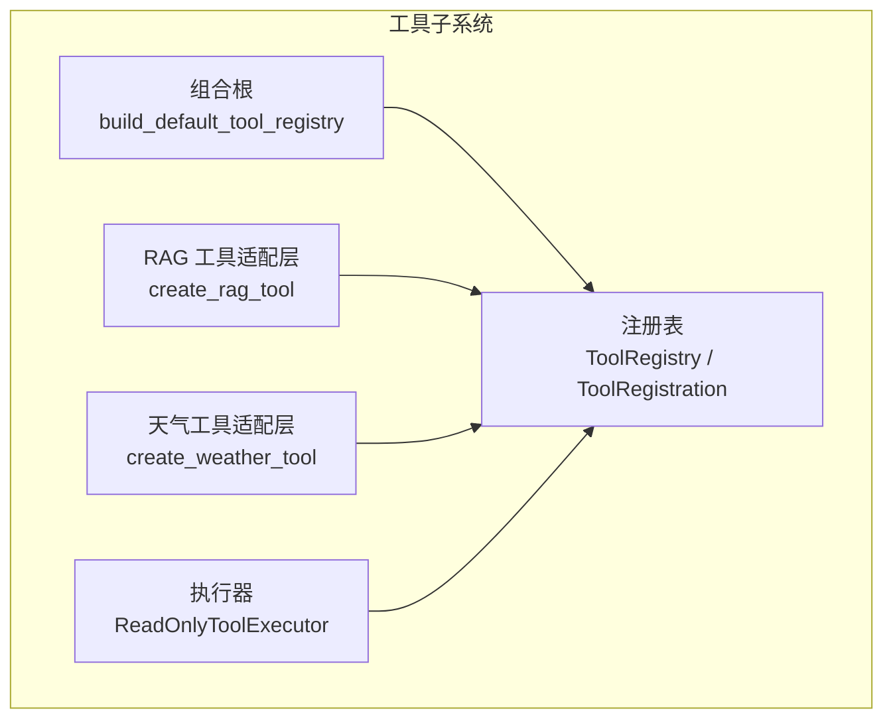
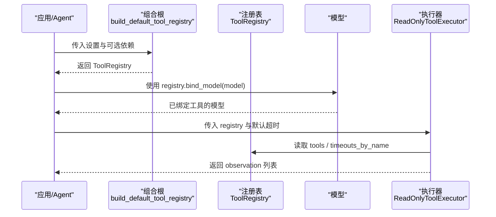
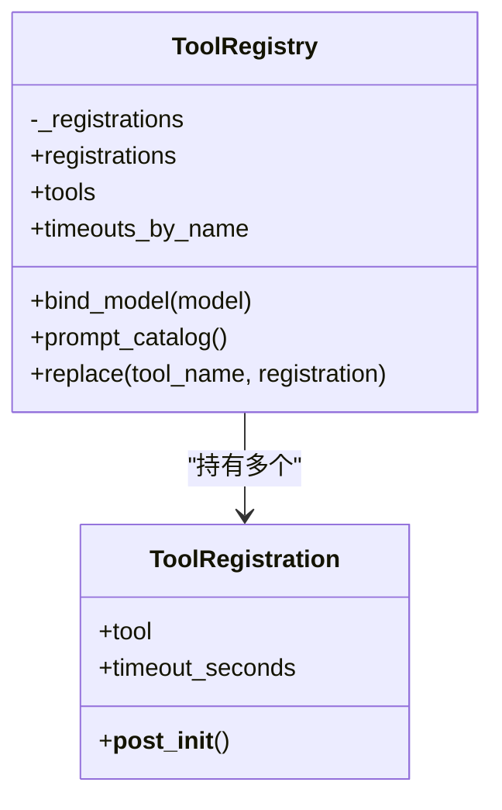
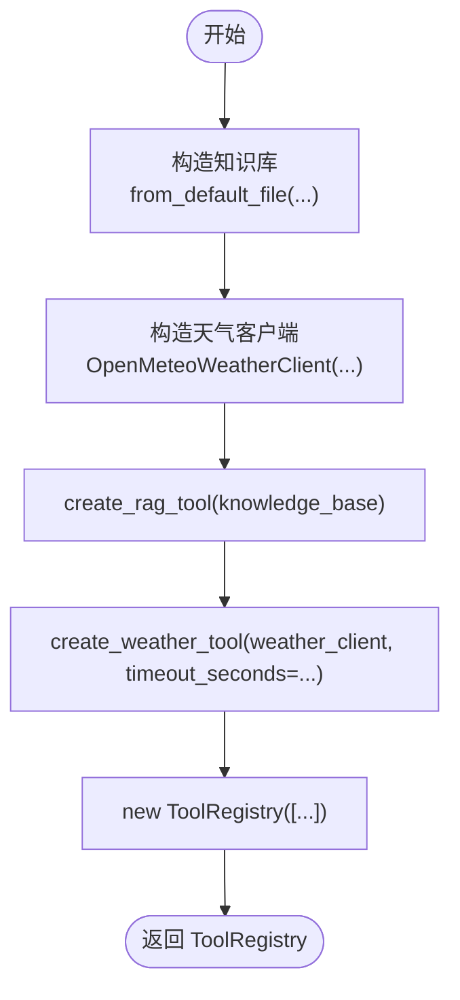
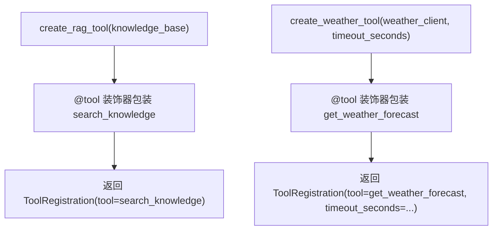
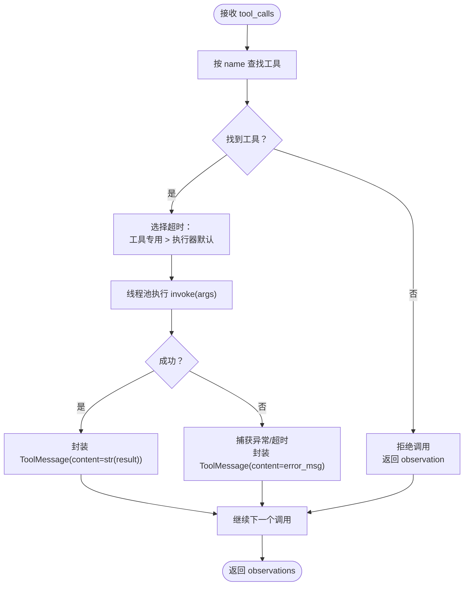
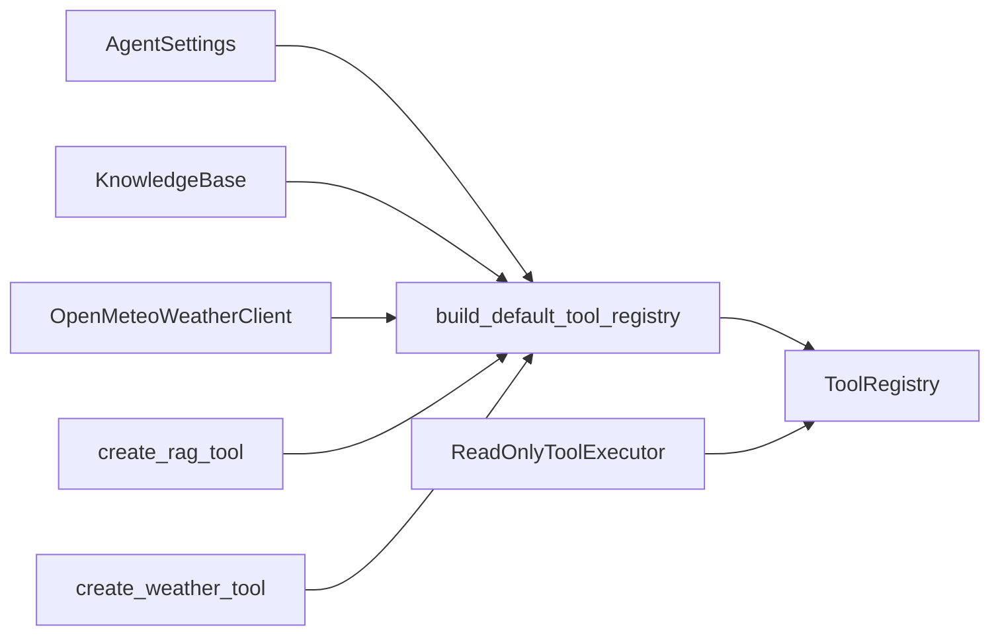
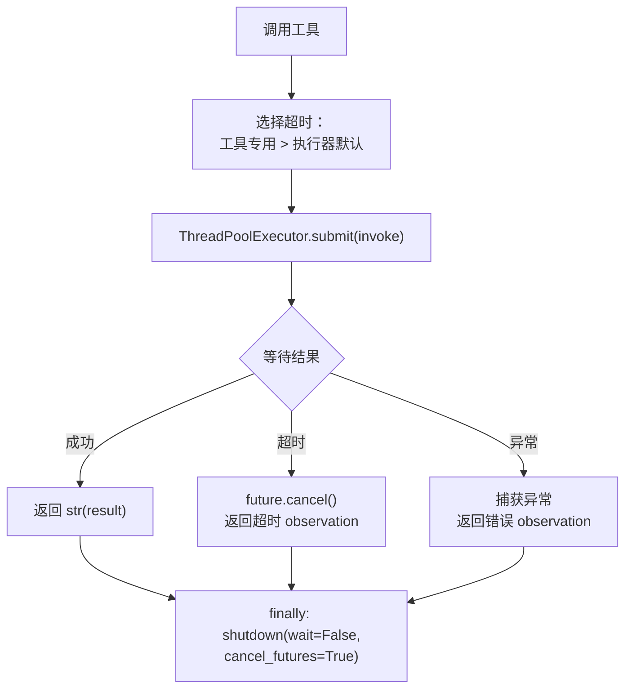

# 注册表模式

<cite>
**本文引用的文件**   
- [registry.py](file://agent_platform/tools/registry.py)
- [executor.py](file://agent_platform/tools/executor.py)
- [factory.py](file://agent_platform/tools/factory.py)
- [weather.py](file://agent_platform/tools/weather.py)
- [rag.py](file://agent_platform/tools/rag.py)
- [__init__.py](file://agent_platform/tools/__init__.py)
</cite>

## 目录
1. [引言](#引言)
2. [项目结构](#项目结构)
3. [核心组件](#核心组件)
4. [架构总览](#架构总览)
5. [详细组件分析](#详细组件分析)
6. [依赖关系分析](#依赖关系分析)
7. [性能与超时策略](#性能与超时策略)
8. [故障排查指南](#故障排查指南)
9. [结论](#结论)

## 引言
本文面向“工具系统”中的注册表模式，围绕 ToolRegistration 数据类与 ToolRegistry 不可变集合展开，解释如何通过单一注册源统一管理：
- 模型侧的工具 Schema（bind_tools）
- 系统 Prompt 中的工具目录
- 执行器侧的白名单、超时与错误处理

通过集中式注册，避免模型 Schema、Prompt 与执行器三处手工维护导致的不同步问题；同时提供 Fail Fast 校验、工具名唯一性保证、可替换的测试替身能力，以及两级超时策略。

## 项目结构
工具子系统位于 agent_platform/tools 下，采用“组合根 + 适配层 + 注册表 + 执行器”的分层组织：
- 组合根：tools/factory.py 负责组装领域客户端并构建默认 ToolRegistry
- 适配层：tools/rag.py、tools/weather.py 将领域能力包装为 LangChain 工具，并返回 ToolRegistration
- 注册表：tools/registry.py 定义 ToolRegistration 与 ToolRegistry，提供只读视图、绑定模型、生成 Prompt 目录、替换工具等能力
- 执行器：tools/executor.py 基于 ToolRegistry 实现只读工具调用、白名单校验与超时保护
- 包契约：tools/__init__.py 暴露对外 API，隐藏内部适配函数

**图表来源**
- [factory.py:18-36](file://agent_platform/tools/factory.py#L18-L36)
- [rag.py:14-26](file://agent_platform/tools/rag.py#L14-L26)
- [weather.py:13-25](file://agent_platform/tools/weather.py#L13-L25)
- [registry.py:15-93](file://agent_platform/tools/registry.py#L15-L93)
- [executor.py:17-67](file://agent_platform/tools/executor.py#L17-L67)

**章节来源**
- [factory.py:1-36](file://agent_platform/tools/factory.py#L1-L36)
- [registry.py:1-93](file://agent_platform/tools/registry.py#L1-L93)
- [executor.py:1-67](file://agent_platform/tools/executor.py#L1-L67)
- [weather.py:1-26](file://agent_platform/tools/weather.py#L1-L26)
- [rag.py:1-36](file://agent_platform/tools/rag.py#L1-L36)
- [__init__.py:1-18](file://agent_platform/tools/__init__.py#L1-L18)

## 核心组件
- ToolRegistration：描述一个工具及其运行策略（主要是超时）。它是不可变的数据对象，新增工具只需创建并注册该对象。
- ToolRegistry：不可变的工具集合，提供：
  - tools：供模型 bind_tools() 使用的工具列表
  - timeouts_by_name：显式配置了专用超时的工具映射
  - prompt_catalog()：从工具 description 动态生成模型可见目录
  - bind_model(model)：以注册表工具 Schema 绑定模型
  - replace(tool_name, registration)：返回替换指定工具后的新注册表，用于测试替身注入

这些能力确保模型 Schema、Prompt 与执行器共享同一份工具清单，从根本上避免不同步。

**章节来源**
- [registry.py:15-93](file://agent_platform/tools/registry.py#L15-L93)

## 架构总览
注册表模式在工具系统中的职责边界如下：
- 组合根集中构造领域客户端，并通过适配层生成 ToolRegistration
- ToolRegistry 作为唯一事实来源，向模型、Prompt 与执行器暴露一致视图
- 执行器基于注册表进行白名单校验、超时裁决与错误收敛

**图表来源**
- [factory.py:18-36](file://agent_platform/tools/factory.py#L18-L36)
- [registry.py:56-75](file://agent_platform/tools/registry.py#L56-L75)
- [executor.py:20-43](file://agent_platform/tools/executor.py#L20-L43)

## 详细组件分析

### ToolRegistration 与 ToolRegistry 设计
- ToolRegistration 是 frozen dataclass，包含：
  - tool：LangChain BaseTool 实例，其 docstring 即模型可见说明
  - timeout_seconds：工具级超时，None 表示回落到执行器默认值
  - __post_init__ 中做 Fail Fast 校验：若显式设置了超时但小于等于 0，直接抛出异常
- ToolRegistry 在构造时：
  - 将输入固化为元组，保证运行期不可变
  - 检查工具名是否重复，重复则立即抛出异常（Fail Fast）
- 对外暴露：
  - registrations：原始注册项序列
  - tools：供模型绑定的工具列表
  - timeouts_by_name：仅包含显式配置超时的工具映射
  - bind_model(model)：安全地绑定模型，不支持或抛 NotImplementedError 时透传原模型
  - prompt_catalog()：从工具 description 生成目录文本
  - replace(tool_name, registration)：返回替换后的新注册表，用于测试替身

**图表来源**
- [registry.py:15-93](file://agent_platform/tools/registry.py#L15-L93)

**章节来源**
- [registry.py:15-93](file://agent_platform/tools/registry.py#L15-L93)

### 组合根：默认工具装配
组合根 build_default_tool_registry 是工具系统的“组合根”，统一构造领域客户端并注册到 ToolRegistry：
- 知识库检索工具：不设置专用超时，走执行器默认超时
- 天气工具：网络调用耗时较长，显式设置专用超时覆盖默认值
- 支持通过参数注入 KnowledgeBase 与 OpenMeteoWeatherClient，便于单元测试替换替身

**图表来源**
- [factory.py:18-36](file://agent_platform/tools/factory.py#L18-L36)
- [rag.py:14-26](file://agent_platform/tools/rag.py#L14-L26)
- [weather.py:13-25](file://agent_platform/tools/weather.py#L13-L25)

**章节来源**
- [factory.py:1-36](file://agent_platform/tools/factory.py#L1-L36)

### 工具适配层：RAG 与天气
- RAG 工具适配层 create_rag_tool：
  - 使用 @tool 装饰器把 search_knowledge 包装为 LangChain 工具
  - 未命中时返回引导性文本，提醒模型如实说明资料不足
  - 返回 ToolRegistration，不设置专用超时
- 天气工具适配层 create_weather_tool：
  - 使用 @tool 装饰器把 get_weather_forecast 包装为 LangChain 工具
  - 返回 ToolRegistration，并显式设置 timeout_seconds

**图表来源**
- [rag.py:14-26](file://agent_platform/tools/rag.py#L14-L26)
- [weather.py:13-25](file://agent_platform/tools/weather.py#L13-L25)

**章节来源**
- [rag.py:1-36](file://agent_platform/tools/rag.py#L1-L36)
- [weather.py:1-26](file://agent_platform/tools/weather.py#L1-L26)

### 执行器：白名单、超时与错误收敛
ReadOnlyToolExecutor 基于 ToolRegistry 实现：
- 白名单校验：模型幻觉出的未注册工具直接拒绝，返回 observation 而非抛出异常
- 超时策略：单工具显式配置优先，否则回落到执行器默认超时
- 错误收敛：工具抛异常或超时都转为文本 observation，避免 LangGraph 图崩溃

**图表来源**
- [executor.py:27-67](file://agent_platform/tools/executor.py#L27-L67)

**章节来源**
- [executor.py:1-67](file://agent_platform/tools/executor.py#L1-L67)

### 工具注册、替换与绑定流程示例
以下示例展示典型用法路径（不直接粘贴代码，给出步骤与对应源码位置）：

- 注册工具
  - 通过 create_rag_tool / create_weather_tool 生成 ToolRegistration
  - 由 build_default_tool_registry 汇总并构造 ToolRegistry
  - 参考：[factory.py:18-36](file://agent_platform/tools/factory.py#L18-L36)、[rag.py:14-26](file://agent_platform/tools/rag.py#L14-L26)、[weather.py:13-25](file://agent_platform/tools/weather.py#L13-L25)

- 绑定模型
  - 使用 registry.bind_model(model) 将工具 Schema 注入模型
  - 若模型不支持 bind_tools 或未注册工具，直接透传原模型
  - 参考：[registry.py:56-65](file://agent_platform/tools/registry.py#L56-L65)

- 生成 Prompt 工具目录
  - 使用 registry.prompt_catalog() 动态生成模型可见目录
  - 无需在 Prompt 中手工维护工具名
  - 参考：[registry.py:67-75](file://agent_platform/tools/registry.py#L67-L75)

- 替换工具（测试替身）
  - 使用 registry.replace("工具名", new_registration) 返回新注册表
  - 替换时要求新注册工具名与目标一致，否则抛出异常
  - 若目标工具不存在，抛出 KeyError
  - 参考：[registry.py:77-93](file://agent_platform/tools/registry.py#L77-L93)

- 执行工具调用
  - ReadOnlyToolExecutor(registry, default_timeout_seconds) 初始化白名单与超时映射
  - execute_tool_calls(tool_calls) 依次执行并返回 ToolMessage 列表
  - 参考：[executor.py:20-43](file://agent_platform/tools/executor.py#L20-L43)

**章节来源**
- [factory.py:18-36](file://agent_platform/tools/factory.py#L18-L36)
- [registry.py:56-93](file://agent_platform/tools/registry.py#L56-L93)
- [executor.py:20-43](file://agent_platform/tools/executor.py#L20-L43)

## 依赖关系分析
- 组合根依赖：
  - AgentSettings（外部配置）
  - KnowledgeBase、OpenMeteoWeatherClient（领域客户端）
  - create_rag_tool、create_weather_tool（适配层）
  - ToolRegistry（注册表）
- 执行器依赖：
  - ToolRegistry（读取 tools、timeouts_by_name）
  - LangChain BaseTool、ToolMessage（工具与消息类型）
- 注册表依赖：
  - BaseTool（工具抽象）
  - 无外部运行时状态，纯数据与行为封装

**图表来源**
- [factory.py:10-36](file://agent_platform/tools/factory.py#L10-L36)
- [executor.py:14-25](file://agent_platform/tools/executor.py#L14-L25)
- [registry.py:12-30](file://agent_platform/tools/registry.py#L12-L30)

**章节来源**
- [factory.py:1-36](file://agent_platform/tools/factory.py#L1-L36)
- [executor.py:1-25](file://agent_platform/tools/executor.py#L1-L25)
- [registry.py:1-30](file://agent_platform/tools/registry.py#L1-L30)

## 性能与超时策略
- 超时策略
  - 工具级超时：ToolRegistration.timeout_seconds 显式配置时优先
  - 执行器默认超时：当工具未显式配置时，使用 ReadOnlyToolExecutor 的 default_timeout_seconds
  - 天气工具通常设置更长的专用超时，RAG 工具走默认值
- 执行模型
  - 使用 ThreadPoolExecutor(max_workers=1) 包裹工具调用，避免阻塞主流程
  - 超时后取消 future 并返回友好 observation，不向上抛出
- 内存与并发
  - ToolRegistry 不可变，构造后为元组，避免运行期修改带来的竞态
  - 执行器每次调用创建线程池并在 finally 中关闭，避免资源泄漏

**图表来源**
- [executor.py:45-67](file://agent_platform/tools/executor.py#L45-L67)

**章节来源**
- [executor.py:45-67](file://agent_platform/tools/executor.py#L45-L67)
- [registry.py:22-24](file://agent_platform/tools/registry.py#L22-L24)

## 故障排查指南
- 工具名重复
  - 现象：构造 ToolRegistry 时抛出 ValueError
  - 原因：存在同名工具
  - 解决：检查所有 ToolRegistration.tool.name，确保唯一
  - 参考：[registry.py:30-36](file://agent_platform/tools/registry.py#L30-L36)

- 工具超时配置非法
  - 现象：构造 ToolRegistration 时抛出 ValueError
  - 原因：timeout_seconds <= 0
  - 解决：设置为正数或留空以使用默认超时
  - 参考：[registry.py:22-24](file://agent_platform/tools/registry.py#L22-L24)

- 替换工具失败
  - 现象：replace 抛出 ValueError 或 KeyError
  - 原因：替换时工具名不一致，或目标工具未注册
  - 解决：确保 replacement.tool.name 与 tool_name 一致，且目标工具确实存在
  - 参考：[registry.py:77-93](file://agent_platform/tools/registry.py#L77-L93)

- 模型无法绑定工具
  - 现象：bind_model 返回原模型
  - 原因：模型没有 bind_tools 方法，或工具列表为空，或 bind_tools 抛出 NotImplementedError
  - 解决：确认模型支持 bind_tools，并确保注册表非空
  - 参考：[registry.py:56-65](file://agent_platform/tools/registry.py#L56-L65)

- 执行器拒绝未知工具
  - 现象：observation 提示不允许调用某工具
  - 原因：模型调用了未在注册表中声明的工具
  - 解决：将该工具加入 ToolRegistry，或修正模型输出
  - 参考：[executor.py:30-43](file://agent_platform/tools/executor.py#L30-L43)

**章节来源**
- [registry.py:22-36](file://agent_platform/tools/registry.py#L22-L36)
- [registry.py:56-93](file://agent_platform/tools/registry.py#L56-L93)
- [executor.py:30-43](file://agent_platform/tools/executor.py#L30-L43)

## 结论
通过注册表模式，工具系统在以下方面获得显著收益：
- 一致性：模型 Schema、Prompt 与执行器共享同一 ToolRegistry，避免手工维护导致的不同步
- 安全性：Fail Fast 校验工具名唯一性与超时合法性，执行器白名单与超时保护防止图崩溃
- 可测试性：replace 提供不可变替换能力，便于注入测试替身
- 可扩展性：新增工具仅需在组合根注册 ToolRegistration，无需多处同步

建议后续扩展遵循：
- 新增工具仅在 tools/factory.py 中注册
- 使用 create_*_tool 适配层封装领域能力
- 对网络或慢操作设置专用超时，其他工具使用默认超时
- 通过 replace 在测试中替换工具，保持生产注册表不变