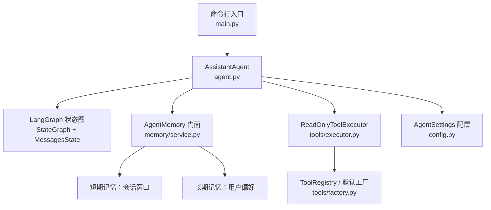
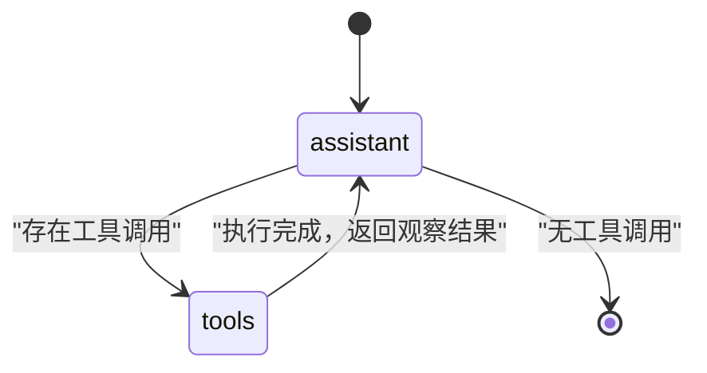
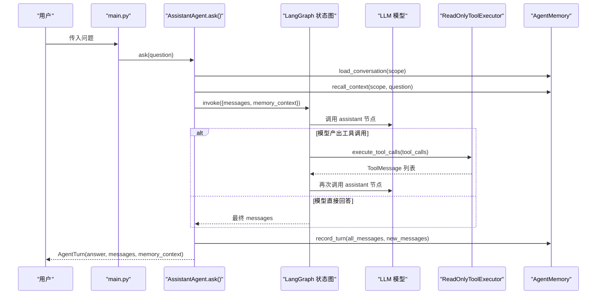
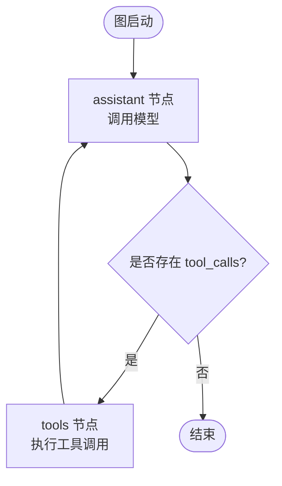
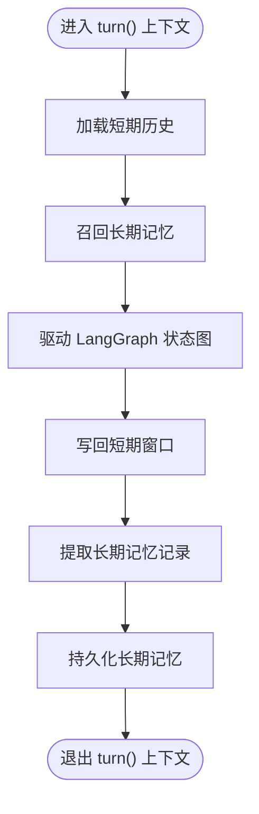
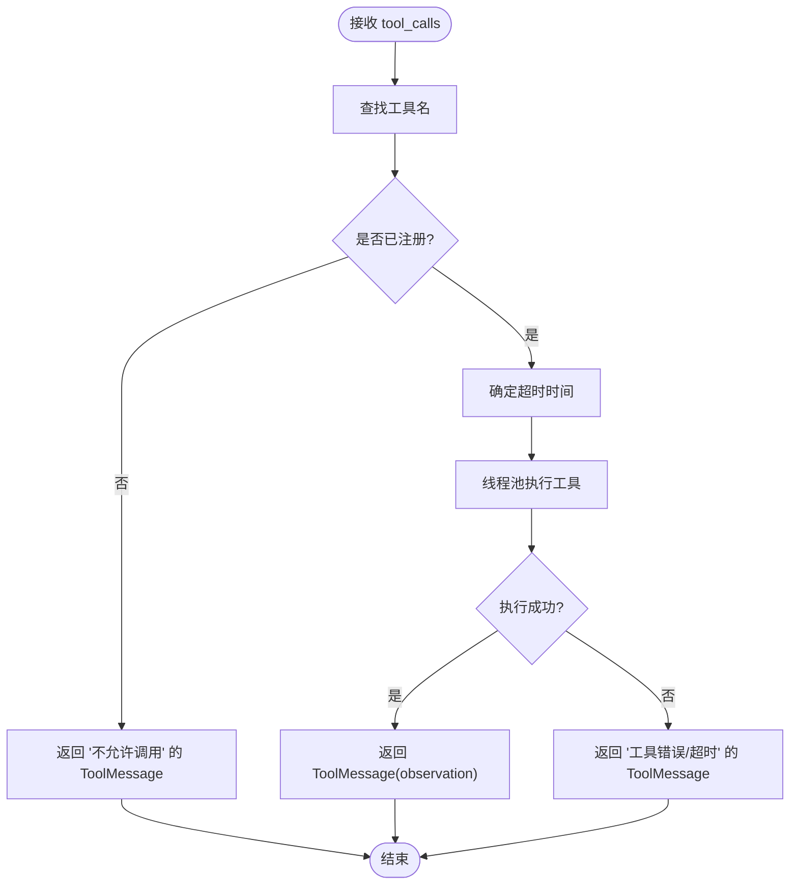
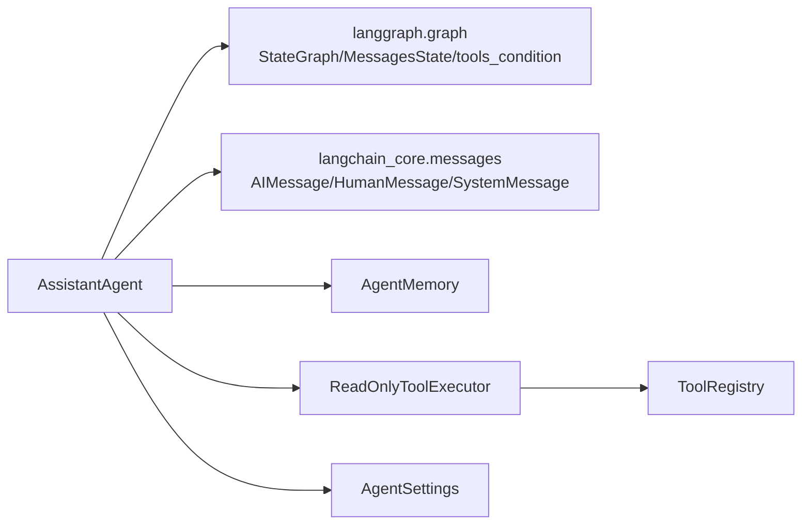

# 状态图模式

<cite>
**本文引用的文件**   
- [main.py](file://main.py)
- [agent.py](file://agent_platform/agent.py)
- [config.py](file://agent_platform/config.py)
- [service.py](file://agent_platform/memory/service.py)
- [executor.py](file://agent_platform/tools/executor.py)
- [factory.py](file://agent_platform/tools/factory.py)
- [README.md](file://README.md)
</cite>

## 目录
1. [引言](#引言)
2. [项目结构](#项目结构)
3. [核心组件](#核心组件)
4. [架构总览](#架构总览)
5. [详细组件分析](#详细组件分析)
6. [依赖关系分析](#依赖关系分析)
7. [性能与可靠性考虑](#性能与可靠性考虑)
8. [故障排查指南](#故障排查指南)
9. [结论](#结论)

## 引言
本文面向“状态图模式”的设计文档，聚焦 LangGraph 状态图引擎在 AssistantAgent 中的应用。目标是解释如何通过状态图编排多轮对话流程、管理工具调用和记忆更新的状态转换，并说明该模式如何保证复杂业务流程中的状态一致性与可追踪性。同时给出状态图的定义、节点函数和边连接的组织方式，对比传统流程控制的优势，并总结其在 AI Agent 场景下的特殊价值。

## 项目结构
本仓库是一个基于 LangChain 与 LangGraph 的通用 Agent 平台。入口脚本负责解析参数、加载配置、组装模型、工具注册表、短期与长期记忆，然后驱动 AssistantAgent 执行问答。Agent 内部使用 LangGraph 的 StateGraph 构建「助手 ↔ 工具」的双向循环，并通过 AgentMemory 门面协调短期会话窗口与长期偏好存储。

**图表来源**
- [main.py:43-89](file://main.py#L43-L89)
- [agent.py:35-118](file://agent_platform/agent.py#L35-L118)
- [service.py:24-90](file://agent_platform/memory/service.py#L24-L90)
- [executor.py:17-43](file://agent_platform/tools/executor.py#L17-L43)
- [factory.py:18-36](file://agent_platform/tools/factory.py#L18-L36)
- [config.py:12-47](file://agent_platform/config.py#L12-L47)

**章节来源**
- [main.py:1-95](file://main.py#L1-L95)
- [README.md:1-17](file://README.md#L1-L17)

## 核心组件
- AssistantAgent：应用层 Agent，封装模型、工具、记忆与 LangGraph 状态图；对外暴露 ask() 作为一轮问答的统一入口。
- AgentState：继承 LangGraph 的 MessagesState，扩展 memory_context 字段，用于注入不可信的长期记忆片段。
- AgentMemory：短期/长期记忆的门面，提供加锁的 turn() 上下文、会话读写、长期记忆召回与写入策略。
- ReadOnlyToolExecutor：统一执行模型产出的 tool_calls，将未注册、超时或异常转换为 ToolMessage，避免整张图崩溃。
- ToolRegistry 与默认工厂：集中注册工具、绑定模型 Schema、维护 Prompt 目录与工具超时策略。
- AgentSettings：集中化运行配置，包括系统提示词、记忆窗口、RAG 参数与工具超时等。

**章节来源**
- [agent.py:20-142](file://agent_platform/agent.py#L20-L142)
- [service.py:24-141](file://agent_platform/memory/service.py#L24-L141)
- [executor.py:17-67](file://agent_platform/tools/executor.py#L17-L67)
- [factory.py:18-36](file://agent_platform/tools/factory.py#L18-L36)
- [config.py:12-47](file://agent_platform/config.py#L12-L47)

## 架构总览
AssistantAgent 通过 LangGraph 的 StateGraph 构建一个两节点有向图：assistant 节点调用模型生成下一步（可能直接回答，也可能携带工具调用），tools 节点执行所有工具调用并把 observation 写回消息流。边的路由由 tools_condition 决定：若存在待执行的 tool_calls，则进入 tools 节点；否则结束。

**图表来源**
- [agent.py:110-118](file://agent_platform/agent.py#L110-L118)

### 状态图数据流
- 输入：messages（历史消息 + 当前问题）与 memory_context（长期记忆片段）。
- 中间状态：assistant 节点追加 AI 回复；tools 节点追加 ToolMessage。
- 输出：最终 messages 列表，以及最后一条不带 tool_calls 的 AI 回复作为 answer。

**图表来源**
- [main.py:78-90](file://main.py#L78-L90)
- [agent.py:84-108](file://agent_platform/agent.py#L84-L108)
- [agent.py:120-141](file://agent_platform/agent.py#L120-L141)
- [executor.py:27-43](file://agent_platform/tools/executor.py#L27-L43)
- [service.py:77-90](file://agent_platform/memory/service.py#L77-L90)

## 详细组件分析

### AssistantAgent 与 LangGraph 状态图
AssistantAgent 在构造时编译状态图，定义两个节点与两条边：START → assistant，assistant → tools（条件边），tools → assistant。tools_condition 根据上一条 AI 消息是否包含 tool_calls 决定路由。

- 状态定义：AgentState 继承 MessagesState，新增 memory_context 字段，用于注入长期记忆片段。
- 节点函数：
  - _assistant_node：按窗口裁剪历史消息，拼接 SystemPrompt 与 memory_context，调用模型；异常降级为普通 AI 消息，确保图正常收尾。
  - _tools_node：从最后一条 AI 消息提取 tool_calls，交由 ReadOnlyToolExecutor 执行，并将 ToolMessage 写回消息流。
- 边连接：
  - START → assistant：图启动后首先进入助手节点。
  - assistant → tools：当 tools_condition 判定存在工具调用时跳转。
  - tools → assistant：工具执行完成后回到助手节点继续推理。
  - assistant → END：若无工具调用，直接结束。

**图表来源**
- [agent.py:110-118](file://agent_platform/agent.py#L110-L118)
- [agent.py:120-141](file://agent_platform/agent.py#L120-L141)

**章节来源**
- [agent.py:20-142](file://agent_platform/agent.py#L20-L142)

### 记忆子系统与状态一致性
AgentMemory 提供统一的记忆访问接口，并通过 turn() 上下文管理器对同一 MemoryScope 串行化读—执行—写流程，避免并发覆盖短期历史。

- 短期记忆：load_conversation() 读取会话历史；trim_for_model() 按窗口策略裁剪以控制 token 成本；record_turn() 全量覆盖短期窗口。
- 长期记忆：recall_context() 按 owner 与问题检索，渲染为带防注入外壳的不可信数据块；writer.extract() 仅保存值得保留的记录。
- 作用域隔离：MemoryScope 支持 tenant_id、user_id、conversation_id，防止跨用户或跨会话泄露。

**图表来源**
- [service.py:51-90](file://agent_platform/memory/service.py#L51-L90)
- [service.py:108-141](file://agent_platform/memory/service.py#L108-L141)

**章节来源**
- [service.py:24-141](file://agent_platform/memory/service.py#L24-L141)

### 工具执行与错误降级
ReadOnlyToolExecutor 负责白名单校验、超时控制与异常降级：

- 白名单：未注册的工具名称直接拒绝，返回 ToolMessage 说明不允许调用。
- 超时：单工具显式配置优先，否则回落到默认超时；超时取消等待线程并返回说明文本。
- 异常：工具抛异常转为 ToolMessage，不让整张图崩溃，由模型向用户说明查询失败。

**图表来源**
- [executor.py:27-67](file://agent_platform/tools/executor.py#L27-L67)

**章节来源**
- [executor.py:17-67](file://agent_platform/tools/executor.py#L17-L67)

### 配置与工具组合
AgentSettings 集中化配置，包括系统提示词、记忆窗口、RAG 参数与工具超时；build_system_prompt() 将工具目录注入到系统提示中。默认工具工厂 build_default_tool_registry() 组合 RAG 与天气工具，并为网络类工具设置专用超时。

**章节来源**
- [config.py:12-47](file://agent_platform/config.py#L12-L47)
- [factory.py:18-36](file://agent_platform/tools/factory.py#L18-L36)

## 依赖关系分析
AssistantAgent 依赖以下外部能力：
- LangGraph：StateGraph、MessagesState、tools_condition、START/END。
- LangChain：消息类型 AIMessage/HumanMessage/SystemMessage、ToolMessage、BaseTool。
- 内部模块：AgentSettings、AgentMemory、ToolRegistry、ReadOnlyToolExecutor。

**图表来源**
- [agent.py:8-17](file://agent_platform/agent.py#L8-L17)
- [executor.py:8-14](file://agent_platform/tools/executor.py#L8-L14)
- [config.py:1-10](file://agent_platform/config.py#L1-L10)

**章节来源**
- [agent.py:8-17](file://agent_platform/agent.py#L8-L17)
- [executor.py:8-14](file://agent_platform/tools/executor.py#L8-L14)

## 性能与可靠性考虑
- Token 成本控制：assistant 节点在调用模型前对历史消息进行裁剪，减少不必要的 token 消耗，同时完整消息仍保留在图状态中供后续处理。
- 工具执行超时：默认工具超时较短，网络类工具使用更长的专用超时，避免长时间阻塞。
- 并发安全：AgentMemory.turn() 对同一会话串行化，避免并发覆盖短期历史。
- 错误降级：模型异常与工具异常均被捕获并转化为普通消息或 ToolMessage，保证状态图稳定收敛。

[本节为一般性指导，不直接分析具体文件]

## 故障排查指南
- 模型调用失败：assistant 节点会捕获异常并返回一条普通 AI 消息，便于图正常结束；检查模型配置与网络连通性。
- 工具未注册：ReadOnlyToolExecutor 会返回“不允许调用”的 ToolMessage；确认 ToolRegistry 是否正确注册工具。
- 工具超时：检查工具专用超时与默认超时配置；网络类工具建议使用更长超时。
- 记忆不一致：确认 MemoryScope 是否正确传递；turn() 上下文是否正确使用；短期窗口裁剪策略是否符合预期。

**章节来源**
- [agent.py:120-141](file://agent_platform/agent.py#L120-L141)
- [executor.py:27-67](file://agent_platform/tools/executor.py#L27-L67)
- [service.py:51-90](file://agent_platform/memory/service.py#L51-L90)

## 结论
状态图模式通过显式的状态与边定义，将多轮对话、工具调用与记忆更新组织为可追踪、可调试的流程。在 AssistantAgent 中，LangGraph 的 StateGraph 提供了稳定的循环控制，tools_condition 自动判断是否需要工具执行，而 AgentMemory 保证了短期与长期记忆的一致性与隔离性。相比传统 if/else 流程控制，状态图模式具备更强的可视化、可测试性与可扩展性，特别适合 AI Agent 这种需要反复推理与外部交互的复杂业务场景。

[本节为总结性内容，不直接分析具体文件]