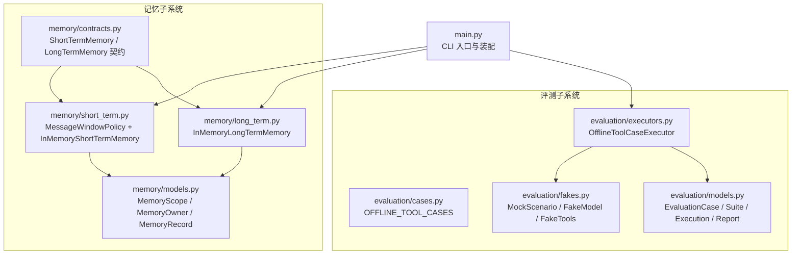
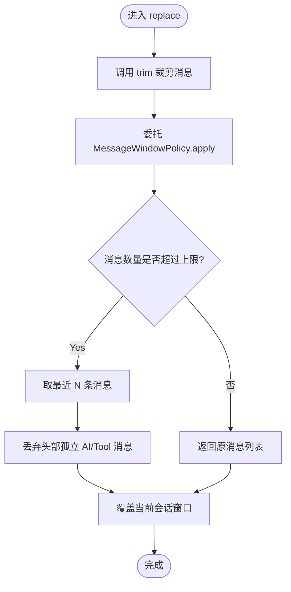
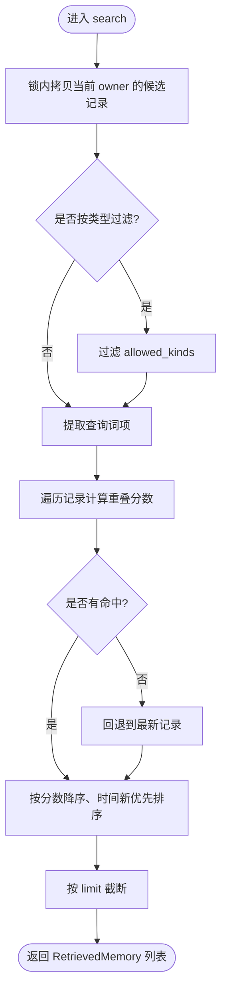
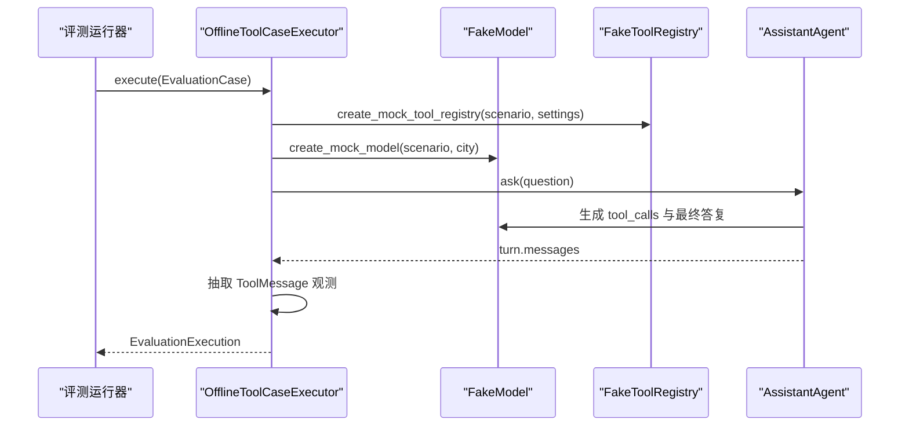
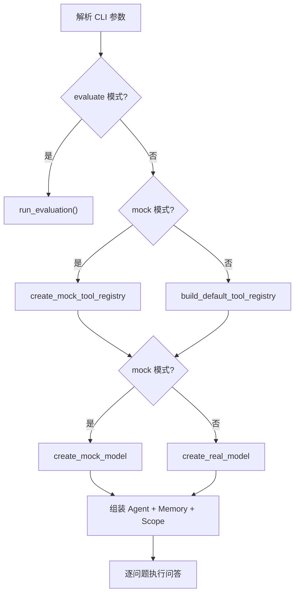
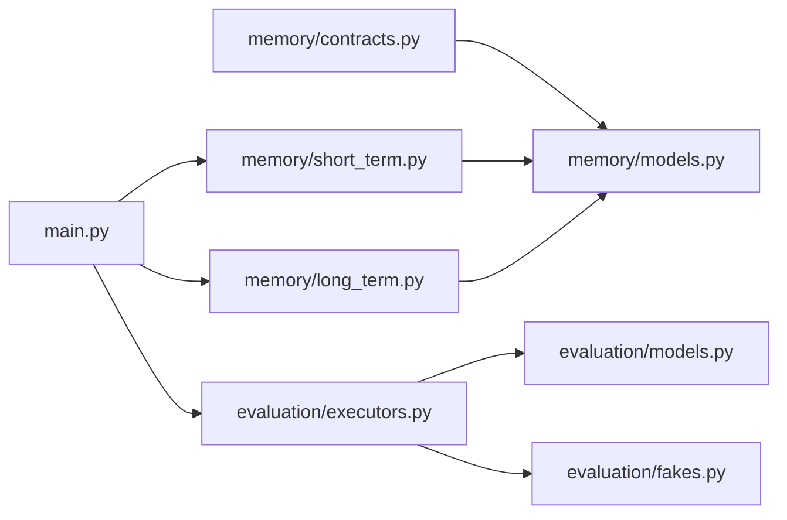

# 策略模式

<cite>
**本文引用的文件**   
- [contracts.py](file://agent_platform/memory/contracts.py)
- [short_term.py](file://agent_platform/memory/short_term.py)
- [long_term.py](file://agent_platform/memory/long_term.py)
- [models.py（记忆模型）](file://agent_platform/memory/models.py)
- [executors.py](file://agent_platform/evaluation/executors.py)
- [cases.py](file://agent_platform/evaluation/cases.py)
- [models.py（评测模型）](file://agent_platform/evaluation/models.py)
- [fakes.py](file://agent_platform/evaluation/fakes.py)
- [main.py](file://main.py)
</cite>

## 目录
1. [引言](#引言)
2. [项目结构](#项目结构)
3. [核心组件](#核心组件)
4. [架构总览](#架构总览)
5. [详细组件分析](#详细组件分析)
6. [依赖关系分析](#依赖关系分析)
7. [性能与可扩展性](#性能与可扩展性)
8. [故障排查指南](#故障排查指南)
9. [结论](#结论)

## 引言
本文件围绕“策略模式”在记忆系统与评测系统中的落地展开，重点说明：
- 短期记忆与长期记忆的契约如何通过 Protocol 抽象，实现可替换的后端实现。
- 评测执行器如何通过协议或统一接口支持不同执行策略。
- 如何在运行时动态选择具体策略，从而提升系统可扩展性与测试友好性。
- 通过仓库中的真实代码路径展示策略接口的定义、默认实现与使用场景。

## 项目结构
该仓库将“记忆子系统”和“评测子系统”解耦为清晰的模块边界：
- 记忆子系统：契约、数据模型、短期消息窗口策略、进程内长期记忆实现。
- 评测子系统：案例定义、执行器、假模型与工具替身、报告模型。
- 应用入口：CLI 启动、参数解析、注入模型/工具/记忆。



**图表来源**
- [contracts.py:17-58](file://agent_platform/memory/contracts.py#L17-L58)
- [short_term.py:17-67](file://agent_platform/memory/short_term.py#L17-L67)
- [long_term.py:20-82](file://agent_platform/memory/long_term.py#L20-L82)
- [models.py（记忆模型）:27-120](file://agent_platform/memory/models.py#L27-L120)
- [executors.py:17-41](file://agent_platform/evaluation/executors.py#L17-L41)
- [cases.py:12-33](file://agent_platform/evaluation/cases.py#L12-L33)
- [models.py（评测模型）:12-83](file://agent_platform/evaluation/models.py#L12-L83)
- [fakes.py:18-98](file://agent_platform/evaluation/fakes.py#L18-L98)
- [main.py:43-84](file://main.py#L43-L84)

**章节来源**
- [contracts.py:1-59](file://agent_platform/memory/contracts.py#L1-L59)
- [short_term.py:1-67](file://agent_platform/memory/short_term.py#L1-L67)
- [long_term.py:1-83](file://agent_platform/memory/long_term.py#L1-L83)
- [models.py（记忆模型）:1-120](file://agent_platform/memory/models.py#L1-L120)
- [executors.py:1-41](file://agent_platform/evaluation/executors.py#L1-L41)
- [cases.py:1-34](file://agent_platform/evaluation/cases.py#L1-L34)
- [models.py（评测模型）:1-83](file://agent_platform/evaluation/models.py#L1-L83)
- [fakes.py:1-98](file://agent_platform/evaluation/fakes.py#L1-L98)
- [main.py:1-95](file://main.py#L1-L95)

## 核心组件
本节聚焦策略模式的关键抽象与默认实现：
- 短期记忆契约 ShortTermMemory：定义 load、replace、trim、clear 四个方法，屏蔽会话级消息窗口的存储细节。
- 长期记忆契约 LongTermMemory：定义 upsert、search、clear_owner，屏蔽跨会话、按用户隔离的记忆检索与清理逻辑。
- 长期记忆写入契约 LongTermMemoryWriter：定义 extract，从新增对话消息中提取可持久化的结构化记忆。
- 短期消息裁剪策略 MessageWindowPolicy：封装“如何裁剪消息窗口”的策略，与短期存储分离。
- 评测执行器 OfflineToolCaseExecutor：封装“如何执行一个评测案例”，与 runner 的断言逻辑解耦。

这些抽象共同构成“稳定契约 + 可替换实现”的策略体系，使上层业务不关心底层是内存、SQLite、Redis 还是向量库，也不关心评测是离线 mock 还是在线真实模型。

**章节来源**
- [contracts.py:17-58](file://agent_platform/memory/contracts.py#L17-L58)
- [short_term.py:17-67](file://agent_platform/memory/short_term.py#L17-L67)
- [executors.py:17-41](file://agent_platform/evaluation/executors.py#L17-L41)

## 架构总览
下图展示策略模式在记忆与评测两个子系统中的协作方式：上层只依赖契约，运行时根据配置注入具体实现。

```mermaid
classDiagram
class ShortTermMemory {
<<Protocol>>
+load(scope) list
+replace(scope, messages) void
+trim(messages) list
+clear(scope) void
}
class LongTermMemory {
<<Protocol>>
+upsert(records) void
+search(query) list
+clear_owner(owner) void
}
class LongTermMemoryWriter {
<<Protocol>>
+extract(scope, new_messages) list
}
class MessageWindowPolicy {
+apply(messages) list
}
class InMemoryShortTermMemory {
-_window_policy : MessageWindowPolicy
-_messages_by_scope : dict
+load(scope) list
+replace(scope, messages) void
+trim(messages) list
+clear(scope) void
}
class InMemoryLongTermMemory {
-_records_by_owner : dict
+upsert(records) void
+search(query) list
+clear_owner(owner) void
}
class OfflineToolCaseExecutor {
-_settings
+execute(case) EvaluationExecution
}
ShortTermMemory <|.. InMemoryShortTermMemory
LongTermMemory <|.. InMemoryLongTermMemory
InMemoryShortTermMemory --> MessageWindowPolicy : "组合裁剪策略"
OfflineToolCaseExecutor --> "调用 Agent 与 Tools" : "执行评测案例"
```

**图表来源**
- [contracts.py:17-58](file://agent_platform/memory/contracts.py#L17-L58)
- [short_term.py:17-67](file://agent_platform/memory/short_term.py#L17-L67)
- [long_term.py:20-82](file://agent_platform/memory/long_term.py#L20-L82)
- [executors.py:17-41](file://agent_platform/evaluation/executors.py#L17-L41)

## 详细组件分析

### 短期记忆策略：消息窗口裁剪与会话存储
短期记忆采用“策略 + 适配器”的组合：
- MessageWindowPolicy 负责“怎么裁剪”，例如保留最近 N 条消息，并避免窗口以孤立的 AI 或 Tool 消息开头。
- InMemoryShortTermMemory 负责“按会话存取”，内部用字典保存每个会话的消息序列，并通过 RLock 保证并发安全。
- 两者都遵循 ShortTermMemory 契约，因此可以独立替换裁剪策略或存储后端。



**图表来源**
- [short_term.py:17-67](file://agent_platform/memory/short_term.py#L17-L67)

**章节来源**
- [short_term.py:17-67](file://agent_platform/memory/short_term.py#L17-L67)
- [contracts.py:17-34](file://agent_platform/memory/contracts.py#L17-L34)

### 长期记忆策略：词面重叠检索与用户隔离
长期记忆契约定义了 upsert、search、clear_owner 三个关键操作：
- upsert 支持幂等写入，相同 id 的记录重复保存不会累积。
- search 先按 owner 过滤候选集，再按 kinds 可选过滤，然后进行词面重叠打分；若无命中则回退到最新记忆。
- clear_owner 删除指定用户的全部长期记忆。



**图表来源**
- [long_term.py:37-66](file://agent_platform/memory/long_term.py#L37-L66)

**章节来源**
- [long_term.py:20-82](file://agent_platform/memory/long_term.py#L20-L82)
- [contracts.py:37-50](file://agent_platform/memory/contracts.py#L37-L50)
- [models.py（记忆模型）:62-103](file://agent_platform/memory/models.py#L62-L103)

### 评测执行策略：离线工具回归执行器
评测执行器 OfflineToolCaseExecutor 封装了“如何跑一个案例”：
- 根据 EvaluationCase 的场景构造 fake 模型与替身工具注册表。
- 驱动 AssistantAgent 执行一轮问答。
- 抽取 ToolMessage 作为观测，组装 EvaluationExecution。



**图表来源**
- [executors.py:17-41](file://agent_platform/evaluation/executors.py#L17-L41)
- [fakes.py:28-98](file://agent_platform/evaluation/fakes.py#L28-L98)
- [models.py（评测模型）:34-42](file://agent_platform/evaluation/models.py#L34-L42)

**章节来源**
- [executors.py:17-41](file://agent_platform/evaluation/executors.py#L17-L41)
- [fakes.py:18-98](file://agent_platform/evaluation/fakes.py#L18-L98)
- [models.py（评测模型）:12-42](file://agent_platform/evaluation/models.py#L12-L42)

### 运行时策略选择：CLI 装配与注入
应用入口 main.py 展示了典型的策略注入点：
- 根据 CLI 参数决定使用 mock 还是真实模型。
- 根据 mock 场景选择对应的 fake 工具注册表。
- 通过 AgentSettings 与 MemoryScope 注入记忆行为与作用域。



**图表来源**
- [main.py:43-84](file://main.py#L43-L84)
- [fakes.py:28-98](file://agent_platform/evaluation/fakes.py#L28-L98)

**章节来源**
- [main.py:43-84](file://main.py#L43-L84)

## 依赖关系分析
- 契约层 contracts.py 仅依赖数据模型 models.py（记忆模型），不依赖任何具体存储实现。
- 短期实现 short_term.py 依赖 MessageWindowPolicy 与 MemoryScope，保持存储与裁剪策略解耦。
- 长期实现 long_term.py 依赖 MemoryOwner、MemoryQuery、RetrievedMemory 等模型，提供进程内默认实现。
- 评测执行器 executors.py 依赖评测模型 evaluation/models.py 与 fakes.py，与 runner 的断言逻辑解耦。
- 应用入口 main.py 作为装配中心，注入模型、工具、记忆与作用域。



**图表来源**
- [contracts.py:1-59](file://agent_platform/memory/contracts.py#L1-L59)
- [short_term.py:1-67](file://agent_platform/memory/short_term.py#L1-L67)
- [long_term.py:1-83](file://agent_platform/memory/long_term.py#L1-L83)
- [models.py（记忆模型）:1-120](file://agent_platform/memory/models.py#L1-L120)
- [executors.py:1-41](file://agent_platform/evaluation/executors.py#L1-L41)
- [models.py（评测模型）:1-83](file://agent_platform/evaluation/models.py#L1-L83)
- [fakes.py:1-98](file://agent_platform/evaluation/fakes.py#L1-L98)
- [main.py:1-95](file://main.py#L1-L95)

**章节来源**
- [contracts.py:1-59](file://agent_platform/memory/contracts.py#L1-L59)
- [short_term.py:1-67](file://agent_platform/memory/short_term.py#L1-L67)
- [long_term.py:1-83](file://agent_platform/memory/long_term.py#L1-L83)
- [models.py（记忆模型）:1-120](file://agent_platform/memory/models.py#L1-L120)
- [executors.py:1-41](file://agent_platform/evaluation/executors.py#L1-L41)
- [models.py（评测模型）:1-83](file://agent_platform/evaluation/models.py#L1-L83)
- [fakes.py:1-98](file://agent_platform/evaluation/fakes.py#L1-L98)
- [main.py:1-95](file://main.py#L1-L95)

## 性能与可扩展性
- 短期消息裁剪策略 MessageWindowPolicy 的时间复杂度主要取决于消息数量与窗口大小；空间复杂度为 O(N) 用于保存会话消息。
- 长期记忆搜索在进程内实现中，先按 owner 过滤，再进行词面重叠打分；排序与截断带来额外开销，但通过锁内拷贝减少临界区。
- 通过 Protocol 契约，可将短期/长期记忆替换为 Redis、SQLite 或向量数据库，而不影响上层 Agent 与评测逻辑。
- 评测执行器可替换为在线模型执行器，只需实现统一的 execute 契约，即可在不改动 runner 的情况下切换执行策略。

[本节为通用指导，不直接分析具体文件]

## 故障排查指南
- 短期消息窗口异常：检查 MessageWindowPolicy.max_messages 是否为正数；确认 trim 后窗口不以孤立 AI/Tool 消息开头。
- 长期记忆检索无结果：检查 MemoryQuery.owner 是否正确；确认 query.text 是否能匹配到记录词项；必要时放宽 kinds 过滤。
- 评测执行失败：检查 EvaluationCase.scenario 是否与 fakes.py 的 MockScenario 一致；确认工具名与 observation 断言是否符合预期。
- CLI 装配错误：确保 .env 配置正确或使用 --mock/--evaluate 模式；检查 tenant_id/user_id/conversation_id 非空。

**章节来源**
- [short_term.py:20-38](file://agent_platform/memory/short_term.py#L20-L38)
- [long_term.py:37-66](file://agent_platform/memory/long_term.py#L37-L66)
- [cases.py:12-33](file://agent_platform/evaluation/cases.py#L12-L33)
- [fakes.py:28-98](file://agent_platform/evaluation/fakes.py#L28-L98)
- [main.py:43-84](file://main.py#L43-L84)

## 结论
通过 ShortTermMemory、LongTermMemory 与 LongTermMemoryWriter 的契约设计，以及 OfflineToolCaseExecutor 的执行策略抽象，系统在记忆与评测两个维度实现了稳定的依赖倒置边界。上层业务只依赖接口，运行时根据配置注入具体实现，既提升了可扩展性，也显著增强了测试友好性。未来引入新的存储后端或评测执行策略时，只需实现对应契约，无需改动现有调用链。