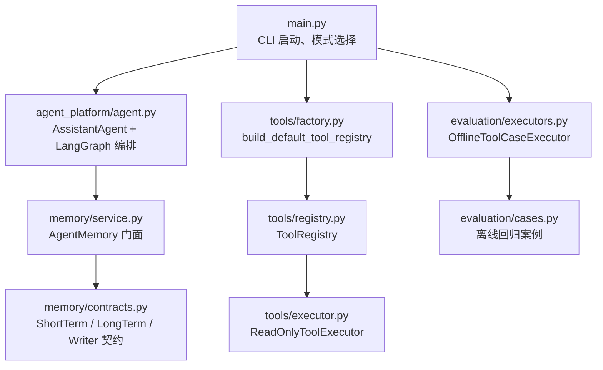
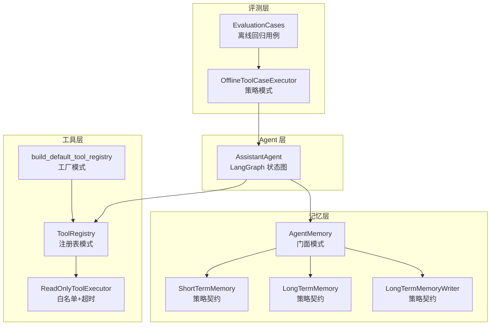
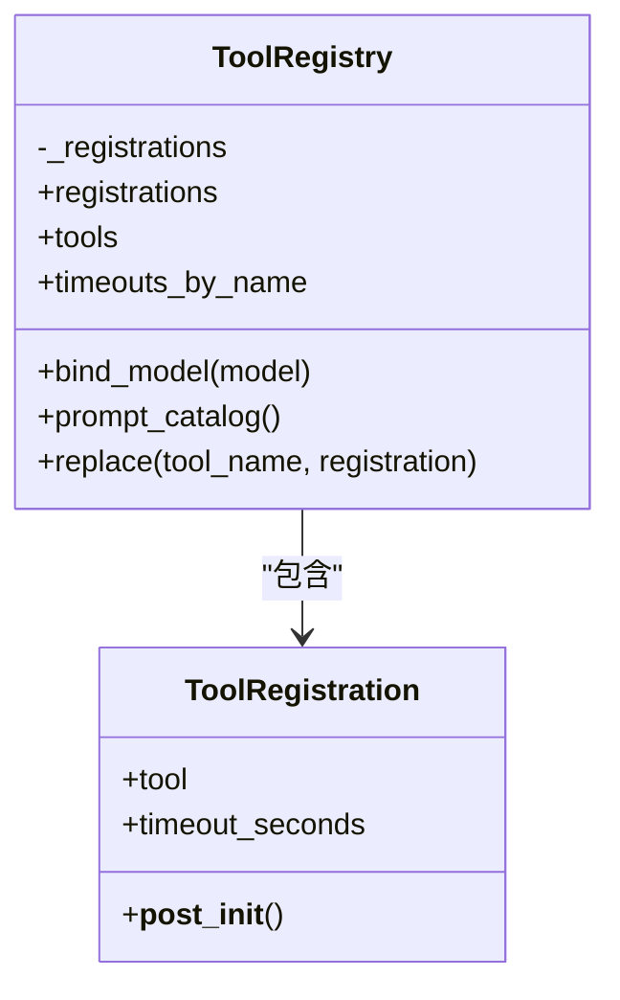
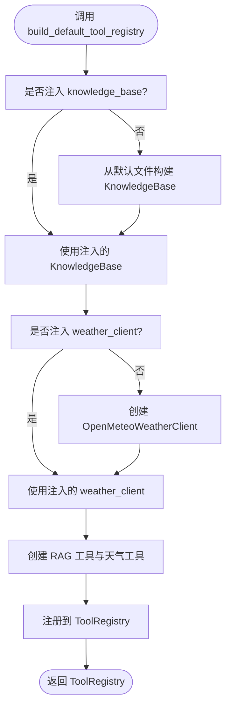
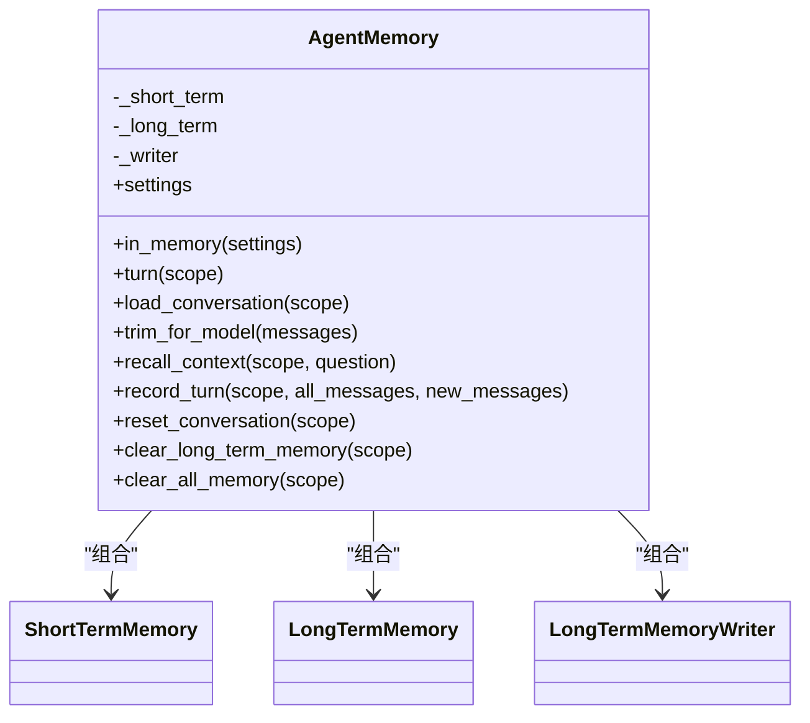
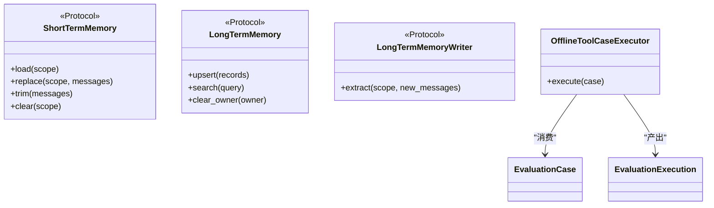
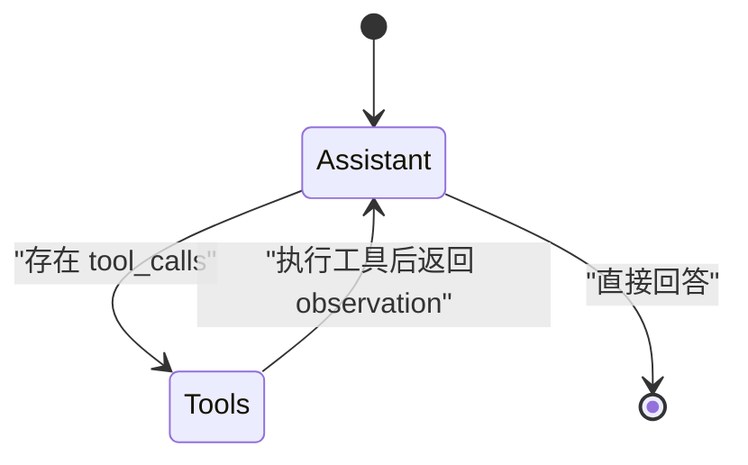
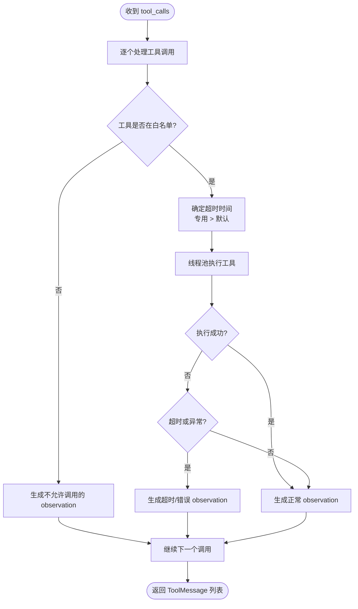
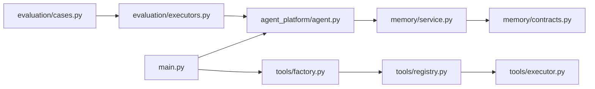

# 设计模式应用

<cite>
**本文引用的文件**   
- [README.md](file://README.md)
- [main.py](file://main.py)
- [agent_platform/agent.py](file://agent_platform/agent.py)
- [agent_platform/tools/registry.py](file://agent_platform/tools/registry.py)
- [agent_platform/tools/factory.py](file://agent_platform/tools/factory.py)
- [agent_platform/tools/executor.py](file://agent_platform/tools/executor.py)
- [agent_platform/memory/service.py](file://agent_platform/memory/service.py)
- [agent_platform/memory/contracts.py](file://agent_platform/memory/contracts.py)
- [agent_platform/evaluation/executors.py](file://agent_platform/evaluation/executors.py)
- [agent_platform/evaluation/cases.py](file://agent_platform/evaluation/cases.py)
</cite>

## 目录
1. [引言](#引言)
2. [项目结构](#项目结构)
3. [核心组件](#核心组件)
4. [架构总览](#架构总览)
5. [详细组件分析](#详细组件分析)
6. [依赖关系分析](#依赖关系分析)
7. [性能与扩展性](#性能与扩展性)
8. [故障排查指南](#故障排查指南)
9. [结论](#结论)
10. [附录：扩展新模式的实践清单](#附录扩展新模式的实践清单)

## 引言
本文件面向 Agent Platform 的设计模式应用，聚焦以下五种模式在代码中的落地方式、适用场景和扩展方法：
- 注册表模式：ToolRegistry 统一管理工具生命周期、Schema、超时策略与 Prompt 目录。
- 门面模式：AgentMemory 作为记忆子系统的唯一入口，屏蔽短期、长期记忆与写入策略的复杂性。
- 策略模式：可替换的记忆实现（短期/长期/Writer）与评测执行器。
- 工厂模式：build_default_tool_registry 构建默认工具集，集中装配领域客户端与适配层。
- 状态图模式：LangGraph StateGraph 驱动多轮对话中“助手 ↔ 工具”的状态流转。

这些模式共同保证：模型绑定、Prompt 工具目录、执行白名单三者来源一致；记忆子系统可独立演进；评测执行器可替换而不影响运行器；多轮对话具备稳定、可观测的状态机。

## 项目结构
Agent Platform 将工具、记忆、评测拆为独立模块，Agent 仅依赖稳定边界。顶层 main.py 负责 CLI、环境加载、真实或 mock 模式切换，并组装 AssistantAgent、ToolRegistry、AgentMemory 等组件。

**图表来源**
- [main.py:43-84](file://main.py#L43-L84)
- [agent_platform/agent.py:35-65](file://agent_platform/agent.py#L35-L65)
- [agent_platform/tools/factory.py:18-36](file://agent_platform/tools/factory.py#L18-L36)
- [agent_platform/tools/registry.py:27-93](file://agent_platform/tools/registry.py#L27-L93)
- [agent_platform/tools/executor.py:17-43](file://agent_platform/tools/executor.py#L17-L43)
- [agent_platform/memory/service.py:24-49](file://agent_platform/memory/service.py#L24-L49)
- [agent_platform/memory/contracts.py:17-58](file://agent_platform/memory/contracts.py#L17-L58)
- [agent_platform/evaluation/executors.py:17-40](file://agent_platform/evaluation/executors.py#L17-L40)
- [agent_platform/evaluation/cases.py:12-33](file://agent_platform/evaluation/cases.py#L12-L33)

**章节来源**
- [README.md:19-48](file://README.md#L19-L48)
- [main.py:1-95](file://main.py#L1-L95)

## 核心组件
本节从设计模式视角梳理关键类及其职责。

| 组件 | 模式 | 主要职责 | 带来的好处 |
| --- | --- | --- | --- |
| ToolRegistration / ToolRegistry | 注册表模式 | 维护工具对象、名称唯一性、超时映射、Prompt 目录、模型绑定 | 避免 Schema、Prompt、执行器三处手工维护导致的不一致 |
| build_default_tool_registry | 工厂模式 | 构造 KnowledgeBase、WeatherClient，包装为 LangChain 工具并注册 | 新增工具只需一处注册，测试可注入替身 |
| ReadOnlyToolExecutor | 白名单 + 超时策略 | 校验工具名、按专用或默认超时执行、失败转为 observation | 单个工具异常不破坏整张图，模型可见错误说明 |
| AgentMemory | 门面模式 | 统一暴露会话历史、消息裁剪、长期召回、偏好写入、清理接口 | 调用方无需关心短期/长期/Writer 的具体组合 |
| ShortTermMemory / LongTermMemory / LongTermMemoryWriter | 策略模式 | 定义可替换的记忆后端与提取策略 | 未来接入 SQLite/Redis/向量库时只改实现，不改 Agent |
| OfflineToolCaseExecutor | 策略模式 | 封装「如何跑一个案例」，与 runner 解耦 | 评测执行器可替换，不影响断言逻辑 |
| AssistantAgent._build_graph | 状态图模式 | 使用 LangGraph StateGraph 组织 assistant/tools 节点 | 多轮对话有明确状态转移，便于调试与扩展 |

**章节来源**
- [agent_platform/tools/registry.py:15-93](file://agent_platform/tools/registry.py#L15-L93)
- [agent_platform/tools/factory.py:1-36](file://agent_platform/tools/factory.py#L1-L36)
- [agent_platform/tools/executor.py:17-67](file://agent_platform/tools/executor.py#L17-L67)
- [agent_platform/memory/service.py:24-105](file://agent_platform/memory/service.py#L24-L105)
- [agent_platform/memory/contracts.py:17-58](file://agent_platform/memory/contracts.py#L17-L58)
- [agent_platform/evaluation/executors.py:17-40](file://agent_platform/evaluation/executors.py#L17-L40)
- [agent_platform/agent.py:110-141](file://agent_platform/agent.py#L110-L141)

## 架构总览
下图展示 Agent 运行时各模式组件之间的协作关系：ToolRegistry 是工具侧事实源；AgentMemory 是记忆侧门面；Evaluator 通过策略执行器驱动 Agent；LangGraph 负责多轮状态流转。

**图表来源**
- [agent_platform/tools/factory.py:18-36](file://agent_platform/tools/factory.py#L18-L36)
- [agent_platform/tools/registry.py:27-93](file://agent_platform/tools/registry.py#L27-L93)
- [agent_platform/tools/executor.py:17-43](file://agent_platform/tools/executor.py#L17-L43)
- [agent_platform/memory/service.py:24-105](file://agent_platform/memory/service.py#L24-L105)
- [agent_platform/agent.py:35-65](file://agent_platform/agent.py#L35-L65)
- [agent_platform/evaluation/executors.py:17-40](file://agent_platform/evaluation/executors.py#L17-L40)
- [agent_platform/evaluation/cases.py:12-33](file://agent_platform/evaluation/cases.py#L12-L33)

## 详细组件分析

### 注册表模式：ToolRegistry
ToolRegistry 是工具系统的单一事实源。它同时提供：
- 供模型绑定的工具列表；
- 由工具 description 动态生成的 Prompt 目录；
- 按工具名的超时映射；
- 不可变集合与名称唯一性校验；
- replace 返回新实例，用于 mock 替换。

适用场景：
- 多个子系统需要读取同一份工具定义；
- 需要避免模型 Schema、Prompt 工具目录、执行器白名单漂移；
- 需要在测试中替换某个工具而不影响其他工具。

**图表来源**
- [agent_platform/tools/registry.py:15-93](file://agent_platform/tools/registry.py#L15-L93)

扩展建议：
- 新增工具时，优先创建 ToolRegistration 或直接传入 BaseTool；
- 若工具需要不同超时，显式设置 timeout_seconds；
- 测试中通过 replace 替换工具，保持注册表不可变语义。

**章节来源**
- [agent_platform/tools/registry.py:1-93](file://agent_platform/tools/registry.py#L1-L93)

### 工厂模式：build_default_tool_registry
build_default_tool_registry 是工具组合根。它根据 AgentSettings 构造 KnowledgeBase 与 OpenMeteoWeatherClient，再经适配层包装为 LangChain 工具，最终交给 ToolRegistry。

适用场景：
- 需要集中装配领域客户端、适配层与工具注册；
- 单元测试希望注入 fake KnowledgeBase 或 WeatherClient；
- 新增工具时只需在此处注册，无需修改 Agent 或 Prompt。

**图表来源**
- [agent_platform/tools/factory.py:18-36](file://agent_platform/tools/factory.py#L18-L36)

扩展建议：
- 新增工具时，先写适配层，再在 factory 中 create 并注册；
- 对网络型工具设置专用超时；
- 测试中通过参数注入 fake 客户端，避免真实网络请求。

**章节来源**
- [agent_platform/tools/factory.py:1-36](file://agent_platform/tools/factory.py#L1-L36)

### 门面模式：AgentMemory
AgentMemory 是记忆子系统的唯一对外入口。它组合 ShortTermMemory、LongTermMemory 与 LongTermMemoryWriter，并提供：
- 会话级串行化 turn 上下文；
- 短期历史加载与裁剪；
- 基于问题的长期记忆召回；
- 偏好写入与清理操作。

适用场景：
- 上层只需要“读历史、写历史、召回偏好”，不需要知道短期/长期存储细节；
- 记忆实现可独立替换；
- 并发访问同一用户会话时需要串行化保护。

**图表来源**
- [agent_platform/memory/service.py:24-105](file://agent_platform/memory/service.py#L24-L105)
- [agent_platform/memory/contracts.py:17-58](file://agent_platform/memory/contracts.py#L17-L58)

扩展建议：
- 实现新的 ShortTermMemory/LongTermMemory/LongTermMemoryWriter 以对接持久化存储；
- 保持 Protocol 签名不变，AgentMemory 无需修改；
- 共享 memory 时必须显式传入 MemoryScope，防止跨用户泄露。

**章节来源**
- [agent_platform/memory/service.py:1-141](file://agent_platform/memory/service.py#L1-L141)
- [agent_platform/memory/contracts.py:1-59](file://agent_platform/memory/contracts.py#L1-L59)

### 策略模式：可替换的记忆实现与评测执行器
记忆子系统通过三个 Protocol 定义稳定边界：
- ShortTermMemory：会话窗口读写与裁剪；
- LongTermMemory：按 owner 隔离的结构化记忆 upsert/search/clear；
- LongTermMemoryWriter：从新增消息中提取值得保存的用户偏好。

评测执行器同样采用策略模式：OfflineToolCaseExecutor 定义 execute(case) → EvaluationExecution 的契约，Runner 只关心断言，不关心具体如何组装模型与工具。

适用场景：
- 需要替换记忆后端（进程内 → SQLite/Redis/向量库）；
- 需要替换评测执行器（离线 fake → 真实模型/后端 benchmark）；
- 需要隔离不同执行路径，避免耦合。

**图表来源**
- [agent_platform/memory/contracts.py:17-58](file://agent_platform/memory/contracts.py#L17-L58)
- [agent_platform/evaluation/executors.py:17-40](file://agent_platform/evaluation/executors.py#L17-L40)

扩展建议：
- 新增记忆实现时，实现对应 Protocol 并在 AgentMemory.in_memory 或自定义组合函数中注入；
- 新增评测执行器时，实现 execute 契约，并让 Runner 接收该执行器；
- 保持 EvaluationCase/EvaluationExecution 结构稳定，便于断言复用。

**章节来源**
- [agent_platform/memory/contracts.py:1-59](file://agent_platform/memory/contracts.py#L1-L59)
- [agent_platform/evaluation/executors.py:1-41](file://agent_platform/evaluation/executors.py#L1-L41)

### 状态图模式：LangGraph 多轮对话
AssistantAgent 使用 LangGraph 的 StateGraph 构建两个节点：assistant 与 tools。当模型返回 tool_calls 时，状态转移到 tools 节点执行工具，再把 observation 写回消息流，随后回到 assistant；否则结束。

适用场景：
- 多轮对话中存在“模型决定是否需要工具”的条件分支；
- 需要可观测、可调试的状态流转；
- 需要把工具执行与模型推理解耦。

**图表来源**
- [agent_platform/agent.py:110-141](file://agent_platform/agent.py#L110-L141)

扩展建议：
- 新增复杂路由时，可在 _build_graph 中添加条件边或中间节点；
- 新增诊断信息时，优先写入 AgentState 而非全局变量；
- 保持 END 语义清晰，避免无终止循环。

**章节来源**
- [agent_platform/agent.py:20-33](file://agent_platform/agent.py#L20-L33)
- [agent_platform/agent.py:110-141](file://agent_platform/agent.py#L110-L141)

### 工具执行流程：白名单、超时与降级
ReadOnlyToolExecutor 负责将模型发起的工具调用安全执行，并把失败转换为模型可见的 observation。其关键行为包括：
- 未注册工具名被拒绝；
- 单工具专用超时优先于默认超时；
- 超时或异常不会向上抛出，而是生成 ToolMessage；
- 线程池执行工具，避免阻塞主流程。

**图表来源**
- [agent_platform/tools/executor.py:17-67](file://agent_platform/tools/executor.py#L17-L67)

**章节来源**
- [agent_platform/tools/executor.py:1-67](file://agent_platform/tools/executor.py#L1-L67)

## 依赖关系分析
Agent Platform 的依赖方向总体是自上而下：main.py 组装高层组件；AssistantAgent 依赖 ToolRegistry 与 AgentMemory；ToolRegistry 依赖工具适配层；AgentMemory 依赖记忆契约；评测执行器依赖 Agent 与案例定义。

**图表来源**
- [main.py:15-19](file://main.py#L15-L19)
- [agent_platform/agent.py:15-17](file://agent_platform/agent.py#L15-L17)
- [agent_platform/tools/factory.py:10-15](file://agent_platform/tools/factory.py#L10-L15)
- [agent_platform/tools/registry.py:12-13](file://agent_platform/tools/registry.py#L12-L13)
- [agent_platform/tools/executor.py:14-14](file://agent_platform/tools/executor.py#L14-L14)
- [agent_platform/memory/service.py:17-21](file://agent_platform/memory/service.py#L17-L21)
- [agent_platform/evaluation/executors.py:11-14](file://agent_platform/evaluation/executors.py#L11-L14)
- [agent_platform/evaluation/cases.py:9-9](file://agent_platform/evaluation/cases.py#L9-L9)

**章节来源**
- [main.py:1-95](file://main.py#L1-L95)
- [agent_platform/agent.py:1-142](file://agent_platform/agent.py#L1-L142)
- [agent_platform/tools/factory.py:1-36](file://agent_platform/tools/factory.py#L1-L36)
- [agent_platform/tools/registry.py:1-93](file://agent_platform/tools/registry.py#L1-L93)
- [agent_platform/tools/executor.py:1-67](file://agent_platform/tools/executor.py#L1-L67)
- [agent_platform/memory/service.py:1-141](file://agent_platform/memory/service.py#L1-L141)
- [agent_platform/memory/contracts.py:1-59](file://agent_platform/memory/contracts.py#L1-L59)
- [agent_platform/evaluation/executors.py:1-41](file://agent_platform/evaluation/executors.py#L1-L41)
- [agent_platform/evaluation/cases.py:1-34](file://agent_platform/evaluation/cases.py#L1-L34)

## 性能与扩展性
- Token 成本控制：AgentMemory.trim_for_model 会按窗口策略裁剪消息，减少送入模型的 token 数量。
- 并发安全：AgentMemory.turn 对同一 MemoryScope 加锁，串行化“读历史 → 执行 Agent → 写历史”，避免并发覆盖。
- 工具超时：ReadOnlyToolExecutor 支持单工具专用超时与默认超时两级策略，避免慢工具拖垮整体响应。
- 可扩展性：记忆后端、评测执行器、工具注册均通过稳定边界或工厂装配，新增实现不影响既有调用方。

[本节为通用指导，不直接分析具体文件]

## 故障排查指南
常见问题与定位思路：
- 工具未被调用或调用失败：检查 ToolRegistry 是否包含该工具，以及 ReadOnlyToolExecutor 的白名单与超时配置。
- 模型幻觉调用未注册工具：观察 executor 生成的“不允许调用” observation，确认 Prompt 工具目录与 ToolRegistry.tools 一致。
- 长期记忆未生效：确认 writer 是否识别到明确授权内容，并检查 recall_context 渲染长度预算。
- 评测结果不稳定：检查 OfflineToolCaseExecutor 是否为每个案例独立组装工具与模型，避免状态污染。
- 多轮对话卡住：检查 LangGraph 状态图是否存在无法到达 END 的路径，或工具 observation 是否缺少必要字段。

**章节来源**
- [agent_platform/tools/executor.py:27-67](file://agent_platform/tools/executor.py#L27-L67)
- [agent_platform/memory/service.py:67-105](file://agent_platform/memory/service.py#L67-L105)
- [agent_platform/evaluation/executors.py:23-40](file://agent_platform/evaluation/executors.py#L23-L40)
- [agent_platform/agent.py:120-141](file://agent_platform/agent.py#L120-L141)

## 结论
Agent Platform 通过注册表、门面、策略、工厂与状态图五种设计模式，构建了高内聚、低耦合、可替换且可观测的 Agent 系统：
- ToolRegistry 确保工具定义一致性；
- AgentMemory 简化记忆子系统使用；
- 策略模式使记忆与评测执行器可替换；
- 工厂模式集中装配工具组合；
- LangGraph 状态图提供稳定的多轮对话控制流。

在实际扩展中，应优先遵循现有契约与组合根，避免绕过 ToolRegistry 或 AgentMemory 直接耦合底层实现。

[本节为总结性内容，不直接分析具体文件]

## 附录：扩展新模式的实践清单
- 新增工具：
  - 在 tools 下新增适配层；
  - 在 build_default_tool_registry 中注册；
  - 如需不同超时，设置 ToolRegistration.timeout_seconds。
- 新增记忆实现：
  - 实现 ShortTermMemory / LongTermMemory / LongTermMemoryWriter 中的一个或多个 Protocol；
  - 在 AgentMemory.in_memory 或自定义组合函数中注入；
  - 确保 MemoryScope 正确隔离 tenant/user/conversation。
- 新增评测执行器：
  - 实现 execute(EvaluationCase) → EvaluationExecution；
  - 保持工具名与 observation 结构稳定；
  - 让 Runner 接收新执行器。
- 扩展 LangGraph 状态图：
  - 在 AssistantAgent._build_graph 中添加节点或条件边；
  - 将诊断信息写入 AgentState；
  - 保证所有路径最终能到达 END。

[本节为通用指导，不直接分析具体文件]