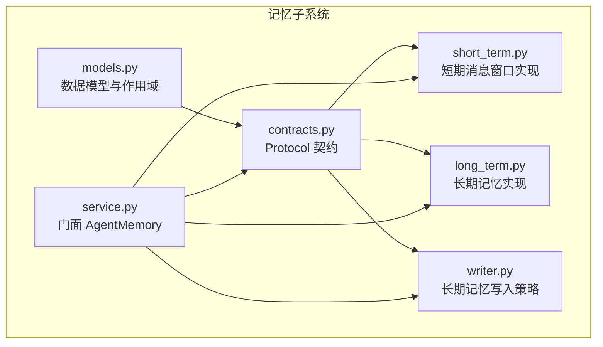
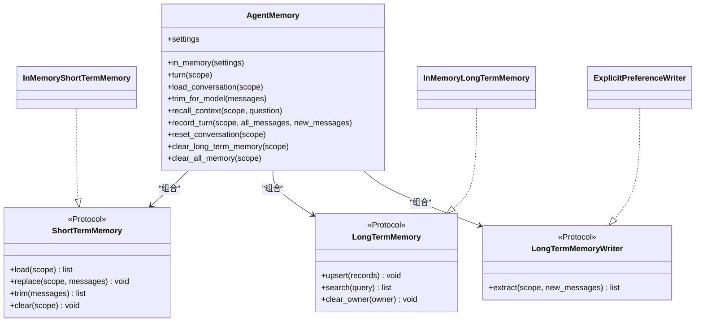
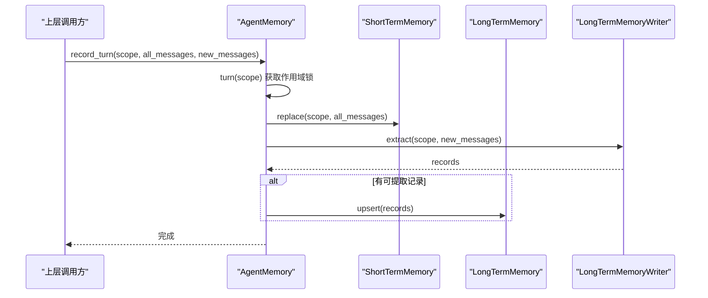
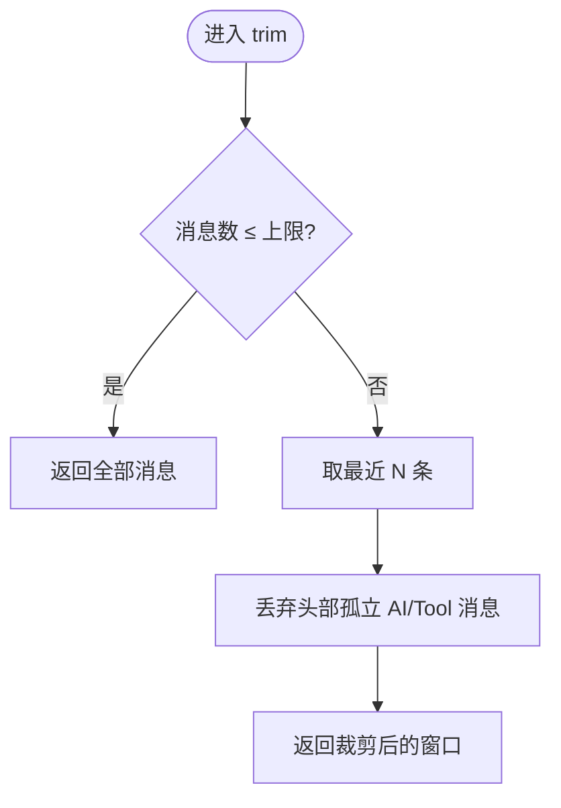
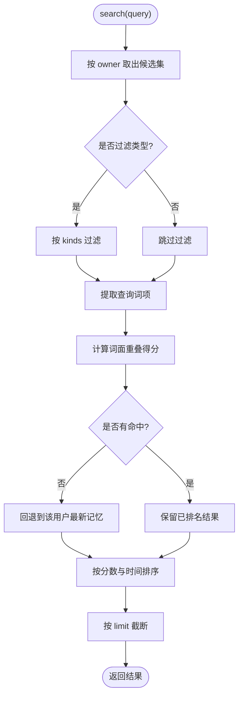
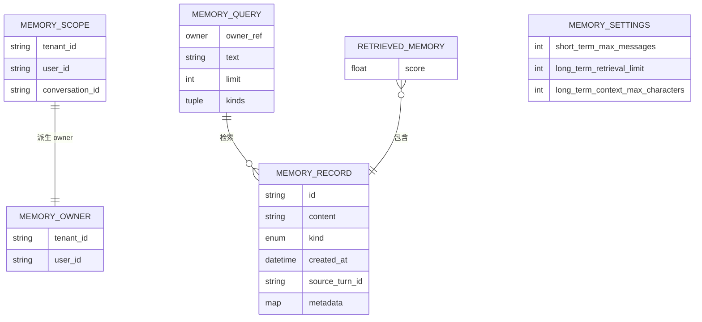
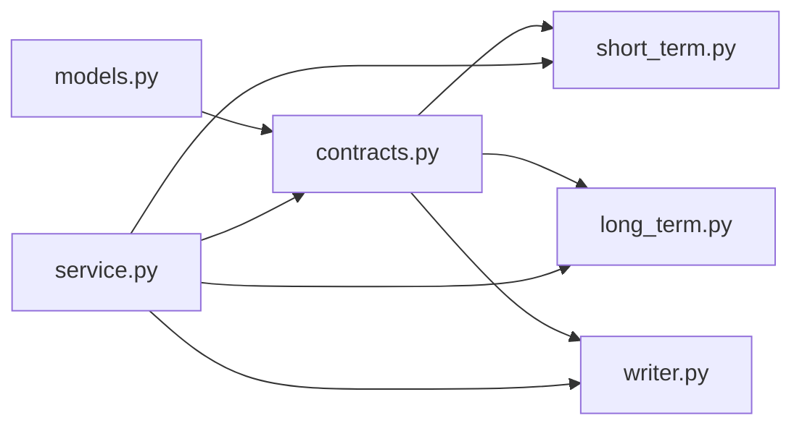

# 门面模式

<cite>
**本文引用的文件**   
- [memory/__init__.py](file://agent_platform/memory/__init__.py)
- [memory/service.py](file://agent_platform/memory/service.py)
- [memory/contracts.py](file://agent_platform/memory/contracts.py)
- [memory/short_term.py](file://agent_platform/memory/short_term.py)
- [memory/long_term.py](file://agent_platform/memory/long_term.py)
- [memory/models.py](file://agent_platform/memory/models.py)
</cite>

## 目录
1. [引言](#引言)
2. [项目结构](#项目结构)
3. [核心组件](#核心组件)
4. [架构总览](#架构总览)
5. [详细组件分析](#详细组件分析)
6. [依赖关系分析](#依赖关系分析)
7. [性能与复杂度](#性能与复杂度)
8. [故障排查指南](#故障排查指南)
9. [结论](#结论)
10. [附录：API 速查](#附录api速查)

## 引言
本设计文档围绕 AgentMemory 的门面模式展开，解释它如何作为统一入口，协调短期记忆 ShortTermMemory 与长期记忆 LongTermMemory 的交互，同时隐藏底层实现的复杂性，为上层组件提供简洁、稳定且线程安全的 API。AgentMemory 通过组合三个协议接口（ShortTermMemory、LongTermMemory、LongTermMemoryWriter）完成记忆读写、作用域隔离、会话窗口裁剪、长期记忆召回与注入等关键流程，使上层业务无需关心具体存储实现，从而获得更好的解耦性与可维护性。

## 项目结构
记忆子系统采用“模型 → 契约 → 进程内实现 → 门面”的分层组织，单向依赖便于替换后端与独立测试：
- models：不可变数据模型与作用域定义
- contracts：面向后端的 Protocol 契约
- short_term / long_term：进程内默认实现
- writer：从对话中提取长期记忆的写入策略
- service：门面 AgentMemory，组合并编排上述组件

**图示来源**
- [memory/models.py:1-120](file://agent_platform/memory/models.py#L1-L120)
- [memory/contracts.py:1-59](file://agent_platform/memory/contracts.py#L1-L59)
- [memory/short_term.py:1-67](file://agent_platform/memory/short_term.py#L1-L67)
- [memory/long_term.py:1-83](file://agent_platform/memory/long_term.py#L1-L83)
- [memory/service.py:1-141](file://agent_platform/memory/service.py#L1-L141)

**章节来源**
- [memory/__init__.py:1-41](file://agent_platform/memory/__init__.py#L1-L41)

## 核心组件
- AgentMemory（门面）：对外暴露统一的记忆访问入口，负责协调短期会话、长期检索与写入策略，并提供作用域锁、上下文渲染等横切能力。
- ShortTermMemory（契约 + InMemoryShortTermMemory 实现）：按完整会话作用域保存 LangChain 消息窗口，支持加载、覆盖、裁剪与清空。
- LongTermMemory（契约 + InMemoryLongTermMemory 实现）：按用户归属跨会话持久化结构化记忆，支持 upsert、搜索与按 owner 清理。
- LongTermMemoryWriter（契约 + ExplicitPreferenceWriter 实现）：从一轮新增消息中筛选值得长期保存的内容。
- 数据模型：MemoryScope、MemoryOwner、MemoryRecord、MemoryQuery、RetrievedMemory、MemorySettings 等。

**章节来源**
- [memory/service.py:24-106](file://agent_platform/memory/service.py#L24-L106)
- [memory/contracts.py:17-58](file://agent_platform/memory/contracts.py#L17-L58)
- [memory/short_term.py:17-67](file://agent_platform/memory/short_term.py#L17-L67)
- [memory/long_term.py:20-83](file://agent_platform/memory/long_term.py#L20-L83)
- [memory/models.py:18-120](file://agent_platform/memory/models.py#L18-L120)

## 架构总览
AgentMemory 作为门面，将短期会话管理、长期记忆检索与写入策略组合在一起，屏蔽了底层存储细节。上层只需调用 AgentMemory 的方法即可完成完整的记忆生命周期操作。

**图示来源**
- [memory/service.py:24-106](file://agent_platform/memory/service.py#L24-L106)
- [memory/contracts.py:17-58](file://agent_platform/memory/contracts.py#L17-L58)
- [memory/short_term.py:41-67](file://agent_platform/memory/short_term.py#L41-L67)
- [memory/long_term.py:20-83](file://agent_platform/memory/long_term.py#L20-L83)

## 详细组件分析

### 门面 AgentMemory：统一入口与编排逻辑
- 职责边界
  - 提供 in_memory 工厂方法，快速创建本地开发默认组合。
  - 通过 turn 作用域锁串行化同一会话的读—执行—写流程，避免并发覆盖短期历史。
  - 封装短期会话加载、裁剪、清空；封装长期记忆检索、写入与清理。
- 线程安全
  - 使用 RLock 对每个 MemoryScope 加锁，保证同一会话的并发访问串行化。
  - 短期与长期实现内部也各自持有锁，形成多层保护。
- 上下文渲染
  - recall_context 将检索到的长期记忆渲染为带防注入外壳的 Prompt 片段，限制字符预算，防止恶意内容逃逸。

**图示来源**
- [memory/service.py:77-91](file://agent_platform/memory/service.py#L77-L91)
- [memory/contracts.py:17-58](file://agent_platform/memory/contracts.py#L17-L58)

**章节来源**
- [memory/service.py:24-106](file://agent_platform/memory/service.py#L24-L106)

### 短期记忆 ShortTermMemory：会话窗口与裁剪策略
- MessageWindowPolicy
  - 按最大消息数裁剪，避免窗口从孤立的 AI 或 ToolMessage 开始，确保模型输入语义完整。
- InMemoryShortTermMemory
  - 按会话作用域隔离存储消息序列，提供 load、replace、trim、clear。
  - 内部使用 RLock 保证并发安全，replace 会先裁剪再覆盖。

**图示来源**
- [memory/short_term.py:17-38](file://agent_platform/memory/short_term.py#L17-L38)

**章节来源**
- [memory/short_term.py:17-67](file://agent_platform/memory/short_term.py#L17-L67)

### 长期记忆 LongTermMemory：用户级隔离与轻量检索
- InMemoryLongTermMemory
  - 按 owner（tenant+user）隔离存储，支持 upsert、search、clear_owner。
  - search 使用词面重叠打分，无命中时回退到最新记忆，并按分数与时间排序后截断。
  - 分词函数 _extract_terms 支持英文整词与中文双字 bigram，避免与外部 RAG 耦合。

**图示来源**
- [memory/long_term.py:37-66](file://agent_platform/memory/long_term.py#L37-L66)
- [memory/long_term.py:74-83](file://agent_platform/memory/long_term.py#L74-L83)

**章节来源**
- [memory/long_term.py:20-83](file://agent_platform/memory/long_term.py#L20-L83)

### 数据模型与作用域
- MemoryScope：包含 tenant_id、user_id、conversation_id，用于短期会话三级隔离。
- MemoryOwner：由 Scope 派生，仅含 tenant_id 与 user_id，用于长期记忆跨会话归属。
- MemoryRecord：不可变记忆条目，包含 kind、content、id、created_at、metadata 等。
- MemoryQuery：检索请求，包含 owner、text、limit、kinds。
- RetrievedMemory：检索结果及分数。
- MemorySettings：门面运行参数，控制短期窗口大小、长期检索条数与注入字符预算。

**图示来源**
- [memory/models.py:27-120](file://agent_platform/memory/models.py#L27-L120)

**章节来源**
- [memory/models.py:18-120](file://agent_platform/memory/models.py#L18-L120)

### 门面模式的解耦优势与可维护性
- 依赖倒置：AgentMemory 只依赖 contracts 中的 Protocol，不感知具体实现；更换 SQLite、Redis 或向量库时无需改动上层。
- 单一入口：上层仅需与 AgentMemory 交互，简化调用路径，降低认知负担。
- 横切关注点集中：作用域锁、上下文渲染、字符预算等横切逻辑集中在门面，便于统一治理。
- 可测试性：各组件可通过 Protocol 进行 Mock，单元测试聚焦裁剪策略、检索打分与渲染逻辑。

**章节来源**
- [memory/contracts.py:1-59](file://agent_platform/memory/contracts.py#L1-L59)
- [memory/service.py:1-22](file://agent_platform/memory/service.py#L1-L22)

## 依赖关系分析
- 模块间依赖方向：models → contracts → short_term / long_term / writer → service
- 门面与契约：AgentMemory 依赖 ShortTermMemory、LongTermMemory、LongTermMemoryWriter 三个 Protocol，保持低耦合。
- 进程内实现：InMemoryShortTermMemory 与 InMemoryLongTermMemory 分别实现对应契约，具备独立演进能力。

**图示来源**
- [memory/models.py:1-120](file://agent_platform/memory/models.py#L1-L120)
- [memory/contracts.py:1-59](file://agent_platform/memory/contracts.py#L1-L59)
- [memory/short_term.py:1-67](file://agent_platform/memory/short_term.py#L1-L67)
- [memory/long_term.py:1-83](file://agent_platform/memory/long_term.py#L1-L83)
- [memory/service.py:1-141](file://agent_platform/memory/service.py#L1-L141)

**章节来源**
- [memory/__init__.py:1-41](file://agent_platform/memory/__init__.py#L1-L41)

## 性能与复杂度
- 短期窗口裁剪
  - 时间复杂度：O(N)，N 为消息数量；主要开销在切片与头部清理。
  - 空间复杂度：O(K)，K 为窗口大小。
- 长期记忆检索
  - 时间复杂度：O(M × T)，M 为候选记录数，T 为分词成本；排序 O(R log R)，R 为命中数。
  - 空间复杂度：O(M + R)。
- 上下文渲染
  - 时间复杂度：O(R)，R 为召回记录数；受字符预算约束提前终止。
- 并发控制
  - 使用 RLock 串行化同一会话的写操作，避免竞态条件；锁粒度控制在会话级别，兼顾吞吐与安全。

[本节为通用性能讨论，不直接分析具体文件]

## 故障排查指南
- 短期窗口异常
  - 现象：模型报错找不到 tool_call。
  - 原因：窗口以孤立 AI/Tool 消息开头。
  - 处理：检查 MessageWindowPolicy.apply 的头部清理逻辑，确认窗口起始消息类型为 human/system。
  - 参考位置：[memory/short_term.py:25-38](file://agent_platform/memory/short_term.py#L25-L38)
- 长期记忆未命中
  - 现象：recall_context 返回空串。
  - 可能原因：query.kinds 过滤过严、文本分词无重叠且无回退命中。
  - 处理：放宽 kinds 或调整 query.text；确认 InMemoryLongTermMemory.search 的回退逻辑。
  - 参考位置：[memory/long_term.py:37-66](file://agent_platform/memory/long_term.py#L37-L66)
- 上下文注入过长
  - 现象：Prompt 被截断或超出预算。
  - 原因：long_term_context_max_characters 配置过小或召回记录过多。
  - 处理：调大字符预算或减少 retrieval limit。
  - 参考位置：[memory/service.py:108-141](file://agent_platform/memory/service.py#L108-L141)
- 并发覆盖问题
  - 现象：同一会话的短期历史被并发覆盖。
  - 原因：未在 turn 作用域内执行写操作。
  - 处理：确保 write 路径包裹在 AgentMemory.turn 中。
  - 参考位置：[memory/service.py:51-57](file://agent_platform/memory/service.py#L51-L57)

**章节来源**
- [memory/short_term.py:25-38](file://agent_platform/memory/short_term.py#L25-L38)
- [memory/long_term.py:37-66](file://agent_platform/memory/long_term.py#L37-L66)
- [memory/service.py:51-57](file://agent_platform/memory/service.py#L51-L57)
- [memory/service.py:108-141](file://agent_platform/memory/service.py#L108-L141)

## 结论
AgentMemory 通过门面模式将复杂的记忆系统抽象为简洁稳定的 API，既屏蔽了短期会话管理与长期检索的细节，又通过 Protocol 契约实现了高度可替换的后端。结合作用域锁与上下文渲染，系统在并发安全与提示注入防护方面提供了可靠保障。这种设计显著提升了代码的可维护性与可扩展性，便于在生产环境中平滑替换存储实现并持续优化检索与渲染策略。

[本节为总结性内容，不直接分析具体文件]

## 附录：API 速查
- AgentMemory.in_memory(settings)：创建本地开发默认组合。
- AgentMemory.load_conversation(scope)：加载会话短期历史。
- AgentMemory.trim_for_model(messages)：按窗口策略裁剪消息。
- AgentMemory.recall_context(scope, question)：召回长期记忆并渲染为 Prompt 片段。
- AgentMemory.record_turn(scope, all_messages, new_messages)：保存短期窗口与长期记忆。
- AgentMemory.reset_conversation(scope)：清空短期历史。
- AgentMemory.clear_long_term_memory(scope)：删除用户长期记忆。
- AgentMemory.clear_all_memory(scope)：清空短期与长期记忆。

**章节来源**
- [memory/service.py:41-106](file://agent_platform/memory/service.py#L41-L106)