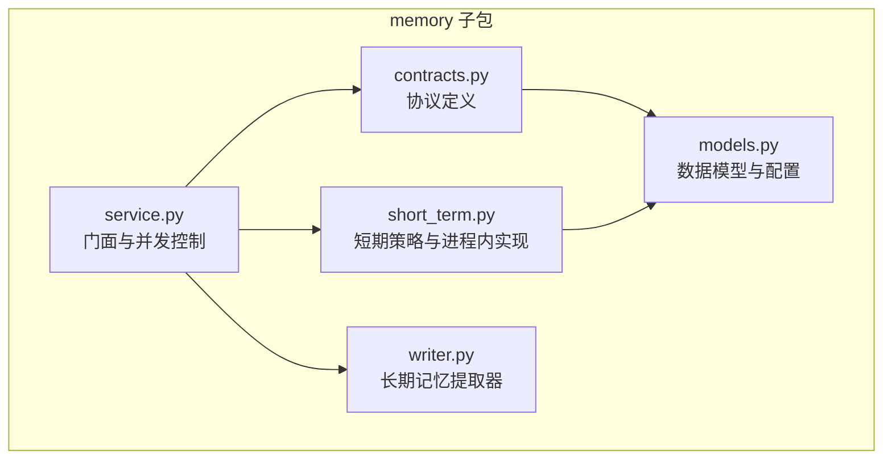
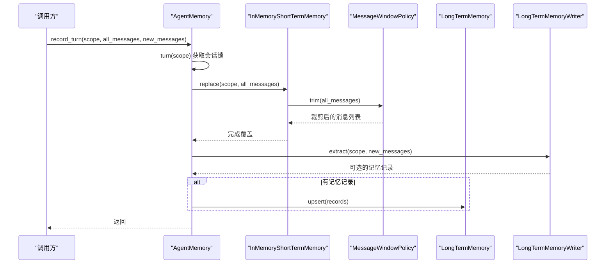
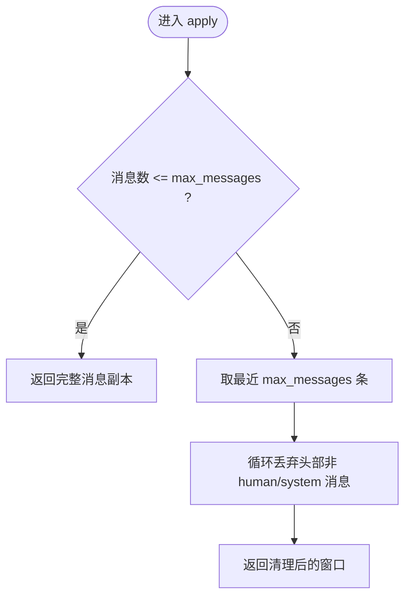
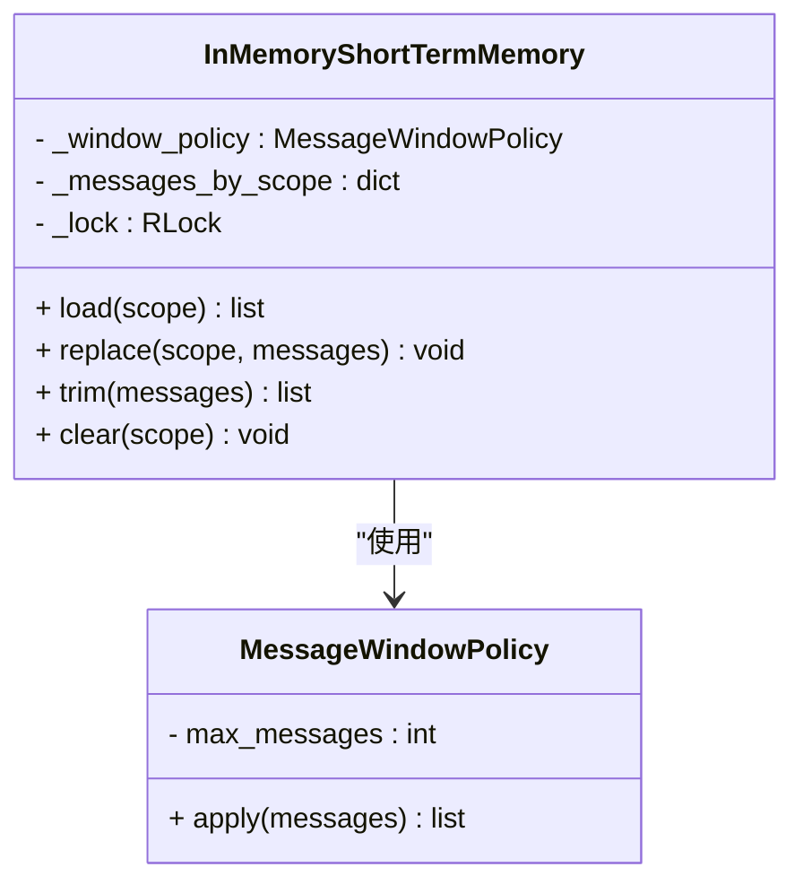
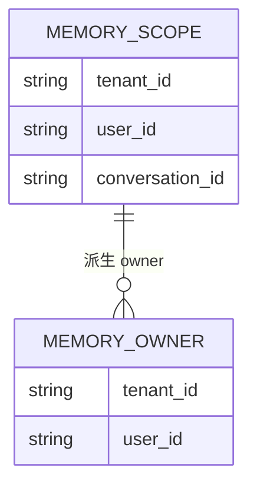
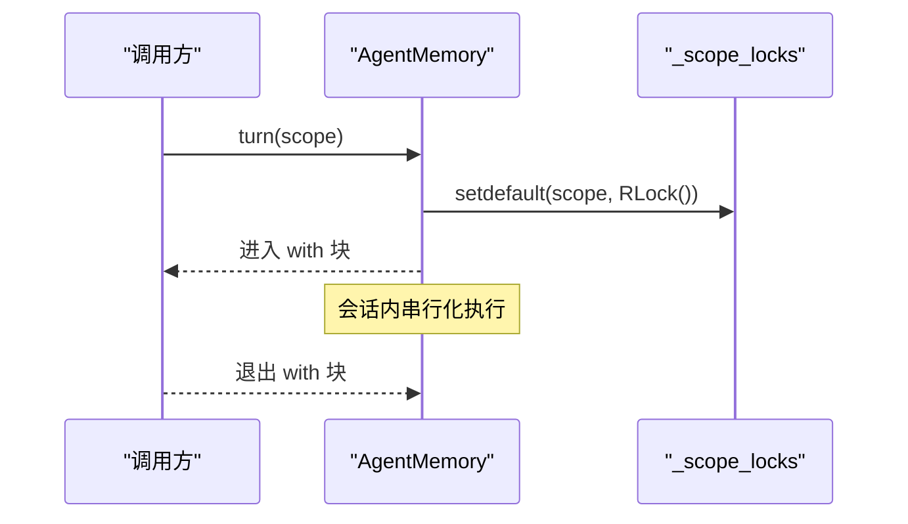
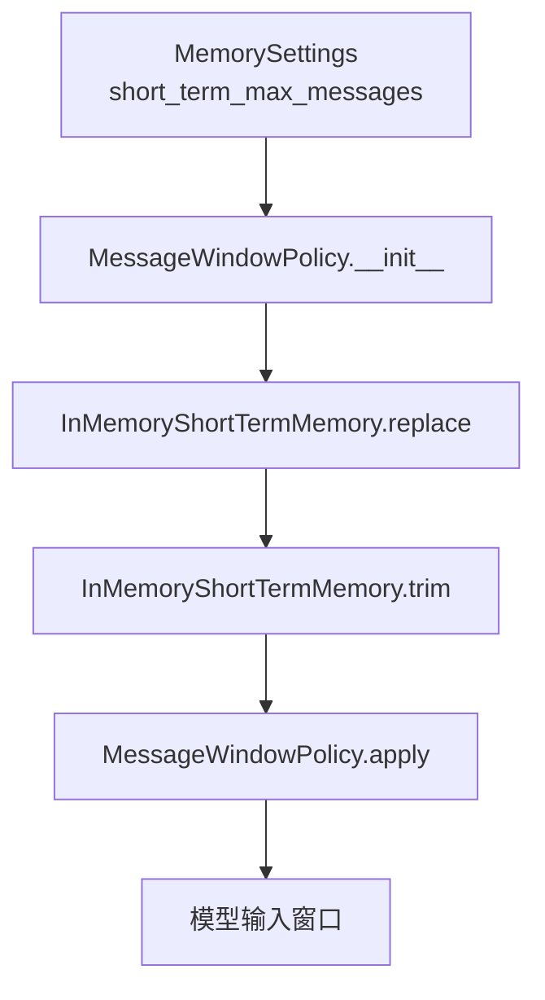
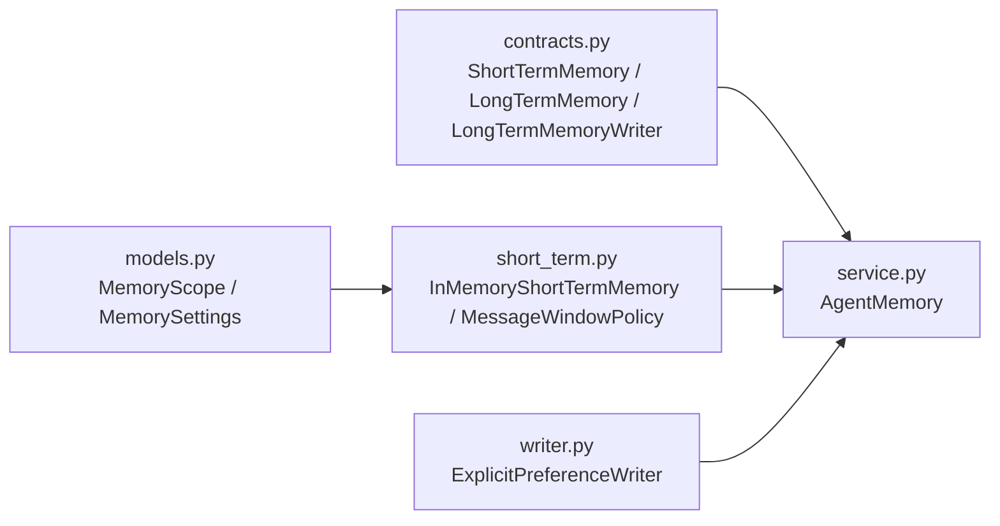

# 短期记忆实现

<cite>
**本文引用的文件**   
- [short_term.py](file://agent_platform/memory/short_term.py)
- [models.py](file://agent_platform/memory/models.py)
- [contracts.py](file://agent_platform/memory/contracts.py)
- [service.py](file://agent_platform/memory/service.py)
- [writer.py](file://agent_platform/memory/writer.py)
</cite>

## 目录
1. [引言](#引言)
2. [项目结构](#项目结构)
3. [核心组件](#核心组件)
4. [架构总览](#架构总览)
5. [详细组件分析](#详细组件分析)
6. [依赖关系分析](#依赖关系分析)
7. [性能与并发考虑](#性能与并发考虑)
8. [故障排查指南](#故障排查指南)
9. [结论](#结论)
10. [附录：自定义短期记忆后端实现指南](#附录自定义短期记忆后端实现指南)

## 引言
本文面向短期记忆模块，重点围绕 ShortTermMemory 协议及其进程内实现 InMemoryShortTermMemory，系统阐述以下主题：
- 消息窗口管理机制与滑动裁剪算法
- 会话隔离策略与作用域设计
- 消息队列的线程安全实现与并发访问控制
- 会话 ID 管理与内存泄漏防护
- 线程锁使用场景、原子性与死锁预防
- 基于 short_term_max_messages 的动态上下文长度控制
- 自定义短期记忆后端的接口契约与最佳实践
- 常见问题排查与性能优化建议

## 项目结构
短期记忆相关代码集中在 memory 子包中，采用“协议 + 模型 + 具体实现 + 门面组合”的分层组织方式：
- contracts.py：定义可替换的后端协议（ShortTermMemory、LongTermMemory、LongTermMemoryWriter）
- models.py：定义作用域、归属、记录、查询、设置等数据模型
- short_term.py：短期记忆策略与进程内实现
- service.py：Agent 与短期/长期记忆的门面组合，提供会话级串行化入口
- writer.py：从用户显式授权消息中提取长期记忆的写入器

**图表来源**
- [contracts.py:17-34](file://agent_platform/memory/contracts.py#L17-L34)
- [models.py:40-59](file://agent_platform/memory/models.py#L40-L59)
- [short_term.py:17-67](file://agent_platform/memory/short_term.py#L17-L67)
- [service.py:24-57](file://agent_platform/memory/service.py#L24-L57)
- [writer.py:37-64](file://agent_platform/memory/writer.py#L37-L64)

**章节来源**
- [contracts.py:1-59](file://agent_platform/memory/contracts.py#L1-L59)
- [models.py:1-120](file://agent_platform/memory/models.py#L1-L120)
- [short_term.py:1-67](file://agent_platform/memory/short_term.py#L1-L67)
- [service.py:1-141](file://agent_platform/memory/service.py#L1-L141)
- [writer.py:1-100](file://agent_platform/memory/writer.py#L1-L100)

## 核心组件
- MessageWindowPolicy：按消息数量进行窗口裁剪，避免窗口以孤立的 AI 或 ToolMessage 开头。
- InMemoryShortTermMemory：按会话作用域隔离的进程内短期消息存储，提供 load、replace、trim、clear 方法，并使用 RLock 保证并发安全。
- ShortTermMemory（Protocol）：短期记忆的可替换后端契约，定义统一接口。
- MemoryScope：短期记忆的作用域，包含 tenant_id、user_id、conversation_id 三级隔离键。
- AgentMemory：门面类，组合短期/长期记忆，并提供 turn 上下文管理器对同一会话进行串行化。

**章节来源**
- [short_term.py:17-67](file://agent_platform/memory/short_term.py#L17-L67)
- [contracts.py:17-34](file://agent_platform/memory/contracts.py#L17-L34)
- [models.py:40-59](file://agent_platform/memory/models.py#L40-L59)
- [service.py:24-57](file://agent_platform/memory/service.py#L24-L57)

## 架构总览
短期记忆在整体系统中的角色如下：
- AgentMemory 作为门面，协调短期窗口与长期召回；对外暴露会话串行化能力（turn）。
- InMemoryShortTermMemory 负责按会话保存最近消息序列，并在 replace 前通过 MessageWindowPolicy 裁剪。
- MemoryScope 提供三级隔离键，确保不同租户、用户、会话的消息互不干扰。
- LongTermMemory 与 LongTermMemoryWriter 负责跨会话的偏好/约束记忆，短期窗口仅用于当前对话上下文。

**图表来源**
- [service.py:77-91](file://agent_platform/memory/service.py#L77-L91)
- [short_term.py:54-61](file://agent_platform/memory/short_term.py#L54-L61)
- [short_term.py:25-38](file://agent_platform/memory/short_term.py#L25-L38)
- [writer.py:40-64](file://agent_platform/memory/writer.py#L40-L64)

## 详细组件分析

### 消息窗口策略：MessageWindowPolicy
- 目标：限制窗口大小并保证窗口起始消息为 human/system，避免孤立 AI/Tool 消息导致下游报错。
- 行为：
  - 若消息数不超过 max_messages，直接返回完整副本。
  - 否则取最近 max_messages 条，再向前丢弃非 human/system 开头的孤立消息，直到窗口头合法或为空。
- 复杂度：时间 O(n)，空间 O(k)（k = max_messages），其中 n 为输入消息长度。

**图表来源**
- [short_term.py:25-38](file://agent_platform/memory/short_term.py#L25-L38)

**章节来源**
- [short_term.py:17-38](file://agent_platform/memory/short_term.py#L17-L38)

### 进程内短期记忆：InMemoryShortTermMemory
- 存储结构：dict[MemoryScope, list[BaseMessage]]，按会话作用域隔离。
- 并发控制：使用 RLock 保护所有读写操作，load 返回拷贝以避免外部修改影响内部状态。
- 关键方法：
  - load(scope)：返回该会话消息的浅拷贝。
  - replace(scope, messages)：先裁剪再覆盖，全程加锁。
  - trim(messages)：委托窗口策略裁剪，不改动存储。
  - clear(scope)：删除该会话的全部短期消息。

**图表来源**
- [short_term.py:41-67](file://agent_platform/memory/short_term.py#L41-L67)
- [short_term.py:17-38](file://agent_platform/memory/short_term.py#L17-L38)

**章节来源**
- [short_term.py:41-67](file://agent_platform/memory/short_term.py#L41-L67)

### 会话隔离与作用域：MemoryScope
- 三级隔离键：tenant_id、user_id、conversation_id。
- 用途：短期窗口按完整三级隔离；长期记忆按 owner（tenant+user）两级隔离，支持跨会话召回。
- 默认值：local/default/default，便于本地演示。
- 校验：构造时要求各字段非空。

**图表来源**
- [models.py:27-59](file://agent_platform/memory/models.py#L27-L59)

**章节来源**
- [models.py:27-59](file://agent_platform/memory/models.py#L27-L59)

### 门面与并发控制：AgentMemory.turn
- 目的：对同一会话的读—执行—写流程进行串行化，避免并发覆盖短期历史。
- 实现：
  - 维护 _scope_locks 字典，按 MemoryScope 分配独立的 RLock。
  - turn 上下文管理器先获取或创建会话锁，再进入 with 块执行业务逻辑。
- 风险规避：
  - 每个会话独立锁，降低锁粒度。
  - 使用 RLock 允许重入，避免同一线程重复加锁导致的自阻塞。

**图表来源**
- [service.py:51-57](file://agent_platform/memory/service.py#L51-L57)

**章节来源**
- [service.py:51-57](file://agent_platform/memory/service.py#L51-L57)

### 动态上下文长度控制：short_term_max_messages
- 配置位置：MemorySettings.short_term_max_messages，默认值为 6。
- 生效路径：
  - AgentMemory.in_memory(settings) 构造时，将 settings.short_term_max_messages 传入 MessageWindowPolicy。
  - InMemoryShortTermMemory.replace 调用 trim，最终由 MessageWindowPolicy.apply 根据 max_messages 裁剪。
- 效果：送入模型的消息窗口最大长度受 short_term_max_messages 控制，避免 token 成本过高。

**图表来源**
- [models.py:105-120](file://agent_platform/memory/models.py#L105-L120)
- [service.py:41-49](file://agent_platform/memory/service.py#L41-L49)
- [short_term.py:20-38](file://agent_platform/memory/short_term.py#L20-L38)

**章节来源**
- [models.py:105-120](file://agent_platform/memory/models.py#L105-L120)
- [service.py:41-49](file://agent_platform/memory/service.py#L41-L49)
- [short_term.py:20-38](file://agent_platform/memory/short_term.py#L20-L38)

## 依赖关系分析
- 协议解耦：AgentMemory 只依赖 ShortTermMemory、LongTermMemory、LongTermMemoryWriter 三个 Protocol，便于替换后端。
- 短期记忆依赖：
  - InMemoryShortTermMemory 依赖 MessageWindowPolicy 和 MemoryScope。
  - MessageWindowPolicy 依赖 BaseMessage（LangChain 消息类型）。
- 门面组合：
  - AgentMemory 组合短期/长期记忆与写入器，并通过 turn 管理会话并发。

**图表来源**
- [contracts.py:17-59](file://agent_platform/memory/contracts.py#L17-L59)
- [models.py:40-59](file://agent_platform/memory/models.py#L40-L59)
- [short_term.py:17-67](file://agent_platform/memory/short_term.py#L17-L67)
- [service.py:24-57](file://agent_platform/memory/service.py#L24-L57)
- [writer.py:37-64](file://agent_platform/memory/writer.py#L37-L64)

**章节来源**
- [contracts.py:1-59](file://agent_platform/memory/contracts.py#L1-L59)
- [models.py:1-120](file://agent_platform/memory/models.py#L1-L120)
- [short_term.py:1-67](file://agent_platform/memory/short_term.py#L1-L67)
- [service.py:1-141](file://agent_platform/memory/service.py#L1-L141)
- [writer.py:1-100](file://agent_platform/memory/writer.py#L1-L100)

## 性能与并发考虑
- 锁粒度与类型：
  - InMemoryShortTermMemory 使用 RLock 保护整个存储字典，避免并发读写导致的数据竞争。
  - AgentMemory 使用 per-scope RLock，降低锁竞争范围，提升并发吞吐。
- 原子性：
  - replace 在锁内完成裁剪与覆盖，保证读取方不会看到部分更新的状态。
  - load 返回副本，避免外部修改影响内部存储。
- 死锁预防：
  - 使用 RLock 而非普通 Lock，允许同一线程重入，减少自阻塞风险。
  - 不在持有锁期间执行耗时 I/O 或复杂计算，保持临界区短小。
- 内存占用：
  - 短期消息保存在进程内存中，进程重启后丢失；适合短时上下文，不适合持久化需求。
  - 可通过调整 short_term_max_messages 控制窗口大小，平衡上下文质量与 token 成本。

**章节来源**
- [short_term.py:41-67](file://agent_platform/memory/short_term.py#L41-L67)
- [service.py:51-57](file://agent_platform/memory/service.py#L51-L57)

## 故障排查指南
- 窗口以孤立 AI/Tool 消息开头：
  - 现象：模型因找不到对应 tool_call 而报错。
  - 原因：窗口裁剪未正确清理头部孤立消息。
  - 处理：检查 MessageWindowPolicy.apply 是否按 human/system 过滤头部消息。
  - 参考：[short_term.py:25-38](file://agent_platform/memory/short_term.py#L25-L38)
- 并发覆盖短期历史：
  - 现象：多轮对话出现消息丢失或顺序错乱。
  - 原因：未在 AgentMemory.turn 上下文中执行 record_turn。
  - 处理：确保所有会话写操作都在 turn(scope) 中进行。
  - 参考：[service.py:51-57](file://agent_platform/memory/service.py#L51-L57)
- 会话未清理导致内存增长：
  - 现象：进程运行一段时间后内存持续增长。
  - 原因：长时间保留大量会话的短期消息且未调用 clear。
  - 处理：在会话结束时调用 reset_conversation 或 clear_all_memory。
  - 参考：[service.py:92-105](file://agent_platform/memory/service.py#L92-L105)
- 窗口过大导致 token 成本飙升：
  - 现象：模型调用费用增加。
  - 原因：short_term_max_messages 配置过大。
  - 处理：调低 MemorySettings.short_term_max_messages。
  - 参考：[models.py:105-120](file://agent_platform/memory/models.py#L105-L120)

**章节来源**
- [short_term.py:25-38](file://agent_platform/memory/short_term.py#L25-L38)
- [service.py:51-57](file://agent_platform/memory/service.py#L51-L57)
- [service.py:92-105](file://agent_platform/memory/service.py#L92-L105)
- [models.py:105-120](file://agent_platform/memory/models.py#L105-L120)

## 结论
短期记忆模块通过清晰的协议抽象、严格的作用域隔离、可靠的并发控制和灵活的窗口裁剪策略，为 Agent 提供了稳定高效的对话上下文管理能力。配合 long-term 记忆与显式偏好提取器，系统在保障隐私与安全的前提下实现了跨会话的知识复用。通过合理配置 short_term_max_messages 与规范使用 AgentMemory.turn，可在性能与体验之间取得良好平衡。

## 附录：自定义短期记忆后端实现指南
- 接口契约：
  - 实现 ShortTermMemory 协议，提供 load、replace、trim、clear 四个方法。
  - load 应返回会话消息的副本，避免外部修改影响内部存储。
  - replace 应在实现内部进行裁剪与覆盖，保证原子性。
  - trim 仅做裁剪，不改变存储状态。
  - clear 删除指定会话的全部短期消息。
- 并发安全：
  - 若后端为进程内存储，需自行实现线程锁（如 RLock）保护共享状态。
  - 若后端为分布式存储（如 Redis），需在客户端侧保证操作的原子性或借助事务。
- 会话隔离：
  - 使用 MemoryScope 作为键，确保 tenant_id、user_id、conversation_id 三级隔离。
- 窗口策略：
  - 可复用 MessageWindowPolicy 或实现自定义裁剪规则，但需遵循“窗口不从孤立 AI/Tool 消息开始”的原则。
- 最佳实践：
  - 在 replace 中优先调用 trim，确保存入窗口的消息符合下游模型要求。
  - 在 clear 中注意幂等性，避免重复删除引发异常。
  - 监控内存占用，定期清理过期会话，防止内存泄漏。

**章节来源**
- [contracts.py:17-34](file://agent_platform/memory/contracts.py#L17-L34)
- [short_term.py:17-67](file://agent_platform/memory/short_term.py#L17-L67)
- [models.py:40-59](file://agent_platform/memory/models.py#L40-L59)