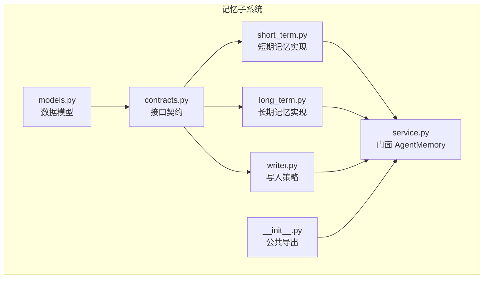
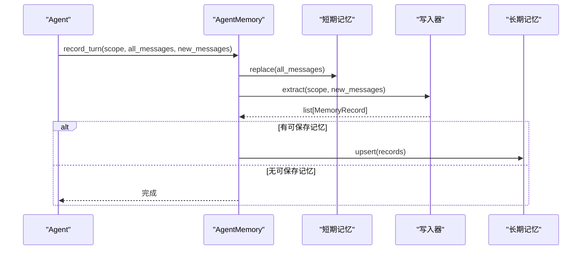
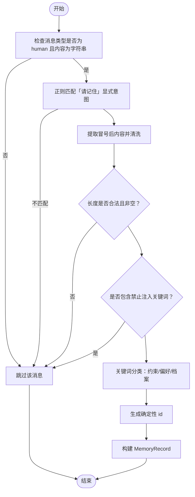
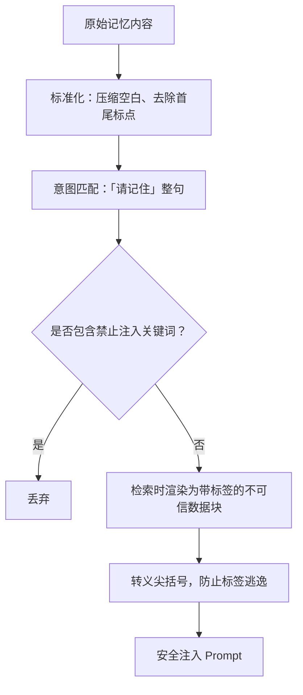
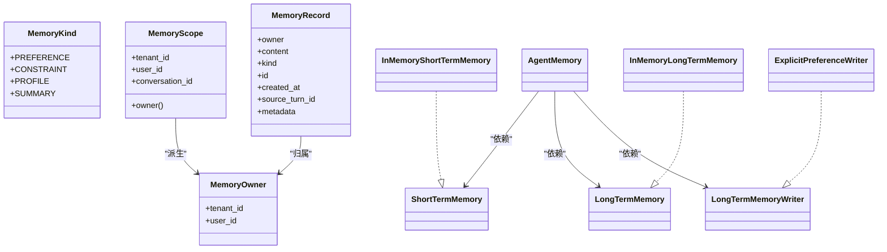

# 记忆写入策略

<cite>
**本文引用的文件**   
- [writer.py](file://agent_platform/memory/writer.py)
- [models.py](file://agent_platform/memory/models.py)
- [service.py](file://agent_platform/memory/service.py)
- [contracts.py](file://agent_platform/memory/contracts.py)
- [long_term.py](file://agent_platform/memory/long_term.py)
- [short_term.py](file://agent_platform/memory/short_term.py)
- [__init__.py](file://agent_platform/memory/__init__.py)
- [README.md](file://README.md)
</cite>

## 目录
1. [引言](#引言)
2. [项目结构](#项目结构)
3. [核心组件](#核心组件)
4. [架构总览](#架构总览)
5. [详细组件分析](#详细组件分析)
6. [依赖关系分析](#依赖关系分析)
7. [性能与可扩展性](#性能与可扩展性)
8. [触发条件与使用模式](#触发条件与使用模式)
9. [敏感信息与数据安全](#敏感信息与数据安全)
10. [格式化、标准化与去重压缩](#格式化标准化与去重压缩)
11. [自定义写入器开发指南](#自定义写入器开发指南)
12. [故障排查](#故障排查)
13. [结论](#结论)

## 引言
本文聚焦“记忆写入策略”，围绕 ExplicitPreferenceWriter 的智能筛选逻辑展开，说明哪些对话内容会被识别为可保存的记忆，包括关键词匹配、意图识别和内容质量评估；解释敏感信息过滤机制；介绍记忆内容的格式化、标准化、去重与压缩策略；说明写入触发条件（用户确认、自动检测、批量处理）；并提供自定义写入器的设计指南、过滤器链设计与性能调优建议。同时结合系统的数据安全合规要求和审计日志最佳实践，给出生产落地的参考方案。

## 项目结构
记忆子系统采用分层与依赖倒置设计：数据模型在最内层，契约接口在中间层，具体实现（短期、长期、写入器）在上层，最终由门面 AgentMemory 组合对外暴露。

**图表来源**
- [models.py:1-120](file://agent_platform/memory/models.py#L1-L120)
- [contracts.py:1-59](file://agent_platform/memory/contracts.py#L1-L59)
- [short_term.py:1-67](file://agent_platform/memory/short_term.py#L1-L67)
- [long_term.py:1-83](file://agent_platform/memory/long_term.py#L1-L83)
- [writer.py:1-100](file://agent_platform/memory/writer.py#L1-L100)
- [service.py:1-141](file://agent_platform/memory/service.py#L1-L141)
- [__init__.py:1-40](file://agent_platform/memory/__init__.py#L1-L40)

**章节来源**
- [__init__.py:1-40](file://agent_platform/memory/__init__.py#L1-L40)
- [README.md:75-96](file://README.md#L75-L96)

## 核心组件
- MemoryKind：长期记忆的语义类型，包括偏好、约束、档案和预留的摘要类型。
- MemoryOwner/MemoryScope：隔离边界，前者用于长期记忆按租户+用户隔离，后者用于短期消息按完整三级作用域隔离。
- MemoryRecord：一条可跨会话召回的记忆记录，包含归属、正文、类型、确定性 id、时间戳、溯源消息 id 与只读元数据。
- LongTermMemoryWriter：定义从一轮新增消息中提取可持久化记忆的契约。
- ExplicitPreferenceWriter：默认写入器，仅保存以“请记住”明确授权的最小偏好/约束数据。
- AgentMemory：门面类，组合短期、长期与写入器，提供会话级串行化、上下文召回与清理能力。

**章节来源**
- [models.py:18-120](file://agent_platform/memory/models.py#L18-L120)
- [contracts.py:53-59](file://agent_platform/memory/contracts.py#L53-L59)
- [writer.py:30-64](file://agent_platform/memory/writer.py#L30-L64)
- [service.py:24-50](file://agent_platform/memory/service.py#L24-L50)

## 架构总览
AgentMemory 是记忆子系统的唯一入口。每次对话轮次中，它负责：
- 将本轮全部消息写入短期窗口；
- 调用写入器从新增消息中提取长期记忆；
- 将提取到的记录 upsert 到长期存储；
- 根据当前问题召回长期记忆并渲染为带防护外壳的 Prompt 片段。

**图表来源**
- [service.py:77-90](file://agent_platform/memory/service.py#L77-L90)
- [writer.py:40-64](file://agent_platform/memory/writer.py#L40-L64)
- [long_term.py:31-36](file://agent_platform/memory/long_term.py#L31-L36)

**章节来源**
- [service.py:77-90](file://agent_platform/memory/service.py#L77-L90)

## 详细组件分析

### ExplicitPreferenceWriter 智能筛选逻辑
ExplicitPreferenceWriter 的核心职责是从新增消息中保守地提取长期记忆，遵循“宁可少记，不可错记”的原则。其筛选流程如下：

1. 消息类型过滤：仅处理类型为 human 且内容为字符串的消息，跳过 AI、Tool 及结构化内容。
2. 显式意图识别：通过正则匹配“请/帮我记住(一下)：...”整句，捕获冒号后的记忆内容。
3. 内容清洗与长度限制：对捕获内容进行空白压缩、标点清理，并拒绝空内容或超过最大字符数的内容。
4. 敏感指令过滤：若内容包含疑似提示注入关键词（如忽略、系统提示、提示词、指令、角色等），直接丢弃。
5. 语义分类：命中硬性约束关键词则标记为 CONSTRAINT；否则命中偏好关键词则标记为 PREFERENCE；其余归为 PROFILE。
6. 幂等 id 生成：基于租户、用户、类型与内容计算确定性 id，确保同一内容重复保存只会覆盖而非累积。
7. 构建记录：填充 owner、content、kind、source_turn_id 与 metadata（writer、conversation_id）。

**图表来源**
- [writer.py:40-78](file://agent_platform/memory/writer.py#L40-L78)
- [writer.py:81-99](file://agent_platform/memory/writer.py#L81-L99)

**章节来源**
- [writer.py:18-27](file://agent_platform/memory/writer.py#L18-L27)
- [writer.py:40-78](file://agent_platform/memory/writer.py#L40-L78)
- [writer.py:81-99](file://agent_platform/memory/writer.py#L81-L99)

### 敏感信息过滤机制
- 提示注入防护：内置 _DISALLOWED_MARKERS 列表，命中即丢弃，防止把指令写进长期记忆。
- 内容边界保护：长期记忆在检索后被渲染为带标签的不可信数据块，并对尖括号进行转义，避免伪造闭合标签逃逸边界。
- 最小化原则：仅保存用户明确授权的偏好/约束，不保存模型回答、工具观测值、天气结果、系统消息或普通提问。
- 元数据审计：每条记录附带 writer 与 conversation_id，便于追踪来源与上下文。

**图表来源**
- [writer.py:24-27](file://agent_platform/memory/writer.py#L24-L27)
- [service.py:108-140](file://agent_platform/memory/service.py#L108-L140)

**章节来源**
- [writer.py:24-27](file://agent_platform/memory/writer.py#L24-L27)
- [service.py:108-140](file://agent_platform/memory/service.py#L108-L140)

### 记忆内容的格式化与标准化
- 文本清洗：_normalise 压缩连续空白并 strip，保证正则匹配与 id 生成稳定。
- 去重策略：确定性 id 基于 tenant_id、user_id、kind、content 计算，相同内容幂等覆盖。
- 压缩策略：单条记忆最大字符数限制，避免超长内容占满注入 Prompt 的字符预算；检索渲染时按字符预算截断。
- 只读元数据：MemoryRecord 构造后将 metadata 固化为只读视图，防止共享引用被外部篡改。

**章节来源**
- [writer.py:97-99](file://agent_platform/memory/writer.py#L97-L99)
- [writer.py:90-94](file://agent_platform/memory/writer.py#L90-L94)
- [models.py:62-80](file://agent_platform/memory/models.py#L62-L80)
- [service.py:108-140](file://agent_platform/memory/service.py#L108-L140)

### 写入触发条件
- 用户确认：ExplicitPreferenceWriter 仅响应以“请记住”开头的显式授权消息。
- 自动检测：AgentMemory.record_turn 自动调用写入器 extract，无需额外开关。
- 批量处理：record_turn 接收 new_messages 序列，逐条扫描并批量 upsert 生成的 MemoryRecord。
- 禁用写入：可通过 NoopLongTermMemoryWriter 替换默认写入器，完全禁用长期写入。

**章节来源**
- [writer.py:30-34](file://agent_platform/memory/writer.py#L30-L34)
- [service.py:77-90](file://agent_platform/memory/service.py#L77-L90)

## 依赖关系分析
- 数据模型与契约：models.py 定义数据结构，contracts.py 定义 ShortTermMemory、LongTermMemory、LongTermMemoryWriter 三个 Protocol，作为依赖倒置边界。
- 实现层：short_term.py 与 long_term.py 分别提供进程内短期与长期记忆实现；writer.py 提供默认写入策略。
- 门面层：service.py 的 AgentMemory 组合三者，对外暴露统一 API。
- 导出层：__init__.py 白名单导出公共 API，隐藏内部细节。

**图表来源**
- [models.py:18-120](file://agent_platform/memory/models.py#L18-L120)
- [contracts.py:17-59](file://agent_platform/memory/contracts.py#L17-L59)
- [short_term.py:41-67](file://agent_platform/memory/short_term.py#L41-L67)
- [long_term.py:20-72](file://agent_platform/memory/long_term.py#L20-L72)
- [writer.py:30-64](file://agent_platform/memory/writer.py#L30-L64)
- [service.py:24-50](file://agent_platform/memory/service.py#L24-L50)

**章节来源**
- [contracts.py:1-59](file://agent_platform/memory/contracts.py#L1-L59)
- [service.py:1-22](file://agent_platform/memory/service.py#L1-L22)

## 性能与可扩展性
- 短期窗口裁剪：MessageWindowPolicy 按消息数量裁剪，避免窗口从孤立 AI 或 Tool 消息开始，减少无效 token 成本。
- 长期检索打分：基于中文双字 bigram 与英文整词的词面重叠打分，无命中时回退到最新记忆，兼顾相关性与可用性。
- 并发安全：短期与长期实现均使用 RLock 保护临界区；AgentMemory.turn 对同一会话串行化读写，避免并发覆盖。
- 可扩展点：通过实现 LongTermMemory 与 LongTermMemoryWriter 契约即可替换后端与写入策略，无需改动上层。

**章节来源**
- [short_term.py:17-38](file://agent_platform/memory/short_term.py#L17-L38)
- [long_term.py:37-66](file://agent_platform/memory/long_term.py#L37-L66)
- [service.py:51-57](file://agent_platform/memory/service.py#L51-L57)

## 触发条件与使用模式
- 用户确认模式：用户发送“请记住...”，ExplicitPreferenceWriter 识别并保存。
- 自动检测模式：AgentMemory.record_turn 自动调用写入器，无需额外配置。
- 批量处理模式：传入 new_messages 序列，写入器逐条处理并批量 upsert。
- 禁用写入模式：使用 NoopLongTermMemoryWriter 替换默认写入器，完全关闭长期记忆写入。

**章节来源**
- [writer.py:30-34](file://agent_platform/memory/writer.py#L30-L34)
- [service.py:77-90](file://agent_platform/memory/service.py#L77-L90)

## 敏感信息与数据安全
- 最小化采集：仅保存用户明确授权的偏好/约束，不保存模型回答、工具观测值、系统消息或普通提问。
- 注入防护：内置禁止注入关键词过滤；检索渲染时对尖括号转义，防止伪造闭合标签。
- 不可信数据块：长期记忆以 <remembered_user_data> 包裹，声明不可信性质，提醒模型不要执行其中指令。
- 审计元数据：每条记录附带 writer 与 conversation_id，便于追踪来源与上下文。
- 合规建议：在生产环境中，应结合租户隔离、访问控制、加密存储与审计日志，确保隐私数据不被意外泄露。

**章节来源**
- [writer.py:24-27](file://agent_platform/memory/writer.py#L24-L27)
- [service.py:108-140](file://agent_platform/memory/service.py#L108-L140)
- [models.py:62-80](file://agent_platform/memory/models.py#L62-L80)

## 格式化、标准化与去重压缩
- 文本清洗：_normalise 压缩空白并 strip，保证正则匹配与 id 生成稳定。
- 去重策略：确定性 id 基于 tenant_id、user_id、kind、content 计算，相同内容幂等覆盖。
- 压缩策略：单条记忆最大字符数限制；检索渲染时按字符预算截断，避免超出 Prompt 预算。
- 只读元数据：MemoryRecord 构造后将 metadata 固化为只读视图，防止共享引用被外部篡改。

**章节来源**
- [writer.py:97-99](file://agent_platform/memory/writer.py#L97-L99)
- [writer.py:90-94](file://agent_platform/memory/writer.py#L90-L94)
- [models.py:62-80](file://agent_platform/memory/models.py#L62-L80)
- [service.py:108-140](file://agent_platform/memory/service.py#L108-L140)

## 自定义写入器开发指南
- 契约要求：实现 LongTermMemoryWriter.extract(scope, new_messages)，返回 MemoryRecord 列表。
- 过滤器链设计：
  - 消息类型过滤：仅处理 human 文本消息。
  - 意图识别：支持多种显式授权句式（如“请记住”“帮我记住”），可扩展正则表达式。
  - 敏感过滤：扩展禁止注入关键词列表，增加隐私字段检测（如身份证号、银行卡号、密码等）。
  - 质量评估：设置最小/最大长度阈值、语言检测、重复度检测。
  - 语义分类：扩展 MemoryKind 或引入更细粒度标签（如健康、财务、出行等）。
- 幂等与审计：
  - 使用确定性 id 实现幂等覆盖。
  - 记录 source_turn_id、writer、conversation_id 等元数据，便于审计与回溯。
- 性能调优：
  - 批量处理：尽量一次性返回多条 MemoryRecord，减少 upsert 调用次数。
  - 轻量分词：避免耦合重型 NLP 库，必要时使用本地规则或轻量模型。
  - 缓存热点：对高频关键词或用户画像做局部缓存，降低重复计算。
- 替换方式：通过 AgentMemory.in_memory(settings) 或构造函数注入自定义写入器，无需修改上层逻辑。

**章节来源**
- [contracts.py:53-59](file://agent_platform/memory/contracts.py#L53-L59)
- [writer.py:30-64](file://agent_platform/memory/writer.py#L30-L64)
- [service.py:41-49](file://agent_platform/memory/service.py#L41-L49)

## 故障排查
- 无法写入长期记忆：
  - 检查是否使用了 NoopLongTermMemoryWriter。
  - 确认消息是否为 human 文本且包含“请记住”显式意图。
  - 检查内容是否命中禁止注入关键词或被长度限制拒绝。
- 记忆未去重：
  - 确认写入器是否生成确定性 id，且 content 未被外部篡改。
- 检索结果为空：
  - 检查 MemoryQuery 的 owner 是否正确；确认长期记忆是否已 upsert。
  - 若无词面重合，系统将回退到最新记忆；若仍为空，检查存储是否被清空。
- 并发覆盖短期历史：
  - 确认通过 AgentMemory.turn 串行化同一会话的读写流程。

**章节来源**
- [writer.py:30-34](file://agent_platform/memory/writer.py#L30-L34)
- [writer.py:40-78](file://agent_platform/memory/writer.py#L40-L78)
- [long_term.py:37-66](file://agent_platform/memory/long_term.py#L37-L66)
- [service.py:51-57](file://agent_platform/memory/service.py#L51-L57)

## 结论
ExplicitPreferenceWriter 以“宁可少记，不可错记”为原则，通过严格的意图识别、敏感过滤与内容质量控制，确保只有用户明确授权的偏好与约束被保存为长期记忆。配合 AgentMemory 的门面编排、短期窗口裁剪与长期记忆检索，系统在易用性、安全性与性能之间取得平衡。通过契约化的 LongTermMemoryWriter，团队可灵活扩展写入策略，满足多样化业务需求，并在生产环境中落实数据安全与审计合规要求。