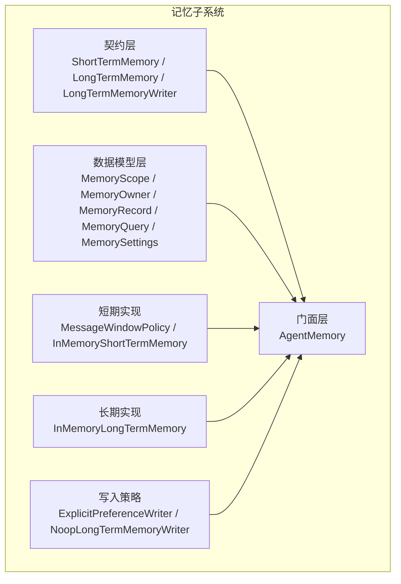
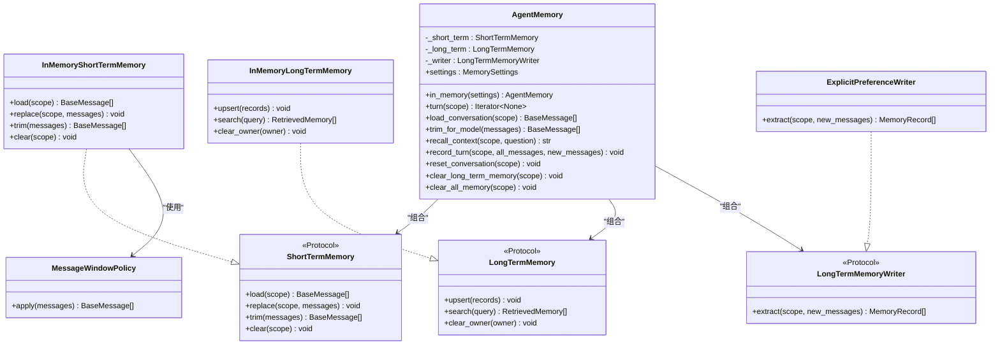
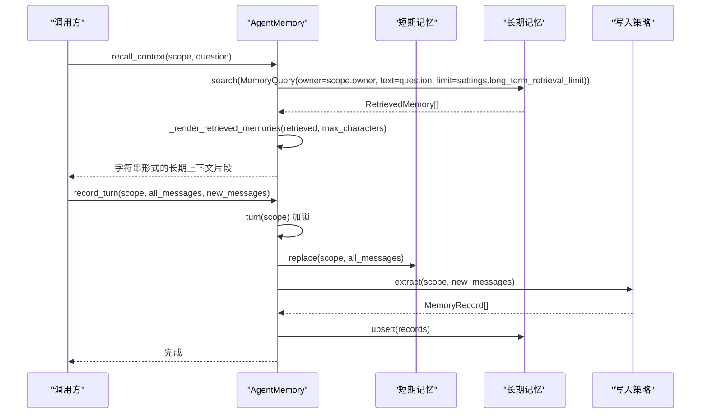
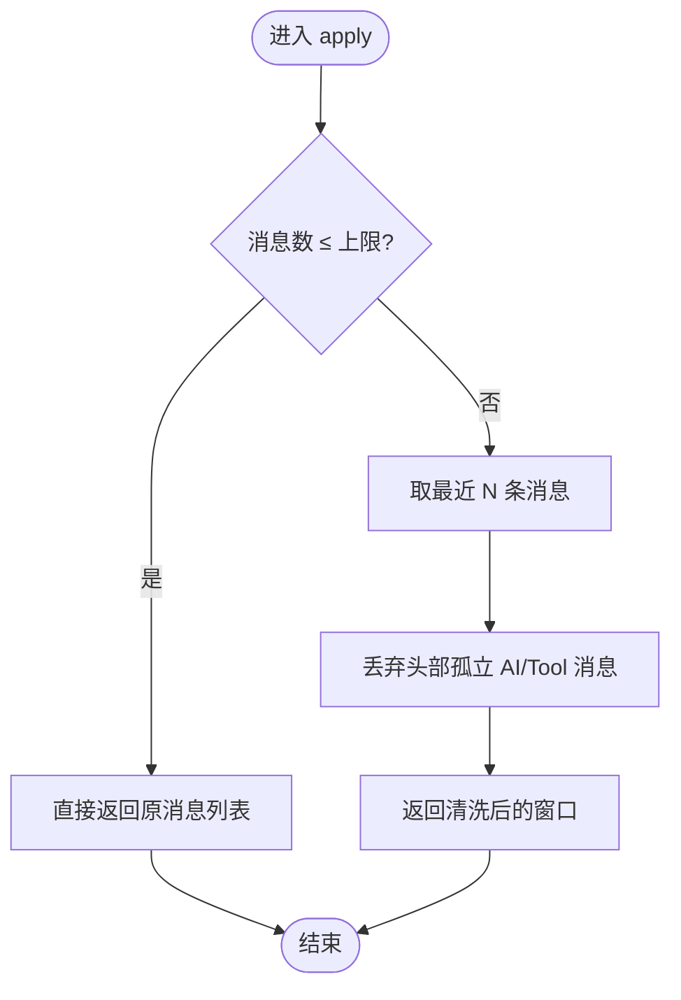
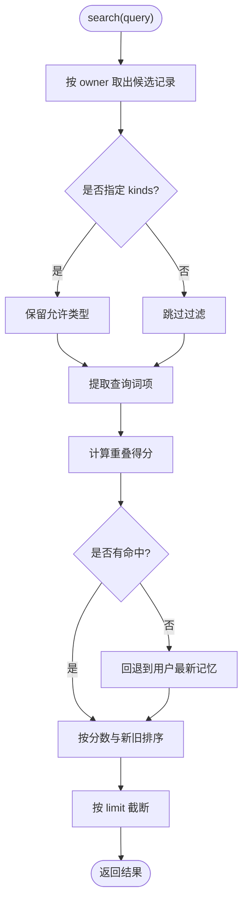
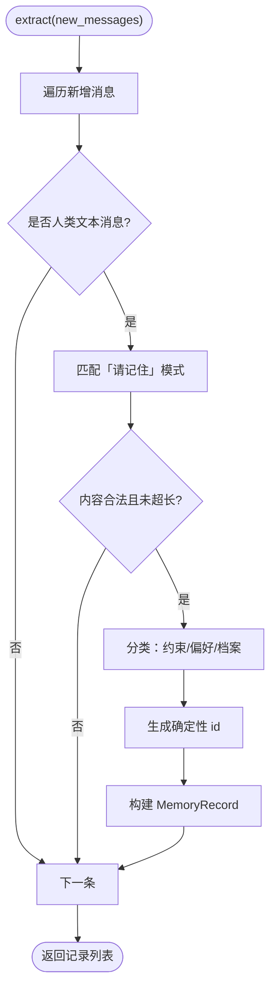
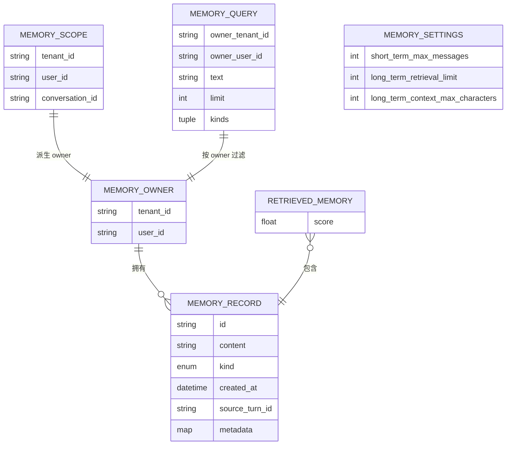
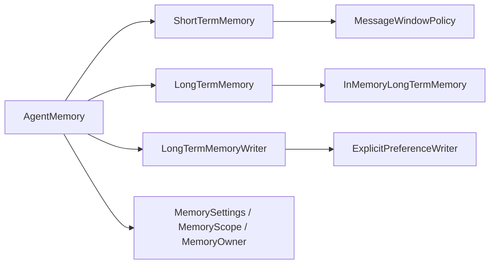
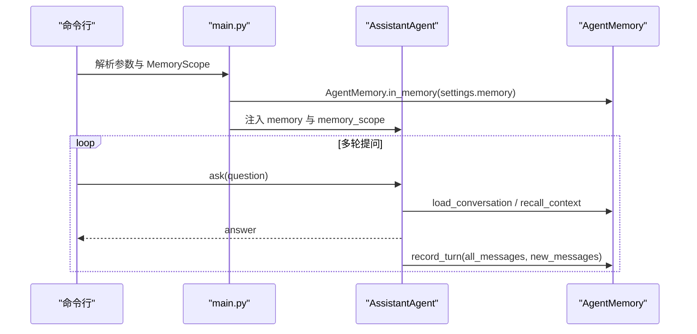

# 记忆服务门面

<cite>
**本文引用的文件**   
- [service.py](file://agent_platform/memory/service.py)
- [contracts.py](file://agent_platform/memory/contracts.py)
- [short_term.py](file://agent_platform/memory/short_term.py)
- [long_term.py](file://agent_platform/memory/long_term.py)
- [writer.py](file://agent_platform/memory/writer.py)
- [models.py](file://agent_platform/memory/models.py)
- [main.py](file://main.py)
- [README.md](file://README.md)
</cite>

## 目录
1. [引言](#引言)
2. [项目结构](#项目结构)
3. [核心组件](#核心组件)
4. [架构总览](#架构总览)
5. [详细组件分析](#详细组件分析)
6. [依赖关系分析](#依赖关系分析)
7. [性能与容量特性](#性能与容量特性)
8. [配置选项与使用示例](#配置选项与使用示例)
9. [监控指标与故障诊断](#监控指标与故障诊断)
10. [结论](#结论)

## 引言
本文件围绕 AgentMemory 门面类，系统化说明其如何统一短期会话历史与长期用户偏好，并通过稳定的契约边界实现可替换后端。文档重点包括：
- 门面模式设计动机与职责划分
- 记忆加载流程：短期历史获取、长期相关记忆召回、上下文组装
- 记忆更新协调机制：会话串行化、写入策略、幂等覆盖
- 与 Agent 核心的集成方式：依赖注入与作用域管理
- 配置项、参数调优建议与典型使用场景
- 性能特征、监控指标与常见故障排查方法

## 项目结构
记忆子系统位于 `agent_platform/memory` 包中，采用“契约 + 默认实现 + 组合门面”的分层组织方式：
- 契约层：定义短期记忆、长期记忆、长期记忆写入器的稳定接口
- 数据模型层：作用域、归属、记录、查询、设置等不可变数据结构
- 默认实现层：进程内短期窗口、进程内长期记忆、显式偏好提取器
- 门面层：AgentMemory 组合三者，对外暴露简洁 API

**图表来源**
- [contracts.py:17-59](file://agent_platform/memory/contracts.py#L17-L59)
- [models.py:18-120](file://agent_platform/memory/models.py#L18-L120)
- [short_term.py:17-67](file://agent_platform/memory/short_term.py#L17-L67)
- [long_term.py:20-83](file://agent_platform/memory/long_term.py#L20-L83)
- [writer.py:30-100](file://agent_platform/memory/writer.py#L30-L100)
- [service.py:24-106](file://agent_platform/memory/service.py#L24-L106)

**章节来源**
- [README.md:33-47](file://README.md#L33-L47)
- [README.md:67-96](file://README.md#L67-L96)

## 核心组件
- AgentMemory：对外的唯一入口，负责组合短期记忆、长期记忆和写入策略，并提供会话级串行化、消息裁剪、长期上下文渲染、清理等操作。
- ShortTermMemory 契约：按完整会话作用域保存 LangChain 消息窗口，支持加载、全量替换、裁剪、清空。
- LongTermMemory 契约：跨短期窗口、按用户隔离的结构化记忆存储，支持 upsert、检索、按用户清理。
- LongTermMemoryWriter 契约：从新增对话消息中提取值得持久化的长期记忆。
- MessageWindowPolicy：按消息数量裁剪，避免窗口以孤立 AI 或工具消息开头。
- InMemoryShortTermMemory：进程内短期消息存储，线程安全。
- InMemoryLongTermMemory：进程内长期记忆存储，基于词面重叠打分与回退策略。
- ExplicitPreferenceWriter：仅保存用户明确授权的最小偏好/约束数据，具备防注入与幂等 id 生成。
- 数据模型：MemoryScope、MemoryOwner、MemoryRecord、MemoryQuery、RetrievedMemory、MemorySettings。

**章节来源**
- [service.py:24-106](file://agent_platform/memory/service.py#L24-L106)
- [contracts.py:17-59](file://agent_platform/memory/contracts.py#L17-L59)
- [short_term.py:17-67](file://agent_platform/memory/short_term.py#L17-L67)
- [long_term.py:20-83](file://agent_platform/memory/long_term.py#L20-L83)
- [writer.py:30-100](file://agent_platform/memory/writer.py#L30-L100)
- [models.py:18-120](file://agent_platform/memory/models.py#L18-L120)

## 架构总览
AgentMemory 作为门面，屏蔽了短期与长期记忆的复杂交互细节。调用方只需传入 MemoryScope 与 MemorySettings，即可在 Agent 生命周期内完成消息加载、上下文组装与记忆更新。

**图表来源**
- [service.py:24-106](file://agent_platform/memory/service.py#L24-L106)
- [contracts.py:17-59](file://agent_platform/memory/contracts.py#L17-L59)
- [short_term.py:17-67](file://agent_platform/memory/short_term.py#L17-L67)
- [long_term.py:20-83](file://agent_platform/memory/long_term.py#L20-L83)
- [writer.py:30-100](file://agent_platform/memory/writer.py#L30-L100)

## 详细组件分析

### AgentMemory 门面设计与职责
- 依赖倒置：构造时只依赖三个 Protocol，便于替换为 SQLite、Redis 或向量库后端。
- 工厂方法：in_memory() 提供本地开发默认组合，长期记录在进程重启后丢失。
- 会话串行化：turn(scope) 通过每会话 RLock 保证同一会话的读—执行—写串行，避免并发覆盖短期历史；不同 scope 可并发执行。
- 消息裁剪：trim_for_model() 委托短期记忆按窗口策略裁剪，控制 token 成本。
- 长期上下文组装：recall_context() 按 owner 召回长期记忆，渲染为带防注入外壳的 Prompt 片段，长度受字符预算限制。
- 记忆更新：record_turn() 先全量覆盖短期窗口，再经 writer 筛选值得保存的记录并 upsert 到长期记忆。
- 清理操作：reset_conversation() 仅清短期；clear_long_term_memory() 仅清长期；clear_all_memory() 同时清理两者。

**图表来源**
- [service.py:67-90](file://agent_platform/memory/service.py#L67-L90)
- [service.py:108-141](file://agent_platform/memory/service.py#L108-L141)
- [long_term.py:37-66](file://agent_platform/memory/long_term.py#L37-L66)
- [writer.py:37-64](file://agent_platform/memory/writer.py#L37-L64)

**章节来源**
- [service.py:24-106](file://agent_platform/memory/service.py#L24-L106)
- [service.py:108-141](file://agent_platform/memory/service.py#L108-L141)

### 短期记忆：窗口策略与进程内实现
- MessageWindowPolicy：按最大消息数裁剪，若窗口以 ToolMessage 或 AI 消息开头，则继续向前丢弃非 human/system 消息，确保窗口从完整用户输入开始。
- InMemoryShortTermMemory：按 MemoryScope 隔离消息序列，内部用 RLock 保护并发读写；load 返回拷贝，replace 会先 trim 再覆盖，clear 删除该会话全部短期消息。

**图表来源**
- [short_term.py:17-38](file://agent_platform/memory/short_term.py#L17-L38)

**章节来源**
- [short_term.py:17-67](file://agent_platform/memory/short_term.py#L17-L67)

### 长期记忆：进程内实现与检索打分
- InMemoryLongTermMemory：按 owner（tenant+user）隔离存储，支持 upsert、search、clear_owner。
- 检索流程：
  1) 按 owner 取出候选集；
  2) 可选按 kinds 过滤；
  3) 词面重叠打分：重叠词项数 / 查询词项数；若无有效查询词项，则全部入选；
  4) 无命中时回退到该用户最新记忆；
  5) 按分数降序、同分新记忆优先排序，最后按 limit 截断。
- 分词：英文整词与中文双字 bigram 混合提取，避免耦合外部 RAG 实现。

**图表来源**
- [long_term.py:37-66](file://agent_platform/memory/long_term.py#L37-L66)
- [long_term.py:74-82](file://agent_platform/memory/long_term.py#L74-L82)

**章节来源**
- [long_term.py:20-83](file://agent_platform/memory/long_term.py#L20-L83)

### 长期记忆写入策略：显式偏好提取
- ExplicitPreferenceWriter：仅识别以“请记住/帮我记住”开头的用户消息，提取冒号后的内容作为记忆正文。
- 安全与质量：
  - 过滤疑似提示注入关键词；
  - 单条记忆长度受限；
  - 分类为约束/偏好/档案三类；
  - 确定性 id：同一用户保存同一内容必得同一 id，实现幂等覆盖。
- NoopLongTermMemoryWriter：禁用长期写入时的空实现。

**图表来源**
- [writer.py:37-64](file://agent_platform/memory/writer.py#L37-L64)
- [writer.py:67-94](file://agent_platform/memory/writer.py#L67-L94)

**章节来源**
- [writer.py:30-100](file://agent_platform/memory/writer.py#L30-L100)

### 数据模型与作用域隔离
- MemoryScope：包含 tenant_id、user_id、conversation_id，短期窗口按三级隔离。
- MemoryOwner：由 Scope 派生，包含 tenant_id、user_id，长期记忆按两级隔离，可跨会话召回。
- MemoryRecord：不可变记录，含 owner、content、kind、id、created_at、source_turn_id、metadata。
- MemoryQuery：检索请求，含 owner、text、limit、kinds。
- RetrievedMemory：检索结果及分数。
- MemorySettings：通用运行参数，如短期窗口大小、召回条数、注入字符预算。

**图表来源**
- [models.py:27-120](file://agent_platform/memory/models.py#L27-L120)

**章节来源**
- [models.py:18-120](file://agent_platform/memory/models.py#L18-L120)

## 依赖关系分析
- 门面层依赖契约层，不感知具体实现；默认实现通过 in_memory() 装配。
- 短期记忆与长期记忆解耦：短期用于会话窗口，长期用于跨会话偏好召回。
- 写入策略独立于存储：只负责从消息中提取记录，不关心 upsert 的具体实现。
- 数据模型与 Agent、工具注册表无关，保持领域纯净。

**图表来源**
- [service.py:24-106](file://agent_platform/memory/service.py#L24-L106)
- [contracts.py:17-59](file://agent_platform/memory/contracts.py#L17-L59)
- [short_term.py:17-67](file://agent_platform/memory/short_term.py#L17-L67)
- [long_term.py:20-83](file://agent_platform/memory/long_term.py#L20-L83)
- [writer.py:30-100](file://agent_platform/memory/writer.py#L30-L100)
- [models.py:18-120](file://agent_platform/memory/models.py#L18-L120)

**章节来源**
- [README.md:33-47](file://README.md#L33-L47)
- [README.md:67-96](file://README.md#L67-L96)

## 性能与容量特性
- 短期窗口裁剪：时间复杂度近似 O(N)，N 为消息数；避免以孤立 AI/Tool 消息开头可减少模型报错风险。
- 长期检索：
  - 按 owner 过滤后线性扫描候选集；
  - 词面重叠打分与排序为 O(K log K)，K 为候选记录数；
  - 无命中时回退到最新记忆，保证可用。
- 注入上下文渲染：逐条追加 JSON 行，遇到字符预算即停止，防止 Prompt 过长。
- 并发控制：
  - 短期存储与长期存储各自使用 RLock；
  - AgentMemory.turn(scope) 按会话串行化，避免并发覆盖。

优化建议：
- 生产环境将 InMemoryLongTermMemory 替换为向量数据库或搜索引擎，以提升大规模召回效率。
- 调整 long_term_retrieval_limit 与 long_term_context_max_characters，平衡召回质量与 token 成本。
- 对高频用户可考虑缓存近期已召回的记忆片段，减少重复检索开销。

[本节为通用性能讨论，不直接分析具体文件]

## 配置选项与使用示例

### 配置项说明
- short_term_max_messages：送入模型的短期窗口最大消息数，至少为 1。
- long_term_retrieval_limit：单次召回的长期记忆条数上限，至少为 1。
- long_term_context_max_characters：注入 Prompt 的长期记忆字符预算，下限 80。

**章节来源**
- [models.py:105-120](file://agent_platform/memory/models.py#L105-L120)

### 使用示例与集成方式
- 通过 AgentMemory.in_memory(settings.memory) 创建默认组合，适合本地开发与演示。
- 在 main.py 中，AssistantAgent 接收 memory 与 memory_scope，多个问题共享同一 Agent 实例内的短期会话窗口与长期记忆。
- CLI 支持通过 --tenant-id、--user-id、--conversation-id 指定作用域，当前为进程内隔离。

**图表来源**
- [main.py:43-90](file://main.py#L43-L90)
- [service.py:41-49](file://agent_platform/memory/service.py#L41-L49)

**章节来源**
- [main.py:43-90](file://main.py#L43-L90)
- [README.md:81-96](file://README.md#L81-L96)

### 参数调优建议
- 短对话、低延迟场景：适当降低 short_term_max_messages，减少 token 消耗。
- 需要更强个性化：提高 long_term_retrieval_limit，但注意字符预算限制。
- 高并发场景：确保每个会话使用独立 MemoryScope，避免锁竞争。
- 长上下文敏感任务：增大 long_term_context_max_characters，但需评估模型上下文上限与成本。

[本节为通用调优建议，不直接分析具体文件]

## 监控指标与故障诊断

### 关键监控指标
- 短期窗口大小：记录每次 trim_for_model 后的消息数量，观察是否频繁触发窗口裁剪。
- 长期召回命中率：统计 recall_context 返回的 RetrievedMemory 数量与平均分数。
- 注入上下文长度：记录 _render_retrieved_memories 输出的字符数，避免超过预算。
- 写入成功率：统计 writer.extract 返回的记录数与 LTM.upsert 成功次数。
- 锁等待与并发冲突：监测 turn(scope) 的持有时间与并发请求排队情况。

### 常见问题与排查
- 短期历史被并发覆盖：检查是否正确使用 turn(scope) 包裹一轮完整的读—执行—写流程。
- 长期记忆未生效：确认用户消息是否以“请记住/帮我记住”开头，且未被注入关键词过滤。
- 检索结果为空：检查 query.owner 是否正确，以及是否存在同用户的长期记录；必要时放宽 kinds 过滤。
- 注入上下文过长：调整 long_term_context_max_characters，或减少 long_term_retrieval_limit。
- 进程重启后长期记忆丢失：这是 InMemoryLongTermMemory 的预期行为，生产环境应替换为持久化后端。

**章节来源**
- [service.py:51-57](file://agent_platform/memory/service.py#L51-L57)
- [service.py:67-90](file://agent_platform/memory/service.py#L67-L90)
- [service.py:108-141](file://agent_platform/memory/service.py#L108-L141)
- [writer.py:18-27](file://agent_platform/memory/writer.py#L18-L27)
- [long_term.py:37-66](file://agent_platform/memory/long_term.py#L37-L66)

## 结论
AgentMemory 门面通过稳定的契约边界与清晰的职责划分，简化了短期会话与长期偏好的复杂交互。它提供了：
- 会话级串行化，避免并发覆盖
- 可控的消息裁剪与长期上下文注入
- 安全的显式偏好提取与幂等写入
- 易于替换的后端抽象，便于向生产级存储迁移

在实际使用中，建议结合业务场景调整 MemorySettings，并在生产环境替换长期记忆实现以获得更好的可扩展性与可靠性。