# 记忆架构设计

<cite>
**本文引用的文件**   
- [models.py](file://agent_platform/memory/models.py)
- [contracts.py](file://agent_platform/memory/contracts.py)
- [service.py](file://agent_platform/memory/service.py)
- [short_term.py](file://agent_platform/memory/short_term.py)
- [long_term.py](file://agent_platform/memory/long_term.py)
- [writer.py](file://agent_platform/memory/writer.py)
</cite>

## 目录
1. [引言](#引言)
2. [项目结构](#项目结构)
3. [核心组件](#核心组件)
4. [架构总览](#架构总览)
5. [详细组件分析](#详细组件分析)
6. [依赖关系分析](#依赖关系分析)
7. [性能与成本考量](#性能与成本考量)
8. [故障排查指南](#故障排查指南)
9. [结论](#结论)

## 引言
本设计文档面向“双层记忆”架构：短期会话记忆负责一次对话的上下文窗口，长期偏好记忆负责跨会话、按用户归属的持久化知识。两者通过统一的作用域和归属边界解耦，既保证短期窗口的轻量可控，又确保长期记忆的幂等、可溯源与可检索。

- 短期会话记忆：以 tenant + user + conversation 三级作用域隔离，生命周期随会话结束而清理。
- 长期偏好记忆：以 tenant + user 两级归属隔离，跨会话复用，支持按语义分类与文本检索。
- 写入策略：仅从用户显式授权的消息中保守提取长期记忆，避免误记与提示注入。
- 门面组合：AgentMemory 作为唯一入口，组合短期、长期与写入器，对外暴露稳定接口。

## 项目结构
记忆子系统位于 agent_platform/memory 目录下，采用“契约 + 模型 + 门面 + 实现”的分层组织方式：
- models.py：定义 MemoryScope、MemoryOwner、MemoryKind、MemoryRecord、MemoryQuery、RetrievedMemory、MemorySettings 等核心数据模型。
- contracts.py：定义 ShortTermMemory、LongTermMemory、LongTermMemoryWriter 三个 Protocol，作为可替换后端的依赖倒置边界。
- service.py：AgentMemory 门面，组合短期、长期与写入器，提供会话级串行化、短期裁剪、长期召回与清理能力。
- short_term.py：短期消息窗口策略 MessageWindowPolicy 与进程内实现 InMemoryShortTermMemory。
- long_term.py：进程内长期记忆实现 InMemoryLongTermMemory，提供基于词面重叠的轻量检索。
- writer.py：从用户消息中提取长期记忆的写入器 ExplicitPreferenceWriter，以及空实现 NoopLongTermMemoryWriter。

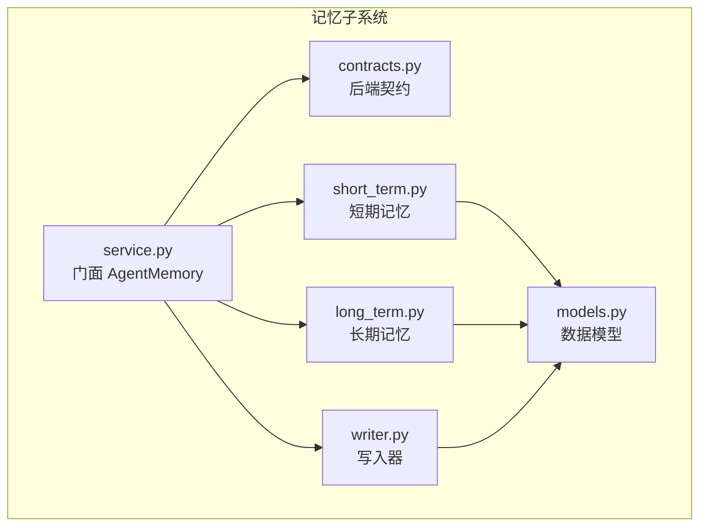

**图表来源**
- [service.py:24-105](file://agent_platform/memory/service.py#L24-L105)
- [contracts.py:17-58](file://agent_platform/memory/contracts.py#L17-L58)
- [short_term.py:17-66](file://agent_platform/memory/short_term.py#L17-L66)
- [long_term.py:20-71](file://agent_platform/memory/long_term.py#L20-L71)
- [writer.py:30-64](file://agent_platform/memory/writer.py#L30-L64)
- [models.py:18-120](file://agent_platform/memory/models.py#L18-L120)

**章节来源**
- [models.py:1-120](file://agent_platform/memory/models.py#L1-L120)
- [contracts.py:1-59](file://agent_platform/memory/contracts.py#L1-L59)
- [service.py:1-141](file://agent_platform/memory/service.py#L1-L141)
- [short_term.py:1-67](file://agent_platform/memory/short_term.py#L1-L67)
- [long_term.py:1-83](file://agent_platform/memory/long_term.py#L1-L83)
- [writer.py:1-100](file://agent_platform/memory/writer.py#L1-L100)

## 核心组件
- MemoryScope：承载 tenant + user + conversation 三级作用域，用于短期记忆隔离；同时派生出 owner（tenant + user）供长期记忆使用。
- MemoryOwner：承载 tenant + user 两级归属，是长期记忆的隔离边界。
- MemoryKind：长期记忆的语义分类枚举，包括 PREFERENCE（偏好）、CONSTRAINT（约束）、PROFILE（档案），并预留 SUMMARY（摘要）。
- MemoryRecord：不可变记录，包含 owner、content、kind、id、created_at、source_turn_id、metadata；构造时进行 Fail Fast 校验，并将 metadata 固化为只读视图。
- MemoryQuery / RetrievedMemory：长期记忆检索请求与结果封装，score 为打分字段，便于未来向量检索保持同一返回契约。
- MemorySettings：控制短期窗口大小、长期召回条数与注入 Prompt 的字符预算。

**章节来源**
- [models.py:18-120](file://agent_platform/memory/models.py#L18-L120)

## 架构总览
AgentMemory 作为门面，协调短期、长期与写入器：
- 短期：load/replace/trim/clear 由 ShortTermMemory 协议抽象，默认实现为 InMemoryShortTermMemory。
- 长期：upsert/search/clear_owner 由 LongTermMemory 协议抽象，默认实现为 InMemoryLongTermMemory。
- 写入：extract 由 LongTermMemoryWriter 协议抽象，默认实现为 ExplicitPreferenceWriter。

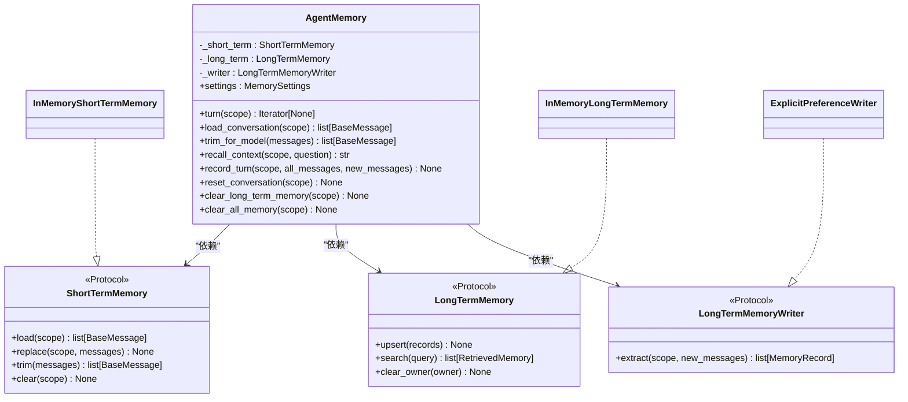

**图表来源**
- [service.py:24-105](file://agent_platform/memory/service.py#L24-L105)
- [contracts.py:17-58](file://agent_platform/memory/contracts.py#L17-L58)
- [short_term.py:41-66](file://agent_platform/memory/short_term.py#L41-L66)
- [long_term.py:20-71](file://agent_platform/memory/long_term.py#L20-L71)
- [writer.py:30-64](file://agent_platform/memory/writer.py#L30-L64)

## 详细组件分析

### 双层记忆设计理念与职责边界
- 短期会话记忆
  - 职责：维护一次对话的最近消息窗口，控制 token 成本，避免孤立 AI/Tool 消息导致调用失败。
  - 隔离：按完整三级作用域 tenant + user + conversation 隔离。
  - 生命周期：随会话重置或清空而失效；进程重启后丢失（默认进程内实现）。
- 长期偏好记忆
  - 职责：保存用户明确授权的偏好、约束与档案事实，跨会话复用，辅助模型个性化回答。
  - 隔离：按两级归属 tenant + user 隔离，跨会话共享。
  - 生命周期：持久化到存储后端；可按用户维度清理。

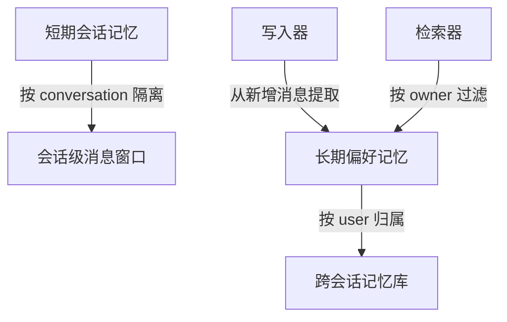

**图表来源**
- [short_term.py:17-66](file://agent_platform/memory/short_term.py#L17-L66)
- [long_term.py:20-71](file://agent_platform/memory/long_term.py#L20-L71)
- [writer.py:37-64](file://agent_platform/memory/writer.py#L37-L64)

**章节来源**
- [short_term.py:17-66](file://agent_platform/memory/short_term.py#L17-L66)
- [long_term.py:1-83](file://agent_platform/memory/long_term.py#L1-L83)
- [writer.py:1-100](file://agent_platform/memory/writer.py#L1-L100)

### 作用域与归属管理：MemoryScope 与 MemoryOwner
- MemoryScope
  - 三级隔离：tenant_id、user_id、conversation_id。
  - 派生 owner：去掉 conversation 一级，得到 MemoryOwner，用于长期记忆归属。
  - 默认值：local/default/default，便于本地演示。
- MemoryOwner
  - 两级隔离：tenant_id、user_id。
  - 校验：不允许空值，Fail Fast。

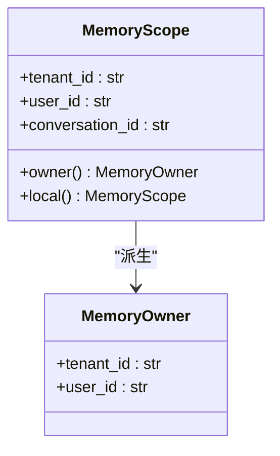

**图表来源**
- [models.py:27-59](file://agent_platform/memory/models.py#L27-L59)

**章节来源**
- [models.py:27-59](file://agent_platform/memory/models.py#L27-L59)

### MemoryKind 语义分类设计
- PREFERENCE：用户偏好，如“喜欢安静的咖啡馆”，可协商参考。
- CONSTRAINT：硬性约束，如“预算不超过 2000”“海鲜过敏”，不可违反。
- PROFILE：用户档案事实，如“带两个孩子出行”。
- SUMMARY：会话摘要（预留类型，当前未启用）。

写入器根据关键词将内容分类为 CONSTRAINT > PREFERENCE > PROFILE，确保约束优先于偏好。

**章节来源**
- [models.py:18-24](file://agent_platform/memory/models.py#L18-L24)
- [writer.py:81-87](file://agent_platform/memory/writer.py#L81-L87)

### MemoryRecord 数据模型原则
- 不可变性：dataclass(frozen=True)，构造后不可修改。
- 元数据保护：metadata 在构造后被 MappingProxyType 包裹为只读视图，防止外部篡改。
- 溯源机制：source_turn_id 记录产生该记忆的消息 id，便于审计与回溯。
- 幂等覆盖：id 可由写入器生成确定性值，重复保存同内容不会累积。
- 安全校验：Fail Fast 校验 id/content 非空、created_at 带时区。

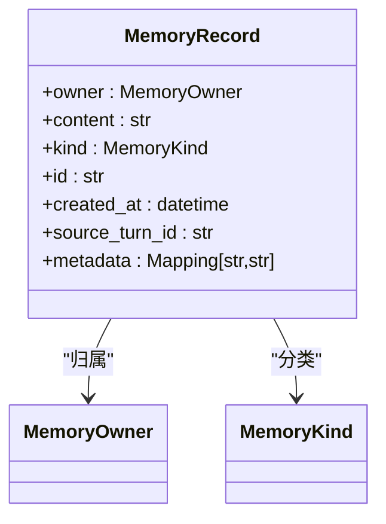

**图表来源**
- [models.py:62-81](file://agent_platform/memory/models.py#L62-L81)

**章节来源**
- [models.py:62-81](file://agent_platform/memory/models.py#L62-L81)

### 作用域继承与数据流转
- 会话级到用户级的继承：
  - 短期记忆：按 MemoryScope（tenant + user + conversation）隔离。
  - 长期记忆：从 MemoryScope.owner 派生 MemoryOwner（tenant + user），跨会话共享。
- 数据流转：
  - 新增消息经写入器提取为 MemoryRecord。
  - 长期记忆按 owner 存储，检索时按 owner 过滤并按文本打分排序。
  - 短期消息按窗口策略裁剪，避免孤立 AI/Tool 消息。

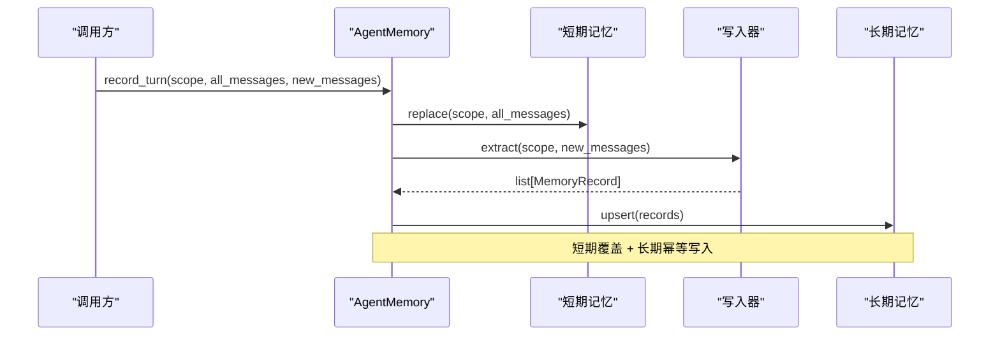

**图表来源**
- [service.py:77-90](file://agent_platform/memory/service.py#L77-L90)
- [writer.py:37-64](file://agent_platform/memory/writer.py#L37-L64)
- [short_term.py:54-61](file://agent_platform/memory/short_term.py#L54-L61)
- [long_term.py:31-36](file://agent_platform/memory/long_term.py#L31-L36)

**章节来源**
- [service.py:77-90](file://agent_platform/memory/service.py#L77-L90)
- [writer.py:37-64](file://agent_platform/memory/writer.py#L37-L64)
- [short_term.py:54-61](file://agent_platform/memory/short_term.py#L54-L61)
- [long_term.py:31-36](file://agent_platform/memory/long_term.py#L31-L36)

### 短期消息窗口策略
- MessageWindowPolicy
  - 保留最近 max_messages 条消息。
  - 丢弃窗口头部的孤立 AI/Tool 消息，确保序列从 human/system 开始。
- InMemoryShortTermMemory
  - 按 MemoryScope 隔离存储消息列表。
  - replace 内部先 trim 再覆盖，线程安全。

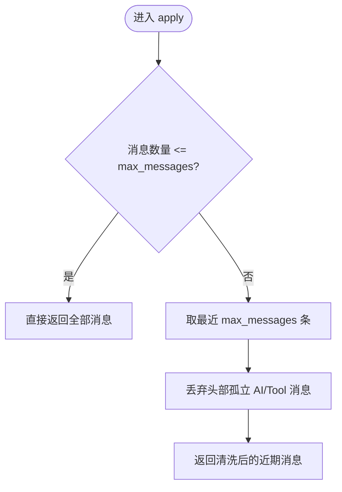

**图表来源**
- [short_term.py:17-38](file://agent_platform/memory/short_term.py#L17-L38)

**章节来源**
- [short_term.py:17-38](file://agent_platform/memory/short_term.py#L17-L38)

### 长期记忆检索与打分
- InMemoryLongTermMemory
  - 按 owner 取出候选集。
  - 可选按 kinds 过滤。
  - 词面重叠打分：重叠词项数 / 查询词项数；无有效词项时全部入选。
  - 回退策略：若无命中则返回最新记忆。
  - 排序：分数降序，同分按 created_at 新优先，最后按 limit 截断。

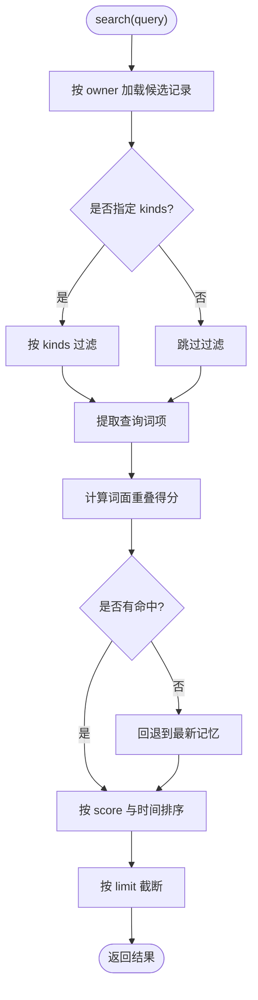

**图表来源**
- [long_term.py:37-66](file://agent_platform/memory/long_term.py#L37-L66)

**章节来源**
- [long_term.py:37-66](file://agent_platform/memory/long_term.py#L37-L66)

### 写入器：显式授权与防注入
- ExplicitPreferenceWriter
  - 仅处理 human 类型且内容为字符串的消息。
  - 正则匹配“请记住...”开头的整句，捕获冒号后的内容。
  - 长度限制与非法标记过滤，防止超长与提示注入。
  - 分类：约束 > 偏好 > 档案。
  - 确定性 id：基于 tenant/user/kind/content 哈希，幂等覆盖。

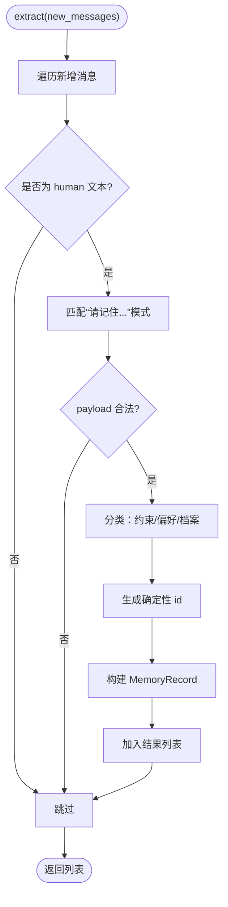

**图表来源**
- [writer.py:37-64](file://agent_platform/memory/writer.py#L37-L64)
- [writer.py:67-94](file://agent_platform/memory/writer.py#L67-L94)

**章节来源**
- [writer.py:37-64](file://agent_platform/memory/writer.py#L37-L64)
- [writer.py:67-94](file://agent_platform/memory/writer.py#L67-L94)

### 门面编排与并发控制
- AgentMemory.turn
  - 为每个 MemoryScope 分配 RLock，串行化同一会话的读—执行—写流程，避免并发覆盖短期历史。
- recall_context
  - 按 scope.owner 检索长期记忆，渲染为带防注入外壳的 Prompt 片段，受字符预算限制。
- record_turn
  - 短期全量覆盖（内部会裁剪），长期仅保存写入器认为值得的内容。

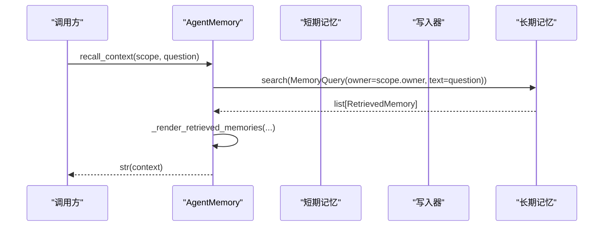

**图表来源**
- [service.py:67-75](file://agent_platform/memory/service.py#L67-L75)
- [service.py:108-140](file://agent_platform/memory/service.py#L108-L140)

**章节来源**
- [service.py:51-75](file://agent_platform/memory/service.py#L51-L75)
- [service.py:108-140](file://agent_platform/memory/service.py#L108-L140)

## 依赖关系分析
- 门面依赖契约：AgentMemory 仅依赖 ShortTermMemory、LongTermMemory、LongTermMemoryWriter 三个 Protocol，不耦合具体实现。
- 默认实现：InMemoryShortTermMemory、InMemoryLongTermMemory、ExplicitPreferenceWriter 提供本地开发默认组合。
- 数据模型独立：models.py 不依赖 Agent、ToolRegistry 或具体存储后端，保证领域模型的稳定性。

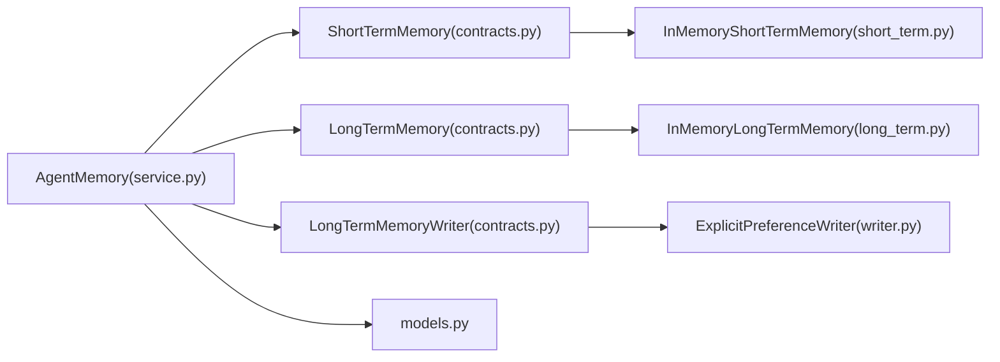

**图表来源**
- [service.py:24-49](file://agent_platform/memory/service.py#L24-L49)
- [contracts.py:17-58](file://agent_platform/memory/contracts.py#L17-L58)
- [short_term.py:41-66](file://agent_platform/memory/short_term.py#L41-L66)
- [long_term.py:20-71](file://agent_platform/memory/long_term.py#L20-L71)
- [writer.py:30-64](file://agent_platform/memory/writer.py#L30-L64)
- [models.py:1-120](file://agent_platform/memory/models.py#L1-L120)

**章节来源**
- [service.py:24-49](file://agent_platform/memory/service.py#L24-L49)
- [contracts.py:17-58](file://agent_platform/memory/contracts.py#L17-L58)

## 性能与成本考量
- 短期窗口裁剪
  - 控制送入模型的消息数量，降低 token 成本。
  - 避免孤立 AI/Tool 消息导致的调用错误。
- 长期检索打分
  - 词面重叠打分简单高效，适合轻量场景；生产环境可替换为向量检索。
  - 无命中时回退到最新记忆，保证基础可用性。
- 注入防护
  - 渲染长期记忆时使用 <remembered_user_data> 标签包裹，并对尖括号转义，防止伪造闭合标签逃逸边界。
  - 字符预算限制，超预算即停止追加，保证注入 Prompt 的长度可控。

**章节来源**
- [short_term.py:17-38](file://agent_platform/memory/short_term.py#L17-L38)
- [long_term.py:37-66](file://agent_platform/memory/long_term.py#L37-L66)
- [service.py:108-140](file://agent_platform/memory/service.py#L108-L140)

## 故障排查指南
- 参数校验失败
  - MemoryOwner/MemoryScope/MemoryRecord/MemoryQuery/MemorySettings 均进行 Fail Fast 校验，常见错误包括空标识符、负数限制、缺少时区等。
- 短期窗口异常
  - 若出现孤立 AI/Tool 消息报错，检查 MessageWindowPolicy.apply 是否正确丢弃头部非 human/system 消息。
- 长期记忆未命中
  - 检查写入器是否成功提取“请记住...”消息；确认分类与 id 生成逻辑；验证检索时的 owner 与 kinds 过滤条件。
- 并发覆盖问题
  - 确认使用 AgentMemory.turn 串行化同一会话的读写流程；检查多实例部署下的锁粒度与存储一致性。

**章节来源**
- [models.py:34-36](file://agent_platform/memory/models.py#L34-L36)
- [models.py:47-49](file://agent_platform/memory/models.py#L47-L49)
- [models.py:74-80](file://agent_platform/memory/models.py#L74-L80)
- [models.py:92-94](file://agent_platform/memory/models.py#L92-L94)
- [models.py:113-119](file://agent_platform/memory/models.py#L113-L119)
- [short_term.py:20-23](file://agent_platform/memory/short_term.py#L20-L23)
- [service.py:51-57](file://agent_platform/memory/service.py#L51-L57)

## 结论
本记忆架构通过短期会话记忆与长期偏好记忆的清晰分离，结合三级作用域与两级归属的管理机制，实现了低成本、高可控的上下文管理与跨会话的知识复用。数据模型遵循不可变性与元数据保护原则，写入器坚持“宁可少记，不可错记”的策略，配合门面编排与并发控制，为 Agent 提供了稳定、可扩展的记忆基础设施。后续可在长期检索层引入向量检索以提升召回质量，并在存储层替换为持久化后端以满足生产需求。