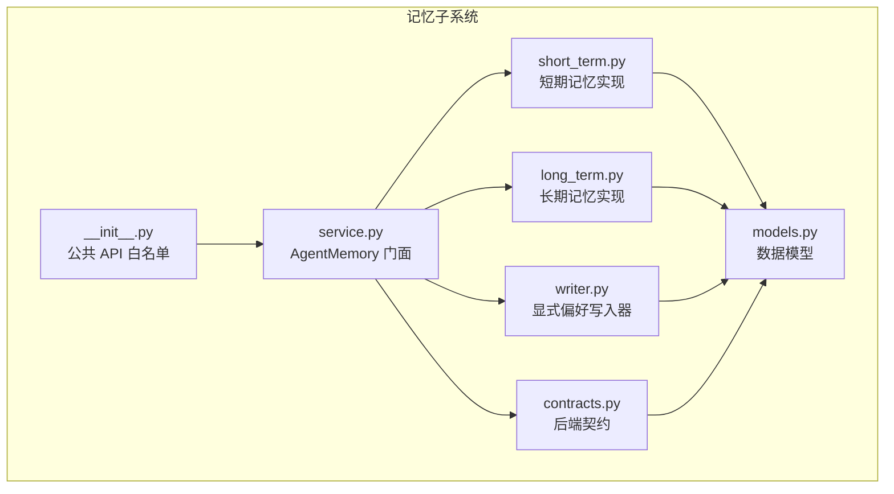
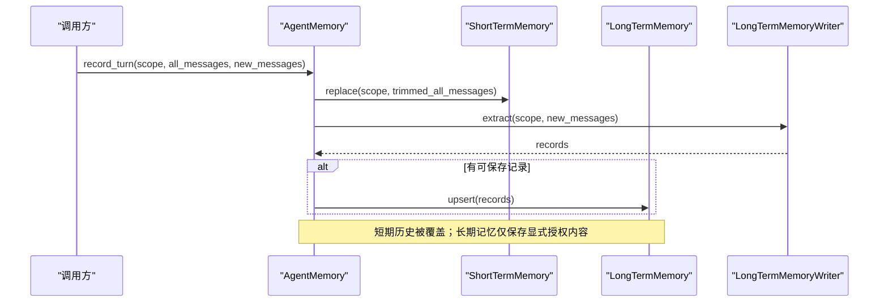
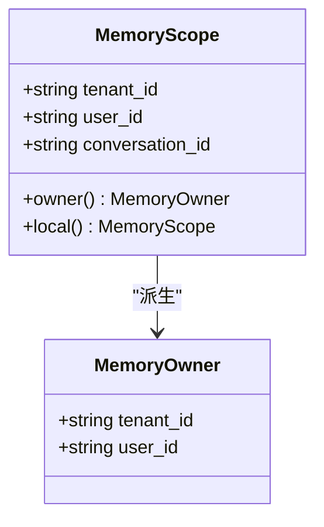
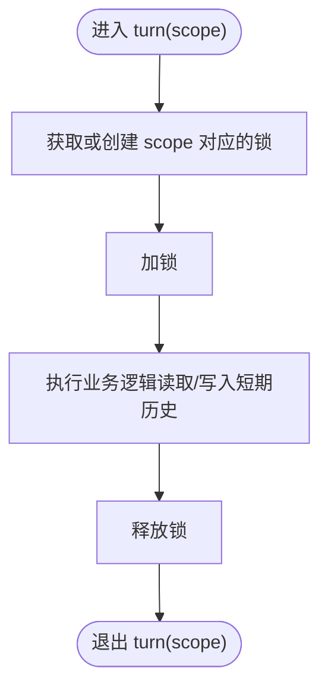
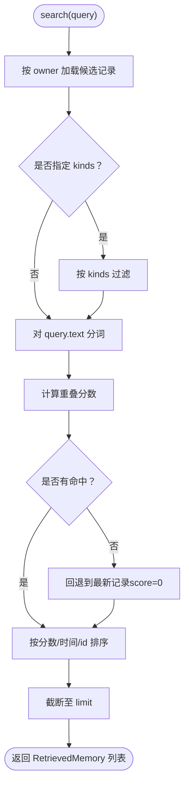
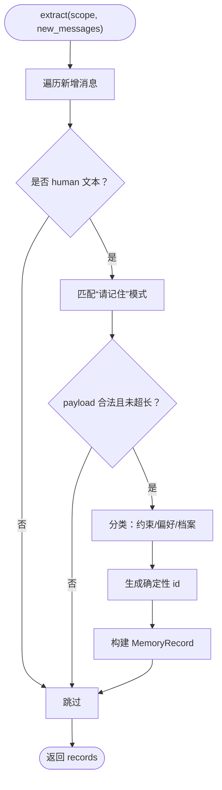
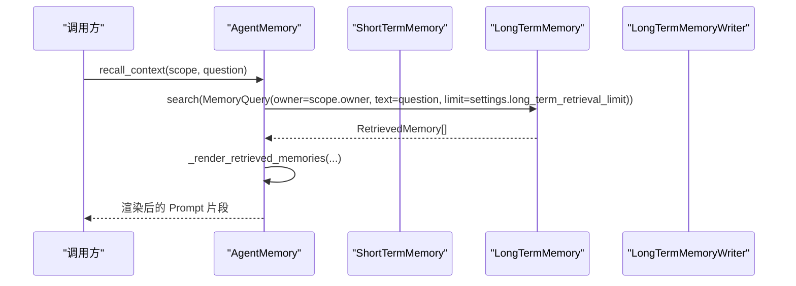
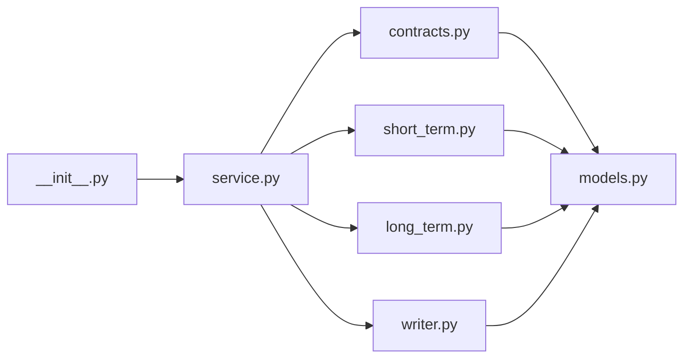

# 记忆系统

<cite>
**本文引用的文件**   
- [memory/__init__.py](file://agent_platform/memory/__init__.py)
- [memory/contracts.py](file://agent_platform/memory/contracts.py)
- [memory/models.py](file://agent_platform/memory/models.py)
- [memory/service.py](file://agent_platform/memory/service.py)
- [memory/short_term.py](file://agent_platform/memory/short_term.py)
- [memory/long_term.py](file://agent_platform/memory/long_term.py)
- [memory/writer.py](file://agent_platform/memory/writer.py)
</cite>

## 目录
1. [引言](#引言)
2. [项目结构](#项目结构)
3. [核心组件](#核心组件)
4. [架构总览](#架构总览)
5. [详细组件分析](#详细组件分析)
6. [依赖关系分析](#依赖关系分析)
7. [性能与容量特性](#性能与容量特性)
8. [故障排查指南](#故障排查指南)
9. [结论](#结论)
10. [附录：自定义后端与迁移指南](#附录自定义后端与迁移指南)

## 引言
本文件面向记忆系统的架构与实现，重点解释双层记忆设计理念：短期会话记忆负责一次对话的消息窗口，长期偏好记忆负责跨会话、按用户隔离的结构化记忆。文档将说明 MemoryScope 与 MemoryOwner 的作用域边界，深入分析 ShortTermMemory 的并发安全与线程保护机制，以及 LongTermMemory 的用户偏好存储策略、数据序列化与跨会话共享方式；同时解析 ExplicitPreferenceWriter 的智能筛选逻辑，给出如何防止敏感信息泄露、如何进行自定义记忆后端实现与迁移的建议。

## 项目结构
记忆子系统位于 agent_platform/memory 包中，采用“模型 → 契约 → 进程内实现 → 门面组合”的分层组织方式：
- models：定义作用域、归属、记录、查询等不可变数据模型。
- contracts：定义可替换的后端接口（Protocol），作为依赖倒置边界。
- short_term / long_term / writer：进程内默认实现。
- service：对外门面 AgentMemory，组合短期、长期与写入策略，并提供会话级串行化入口。

**图表来源**
- [memory/__init__.py:1-41](file://agent_platform/memory/__init__.py#L1-L41)
- [memory/service.py:1-49](file://agent_platform/memory/service.py#L1-L49)
- [memory/contracts.py:1-59](file://agent_platform/memory/contracts.py#L1-L59)
- [memory/models.py:1-120](file://agent_platform/memory/models.py#L1-L120)

**章节来源**
- [memory/__init__.py:1-41](file://agent_platform/memory/__init__.py#L1-L41)

## 核心组件
- 数据模型：MemoryScope、MemoryOwner、MemoryRecord、MemoryQuery、RetrievedMemory、MemorySettings、MemoryKind。
- 契约接口：ShortTermMemory、LongTermMemory、LongTermMemoryWriter。
- 短期记忆：MessageWindowPolicy 裁剪策略 + InMemoryShortTermMemory 进程内存储。
- 长期记忆：InMemoryLongTermMemory 进程内存储与词面重叠检索。
- 写入器：ExplicitPreferenceWriter 从显式授权消息中提取偏好/约束。
- 门面：AgentMemory 统一暴露会话加载、裁剪、召回、记录、清理等操作。

**章节来源**
- [memory/models.py:18-120](file://agent_platform/memory/models.py#L18-L120)
- [memory/contracts.py:17-59](file://agent_platform/memory/contracts.py#L17-L59)
- [memory/short_term.py:17-67](file://agent_platform/memory/short_term.py#L17-L67)
- [memory/long_term.py:20-83](file://agent_platform/memory/long_term.py#L20-L83)
- [memory/writer.py:30-100](file://agent_platform/memory/writer.py#L30-L100)
- [memory/service.py:24-106](file://agent_platform/memory/service.py#L24-L106)

## 架构总览
记忆系统通过 AgentMemory 门面协调短期与长期记忆：
- 短期记忆以完整会话为作用域，提供消息加载、裁剪、覆盖与清空。
- 长期记忆以用户为归属，支持幂等 upsert、按 owner 过滤检索、按类型过滤与字符预算注入。
- 写入器仅从本轮新增消息中筛选值得持久化的内容，避免误写指令或敏感信息。
- 所有对外操作通过 Protocol 解耦，便于替换为 SQLite、Redis 或向量库。

**图表来源**
- [memory/service.py:77-91](file://agent_platform/memory/service.py#L77-L91)
- [memory/contracts.py:17-59](file://agent_platform/memory/contracts.py#L17-L59)

**章节来源**
- [memory/service.py:24-106](file://agent_platform/memory/service.py#L24-L106)

## 详细组件分析

### 双层记忆设计与职责分离
- 短期会话记忆：
  - 职责：维护一次对话的消息窗口，控制送入模型的消息数量与起始语义完整性。
  - 特点：按完整会话隔离（tenant+user+conversation），不跨会话保留。
- 长期偏好记忆：
  - 职责：跨会话保存用户明确授权的偏好、约束与档案事实，供后续问题召回。
  - 特点：按用户归属（tenant+user）隔离，支持跨会话共享与幂等更新。

这种分离使短期窗口专注于上下文长度与语义连贯性，长期记忆专注于个性化与一致性，降低彼此耦合与风险。

**章节来源**
- [memory/models.py:1-6](file://agent_platform/memory/models.py#L1-L6)
- [memory/contracts.py:17-50](file://agent_platform/memory/contracts.py#L17-L50)

### 作用域管理：MemoryScope 与 MemoryOwner
- MemoryScope：表示一次对话的完整作用域，包含 tenant_id、user_id、conversation_id，并派生出 MemoryOwner。
- MemoryOwner：表示长期记忆的归属边界，仅含 tenant_id 与 user_id，用于跨会话召回。
- 校验规则：两者均要求字段非空，确保隔离边界有效。

**图表来源**
- [memory/models.py:27-59](file://agent_platform/memory/models.py#L27-L59)

**章节来源**
- [memory/models.py:27-59](file://agent_platform/memory/models.py#L27-L59)

### 短期记忆：消息窗口、会话隔离与并发安全
- 会话隔离：
  - InMemoryShortTermMemory 使用 dict[MemoryScope, list[BaseMessage]] 存储，每个会话独立。
- 消息裁剪：
  - MessageWindowPolicy 保留最近 N 条消息，并丢弃窗口开头的孤立 AI/Tool 消息，保证窗口从 human/system 开始。
- 并发安全：
  - InMemoryShortTermMemory 内部使用 RLock 保护读写。
  - AgentMemory.turn 为每个 MemoryScope 分配一个 RLock，确保同一会话的读—执行—写流程串行化，避免并发覆盖短期历史。

**图表来源**
- [memory/service.py:51-57](file://agent_platform/memory/service.py#L51-L57)
- [memory/short_term.py:41-67](file://agent_platform/memory/short_term.py#L41-L67)

**章节来源**
- [memory/short_term.py:17-67](file://agent_platform/memory/short_term.py#L17-L67)
- [memory/service.py:51-57](file://agent_platform/memory/service.py#L51-L57)

### 长期记忆：用户偏好存储、序列化和跨会话共享
- 存储结构：
  - InMemoryLongTermMemory 使用 defaultdict(dict) 按 owner 分组存储 MemoryRecord，键为确定性 id。
- 写入策略：
  - upsert 按 id 幂等覆盖，重复保存不会累积。
- 检索策略：
  - 先按 owner 取出候选集，再可选按 kinds 过滤。
  - 使用轻量分词提取英文整词与中文双字 bigram，计算重叠率作为分数。
  - 若无直接命中，回退到该用户的最新记忆（score=0）。
  - 最终按分数降序、时间戳降序、id 升序排序并截断 limit。
- 序列化与跨会话：
  - MemoryRecord 是冻结 dataclass，metadata 固化为只读视图，created_at 带时区，确保跨进程/会话一致性与安全性。
  - 当前实现为进程内存储；生产环境可通过实现 LongTermMemory 契约替换为 SQLite/Redis/向量库。

**图表来源**
- [memory/long_term.py:37-66](file://agent_platform/memory/long_term.py#L37-L66)

**章节来源**
- [memory/long_term.py:20-83](file://agent_platform/memory/long_term.py#L20-L83)
- [memory/models.py:62-103](file://agent_platform/memory/models.py#L62-L103)

### 显式偏好写入器：智能筛选与安全边界
- 触发条件：
  - 仅处理类型为 human 且内容为字符串的消息。
  - 正则匹配“请记住/帮我记住...”开头，捕获冒号后的记忆正文。
- 安全过滤：
  - 忽略疑似提示注入的内容（如包含“忽略”“系统提示”“提示词”“指令”“角色”“system prompt”等关键词）。
  - 单条记忆最大字符数限制，防止超长内容占满注入 Prompt 的字符预算。
- 分类与幂等：
  - 根据关键词将记忆分为 CONSTRAINT/PREFERENCE/PROFILE。
  - 使用 sha256 生成确定性 id，同一用户保存同一内容会幂等覆盖，避免重复累积。
- 元数据：
  - 记录 writer 名称与 conversation_id，便于溯源与审计。

**图表来源**
- [memory/writer.py:37-64](file://agent_platform/memory/writer.py#L37-L64)
- [memory/writer.py:67-99](file://agent_platform/memory/writer.py#L67-L99)

**章节来源**
- [memory/writer.py:1-100](file://agent_platform/memory/writer.py#L1-L100)

### 门面层：AgentMemory 的组合与渲染
- 组合：
  - 构造时注入 ShortTermMemory、LongTermMemory、LongTermMemoryWriter 与 MemorySettings。
  - in_memory 工厂提供本地开发默认实现。
- 会话串行化：
  - turn 上下文管理器为每个 MemoryScope 分配 RLock，确保同一会话的读—执行—写串行化。
- 短期历史：
  - load_conversation 读取会话消息；trim_for_model 按窗口策略裁剪。
- 长期召回：
  - recall_context 基于当前问题检索长期记忆，并以带防注入外壳的 Prompt 片段返回。
- 记录与清理：
  - record_turn 覆盖短期历史并按 writer 结果 upsert 长期记忆。
  - reset_conversation 仅清短期；clear_long_term_memory 清长期；clear_all_memory 同时清理。

**图表来源**
- [memory/service.py:67-75](file://agent_platform/memory/service.py#L67-L75)
- [memory/service.py:108-141](file://agent_platform/memory/service.py#L108-L141)

**章节来源**
- [memory/service.py:24-106](file://agent_platform/memory/service.py#L24-L106)
- [memory/service.py:108-141](file://agent_platform/memory/service.py#L108-L141)

## 依赖关系分析
- 单向依赖：
  - __init__.py 导出公共 API，依赖 service、models、short_term、long_term、writer。
  - service 依赖 contracts 与具体实现，但不反向依赖上层业务。
  - contracts 仅依赖 models，保持契约稳定。
- 外部依赖：
  - langchain_core.messages.BaseMessage 作为消息载体。
- 可替换性：
  - 通过 Protocol 抽象，短期/长期/写入均可替换为其他后端。

**图表来源**
- [memory/__init__.py:8-21](file://agent_platform/memory/__init__.py#L8-L21)
- [memory/service.py:17-21](file://agent_platform/memory/service.py#L17-L21)
- [memory/contracts.py:14-15](file://agent_platform/memory/contracts.py#L14-L15)

**章节来源**
- [memory/__init__.py:1-41](file://agent_platform/memory/__init__.py#L1-L41)
- [memory/service.py:17-21](file://agent_platform/memory/service.py#L17-L21)

## 性能与容量特性
- 短期窗口：
  - MessageWindowPolicy 按消息数量裁剪，避免窗口从孤立 AI/Tool 消息开始，减少无效 token 消耗。
  - InMemoryShortTermMemory 使用 RLock 保护，避免并发覆盖。
- 长期检索：
  - 先按 owner 取候选集，缩小临界区；分词为轻量实现，避免引入重型 RAG 依赖。
  - 无命中时回退到最新记忆，提升召回稳定性。
- 注入预算：
  - _render_retrieved_memories 对注入 Prompt 的字符数进行预算控制，超出即停止追加，防止上下文爆炸。
- 幂等写入：
  - ExplicitPreferenceWriter 使用确定性 id，避免重复累积，降低存储膨胀。

[本节为通用性能讨论，不直接分析具体代码行]

## 故障排查指南
- 短期历史为空或被覆盖：
  - 检查是否正确使用 turn(scope) 串行化会话操作。
  - 确认 trim_for_model 与 replace 的使用顺序与参数。
- 长期记忆未召回：
  - 检查 MemoryQuery.owner 是否正确派生自 MemoryScope。
  - 确认 ExplicitPreferenceWriter 是否成功提取记录（消息是否为 human 文本且匹配“请记住”模式）。
- 注入 Prompt 异常：
  - 检查 _render_retrieved_memories 的字符预算设置，避免过长导致上下文溢出。
- 并发冲突：
  - 确保同一会话的所有读写在 turn(scope) 内进行，避免多线程竞争。

**章节来源**
- [memory/service.py:51-57](file://agent_platform/memory/service.py#L51-L57)
- [memory/service.py:67-75](file://agent_platform/memory/service.py#L67-L75)
- [memory/service.py:108-141](file://agent_platform/memory/service.py#L108-L141)
- [memory/writer.py:37-64](file://agent_platform/memory/writer.py#L37-L64)

## 结论
记忆系统通过双层设计清晰分离短期会话与长期偏好，借助 MemoryScope/MemoryOwner 明确作用域边界，利用 Protocol 实现可替换后端，并通过显式授权与智能筛选保障数据安全与可控。AgentMemory 门面提供统一的会话串行化与资源管理，配合轻量分词与字符预算控制，兼顾性能与稳定性。

[本节为总结性内容，不直接分析具体代码行]

## 附录：自定义后端与迁移指南

### 自定义短期记忆后端
- 实现 ShortTermMemory 协议：
  - load(scope): 返回该会话的消息列表。
  - replace(scope, messages): 全量覆盖会话窗口（内部可按策略裁剪）。
  - trim(messages): 按窗口策略裁剪消息序列。
  - clear(scope): 清空该会话短期消息。
- 建议：
  - 使用会话键（tenant+user+conversation）隔离数据。
  - 使用线程锁或异步锁保证并发安全。
  - 若使用 Redis，可将消息序列化为 JSON 数组，按过期策略清理。

**章节来源**
- [memory/contracts.py:17-34](file://agent_platform/memory/contracts.py#L17-L34)
- [memory/short_term.py:17-67](file://agent_platform/memory/short_term.py#L17-L67)

### 自定义长期记忆后端
- 实现 LongTermMemory 协议：
  - upsert(records): 按记录 id 幂等写入或覆盖。
  - search(query): 按 owner 与文本检索，返回带分数的有序结果。
  - clear_owner(owner): 删除该用户名下的全部长期记忆。
- 建议：
  - 使用 tenant+user 作为分区键，确保多租户隔离。
  - 索引 content 与 kind，支持快速过滤与检索。
  - 若使用向量库，可在 search 中结合向量相似度与词面重叠打分。

**章节来源**
- [memory/contracts.py:37-50](file://agent_platform/memory/contracts.py#L37-L50)
- [memory/long_term.py:20-83](file://agent_platform/memory/long_term.py#L20-L83)

### 自定义写入器
- 实现 LongTermMemoryWriter 协议：
  - extract(scope, new_messages): 从本轮新增消息中筛选值得持久化的内容。
- 建议：
  - 严格限定触发条件（如显式授权语句）。
  - 实施内容过滤（拒绝疑似注入与敏感信息）。
  - 使用确定性 id 实现幂等覆盖，避免重复累积。

**章节来源**
- [memory/contracts.py:53-59](file://agent_platform/memory/contracts.py#L53-L59)
- [memory/writer.py:30-100](file://agent_platform/memory/writer.py#L30-L100)

### 迁移路径
- 从 InMemory 到持久化后端：
  - 保持现有 AgentMemory 调用不变，仅替换构造时的 ShortTermMemory/LongTermMemory/Writing 实现。
  - 逐步验证 load/replace/trim/clear 与 upsert/search/clear_owner 的行为一致性。
  - 在生产环境启用字符预算与会话串行化，监控上下文长度与并发冲突。
- 配置调优：
  - 调整 MemorySettings.short_term_max_messages 控制短期窗口大小。
  - 调整 MemorySettings.long_term_retrieval_limit 与 long_term_context_max_characters 控制召回数量与注入长度。

**章节来源**
- [memory/service.py:41-49](file://agent_platform/memory/service.py#L41-L49)
- [memory/models.py:105-120](file://agent_platform/memory/models.py#L105-L120)