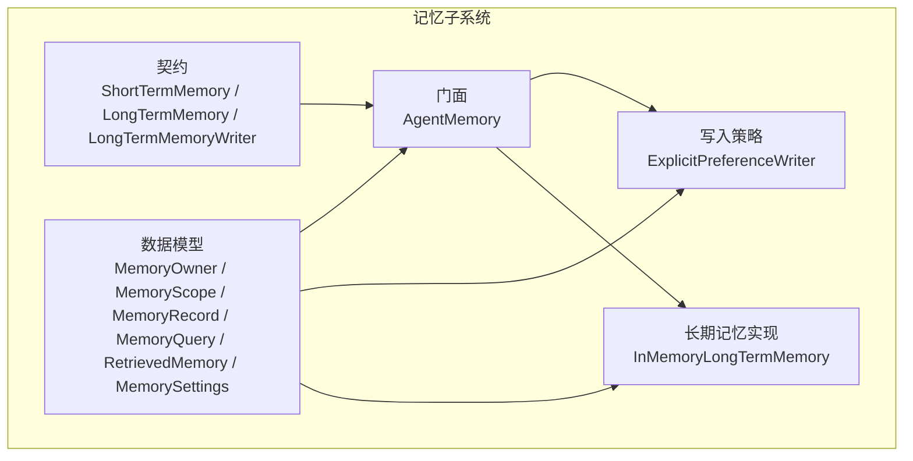
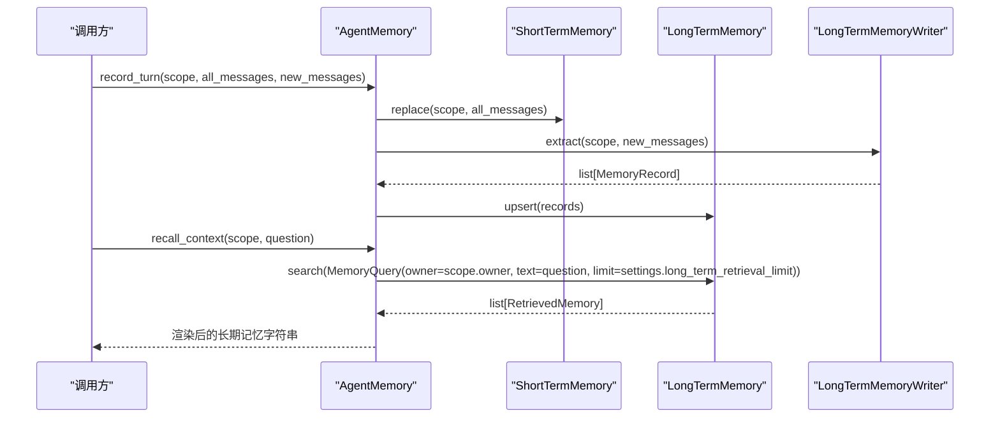
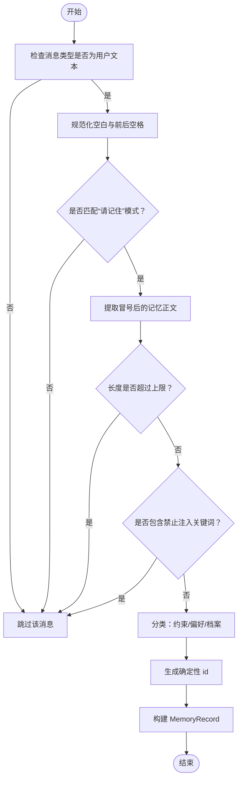
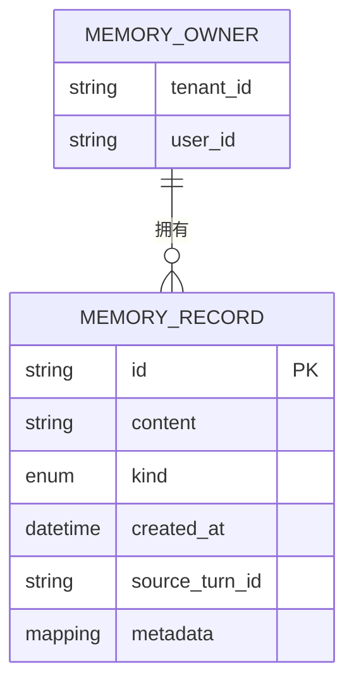
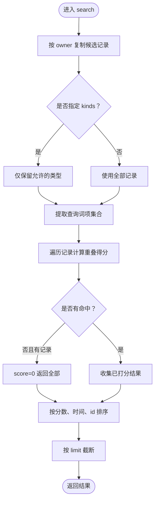
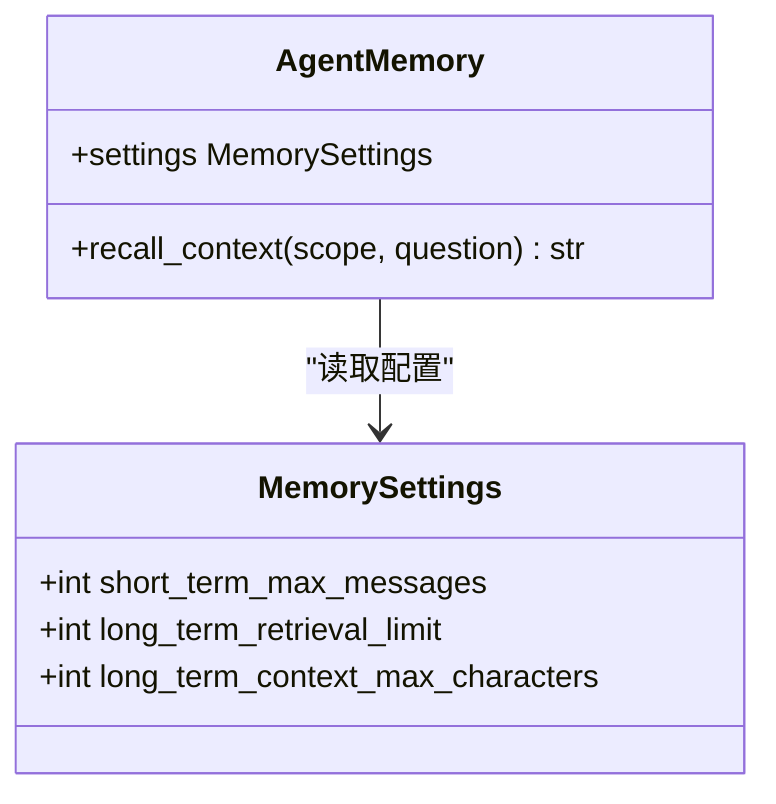
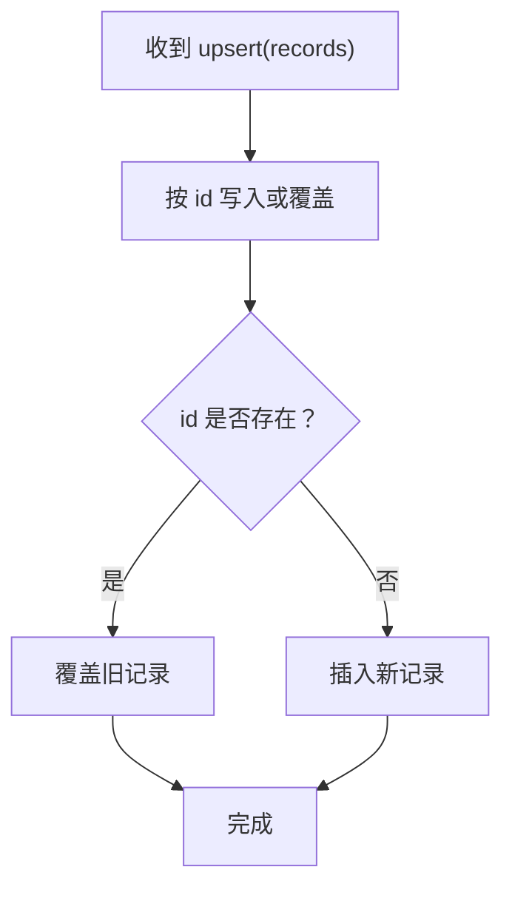
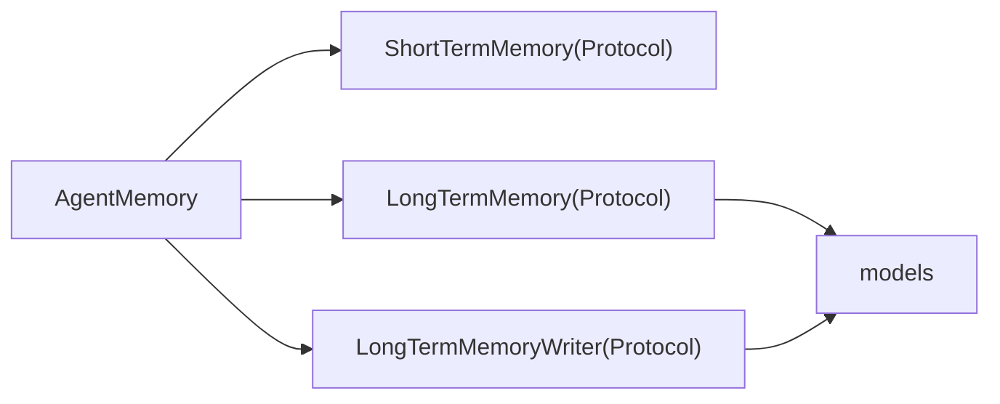

# 长期记忆实现

<cite>
**本文引用的文件**   
- [long_term.py](file://agent_platform/memory/long_term.py)
- [models.py](file://agent_platform/memory/models.py)
- [service.py](file://agent_platform/memory/service.py)
- [writer.py](file://agent_platform/memory/writer.py)
- [contracts.py](file://agent_platform/memory/contracts.py)
</cite>

## 目录
1. [引言](#引言)
2. [项目结构](#项目结构)
3. [核心组件](#核心组件)
4. [架构总览](#架构总览)
5. [详细组件分析](#详细组件分析)
6. [依赖关系分析](#依赖关系分析)
7. [性能与扩展指南](#性能与扩展指南)
8. [数据迁移与备份恢复](#数据迁移与备份恢复)
9. [故障排查](#故障排查)
10. [结论](#结论)

## 引言
本文件面向“长期记忆”子系统，聚焦 LongTermMemory 的实现契约、用户偏好写入策略、检索机制、配置参数影响、版本管理与幂等更新策略，以及后端扩展、性能优化和迁移备份实践。文档以仓库中的内存实现为基准，同时给出可替换的持久化方案建议，帮助读者在不改动上层 Agent 逻辑的前提下，将长期记忆从进程内存储平滑迁移到 SQLite、Redis 或向量数据库。

## 项目结构
长期记忆相关代码集中在 memory 包中，采用“契约 + 模型 + 门面 + 具体实现 + 写入策略”的分层组织方式：
- contracts.py：定义 ShortTermMemory、LongTermMemory、LongTermMemoryWriter 三个 Protocol，作为依赖倒置边界。
- models.py：定义 MemoryOwner、MemoryScope、MemoryRecord、MemoryQuery、RetrievedMemory、MemorySettings 等不可变数据模型。
- long_term.py：提供 InMemoryLongTermMemory，按 owner 隔离、基于词面重叠打分的检索实现。
- writer.py：提供 ExplicitPreferenceWriter，仅保存用户显式授权的记忆内容，并生成确定性 id 实现幂等覆盖。
- service.py：AgentMemory 门面组合短期记忆、长期记忆与写入策略，统一暴露会话加载、上下文召回、记录轮次、清空等能力。

**图表来源**
- [contracts.py:17-58](file://agent_platform/memory/contracts.py#L17-L58)
- [models.py:18-119](file://agent_platform/memory/models.py#L18-L119)
- [service.py:24-105](file://agent_platform/memory/service.py#L24-L105)
- [writer.py:37-64](file://agent_platform/memory/writer.py#L37-L64)
- [long_term.py:20-71](file://agent_platform/memory/long_term.py#L20-L71)

**章节来源**
- [contracts.py:1-59](file://agent_platform/memory/contracts.py#L1-L59)
- [models.py:1-120](file://agent_platform/memory/models.py#L1-L120)
- [service.py:1-141](file://agent_platform/memory/service.py#L1-L141)
- [writer.py:1-100](file://agent_platform/memory/writer.py#L1-L100)
- [long_term.py:1-83](file://agent_platform/memory/long_term.py#L1-L83)

## 核心组件
- LongTermMemory 契约：定义 upsert、search、clear_owner 三个方法，屏蔽具体存储细节。
- InMemoryLongTermMemory：进程内 dict 存储，按 owner 隔离；支持确定性 id 的幂等 upsert；基于中文双字 bigram 与英文整词的词面重叠打分，无命中时回退最新记忆；结果按分数降序、时间新优先、id 稳定排序，并按 limit 截断。
- MemoryQuery：封装检索请求，包含 owner、text、limit、kinds；limit 必须至少为 1。
- MemorySettings：控制 short_term_max_messages、long_term_retrieval_limit、long_term_context_max_characters；后者用于限制注入 Prompt 的长期记忆字符预算。
- ExplicitPreferenceWriter：仅提取“请记住”开头的用户消息，过滤疑似提示注入，分类为约束/偏好/档案，使用 sha256 生成确定性 id 实现幂等覆盖。
- AgentMemory：门面组合短期记忆、长期记忆与写入策略；recall_context 根据 question 召回长期记忆，渲染为带防注入外壳的 Prompt 片段；record_turn 串行化同一会话的读写流程。

**章节来源**
- [contracts.py:37-58](file://agent_platform/memory/contracts.py#L37-L58)
- [long_term.py:20-83](file://agent_platform/memory/long_term.py#L20-L83)
- [models.py:27-119](file://agent_platform/memory/models.py#L27-L119)
- [writer.py:37-99](file://agent_platform/memory/writer.py#L37-L99)
- [service.py:24-105](file://agent_platform/memory/service.py#L24-L105)

## 架构总览
AgentMemory 是对外唯一入口，内部通过 Protocol 解耦短期记忆、长期记忆与写入策略。默认 in_memory 工厂装配 InMemoryShortTermMemory、InMemoryLongTermMemory 与 ExplicitPreferenceWriter。

**图表来源**
- [service.py:77-90](file://agent_platform/memory/service.py#L77-L90)
- [service.py:67-75](file://agent_platform/memory/service.py#L67-L75)
- [contracts.py:17-58](file://agent_platform/memory/contracts.py#L17-L58)

**章节来源**
- [service.py:24-105](file://agent_platform/memory/service.py#L24-L105)

## 详细组件分析

### 用户偏好存储策略（显式授权写入）
- 触发条件：仅当新增消息为 human 类型且文本匹配“请记住”模式时才尝试提取。
- 安全过滤：丢弃疑似提示注入的内容（如含“忽略”“系统提示”“指令”等关键词）。
- 长度限制：单条记忆最大字符数上限，防止超长内容占用注入 Prompt 预算。
- 分类规则：优先判定为约束（如预算、过敏），其次偏好（喜欢、偏好），否则归为档案。
- 幂等写入：使用 tenant_id、user_id、kind、content 拼接后 sha256 生成确定性 id，重复保存同内容只会覆盖，不会累积。
- 元数据：记录 writer 来源与 conversation_id，便于审计与溯源。

**图表来源**
- [writer.py:37-99](file://agent_platform/memory/writer.py#L37-L99)

**章节来源**
- [writer.py:17-27](file://agent_platform/memory/writer.py#L17-L27)
- [writer.py:37-64](file://agent_platform/memory/writer.py#L37-L64)
- [writer.py:67-99](file://agent_platform/memory/writer.py#L67-L99)

### 数据序列化与跨会话共享
- 序列化：检索结果在渲染为 Prompt 片段时，每条记忆编码为 JSON，并对尖括号进行转义，防止闭合标签逃逸。
- 跨会话共享：长期记忆按 MemoryOwner（tenant+user）隔离，不绑定 conversation_id，因此同一用户的不同会话可以共享偏好与约束。
- 作用域隔离：短期窗口按完整三级作用域（tenant+user+conversation）隔离；长期记忆只保留两级归属。

**图表来源**
- [models.py:27-80](file://agent_platform/memory/models.py#L27-L80)

**章节来源**
- [models.py:27-80](file://agent_platform/memory/models.py#L27-L80)
- [service.py:108-140](file://agent_platform/memory/service.py#L108-L140)

### MemoryQuery 检索机制
- 候选集获取：按 query.owner 取出所有记录，锁内拷贝减少临界区。
- 类型过滤：若 kinds 非空，则仅保留匹配类型的记录。
- 分词与打分：对查询文本与记录内容分别提取词项集合，计算重叠比例；若无有效词项，则全部入选。
- 回退策略：若无直接命中但有记录，则以 score=0 返回全部记录，保证用户偏好总能被考虑。
- 排序与限制：按 score 降序、created_at 新优先、id 稳定排序，最后按 query.limit 截断。

**图表来源**
- [long_term.py:37-66](file://agent_platform/memory/long_term.py#L37-L66)

**章节来源**
- [long_term.py:37-66](file://agent_platform/memory/long_term.py#L37-L66)

### MemorySettings 配置参数的影响
- long_term_retrieval_limit：控制单次召回的长期记忆条数，直接影响注入 Prompt 的长度与模型上下文压力。
- long_term_context_max_characters：控制渲染后的长期记忆字符预算；超出预算时停止追加条目，确保注入长度可控。
- short_term_max_messages：控制短期窗口最大消息数，间接影响整体 token 成本。

**图表来源**
- [models.py:105-119](file://agent_platform/memory/models.py#L105-L119)
- [service.py:67-75](file://agent_platform/memory/service.py#L67-L75)

**章节来源**
- [models.py:105-119](file://agent_platform/memory/models.py#L105-L119)
- [service.py:67-75](file://agent_platform/memory/service.py#L67-L75)

### 记忆记录的版本管理与更新策略
- 幂等写入：确定性 id 由 tenant_id、user_id、kind、content 共同决定，相同内容重复保存不会产生多条记录。
- 覆盖语义：upsert 按 id 覆盖，避免历史累积；适合增量更新场景。
- 冲突解决：由于 id 完全由内容派生，不存在并发冲突导致的版本分裂；如需引入版本号或时间戳字段，可在扩展实现中增加乐观锁或比较交换逻辑。

**图表来源**
- [long_term.py:31-35](file://agent_platform/memory/long_term.py#L31-L35)
- [writer.py:90-94](file://agent_platform/memory/writer.py#L90-L94)

**章节来源**
- [long_term.py:31-35](file://agent_platform/memory/long_term.py#L31-L35)
- [writer.py:90-94](file://agent_platform/memory/writer.py#L90-L94)

### 长期记忆存储后端扩展指南
- 契约一致性：任何新后端需实现 LongTermMemory 的三个方法：upsert、search、clear_owner。
- 持久化方案选择：
  - SQLite：适合单机部署、结构化查询与事务保障；注意索引 owner 与 id。
  - Redis：适合高吞吐、低延迟缓存；可用有序集合维护分数与时间排序。
  - 向量库：适合语义检索；需在 search 中融合向量相似度与词面重叠打分。
- 性能优化建议：
  - 索引：对 owner、kind、created_at、id 建立合适索引。
  - 批量操作：upsert 支持 Iterable，后端应批量写入以减少往返。
  - 扫描范围：search 先按 owner 过滤再打分，避免全表扫描。
  - 排序优化：利用数据库排序或外部排序结构（如堆）处理 top-k。
  - 缓存热点：对高频 owner 的候选集做本地缓存，降低 IO 压力。

**章节来源**
- [contracts.py:37-50](file://agent_platform/memory/contracts.py#L37-L50)
- [long_term.py:20-35](file://agent_platform/memory/long_term.py#L20-L35)

## 依赖关系分析
- AgentMemory 依赖三个 Protocol，不耦合具体实现，便于替换短期/长期记忆与写入策略。
- InMemoryLongTermMemory 依赖 models 中的 MemoryOwner、MemoryQuery、MemoryRecord、RetrievedMemory。
- ExplicitPreferenceWriter 依赖 models 中的 MemoryKind、MemoryRecord、MemoryScope。
- service.py 组合三者并提供统一的 turn 串行化上下文，避免同一会话并发写覆盖短期历史。

**图表来源**
- [service.py:24-49](file://agent_platform/memory/service.py#L24-L49)
- [contracts.py:17-58](file://agent_platform/memory/contracts.py#L17-L58)
- [models.py:18-119](file://agent_platform/memory/models.py#L18-L119)

**章节来源**
- [service.py:24-49](file://agent_platform/memory/service.py#L24-L49)
- [contracts.py:17-58](file://agent_platform/memory/contracts.py#L17-L58)

## 性能与扩展指南
- 检索复杂度：当前实现为 O(N) 扫描候选集，N 为某 owner 下的记录数；适合中小规模数据。
- 分词开销：中文双字 bigram 与英文整词提取轻量，但频繁调用仍有成本；可对热门查询做缓存。
- 渲染开销：_render_retrieved_memories 逐条 JSON 编码并统计字符预算；可通过预编码与批量截断优化。
- 并发控制：turn 上下文为每个 scope 分配 RLock，保证同一会话串行执行；多会话并行不受影响。
- 扩展建议：
  - 引入分页与游标，避免一次性拉取大量记录。
  - 在 search 中增加提前终止条件，达到 limit 即返回。
  - 对长文本记录进行摘要或压缩，减少注入 Prompt 的字符预算消耗。

**章节来源**
- [long_term.py:37-66](file://agent_platform/memory/long_term.py#L37-L66)
- [service.py:51-57](file://agent_platform/memory/service.py#L51-L57)
- [service.py:108-140](file://agent_platform/memory/service.py#L108-L140)

## 数据迁移与备份恢复
- 迁移策略：
  - 导出：按 owner 分组导出 MemoryRecord 列表，包含 id、content、kind、created_at、source_turn_id、metadata。
  - 转换：根据目标后端 schema 映射字段；必要时对 content 进行清洗与标准化。
  - 导入：使用 upsert 批量写入，利用确定性 id 实现幂等覆盖。
- 备份恢复：
  - 定期快照：对长期记忆进行定时快照，保留版本与时间戳。
  - 校验：恢复前校验 id 唯一性与 owner 完整性。
  - 回滚：支持按时间戳回滚到最近一次快照。
- 最佳实践：
  - 使用事务保证导入一致性。
  - 分批导入，避免长时间锁表。
  - 记录迁移日志与失败重试队列。

[本节为通用指导，不直接分析具体文件]

## 故障排查
- 检索结果为空：
  - 检查 query.owner 是否正确；确认 records_by_owner 中存在对应 owner。
  - 检查 kinds 过滤是否过严；必要时放宽或移除过滤。
  - 检查 query.text 是否为空；空查询会返回全部记录（score=0）。
- 记忆未写入：
  - 检查消息类型是否为 human 且内容为字符串。
  - 检查是否匹配“请记住”模式；确认未被禁止注入关键词过滤。
  - 检查单条记忆长度是否超过上限。
- 注入 Prompt 过长：
  - 调整 long_term_context_max_characters 增大预算或减少 long_term_retrieval_limit。
  - 对长文本记录进行摘要或压缩。
- 并发覆盖问题：
  - 确保使用 turn 上下文串行化同一会话的读写。
  - 检查后端 upsert 是否真正按 id 幂等覆盖。

**章节来源**
- [long_term.py:37-66](file://agent_platform/memory/long_term.py#L37-L66)
- [writer.py:37-99](file://agent_platform/memory/writer.py#L37-L99)
- [service.py:51-57](file://agent_platform/memory/service.py#L51-L57)
- [service.py:108-140](file://agent_platform/memory/service.py#L108-L140)

## 结论
长期记忆模块通过清晰的契约与不可变数据模型，实现了用户偏好的显式授权写入、安全的注入防护、跨会话共享与幂等更新。InMemoryLongTermMemory 提供了轻量、可替换的检索实现，配合 MemorySettings 控制检索数量与字符预算，确保注入 Prompt 的可控性。扩展至生产级后端时，只需遵循 LongTermMemory 契约，结合合适的索引、批量操作与排序优化，即可在保证一致性的前提下提升性能与可扩展性。