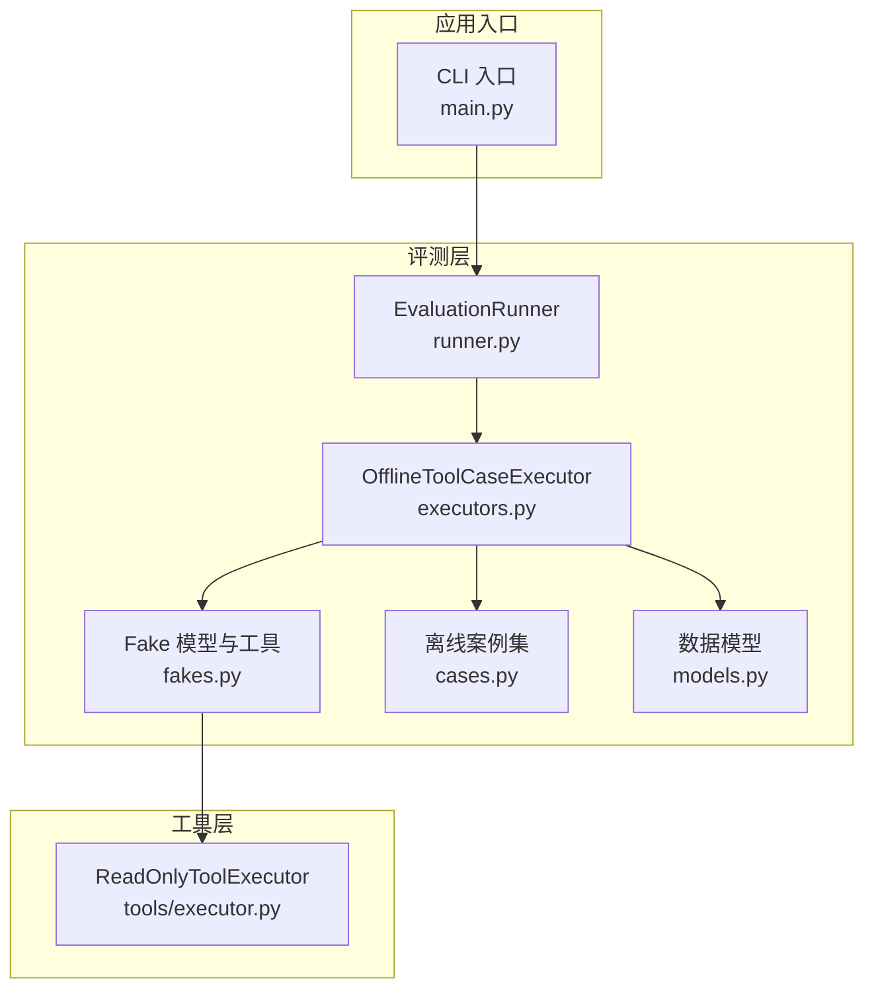
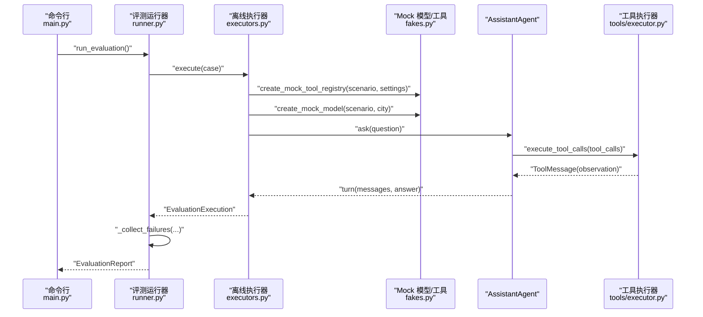
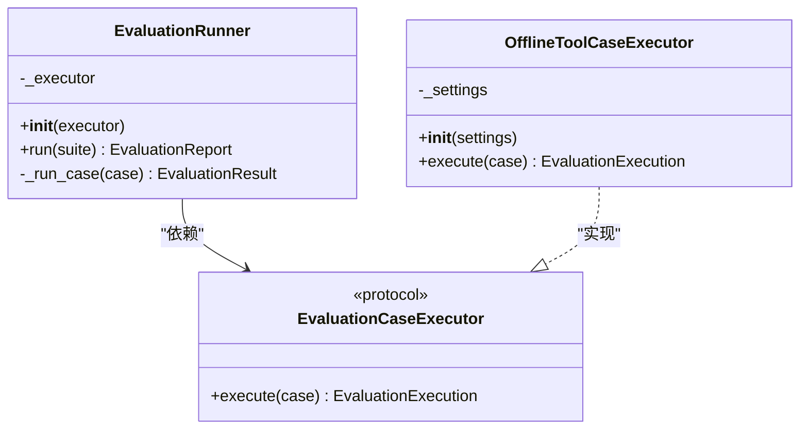
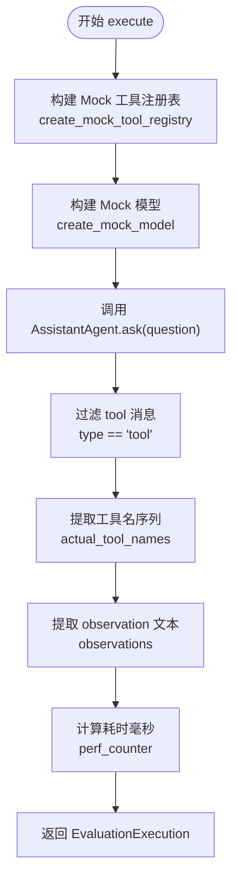
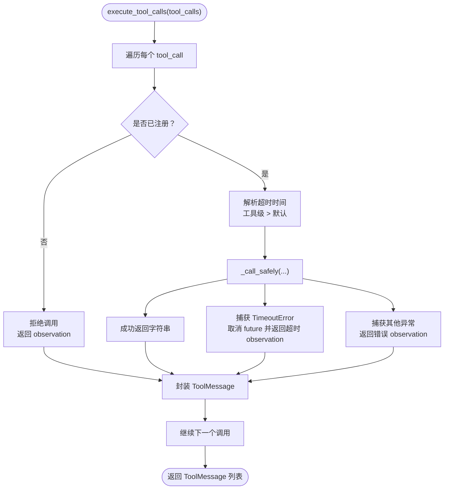
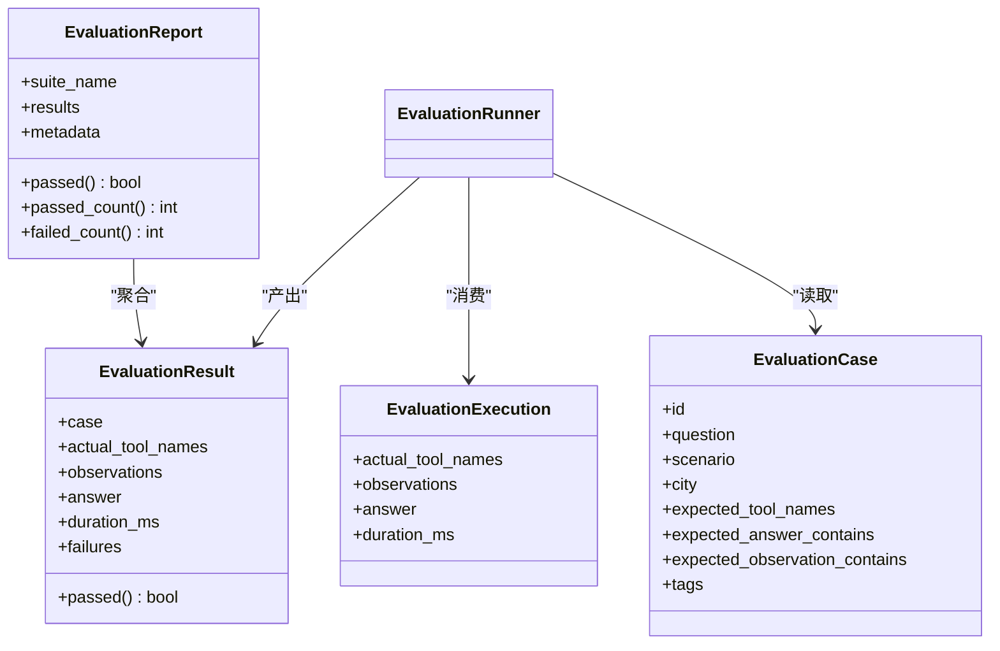
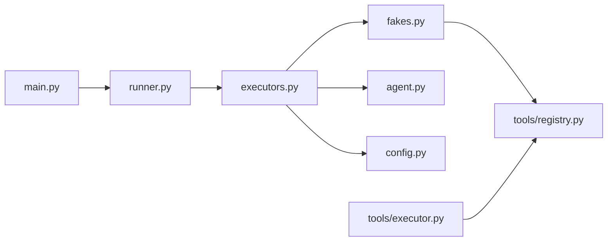

# 执行器框架

<cite>
**本文引用的文件**   
- [executors.py](file://agent_platform/evaluation/executors.py)
- [runner.py](file://agent_platform/evaluation/runner.py)
- [models.py](file://agent_platform/evaluation/models.py)
- [cases.py](file://agent_platform/evaluation/cases.py)
- [fakes.py](file://agent_platform/evaluation/fakes.py)
- [executor.py](file://agent_platform/tools/executor.py)
- [main.py](file://main.py)
- [README.md](file://README.md)
</cite>

## 目录
1. [引言](#引言)
2. [项目结构](#项目结构)
3. [核心组件](#核心组件)
4. [架构总览](#架构总览)
5. [详细组件分析](#详细组件分析)
6. [依赖关系分析](#依赖关系分析)
7. [性能与可观测性](#性能与可观测性)
8. [故障排查指南](#故障排查指南)
9. [结论](#结论)
10. [附录：自定义执行器开发指南](#附录自定义执行器开发指南)

## 引言
本文件面向评测执行器框架，重点解释 EvaluationCaseExecutor 协议的设计意图与扩展方式，并深入剖析默认离线执行器 OfflineToolCaseExecutor 的完整实现流程。文档将案例执行的各个阶段拆分为 Agent 调用、工具执行、结果收集、耗时统计和观测记录，同时说明工具调用的拦截机制，包括实际工具名捕获、observation 收集与超时处理。最后提供在不同环境（离线、在线、混合）下使用评测案例的方法，以及性能优化建议与自定义执行器的开发规范。

## 项目结构
评测相关代码集中在 evaluation 包中，并与 tools 层的工具执行器解耦：
- evaluation/models.py：定义案例、套件、执行观测、断言结果与报告的数据模型。
- evaluation/cases.py：维护稳定的离线回归案例集合。
- evaluation/fakes.py：提供无网络模型与替身工具，用于离线场景的可重复验证。
- evaluation/executors.py：默认离线执行器，负责组装 fake 模型与工具注册表并执行一轮问答。
- evaluation/runner.py：通用评测运行器、断言逻辑与控制台报告器，并通过 Protocol 暴露 ExecutionCaseExecutor 接口。
- tools/executor.py：统一工具执行入口，负责白名单校验、超时控制与错误转 observation。
- main.py：应用启动入口，支持真实模型、mock 模式与 --evaluate 评测模式。
- README.md：平台整体架构、工具与评测使用说明。

**图表来源**
- [runner.py:17-32](file://agent_platform/evaluation/runner.py#L17-L32)
- [executors.py:17-40](file://agent_platform/evaluation/executors.py#L17-L40)
- [fakes.py:28-56](file://agent_platform/evaluation/fakes.py#L28-L56)
- [executor.py:17-43](file://agent_platform/tools/executor.py#L17-L43)
- [main.py:43-58](file://main.py#L43-L58)

**章节来源**
- [README.md:19-48](file://README.md#L19-L48)
- [README.md:98-108](file://README.md#L98-L108)

## 核心组件
- EvaluationCaseExecutor 协议：定义 execute(case) -> EvaluationExecution 的统一契约，使 runner 与具体执行器解耦。
- OfflineToolCaseExecutor：默认离线执行器，基于 fakes 构造确定性 Agent 行为，抽取 tool_messages 作为观测，返回 EvaluationExecution。
- ReadOnlyToolExecutor：工具执行拦截层，负责白名单校验、单工具超时与异常转 observation，保证图不崩溃。
- EvaluationRunner：顺序执行 suite 中的案例，收集失败描述，生成 EvaluationReport，并提供 ConsoleReporter 输出。
- 数据模型：EvaluationCase、EvaluationSuite、EvaluationExecution、EvaluationResult、EvaluationReport。

**章节来源**
- [runner.py:17-32](file://agent_platform/evaluation/runner.py#L17-L32)
- [executors.py:17-40](file://agent_platform/evaluation/executors.py#L17-L40)
- [executor.py:17-43](file://agent_platform/tools/executor.py#L17-L43)
- [models.py:12-83](file://agent_platform/evaluation/models.py#L12-L83)

## 架构总览
评测执行链路如下：
- CLI 通过 main.py 进入 --evaluate 分支，调用 run_evaluation。
- run_evaluation 创建 EvaluationRunner，默认注入 OfflineToolCaseExecutor。
- Runner 遍历 EvaluationSuite.cases，逐个调用 executor.execute。
- OfflineToolCaseExecutor 根据 case.scenario 构建 mock_tool_registry 与 mock_model，驱动 AssistantAgent.ask 完成一轮对话。
- 从 turn.messages 中过滤出 type == "tool" 的消息，提取 name 与 content 作为 actual_tool_names 与 observations。
- 计算 duration_ms 并返回 EvaluationExecution。
- Runner 对 execution 进行断言比对，生成 EvaluationResult，最终汇总为 EvaluationReport。

**图表来源**
- [main.py:43-58](file://main.py#L43-L58)
- [runner.py:23-50](file://agent_platform/evaluation/runner.py#L23-L50)
- [executors.py:23-40](file://agent_platform/evaluation/executors.py#L23-L40)
- [fakes.py:28-97](file://agent_platform/evaluation/fakes.py#L28-L97)
- [executor.py:27-43](file://agent_platform/tools/executor.py#L27-L43)

## 详细组件分析

### EvaluationCaseExecutor 协议与扩展机制
- 协议位置：runner.py 中定义 EvaluationCaseExecutor，仅要求实现 execute(case) -> EvaluationExecution。
- 扩展点：任何实现该协议的类都可被 EvaluationRunner 注入，从而替换默认的离线执行器，例如在线模型执行器、混合执行器或特定后端 benchmark 执行器。
- 设计优势：runner 只关心“如何跑一个案例”，不关心“如何断言”；断言逻辑集中在 _collect_failures，便于统一报告与 CI 集成。

**图表来源**
- [runner.py:17-32](file://agent_platform/evaluation/runner.py#L17-L32)
- [executors.py:17-40](file://agent_platform/evaluation/executors.py#L17-L40)

**章节来源**
- [runner.py:17-32](file://agent_platform/evaluation/runner.py#L17-L32)

### OfflineToolCaseExecutor 完整实现流程
- 初始化：接收可选 AgentSettings，未传入时使用默认设置。
- 构建工具注册表：根据 case.scenario 调用 create_mock_tool_registry，替换需要模拟的工具（如 search_knowledge、get_weather_forecast）。
- 构建模型：根据 case.scenario 与 city 调用 create_mock_model，预置两段回复以驱动 assistant→tools→assistant 循环。
- 执行问答：使用 AssistantAgent.ask(question)，得到 turn（包含 messages 与 answer）。
- 结果收集：过滤 turn.messages 中 type == "tool" 的消息，提取 name 与 content 分别作为 actual_tool_names 与 observations。
- 耗时统计：使用 perf_counter 计算端到端耗时毫秒数。
- 返回 EvaluationExecution：供 runner 断言与报告。

**图表来源**
- [executors.py:23-40](file://agent_platform/evaluation/executors.py#L23-L40)
- [fakes.py:28-97](file://agent_platform/evaluation/fakes.py#L28-L97)

**章节来源**
- [executors.py:17-40](file://agent_platform/evaluation/executors.py#L17-L40)
- [fakes.py:28-97](file://agent_platform/evaluation/fakes.py#L28-L97)

### 工具调用拦截机制：实际工具名捕获、observation 收集与超时处理
- 白名单拦截：ReadOnlyToolExecutor 持有 registry.tools 映射，若模型调用未注册工具，直接拒绝并返回“不允许调用”的 observation。
- 超时策略：单工具显式配置优先，否则回落到执行器默认值；通过 ThreadPoolExecutor 提交 invoke，future.result(timeout=...) 捕获 TimeoutError。
- 异常转 observation：工具抛出的异常不会向上抛出，而是转为“工具错误：...”，由模型向用户说明查询失败，避免 LangGraph 图崩溃。
- 日志打印：执行时打印工具名与参数，observation 也打印，便于调试。

**图表来源**
- [executor.py:27-67](file://agent_platform/tools/executor.py#L27-L67)

**章节来源**
- [executor.py:1-67](file://agent_platform/tools/executor.py#L1-L67)

### 案例执行阶段分解
- Agent 调用：OfflineToolCaseExecutor 使用 AssistantAgent.ask 驱动一次问答，内部由 LangGraph 决定是否需要工具。
- 工具执行：当模型发起 tool_calls，LangGraph 进入 tools 节点，由 ReadOnlyToolExecutor 统一执行。
- 结果收集：执行器从 turn.messages 中筛选 tool 类型消息，提取 name 与 content。
- 耗时统计：使用 perf_counter 在 execute 前后计时，换算为毫秒。
- 观测记录：observations 为各工具返回的 observation 文本，answer 为最终自然语言答复。

**章节来源**
- [executors.py:23-40](file://agent_platform/evaluation/executors.py#L23-L40)
- [executor.py:27-67](file://agent_platform/tools/executor.py#L27-L67)

### 断言与报告
- 断言逻辑：_collect_failures 比较 actual_tool_names 与 expected_tool_names，检查 observations 与 answer 是否包含预期子串。
- 报告结构：EvaluationResult 聚合 case、execution 与 failures；EvaluationReport 汇总 suite_name、results 与 metadata，并提供 passed、passed_count、failed_count。
- 控制台输出：ConsoleReporter 逐案例打印状态、工具序列、observation、answer 与失败原因，末尾汇总通过数。

**图表来源**
- [models.py:12-83](file://agent_platform/evaluation/models.py#L12-L83)
- [runner.py:84-103](file://agent_platform/evaluation/runner.py#L84-L103)

**章节来源**
- [runner.py:23-50](file://agent_platform/evaluation/runner.py#L23-L50)
- [runner.py:53-81](file://agent_platform/evaluation/runner.py#L53-L81)
- [runner.py:84-103](file://agent_platform/evaluation/runner.py#L84-L103)
- [models.py:12-83](file://agent_platform/evaluation/models.py#L12-L83)

## 依赖关系分析
- runner.py 依赖 executors.py 的默认执行器与 models.py 的数据模型。
- executors.py 依赖 fakes.py 的 mock 模型与工具注册表，以及 agent_platform.agent.AssistantAgent 与 config.AgentSettings。
- fakes.py 依赖 tools.registry.ToolRegistry 与 tools.factory.build_default_tool_registry，并复用 AgentSettings。
- tools.executor.ReadOnlyToolExecutor 依赖 langchain_core 的 ToolMessage 与 BaseTool，以及 tools.registry.ToolRegistry。
- main.py 在 --evaluate 模式下短路到 run_evaluation，并在非评测模式下装配真实模型或 mock 模型。

**图表来源**
- [runner.py:12-14](file://agent_platform/evaluation/runner.py#L12-L14)
- [executors.py:11-14](file://agent_platform/evaluation/executors.py#L11-L14)
- [fakes.py:14-15](file://agent_platform/evaluation/fakes.py#L14-L15)
- [executor.py:11-14](file://agent_platform/tools/executor.py#L11-L14)
- [main.py:15-19](file://main.py#L15-L19)

**章节来源**
- [runner.py:12-14](file://agent_platform/evaluation/runner.py#L12-L14)
- [executors.py:11-14](file://agent_platform/evaluation/executors.py#L11-L14)
- [fakes.py:14-15](file://agent_platform/evaluation/fakes.py#L14-L15)
- [executor.py:11-14](file://agent_platform/tools/executor.py#L11-L14)
- [main.py:15-19](file://main.py#L15-L19)

## 性能与可观测性
- 耗时统计：OfflineToolCaseExecutor 使用 perf_counter 计算端到端耗时，单位毫秒，便于评估不同 scenario 的执行效率。
- 工具超时：ReadOnlyToolExecutor 通过 ThreadPoolExecutor 限制单工具等待时间，避免长尾任务拖垮整个图；超时后取消 future 并返回 observation。
- 日志输出：工具执行与 observation 均打印，便于定位问题；建议在生产环境中收敛日志级别。
- 并发隔离：每个案例独立组装注册表与 Agent，互不污染，结果可复现；适合批量回归测试。

[本节为通用指导，无需具体文件引用]

## 故障排查指南
- 工具未注册：ReadOnlyToolExecutor 会拒绝未注册工具调用，并返回“不允许调用”的 observation；检查 ToolRegistry 是否正确注册。
- 工具超时：当工具执行超过 timeout_seconds，将返回“工具超时” observation；检查 fakes.py 中 timeout 场景与默认超时配置。
- 工具异常：工具抛出的异常会被捕获并转为 observation；检查 fakes.py 中 error 场景与工具实现。
- 断言失败：_collect_failures 会列出工具名序列不一致、observation 缺失、answer 缺失等失败原因；对照 cases.py 的预期值调整。

**章节来源**
- [executor.py:27-67](file://agent_platform/tools/executor.py#L27-L67)
- [runner.py:84-103](file://agent_platform/evaluation/runner.py#L84-L103)
- [fakes.py:32-56](file://agent_platform/evaluation/fakes.py#L32-L56)

## 结论
评测执行器框架通过 EvaluationCaseExecutor 协议实现了执行器与 runner 的解耦，默认离线执行器 OfflineToolCaseExecutor 提供了稳定、可重复的回归能力。工具执行拦截层 ReadOnlyToolExecutor 确保工具调用具备白名单、超时与异常处理能力，保障图稳定性。结合 fakes 与 cases，可在离线环境下覆盖 RAG、天气、超时、错误与无需工具等多种场景。未来可通过实现新的执行器接入在线模型或混合环境，保持 runner 与报告器不变。

[本节为总结性内容，无需具体文件引用]

## 附录：自定义执行器开发指南

### 协议实现要求
- 实现 EvaluationCaseExecutor 协议，提供 execute(case) -> EvaluationExecution。
- 返回的 EvaluationExecution 必须包含 actual_tool_names、observations、answer、duration_ms。
- 建议使用 perf_counter 计算耗时，并以毫秒为单位。

**章节来源**
- [runner.py:17-20](file://agent_platform/evaluation/runner.py#L17-L20)
- [models.py:34-42](file://agent_platform/evaluation/models.py#L34-L42)

### 异步处理与错误恢复
- 若执行器涉及异步 I/O，应在 execute 内妥善处理异步回调与超时，确保不阻塞 runner 的顺序执行。
- 对于外部服务调用，建议采用类似 ReadOnlyToolExecutor 的错误恢复策略：将异常转换为 observation，而不是向上抛出，以便模型能向用户说明失败原因。
- 如需并行执行多个案例，注意保持案例间资源隔离（如独立的工具注册表与 Agent），避免状态污染。

[本节为通用指导，无需具体文件引用]

### 不同环境的使用方式
- 离线环境：使用 DEFAULT_OFFLINE_TOOL_SUITE 与 OfflineToolCaseExecutor，无需 API Key 或网络。
- 在线环境：实现新的执行器，注入真实模型与工具注册表，保持 evaluate 流程不变。
- 混合环境：在同一 suite 中组合离线与在线案例，通过不同执行器或条件分支切换。

**章节来源**
- [README.md:98-108](file://README.md#L98-L108)
- [main.py:43-58](file://main.py#L43-L58)

### 性能优化建议
- 减少不必要的工具调用：在 execute 前根据 case.scenario 与 question 做轻量路由判断，跳过无关工具。
- 缓存工具注册表与模型实例：若 suite 较大且场景重复，可复用已构建的注册表与模型，降低开销。
- 控制日志级别：在生产环境中收敛日志输出，仅保留必要信息，避免 I/O 瓶颈。
- 合理设置超时：根据工具特性配置 timeout_seconds，避免长尾任务影响整体吞吐。

[本节为通用指导，无需具体文件引用]