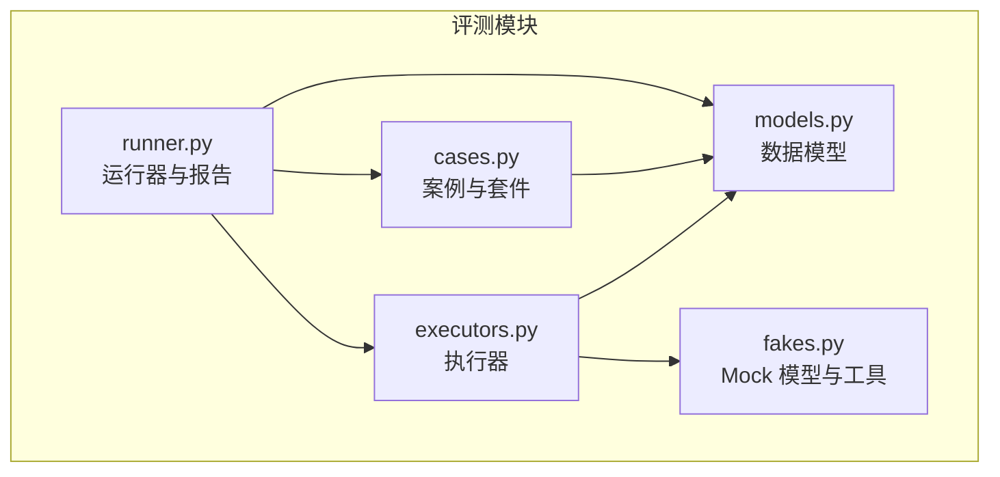
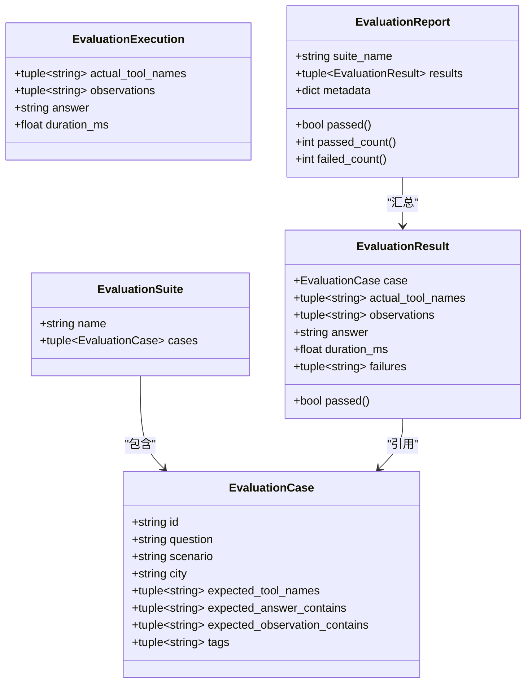
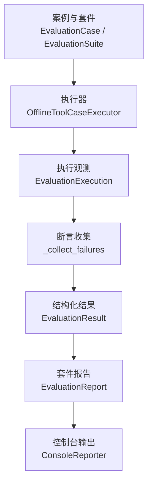
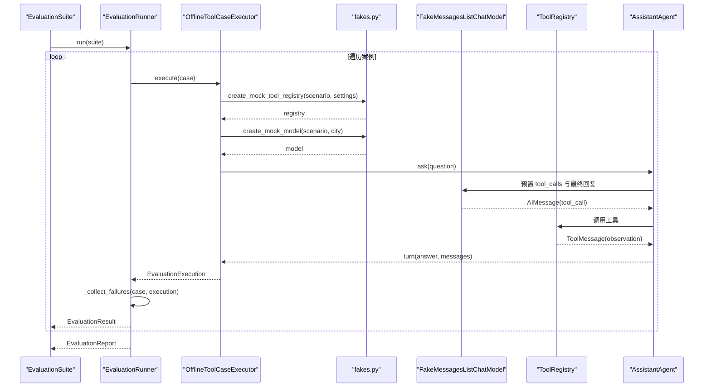
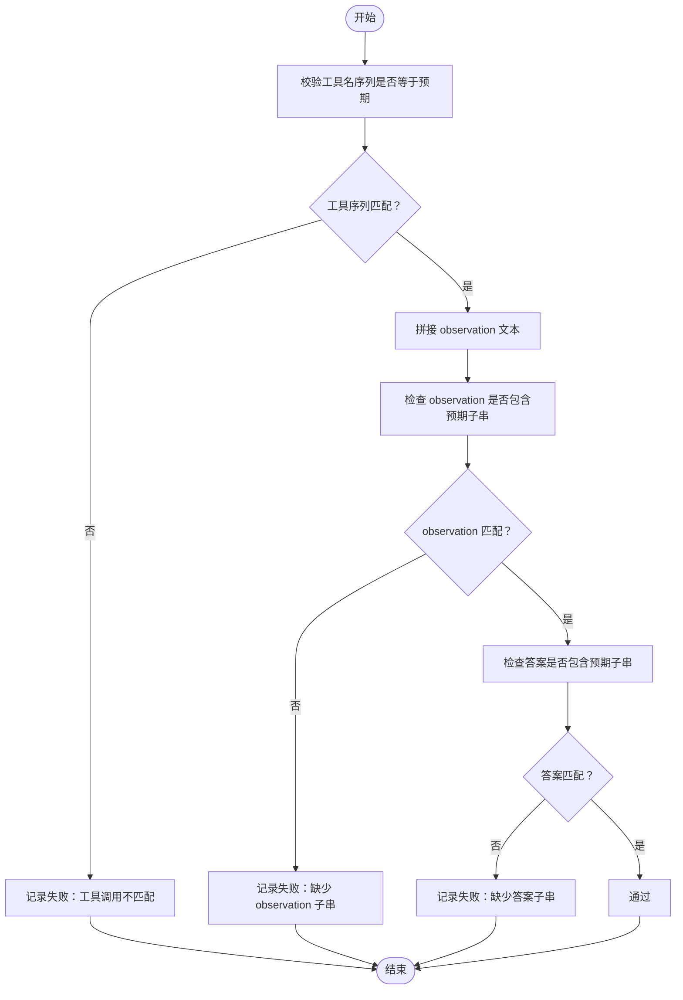
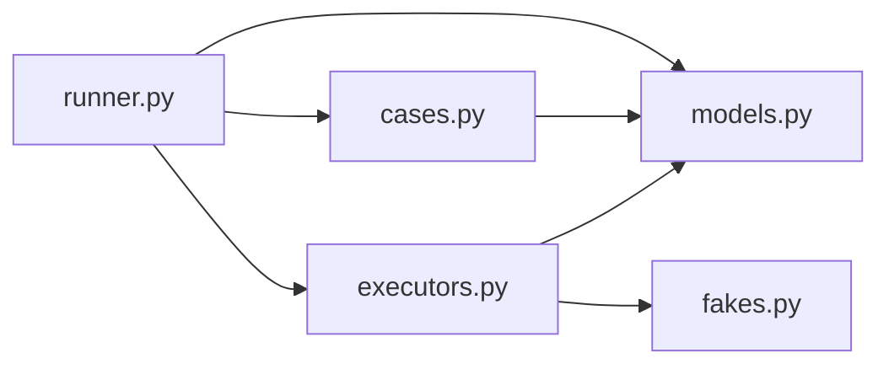

# 数据模型设计

<cite>
**本文引用的文件**   
- [models.py](file://agent_platform/evaluation/models.py)
- [cases.py](file://agent_platform/evaluation/cases.py)
- [executors.py](file://agent_platform/evaluation/executors.py)
- [runner.py](file://agent_platform/evaluation/runner.py)
- [fakes.py](file://agent_platform/evaluation/fakes.py)
</cite>

## 目录
1. [引言](#引言)
2. [项目结构](#项目结构)
3. [核心数据模型总览](#核心数据模型总览)
4. [架构分层与职责划分](#架构分层与职责划分)
5. [详细字段说明与使用场景](#详细字段说明与使用场景)
6. [不可变数据类的设计优势](#不可变数据类的设计优势)
7. [执行流程与断言逻辑](#执行流程与断言逻辑)
8. [使用示例与最佳实践](#使用示例与最佳实践)
9. [依赖关系分析](#依赖关系分析)
10. [性能与可扩展性考虑](#性能与可扩展性考虑)
11. [故障排查指南](#故障排查指南)
12. [结论](#结论)

## 引言
本文件面向评测子系统的数据模型设计，重点解释 EvaluationCase、EvaluationSuite、EvaluationExecution、EvaluationResult 和 EvaluationReport 五个核心类的职责、字段含义、类型约束和使用方式。文档同时说明“案例/套件 → 执行 → 结果/报告”的分层思想，以及 frozen=True 不可变数据类在可重复、可比较、可序列化评测系统中的价值。

## 项目结构
评测相关代码集中在 evaluation 包中：
- models.py：定义评测数据、执行观测、结果与报告的不可变数据类。
- cases.py：提供稳定的离线工具回归案例集合与默认套件。
- executors.py：实现默认执行器，将案例转换为原始执行观测。
- runner.py：串联执行、断言、报告生成，并提供控制台输出与 CLI 入口。
- fakes.py：提供无网络、确定性的 Mock 模型与替身工具，用于稳定验证 Agent 的工具路由与错误处理。

**图表来源**
- [models.py:1-83](file://agent_platform/evaluation/models.py#L1-L83)
- [cases.py:1-34](file://agent_platform/evaluation/cases.py#L1-L34)
- [executors.py:1-41](file://agent_platform/evaluation/executors.py#L1-L41)
- [runner.py:1-104](file://agent_platform/evaluation/runner.py#L1-L104)
- [fakes.py:1-98](file://agent_platform/evaluation/fakes.py#L1-L98)

**章节来源**
- [models.py:1-83](file://agent_platform/evaluation/models.py#L1-L83)
- [cases.py:1-34](file://agent_platform/evaluation/cases.py#L1-L34)
- [executors.py:1-41](file://agent_platform/evaluation/executors.py#L1-L41)
- [runner.py:1-104](file://agent_platform/evaluation/runner.py#L1-L104)
- [fakes.py:1-98](file://agent_platform/evaluation/fakes.py#L1-L98)

## 核心数据模型总览
评测系统围绕五类不可变数据对象组织数据流：
- EvaluationCase：描述一个可重复执行的 Agent 行为断言。
- EvaluationSuite：同一执行模型下的一组案例集合。
- EvaluationExecution：执行器返回的原始观测，不包含断言判断。
- EvaluationResult：单个案例的结构化结果，包含失败原因与通过状态。
- EvaluationReport：套件级完整报告，汇总通过数、失败数与元数据。

**图表来源**
- [models.py:12-83](file://agent_platform/evaluation/models.py#L12-L83)

**章节来源**
- [models.py:12-83](file://agent_platform/evaluation/models.py#L12-L83)

## 架构分层与职责划分
评测系统采用三层设计：
- 设计与声明层（Case/Suite）：用不可变数据描述“要验什么”，包括问题、场景、期望工具调用、答案与 observation 子串、标签等。
- 执行层（Execution）：由执行器负责“如何跑一个案例”，产出与断言无关的原始观测，如实际工具名序列、observation 文本、最终答案与耗时。
- 断言与报告层（Result/Report）：将 Execution 与 Case 的断言合并，生成可机器消费的结构化结果；Report 汇总套件级统计与元数据，便于 CI、JSON 或仪表盘消费。

**图表来源**
- [cases.py:12-33](file://agent_platform/evaluation/cases.py#L12-L33)
- [executors.py:17-41](file://agent_platform/evaluation/executors.py#L17-L41)
- [runner.py:23-50](file://agent_platform/evaluation/runner.py#L23-L50)
- [runner.py:53-81](file://agent_platform/evaluation/runner.py#L53-L81)

**章节来源**
- [cases.py:1-34](file://agent_platform/evaluation/cases.py#L1-L34)
- [executors.py:1-41](file://agent_platform/evaluation/executors.py#L1-L41)
- [runner.py:1-104](file://agent_platform/evaluation/runner.py#L1-L104)

## 详细字段说明与使用场景
### EvaluationCase
- id：字符串，案例唯一标识，用于报告中定位与筛选。
- question：字符串，模拟用户提问，驱动 Agent 的行为路径。
- scenario：字符串，MockScenario 取值之一，决定 fake 模型与替身工具行为（例如正常 RAG、天气、超时、报错、无需工具）。
- city：字符串，传给 fake 模型构造工具调用的参数，影响检索或天气工具的输入。
- expected_tool_names：元组，期望被调用的工具名序列；空元组表示不应调用工具。
- expected_answer_contains：元组，最终答复必须包含的子串，用于语义断言。
- expected_observation_contains：元组，工具 observation 必须包含的子串，用于断言工具回传内容。
- tags：元组，分类标签，便于按类别筛选与统计（如 rag、weather、failure、no-tool）。

典型使用场景：
- RAG 命中：指定城市与 source-id，断言检索工具被调用且答案与 observation 包含对应来源标识。
- 天气路由：断言天气工具被调用并返回模拟预报。
- 失败路径：断言超时或异常时不编造结果，而是如实说明。
- 无需工具：断言不调用任何工具，直接回答。

**章节来源**
- [models.py:12-24](file://agent_platform/evaluation/models.py#L12-L24)
- [cases.py:12-28](file://agent_platform/evaluation/cases.py#L12-L28)
- [fakes.py:18-25](file://agent_platform/evaluation/fakes.py#L18-L25)

### EvaluationSuite
- name：字符串，套件名称，用于报告标题与统计。
- cases：元组，包含多个 EvaluationCase，构成一次评测集。

典型使用场景：
- 将一组离线工具回归案例打包为 DEFAULT_OFFLINE_TOOL_SUITE，供 Runner 顺序执行。

**章节来源**
- [models.py:26-32](file://agent_platform/evaluation/models.py#L26-L32)
- [cases.py:30-33](file://agent_platform/evaluation/cases.py#L30-L33)

### EvaluationExecution
- actual_tool_names：元组，实际被调用的工具名序列，用于断言路由与调用次数。
- observations：元组，各工具返回的 observation 文本，用于断言工具回传内容。
- answer：字符串，Agent 的最终自然语言答复，用于断言答案语义。
- duration_ms：浮点数，端到端耗时（毫秒），用于性能监控与回归对比。

典型使用场景：
- 执行器从 Agent 对话轮次中提取 ToolMessage，组装为 EvaluationExecution，供 Runner 断言。

**章节来源**
- [models.py:34-42](file://agent_platform/evaluation/models.py#L34-L42)
- [executors.py:23-41](file://agent_platform/evaluation/executors.py#L23-L41)

### EvaluationResult
- case：EvaluationCase，被断言的案例本身，便于回溯。
- actual_tool_names：元组，实际工具名序列。
- observations：元组，工具 observation 文本。
- answer：字符串，最终答案。
- duration_ms：浮点数，耗时。
- failures：元组，逐项比对收集到的失败描述；空元组即通过。
- passed：属性，无失败描述即视为通过。

典型使用场景：
- Runner 将 Execution 与 Case 断言合并，生成 Result，供 Report 汇总。

**章节来源**
- [models.py:44-59](file://agent_platform/evaluation/models.py#L44-L59)
- [runner.py:34-50](file://agent_platform/evaluation/runner.py#L34-L50)

### EvaluationReport
- suite_name：字符串，套件名称。
- results：元组，EvaluationResult 集合。
- metadata：字典，扩展元数据（如环境、版本、配置摘要）。
- passed：属性，全部案例通过则为真，可作为 CLI 退出码依据。
- passed_count：属性，通过的案例数。
- failed_count：属性，失败的案例数。

典型使用场景：
- 报告可用于 CI 集成、JSON 导出或仪表盘展示；ConsoleReporter 渲染开发期可读输出。

**章节来源**
- [models.py:61-83](file://agent_platform/evaluation/models.py#L61-L83)
- [runner.py:53-81](file://agent_platform/evaluation/runner.py#L53-L81)

## 不可变数据类的设计优势
所有核心数据类均使用 frozen=True 的 dataclass，带来以下优势：
- 稳定性与可复现性：一旦创建，实例不可修改，避免在执行、断言、报告阶段被意外篡改。
- 可哈希与可缓存：适合放入集合或作为字典键，便于去重与缓存优化。
- 可比较与可序列化：天然支持相等性比较，便于单元测试与 JSON/CI 消费。
- 明确职责边界：Case/Suite 只描述断言，Execution 只承载观测，Result/Report 只承载结果与统计，降低耦合。

**章节来源**
- [models.py:12-83](file://agent_platform/evaluation/models.py#L12-L83)

## 执行流程与断言逻辑
### 执行流程
Runner 顺序执行套件内全部案例：
- 对每个案例调用执行器的 execute，得到 EvaluationExecution。
- 将 Execution 与 Case 的断言进行比对，收集 failures。
- 生成 EvaluationResult，并最终汇总为 EvaluationReport。

**图表来源**
- [runner.py:29-50](file://agent_platform/evaluation/runner.py#L29-L50)
- [executors.py:23-41](file://agent_platform/evaluation/executors.py#L23-L41)
- [fakes.py:28-98](file://agent_platform/evaluation/fakes.py#L28-L98)

### 断言逻辑
_collect_failures 将实际观测与案例断言逐项比对：
- 工具名序列要求完全相等：既校验路由选择，也校验调用次数。
- observation 文本需包含预期子串。
- 最终答案需包含预期子串。
- 任一不满足则记录失败描述；空列表即通过。

**图表来源**
- [runner.py:84-103](file://agent_platform/evaluation/runner.py#L84-L103)

**章节来源**
- [runner.py:84-103](file://agent_platform/evaluation/runner.py#L84-L103)

## 使用示例与最佳实践
### 构建案例与套件
- 使用 EvaluationCase 定义案例，确保 id 唯一、scenario 与 city 与断言一致。
- 将多个案例组合为 EvaluationSuite，命名为具有业务意义的套件名。

最佳实践：
- 为不同能力域（RAG、天气、错误处理）设置 tags，便于统计与筛选。
- 对于无需工具的场景，expected_tool_names 设为空元组，避免误判。

**章节来源**
- [cases.py:12-33](file://agent_platform/evaluation/cases.py#L12-L33)

### 执行与断言
- 使用 OfflineToolCaseExecutor 执行案例，得到 EvaluationExecution。
- 使用 EvaluationRunner 自动断言并生成 EvaluationResult。
- 使用 ConsoleReporter 查看终端输出，或通过 EvaluationReport 的属性获取统计。

最佳实践：
- 在 CI 中使用 run_evaluation 的布尔返回值控制退出码。
- 通过 EvaluationReport.metadata 注入环境信息（如 Python 版本、LangChain 版本、工具超时配置）。

**章节来源**
- [executors.py:17-41](file://agent_platform/evaluation/executors.py#L17-L41)
- [runner.py:23-81](file://agent_platform/evaluation/runner.py#L23-L81)

### 替换执行器与报告器
- 自定义 EvaluationCaseExecutor 以接入真实模型或其他装配方式。
- 自定义 Reporter 以输出 JSON、CSV 或对接仪表盘。

最佳实践：
- 保持 execute 契约不变，仅替换内部装配逻辑。
- 报告器应消费 EvaluationReport，避免直接解析中间结构。

**章节来源**
- [runner.py:17-21](file://agent_platform/evaluation/runner.py#L17-L21)
- [runner.py:53-81](file://agent_platform/evaluation/runner.py#L53-L81)

## 依赖关系分析

**图表来源**
- [cases.py:9-33](file://agent_platform/evaluation/cases.py#L9-L33)
- [executors.py:7-14](file://agent_platform/evaluation/executors.py#L7-L14)
- [runner.py:12-14](file://agent_platform/evaluation/runner.py#L12-L14)

**章节来源**
- [cases.py:1-34](file://agent_platform/evaluation/cases.py#L1-L34)
- [executors.py:1-41](file://agent_platform/evaluation/executors.py#L1-L41)
- [runner.py:1-104](file://agent_platform/evaluation/runner.py#L1-L104)

## 性能与可扩展性考虑
- 执行器每案例独立组装注册表与 Agent，互不污染，保证结果可复现。
- 使用 perf_counter 测量端到端耗时，便于性能回归检测。
- 通过 Protocol 抽象 EvaluationCaseExecutor，便于替换执行后端。
- Report 提供 passed_count 与 failed_count，便于快速统计与可视化。

建议：
- 对大规模套件，考虑并行执行与结果聚合，但需注意共享状态隔离。
- 将 metadata 扩展为结构化对象，便于跨平台消费。

**章节来源**
- [executors.py:23-41](file://agent_platform/evaluation/executors.py#L23-L41)
- [runner.py:23-32](file://agent_platform/evaluation/runner.py#L23-L32)
- [models.py:61-83](file://agent_platform/evaluation/models.py#L61-L83)

## 故障排查指南
常见问题与定位方法：
- 工具调用不匹配：检查 scenario 与 city 是否与预期一致；确认 fakes.py 中的 MockScenario 分支是否正确。
- observation 缺失子串：检查工具实现是否返回预期文本；必要时调整 expected_observation_contains。
- 答案缺失子串：检查 final_answer 构造逻辑；确认断言子串与实际措辞一致。
- 超时或错误路径未触发：确认 fakes.py 中 timeout/error 分支是否生效；检查工具超时配置。

参考位置：
- 断言逻辑：_collect_failures
- Mock 工具与模型：create_mock_tool_registry、create_mock_model

**章节来源**
- [runner.py:84-103](file://agent_platform/evaluation/runner.py#L84-L103)
- [fakes.py:28-98](file://agent_platform/evaluation/fakes.py#L28-L98)

## 结论
评测数据模型通过不可变数据类与清晰分层，实现了“断言—执行—结果—报告”的可复用、可比较、可消费的流水线。EvaluationCase/EvaluationSuite 描述断言，EvaluationExecution 承载观测，EvaluationResult/EvaluationReport 汇总结果与统计。配合 fakes.py 的确定性 Mock，评测可在无网络环境下稳定运行，便于回归测试与 CI 集成。通过 Protocol 与可替换执行器/报告器，系统具备良好的扩展性与可维护性。