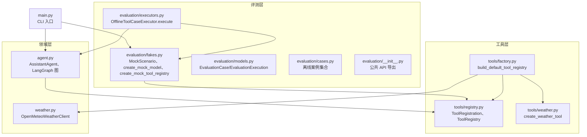
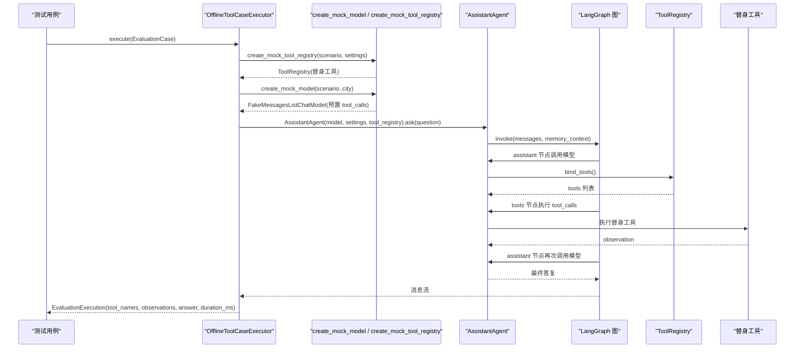
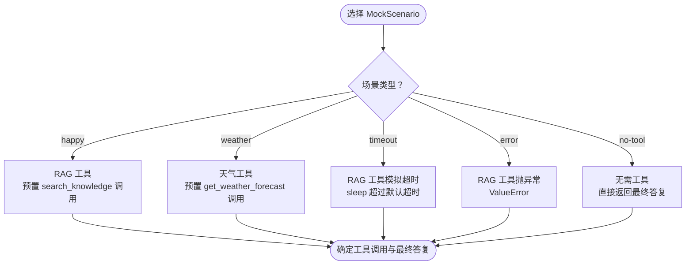
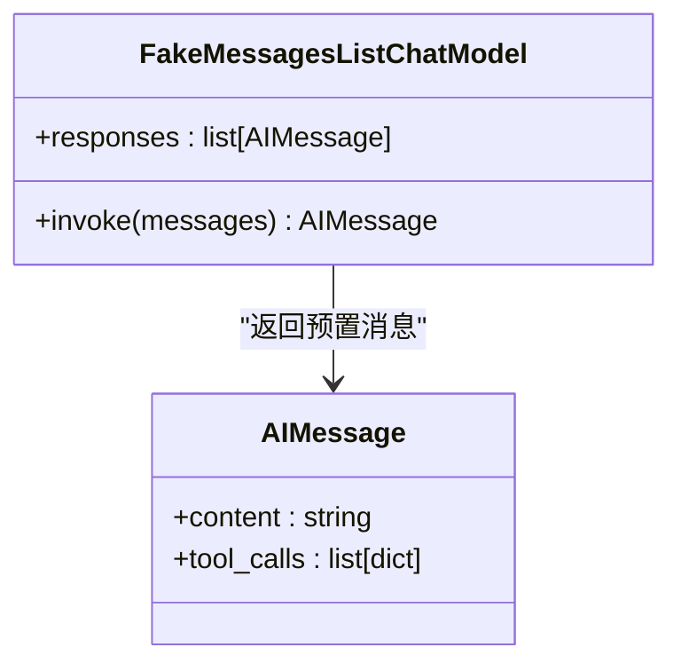
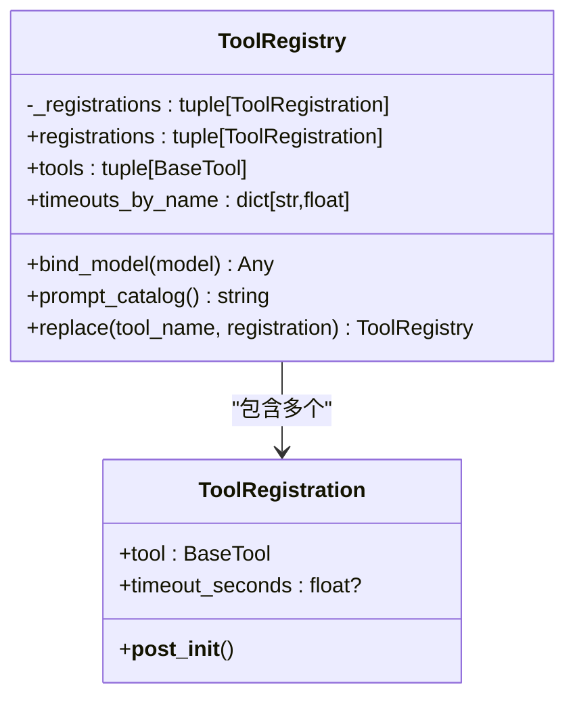
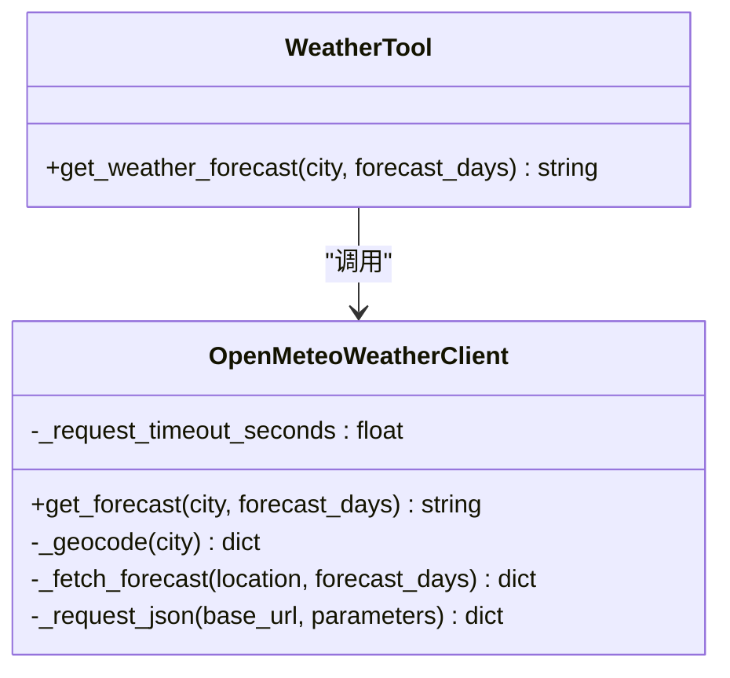
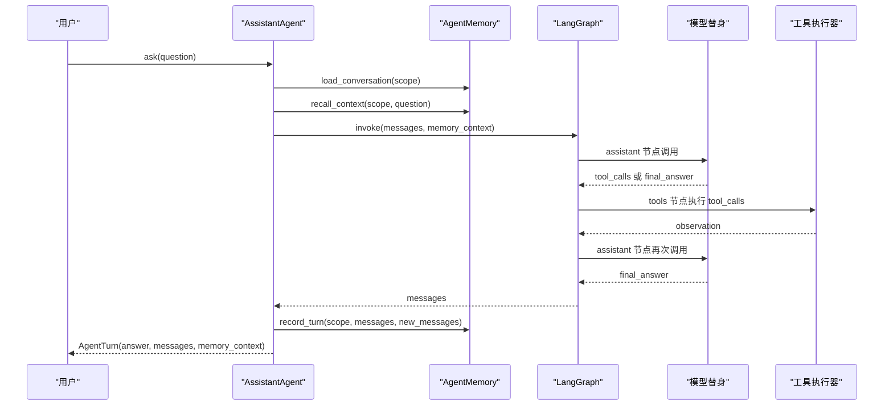
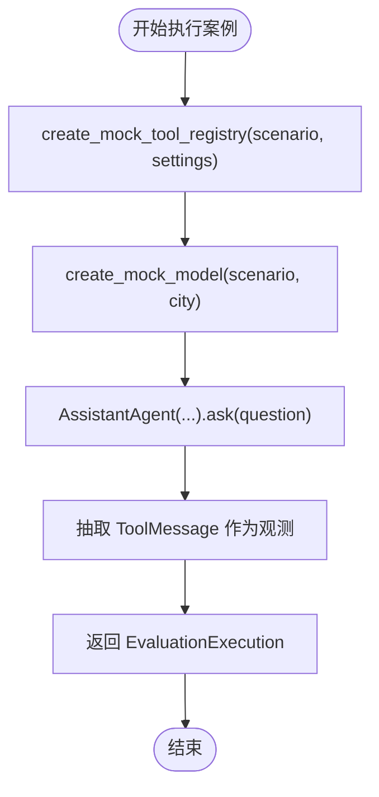
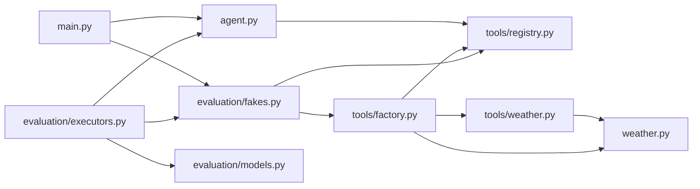

# 模拟对象与替身

<cite>
**本文引用的文件**   
- [fakes.py](file://agent_platform/evaluation/fakes.py)
- [registry.py](file://agent_platform/tools/registry.py)
- [factory.py](file://agent_platform/tools/factory.py)
- [weather.py](file://agent_platform/tools/weather.py)
- [weather_client.py](file://agent_platform/weather.py)
- [agent.py](file://agent_platform/agent.py)
- [executors.py](file://agent_platform/evaluation/executors.py)
- [models.py](file://agent_platform/evaluation/models.py)
- [cases.py](file://agent_platform/evaluation/cases.py)
- [__init__.py](file://agent_platform/evaluation/__init__.py)
- [main.py](file://main.py)
</cite>

## 目录
1. [引言](#引言)
2. [项目结构](#项目结构)
3. [核心组件](#核心组件)
4. [架构总览](#架构总览)
5. [详细组件分析](#详细组件分析)
6. [依赖关系分析](#依赖关系分析)
7. [性能与稳定性考虑](#性能与稳定性考虑)
8. [故障排查指南](#故障排查指南)
9. [结论](#结论)
10. [附录：自定义替身开发指南](#附录自定义替身开发指南)

## 引言
本文件围绕“模拟对象与替身”主题，系统化说明如何在无网络环境下对 Agent、工具链和外部 API 进行稳定、可重复的单元测试。重点包括：
- 通过 `MockScenario` 枚举控制不同离线场景的行为分支。
- 使用 `FakeMessagesListChatModel` 驱动模型输出预置的工具调用和最终答复。
- 通过 `ToolRegistry.replace` 替换 RAG 或天气工具为替身实现。
- 在评测执行器中组装 fake 模型与替身注册表，断言工具调用序列、observation 文本和最终答案。
- 提供扩展自定义替身的协议要求和常见模式，避免外部依赖影响测试结果。

## 项目结构
与替身系统直接相关的代码主要分布在以下模块：
- `agent_platform/evaluation/fakes.py`：定义 `MockScenario`、构造 fake 模型与替身工具注册表。
- `agent_platform/tools/registry.py`：定义 `ToolRegistration`、`ToolRegistry`，提供不可变注册表和替换能力。
- `agent_platform/tools/factory.py`：默认工具组合根，支持注入知识库和天气客户端替身。
- `agent_platform/tools/weather.py`：天气工具的 LangChain 适配层。
- `agent_platform/weather.py`：真实天气客户端，封装 Open-Meteo 网络请求。
- `agent_platform/agent.py`：Agent 编排，绑定工具、记忆、LangGraph 图和执行器。
- `agent_platform/evaluation/executors.py`：评测执行器，按案例组装 fake 模型与替身注册表并回收观测。
- `agent_platform/evaluation/models.py`：评测数据模型，描述案例、执行结果和报告。
- `agent_platform/evaluation/cases.py`：离线回归案例集合入口。
- `agent_platform/evaluation/__init__.py`：评测公共 API 导出。
- `main.py`：CLI 入口，演示 mock 与真实模式的切换。

**图表来源**
- [fakes.py:1-98](file://agent_platform/evaluation/fakes.py#L1-L98)
- [executors.py:20-40](file://agent_platform/evaluation/executors.py#L20-L40)
- [models.py:12-36](file://agent_platform/evaluation/models.py#L12-L36)
- [cases.py:1-9](file://agent_platform/evaluation/cases.py#L1-L9)
- [registry.py:15-94](file://agent_platform/tools/registry.py#L15-L94)
- [factory.py:18-36](file://agent_platform/tools/factory.py#L18-L36)
- [weather.py:13-25](file://agent_platform/tools/weather.py#L13-L25)
- [weather_client.py:59-131](file://agent_platform/weather.py#L59-L131)
- [agent.py:35-142](file://agent_platform/agent.py#L35-L142)
- [main.py:60-94](file://main.py#L60-L94)

**章节来源**
- [fakes.py:1-98](file://agent_platform/evaluation/fakes.py#L1-L98)
- [registry.py:15-94](file://agent_platform/tools/registry.py#L15-L94)
- [factory.py:18-36](file://agent_platform/tools/factory.py#L18-L36)
- [weather.py:13-25](file://agent_platform/tools/weather.py#L13-L25)
- [weather_client.py:59-131](file://agent_platform/weather.py#L59-L131)
- [agent.py:35-142](file://agent_platform/agent.py#L35-L142)
- [executors.py:20-40](file://agent_platform/evaluation/executors.py#L20-L40)
- [models.py:12-36](file://agent_platform/evaluation/models.py#L12-L36)
- [cases.py:1-9](file://agent_platform/evaluation/cases.py#L1-L9)
- [__init__.py:1-29](file://agent_platform/evaluation/__init__.py#L1-L29)
- [main.py:60-94](file://main.py#L60-L94)

## 核心组件
本节聚焦替身系统的核心构件及其职责：
- `MockScenario`：五种离线场景的类型别名，用于统一控制 fake 模型与替身工具行为。
- `create_mock_model`：基于 `FakeMessagesListChatModel` 预置两段 AI 消息，第一条触发工具调用，第二条给出最终答复。
- `create_mock_tool_registry`：复制默认工具注册表，按场景替换 RAG 或天气工具为替身实现。
- `ToolRegistry`：不可变工具集合，提供工具列表、超时映射、Prompt 目录生成、模型绑定和替换能力。
- `ToolRegistration`：一个工具与其运行策略（名称、描述、超时）。
- `build_default_tool_registry`：默认工具组合根，将 RAG 与天气工具装配成注册表，支持注入替身客户端。
- `OpenMeteoWeatherClient`：真实天气客户端，封装地理编码与预报查询，所有异常收敛为 `WeatherServiceError`。
- `AssistantAgent`：Agent 编排，绑定模型与工具，驱动 LangGraph 循环，串行更新短期与长期记忆。
- `OfflineToolCaseExecutor`：评测执行器，按案例组装 fake 模型与替身注册表，回收工具名序列与 observation 文本。

**章节来源**
- [fakes.py:18-98](file://agent_platform/evaluation/fakes.py#L18-L98)
- [registry.py:15-94](file://agent_platform/tools/registry.py#L15-L94)
- [factory.py:18-36](file://agent_platform/tools/factory.py#L18-L36)
- [weather_client.py:55-131](file://agent_platform/weather.py#L55-L131)
- [agent.py:35-142](file://agent_platform/agent.py#L35-L142)
- [executors.py:20-40](file://agent_platform/evaluation/executors.py#L20-L40)

## 架构总览
替身系统通过“模型替身 + 工具替身 + 评测执行器”三层协作，在不依赖外部 LLM 和网络的情况下完成 Agent 行为验证。

**图表来源**
- [executors.py:20-40](file://agent_platform/evaluation/executors.py#L20-L40)
- [fakes.py:28-98](file://agent_platform/evaluation/fakes.py#L28-L98)
- [agent.py:84-142](file://agent_platform/agent.py#L84-L142)
- [registry.py:56-65](file://agent_platform/tools/registry.py#L56-L65)

## 详细组件分析

### MockScenario 与场景控制
`MockScenario` 是五种离线场景的类型别名，决定 fake 模型与替身工具的行为分支：
- `happy`：正常 RAG 检索，最终答复引用知识库 source-id。
- `weather`：天气工具调用，最终答复声明已查询天气。
- `timeout`：RAG 工具模拟超时，最终答复说明未编造结果。
- `error`：RAG 工具抛出异常，最终答复说明查询失败。
- `no-tool`：无需工具，直接返回最终答复。

这些场景由 `create_mock_tool_registry` 与 `create_mock_model` 共同配合：前者替换工具实现，后者预置工具调用与最终答复。

**图表来源**
- [fakes.py:18-98](file://agent_platform/evaluation/fakes.py#L18-L98)

**章节来源**
- [fakes.py:18-98](file://agent_platform/evaluation/fakes.py#L18-L98)

### FakeMessagesListChatModel 驱动的模型替身
`create_mock_model` 使用 `FakeMessagesListChatModel` 预置两条 AI 消息：
- 第一条包含 `tool_calls`，驱动 LangGraph 进入 `tools` 节点。
- 第二条为最终答复，内容根据场景与城市参数构造。

该替身不依赖真实 LLM，确保每次测试都走相同路径，便于断言工具调用顺序与最终答案。

**图表来源**
- [fakes.py:59-98](file://agent_platform/evaluation/fakes.py#L59-L98)

**章节来源**
- [fakes.py:59-98](file://agent_platform/evaluation/fakes.py#L59-L98)

### ToolRegistry 与替身工具替换
`ToolRegistry` 是不可变工具集合，提供：
- `tools`：供模型绑定的 LangChain 工具列表。
- `timeouts_by_name`：显式配置超时的工具映射。
- `prompt_catalog`：动态生成模型可见的工具目录。
- `bind_model`：安全绑定模型，兼容不支持绑定的测试替身。
- `replace`：返回替换指定工具后的新注册表，供 mock 与集成测试注入替身。

替身工具通过 `@tool` 装饰器创建，并使用 `ToolRegistration` 包装，以携带超时策略。

**图表来源**
- [registry.py:15-94](file://agent_platform/tools/registry.py#L15-L94)

**章节来源**
- [registry.py:15-94](file://agent_platform/tools/registry.py#L15-L94)

### 天气工具与真实客户端
天气工具通过 `create_weather_tool` 将 `OpenMeteoWeatherClient` 包装为 LangChain 工具，并标记专用超时覆盖默认值。真实客户端负责：
- 地理编码：城市名 → 经纬度。
- 预报查询：坐标 → 逐日天气数据。
- 数据校验与格式化：统一抛出 `WeatherServiceError`。

替身场景中，`create_mock_tool_registry` 会替换 `get_weather_forecast` 为本地固定返回，避免网络调用。

**图表来源**
- [weather_client.py:59-131](file://agent_platform/weather.py#L59-L131)
- [weather.py:13-25](file://agent_platform/tools/weather.py#L13-L25)

**章节来源**
- [weather_client.py:59-131](file://agent_platform/weather.py#L59-L131)
- [weather.py:13-25](file://agent_platform/tools/weather.py#L13-L25)

### Agent 编排与 LangGraph 流程
`AssistantAgent` 负责：
- 构造函数注入模型、设置、工具注册表、记忆与作用域。
- 绑定工具 Schema，使模型能发起结构化工具调用。
- 构建 LangGraph 状态图：assistant → tools → assistant → END。
- 执行一轮问答：加载短期历史、召回长期记忆、驱动图循环、写回记忆、提取最终答复。

**图表来源**
- [agent.py:84-142](file://agent_platform/agent.py#L84-L142)

**章节来源**
- [agent.py:84-142](file://agent_platform/agent.py#L84-L142)

### 评测执行器与断言回收
`OfflineToolCaseExecutor.execute` 按案例场景组装 fake 模型与替身工具，跑一轮问答并回收原始观测：
- 每个案例独立组装注册表与 Agent，互不污染，结果可复现。
- 抽取 `ToolMessage` 作为观测：工具名序列与 observation 文本是断言对象。
- 返回 `EvaluationExecution`，包含实际工具名、observation、最终答案与耗时。

**图表来源**
- [executors.py:20-40](file://agent_platform/evaluation/executors.py#L20-L40)

**章节来源**
- [executors.py:20-40](file://agent_platform/evaluation/executors.py#L20-L40)

## 依赖关系分析
替身系统的依赖关系如下：
- `evaluation/fakes.py` 依赖 `tools/registry.py`、`tools/factory.py`、`config`。
- `tools/factory.py` 依赖 `tools/registry.py`、`tools/weather.py`、`weather.py`、`rag.py`。
- `tools/weather.py` 依赖 `weather.py`、`tools/registry.py`。
- `agent.py` 依赖 `tools/registry.py`、`memory`、`config`。
- `evaluation/executors.py` 依赖 `evaluation/fakes.py`、`agent.py`、`evaluation/models.py`。
- `main.py` 依赖 `evaluation/fakes.py`、`agent.py`、`memory`。

**图表来源**
- [fakes.py:1-98](file://agent_platform/evaluation/fakes.py#L1-L98)
- [registry.py:15-94](file://agent_platform/tools/registry.py#L15-L94)
- [factory.py:18-36](file://agent_platform/tools/factory.py#L18-L36)
- [weather.py:13-25](file://agent_platform/tools/weather.py#L13-L25)
- [weather_client.py:59-131](file://agent_platform/weather.py#L59-L131)
- [agent.py:35-142](file://agent_platform/agent.py#L35-L142)
- [executors.py:20-40](file://agent_platform/evaluation/executors.py#L20-L40)
- [models.py:12-36](file://agent_platform/evaluation/models.py#L12-L36)
- [main.py:60-94](file://main.py#L60-L94)

**章节来源**
- [fakes.py:1-98](file://agent_platform/evaluation/fakes.py#L1-L98)
- [registry.py:15-94](file://agent_platform/tools/registry.py#L15-L94)
- [factory.py:18-36](file://agent_platform/tools/factory.py#L18-L36)
- [weather.py:13-25](file://agent_platform/tools/weather.py#L13-L25)
- [weather_client.py:59-131](file://agent_platform/weather.py#L59-L131)
- [agent.py:35-142](file://agent_platform/agent.py#L35-L142)
- [executors.py:20-40](file://agent_platform/evaluation/executors.py#L20-L40)
- [models.py:12-36](file://agent_platform/evaluation/models.py#L12-L36)
- [main.py:60-94](file://main.py#L60-L94)

## 性能与稳定性考虑
- **确定性**：fake 模型预置固定响应，避免 LLM 随机性导致测试不稳定。
- **隔离性**：每个评测案例独立组装注册表与 Agent，避免跨案例污染。
- **超时控制**：天气工具标记专用超时，RAG 工具在 timeout 场景模拟延迟，确保执行器超时路径被触发。
- **错误收敛**：真实天气客户端统一抛出 `WeatherServiceError`，便于上层捕获与断言。
- **无网络依赖**：替身工具与 fake 模型完全本地化，适合 CI 环境运行。

[本节为通用指导，不涉及具体文件分析]

## 故障排查指南
常见问题与定位方法：
- **工具名不一致**：`ToolRegistry.replace` 要求替换工具名与目标一致，否则抛出 `ValueError`。
- **工具未注册**：替换时若目标工具不存在，抛出 `KeyError`。
- **超时配置无效**：`ToolRegistration.__post_init__` 校验超时必须大于 0。
- **模型不支持绑定**：`ToolRegistry.bind_model` 对不支持绑定的测试替身保持原样。
- **天气服务异常**：真实客户端抛出 `WeatherServiceError`，检查城市名、forecast_days 范围与网络响应格式。

**章节来源**
- [registry.py:22-25](file://agent_platform/tools/registry.py#L22-L25)
- [registry.py:77-93](file://agent_platform/tools/registry.py#L77-L93)
- [registry.py:56-65](file://agent_platform/tools/registry.py#L56-L65)
- [weather_client.py:67-131](file://agent_platform/weather.py#L67-L131)

## 结论
通过 `MockScenario`、`FakeMessagesListChatModel`、`ToolRegistry.replace` 与评测执行器的协作，项目实现了在无网络环境下对 Agent 工具路由、observation 与最终答复的稳定断言。该设计避免了外部 LLM 与第三方 API 的不确定性，提升了测试的可重复性与可维护性。扩展自定义替身时，遵循 `ToolRegistration` 协议与 `ToolRegistry` 替换模式即可无缝接入现有体系。

[本节为总结性内容，不涉及具体文件分析]

## 附录：自定义替身开发指南

### 实现协议要求
- **工具替身**：使用 `@tool` 装饰器定义函数，并通过 `ToolRegistration` 包装，携带超时策略。
- **模型替身**：继承或复用 `FakeMessagesListChatModel`，预置 `AIMessage` 列表，第一条包含 `tool_calls`，第二条为最终答复。
- **注册表替换**：使用 `ToolRegistry.replace` 返回新注册表，确保工具名一致且目标存在。

### 常见模式
- **RAG 替身**：模拟成功检索、超时、异常三种分支，最终答复声明证据来源或未编造结果。
- **天气替身**：返回固定格式的天气预报文本，避免网络调用。
- **无需工具**：直接返回最终答复，跳过工具调用路径。

### 构建稳定测试环境
- **隔离案例**：每个案例独立组装 fake 模型与替身注册表。
- **断言观测**：抽取 `ToolMessage` 工具名与 observation 文本进行断言。
- **CI 友好**：完全本地化，无外部依赖，适合持续集成环境。

**章节来源**
- [fakes.py:28-98](file://agent_platform/evaluation/fakes.py#L28-L98)
- [registry.py:15-94](file://agent_platform/tools/registry.py#L15-L94)
- [executors.py:20-40](file://agent_platform/evaluation/executors.py#L20-L40)