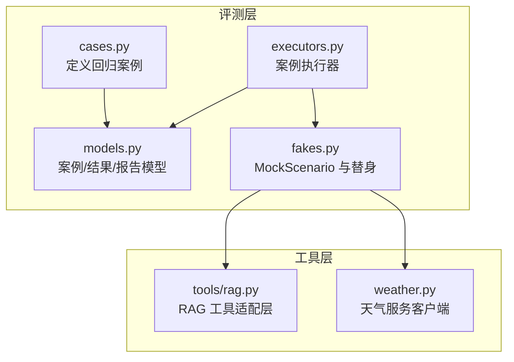
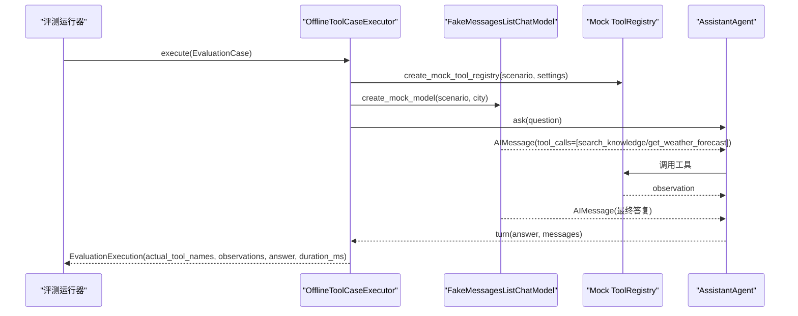
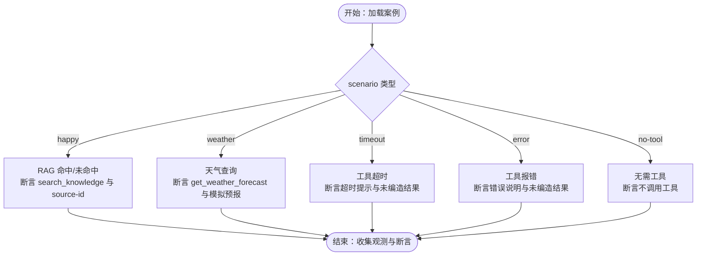
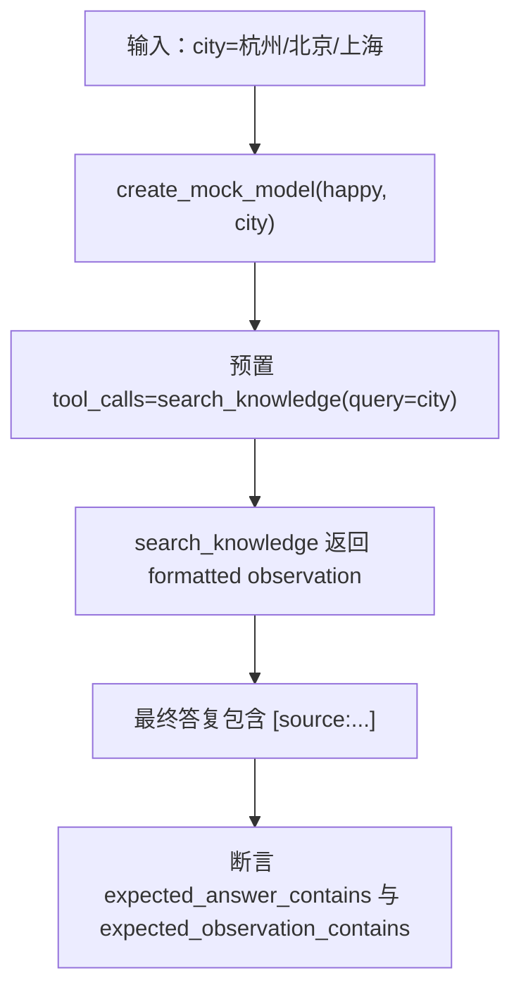
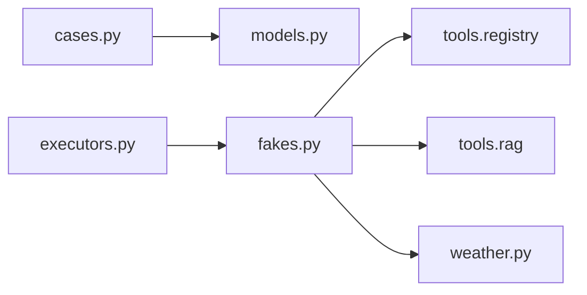

# 测试案例定义

<cite>
**本文引用的文件**   
- [cases.py](file://agent_platform/evaluation/cases.py)
- [models.py](file://agent_platform/evaluation/models.py)
- [executors.py](file://agent_platform/evaluation/executors.py)
- [fakes.py](file://agent_platform/evaluation/fakes.py)
- [rag.py](file://agent_platform/tools/rag.py)
- [weather.py](file://agent_platform/weather.py)
</cite>

## 目录
1. [引言](#引言)
2. [项目结构](#项目结构)
3. [核心组件](#核心组件)
4. [架构总览](#架构总览)
5. [详细组件分析](#详细组件分析)
6. [依赖关系分析](#依赖关系分析)
7. [性能与稳定性考量](#性能与稳定性考量)
8. [故障排查指南](#故障排查指南)
9. [结论](#结论)
10. [附录：编写新测试案例的完整流程](#附录编写新测试案例的完整流程)

## 引言
本指南面向需要为 Agent 平台编写稳定、可回归的工具调用测试案例的开发者。文档围绕“固定回归案例”的设计思路与覆盖策略展开，重点说明以下场景的实现方式与断言设计：
- RAG 命中场景
- RAG 未命中场景
- 天气查询场景
- 工具超时场景
- 工具报错场景
- 无需工具场景

同时，文档解释如何通过 scenario 参数选择 MockScenario 行为，如何设置 expected_tool_names、expected_answer_contains、expected_observation_contains 等断言条件，并给出案例命名规范、标签分类策略和大量案例的组织管理方法，确保回归测试有效且可维护。

## 项目结构
评测相关代码集中在 evaluation 包中，配合 tools 与 weather 模块提供真实或模拟的工具实现。关键文件职责如下：
- cases.py：集中定义离线工具回归案例集合与默认套件。
- models.py：定义 EvaluationCase、EvaluationSuite、Execution、Result、Report 等数据模型。
- executors.py：定义 OfflineToolCaseExecutor，负责按案例组装 fake 模型与替身工具，执行问答并回收观测。
- fakes.py：提供 MockScenario 五种行为（happy、weather、timeout、error、no-tool），以及 create_mock_model 与 create_mock_tool_registry。
- rag.py：本地知识库检索工具的适配层，构造 search_knowledge 工具及格式化 observation。
- weather.py：Open-Meteo 天气客户端与服务错误类型，用于理解天气工具的真实行为与异常边界。



**图表来源**
- [cases.py:12-33](file://agent_platform/evaluation/cases.py#L12-L33)
- [models.py:12-82](file://agent_platform/evaluation/models.py#L12-L82)
- [executors.py:17-40](file://agent_platform/evaluation/executors.py#L17-L40)
- [fakes.py:18-56](file://agent_platform/evaluation/fakes.py#L18-L56)
- [rag.py:14-26](file://agent_platform/tools/rag.py#L14-L26)
- [weather.py:55-78](file://agent_platform/weather.py#L55-L78)

**章节来源**
- [cases.py:1-34](file://agent_platform/evaluation/cases.py#L1-L34)
- [models.py:1-83](file://agent_platform/evaluation/models.py#L1-L83)
- [executors.py:1-41](file://agent_platform/evaluation/executors.py#L1-L41)
- [fakes.py:1-98](file://agent_platform/evaluation/fakes.py#L1-L98)
- [rag.py:1-36](file://agent_platform/tools/rag.py#L1-L36)
- [weather.py:1-175](file://agent_platform/weather.py#L1-L175)

## 核心组件
- EvaluationCase：描述一个可重复执行的 Agent 行为断言，包含 id、question、scenario、city、expected_tool_names、expected_answer_contains、expected_observation_contains、tags。
- EvaluationSuite：同一执行模型下的一组评测案例。
- OfflineToolCaseExecutor：默认执行器，使用确定性 fake 验证工具编排，不访问网络；按 case.scenario 创建 mock 模型与替身工具，执行 ask 并收集 tool_messages 作为观测。
- MockScenario：五种离线场景常量 happy、weather、timeout、error、no-tool，决定 fake 模型与替身工具的行为。
- create_mock_tool_registry：复制默认注册表，替换当前离线场景需要模拟的单个工具（如 search_knowledge、get_weather_forecast）。
- create_mock_model：预置两段回复驱动 LangGraph 完成 assistant→tools→assistant 循环，并根据 scenario 与 city 生成最终答复。

**章节来源**
- [models.py:12-32](file://agent_platform/evaluation/models.py#L12-L32)
- [executors.py:17-40](file://agent_platform/evaluation/executors.py#L17-L40)
- [fakes.py:18-98](file://agent_platform/evaluation/fakes.py#L18-L98)

## 架构总览
评测执行的关键流程如下：
1. 从 cases.py 加载 EvaluationCase 列表。
2. 执行器根据 case.scenario 调用 create_mock_tool_registry 与 create_mock_model。
3. AssistantAgent 接收 question，由 fake model 返回第一段带 tool_calls 的消息，进入工具节点。
4. 替身工具返回 observation，第二段消息给出最终答复。
5. 执行器抽取 ToolMessage 序列，得到 actual_tool_names 与 observations，并记录 answer 与耗时。
6. runner 将 Execution 与断言合并为 Result/Report，供 CI 或仪表盘消费。



**图表来源**
- [executors.py:23-40](file://agent_platform/evaluation/executors.py#L23-L40)
- [fakes.py:28-98](file://agent_platform/evaluation/fakes.py#L28-L98)

**章节来源**
- [executors.py:17-40](file://agent_platform/evaluation/executors.py#L17-L40)
- [fakes.py:28-98](file://agent_platform/evaluation/fakes.py#L28-L98)

## 详细组件分析

### 固定回归案例设计与覆盖策略
cases.py 定义了 OFFLINE_TOOL_CASES，覆盖以下关键路径：
- RAG 命中：杭州、北京、上海分别命中不同 source-id，断言 expected_answer_contains 与 expected_observation_contains 均包含对应 [source:...].
- 天气路由：weather 场景应调用 get_weather_forecast，并在 final answer 与 observation 中包含模拟预报文本。
- 重复问法：同一城市不同措辞应稳定命中同一来源，保证检索一致性。
- 失败路径：miss（未收录）、timeout（超时）、error（报错）都应如实说明，而非编造结果。
- 无需工具：no-tool 场景不应调用任何工具，直接回答。



**图表来源**
- [cases.py:12-28](file://agent_platform/evaluation/cases.py#L12-L28)
- [fakes.py:18-98](file://agent_platform/evaluation/fakes.py#L18-L98)

**章节来源**
- [cases.py:12-28](file://agent_platform/evaluation/cases.py#L12-L28)

### 通过 scenario 参数选择 MockScenario 行为
MockScenario 支持五种值：
- happy：正常 RAG 检索，依据 city 映射到 _SOURCE_IDS，生成含 [source:...] 的最终答复。
- weather：预置一次 get_weather_forecast 工具调用，最终答复声明证据来源。
- timeout：替换 search_knowledge 为 sleep 超过默认超时，触发超时路径。
- error：替换 search_knowledge 抛出 ValueError，触发错误处理路径。
- no-tool：直接返回无需查询的模拟回复，不调用工具。

create_mock_tool_registry 与 create_mock_model 共同决定：
- 工具侧：替换 search_knowledge 或 get_weather_forecast 的行为。
- 模型侧：预置两段 AIMessage，第一段驱动工具调用，第二段给出最终答复。

```mermaid
classDiagram
class MockScenario {
<<literal>>
"happy"
"weather"
"timeout"
"error"
"no-tool"
}
class FakeMessagesListChatModel {
+responses : list[AIMessage]
}
class ToolRegistry {
+replace(name, registration)
}
class create_mock_tool_registry {
+create_mock_tool_registry(scenario, settings) ToolRegistry
}
class create_mock_model {
+create_mock_model(scenario, city) FakeMessagesListChatModel
}
create_mock_tool_registry --> ToolRegistry : "替换工具"
create_mock_model --> FakeMessagesListChatModel : "预置两段回复"
MockScenario <.. create_mock_tool_registry : "决定替换逻辑"
MockScenario <.. create_mock_model : "决定工具调用与最终答复"
```

**图表来源**
- [fakes.py:18-98](file://agent_platform/evaluation/fakes.py#L18-L98)

**章节来源**
- [fakes.py:18-98](file://agent_platform/evaluation/fakes.py#L18-L98)

### 断言条件设置：expected_tool_names、expected_answer_contains、expected_observation_contains
- expected_tool_names：期望实际调用的工具名序列。空 tuple 表示不应调用工具。
- expected_answer_contains：最终答复必须包含的子串。
- expected_observation_contains：工具 observation 必须包含的子串。

在 cases.py 中，每个 EvaluationCase 明确指定这些字段，例如：
- RAG 命中：expected_tool_names=("search_knowledge",)，expected_answer_contains 与 expected_observation_contains 包含对应 [source:...]。
- 天气查询：expected_tool_names=("get_weather_forecast",)，answer 与 observation 包含模拟预报文本。
- 超时/报错：answer 包含“超时/错误”说明，observation 包含“工具超时/工具错误”。
- 无需工具：expected_tool_names=()，answer 包含“无需查询”。

**章节来源**
- [cases.py:12-28](file://agent_platform/evaluation/cases.py#L12-L28)
- [models.py:12-23](file://agent_platform/evaluation/models.py#L12-L23)

### RAG 命中场景实现
- 通过 happy 场景与 city 映射到 _SOURCE_IDS，generate 最终答复包含 [source:hangzhou-west-lake]、[source:beijing-palace]、[source:shanghai-bund]。
- 工具侧 search_knowledge 返回格式化 observation，包含 [source:...] 标识与片段内容。
- 断言 expected_answer_contains 与 expected_observation_contains 均匹配对应 source-id。



**图表来源**
- [fakes.py:59-98](file://agent_platform/evaluation/fakes.py#L59-L98)
- [rag.py:14-36](file://agent_platform/tools/rag.py#L14-L36)

**章节来源**
- [fakes.py:59-98](file://agent_platform/evaluation/fakes.py#L59-L98)
- [rag.py:14-36](file://agent_platform/tools/rag.py#L14-L36)

### RAG 未命中场景实现
- 当 city 不在 _SOURCE_IDS 时，create_mock_model 生成最终答复包含“未检索到相关资料”，强调资料不足且不编造事实。
- 工具侧 search_knowledge 在未命中时返回引导性文本，提醒模型如实说明资料不足。
- 断言 expected_answer_contains 与 expected_observation_contains 包含“未检索到相关资料”。

**章节来源**
- [fakes.py:85-92](file://agent_platform/evaluation/fakes.py#L85-L92)
- [rag.py:17-24](file://agent_platform/tools/rag.py#L17-L24)

### 天气查询场景实现
- weather 场景预置 get_weather_forecast 工具调用，最终答复声明证据来源。
- 替身工具返回模拟预报文本，包含城市、温度区间与降水概率。
- 断言 expected_tool_names=("get_weather_forecast",)，answer 与 observation 包含“已查询...天气”与“天气预报（模拟）”。

**章节来源**
- [fakes.py:44-54](file://agent_platform/evaluation/fakes.py#L44-L54)
- [fakes.py:64-73](file://agent_platform/evaluation/fakes.py#L64-L73)

### 超时场景实现
- timeout 场景替换 search_knowledge 为 sleep 超过默认超时，必然触发超时路径。
- 最终答复包含“search_knowledge 超时”，强调未编造结果。
- 断言 expected_answer_contains 包含“search_knowledge 超时”，observation 包含“工具超时”。

**章节来源**
- [fakes.py:32-42](file://agent_platform/evaluation/fakes.py#L32-L42)
- [fakes.py:81-84](file://agent_platform/evaluation/fakes.py#L81-L84)

### 错误场景实现
- error 场景替换 search_knowledge 抛出 ValueError，触发错误处理路径。
- 最终答复包含“search_knowledge 返回 ValueError”，强调未编造结果。
- 断言 expected_answer_contains 包含“search_knowledge 返回 ValueError”，observation 包含“工具错误”。

**章节来源**
- [fakes.py:32-42](file://agent_platform/evaluation/fakes.py#L32-L42)
- [fakes.py:81-84](file://agent_platform/evaluation/fakes.py#L81-L84)

### 无需工具场景实现
- no-tool 场景直接返回无需查询的模拟回复，不调用工具。
- 断言 expected_tool_names=()，answer 包含“无需查询”。

**章节来源**
- [fakes.py:59-63](file://agent_platform/evaluation/fakes.py#L59-L63)

## 依赖关系分析
评测执行链路的依赖关系如下：
- cases.py 依赖 models.py 定义 EvaluationCase/EvaluationSuite。
- executors.py 依赖 fakes.py 的 create_mock_model/create_mock_tool_registry，以及 agent 与 config。
- fakes.py 依赖 tools.registry 与 tools.rag/weather 的实际工具接口，但通过 replace 替换为替身。
- rag.py 依赖 KnowledgeBase 与 SearchResult，封装 search_knowledge 工具。
- weather.py 提供 OpenMeteoWeatherClient 与 WeatherServiceError，用于理解真实天气服务的异常边界。



**图表来源**
- [cases.py:9-33](file://agent_platform/evaluation/cases.py#L9-L33)
- [executors.py:11-14](file://agent_platform/evaluation/executors.py#L11-L14)
- [fakes.py:14-16](file://agent_platform/evaluation/fakes.py#L14-L16)
- [rag.py:8-12](file://agent_platform/tools/rag.py#L8-L12)
- [weather.py:55-78](file://agent_platform/weather.py#L55-L78)

**章节来源**
- [cases.py:9-33](file://agent_platform/evaluation/cases.py#L9-L33)
- [executors.py:11-14](file://agent_platform/evaluation/executors.py#L11-L14)
- [fakes.py:14-16](file://agent_platform/evaluation/fakes.py#L14-L16)
- [rag.py:8-12](file://agent_platform/tools/rag.py#L8-L12)
- [weather.py:55-78](file://agent_platform/weather.py#L55-L78)

## 性能与稳定性考量
- 执行器使用 perf_counter 测量端到端耗时，便于统计案例性能。
- 替身工具避免网络访问，确保离线回归稳定。
- 超时场景通过 sleep 控制触发时间，需与默认超时配置保持一致。
- 建议对大量案例进行分组与标签筛选，提升回归效率。

**章节来源**
- [executors.py:23-40](file://agent_platform/evaluation/executors.py#L23-L40)
- [fakes.py:32-42](file://agent_platform/evaluation/fakes.py#L32-L42)

## 故障排查指南
常见问题与定位方法：
- 工具未调用：检查 case.scenario 是否为 no-tool，或 expected_tool_names 是否正确。
- 答案不包含预期子串：核对 create_mock_model 生成的 final_answer 与 expected_answer_contains。
- observation 不符合预期：确认替身工具返回内容与 expected_observation_contains。
- 超时/错误路径未触发：检查 create_mock_tool_registry 是否替换了 search_knowledge，以及超时配置是否匹配。

**章节来源**
- [fakes.py:32-42](file://agent_platform/evaluation/fakes.py#L32-L42)
- [fakes.py:59-98](file://agent_platform/evaluation/fakes.py#L59-L98)

## 结论
通过 cases.py 定义的固定回归案例与 fakes.py 提供的 MockScenario，评测体系能够稳定覆盖 RAG 命中、未命中、天气查询、超时、错误与无需工具等关键路径。借助 expected_tool_names、expected_answer_contains、expected_observation_contains 等断言条件，结合 tags 分类策略，可实现高可用、可维护的回归测试套件。

## 附录：编写新测试案例的完整流程
1. 确定场景：选择 scenario（happy、weather、timeout、error、no-tool）。
2. 设计问题与城市：question 与 city 应能驱动目标工具调用。
3. 设置断言：
   - expected_tool_names：期望工具名序列。
   - expected_answer_contains：最终答复必须包含的子串。
   - expected_observation_contains：工具 observation 必须包含的子串。
   - tags：添加分类标签（如 rag、weather、failure、miss）。
4. 添加到 OFFLINE_TOOL_CASES：保持顺序清晰，注释说明覆盖点。
5. 运行回归：通过 EvaluationSuite 与执行器运行，观察 Result/Report。

最佳实践：
- 案例命名规范：使用短横线分隔的小写英文或拼音，如 rag-hangzhou、weather-beijing、rag-timeout。
- 断言设计原则：最小必要断言，聚焦关键行为（工具调用、关键子串、observation 关键字）。
- 标签分类策略：按领域（rag、weather）、状态（success、failure、miss）分类，便于统计与筛选。
- 组织与管理：按场景分组注释，保持案例数量可控，定期清理重复或过时案例。

**章节来源**
- [cases.py:12-33](file://agent_platform/evaluation/cases.py#L12-L33)
- [models.py:12-23](file://agent_platform/evaluation/models.py#L12-L23)