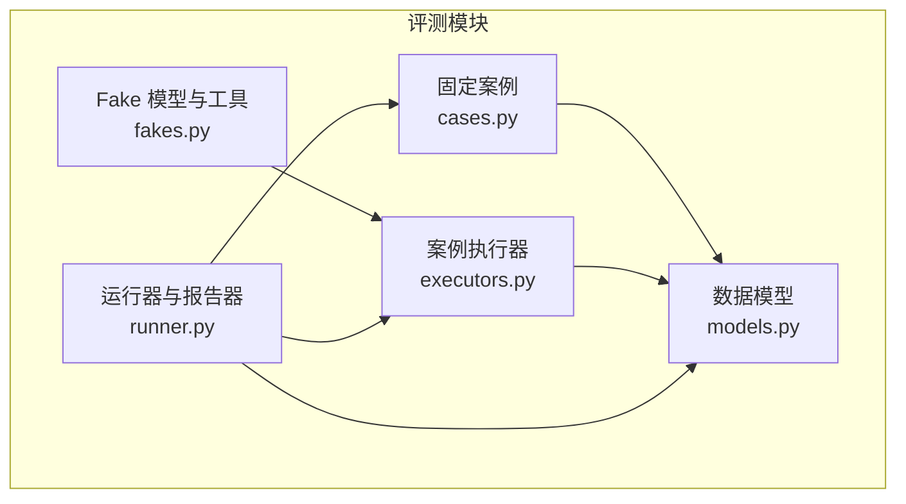
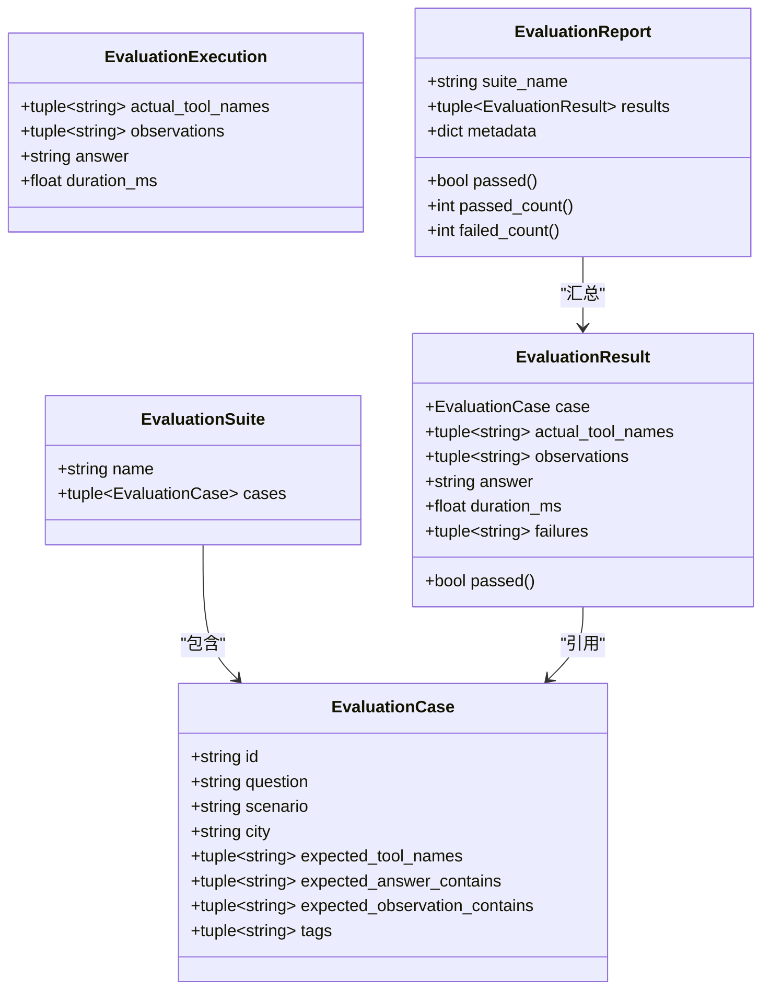
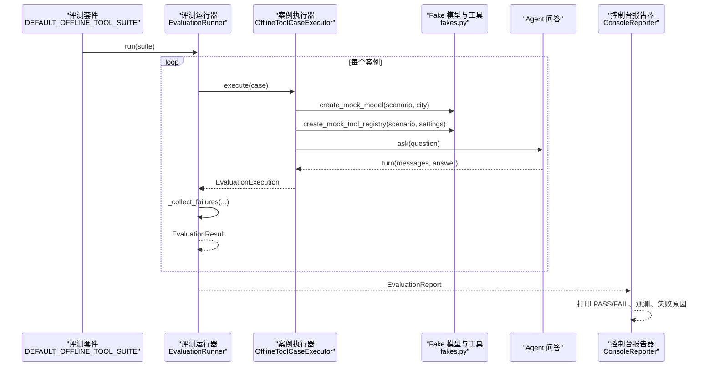
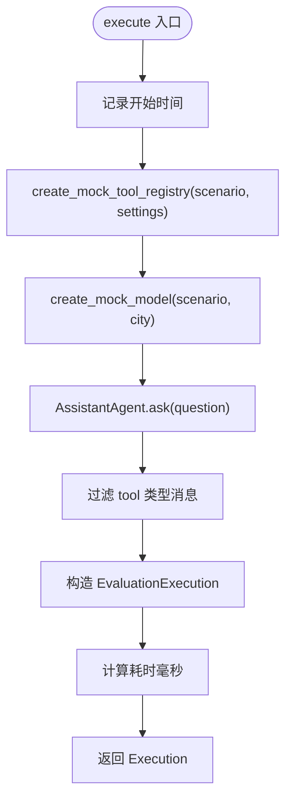
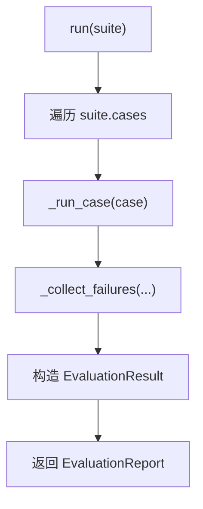
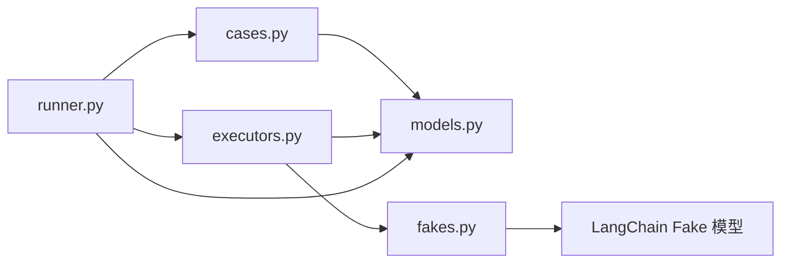

# 评测系统

<cite>
**本文引用的文件**   
- [models.py](file://agent_platform/evaluation/models.py)
- [cases.py](file://agent_platform/evaluation/cases.py)
- [executors.py](file://agent_platform/evaluation/executors.py)
- [runner.py](file://agent_platform/evaluation/runner.py)
- [fakes.py](file://agent_platform/evaluation/fakes.py)
- [README.md](file://README.md)
</cite>

## 目录
1. [引言](#引言)
2. [项目结构](#项目结构)
3. [核心数据模型](#核心数据模型)
4. [架构总览](#架构总览)
5. [详细组件分析](#详细组件分析)
6. [依赖关系分析](#依赖关系分析)
7. [性能与稳定性考量](#性能与稳定性考量)
8. [故障排查指南](#故障排查指南)
9. [结论](#结论)
10. [附录：测试编写规范与持续集成建议](#附录测试编写规范与持续集成建议)

## 引言
本评测系统围绕“可重复、可断言、可报告”的 Agent 行为验证展开。它把“要验什么”（案例）、“怎么跑一个案例”（执行器）、“如何比较结果”（运行器断言）和“如何输出报告”（报告器）解耦，从而既能用确定性 fake 做离线回归，也能替换为真实模型或后端进行基准测试。

核心目标包括：
- 明确 EvaluationSuite、EvaluationCase、EvaluationExecution 等数据模型的设计意图和使用方式。
- 说明评测运行器的案例加载、执行调度、断言比较和报告生成流程。
- 深入解析 OfflineToolCaseExecutor 的实现，展示如何使用 fakes 在无网络环境下稳定复现工具调用路径。
- 解释固定回归案例的设计思路，覆盖 RAG 命中/未命中、天气查询、超时和错误场景。
- 提供自定义评测执行器的开发指南和测试用例编写规范。
- 给出自动化测试最佳实践与持续集成建议。

## 项目结构
评测相关代码集中在 `agent_platform/evaluation` 包中，采用按职责分层的方式组织：
- 数据模型层：定义案例、套件、执行观测、结果和报告。
- 案例定义层：维护稳定的离线回归案例集合。
- 执行器层：封装“如何执行一个案例”，默认使用 fake 模型和替身工具。
- 运行器层：负责顺序执行、断言比对和结构化报告生成。
- Fake 层：提供无网络的模型回复队列和工具替身，用于稳定驱动 Agent 的工具调用路径。

**图表来源**
- [models.py:1-83](file://agent_platform/evaluation/models.py#L1-L83)
- [cases.py:1-34](file://agent_platform/evaluation/cases.py#L1-L34)
- [fakes.py:1-98](file://agent_platform/evaluation/fakes.py#L1-L98)
- [executors.py:1-41](file://agent_platform/evaluation/executors.py#L1-L41)
- [runner.py:1-104](file://agent_platform/evaluation/runner.py#L1-L104)

**章节来源**
- [README.md:19-48](file://README.md#L19-L48)
- [README.md:98-108](file://README.md#L98-L108)

## 核心数据模型
评测系统的数据模型分为三层：
- 描述层：EvaluationCase 表示单个可重复执行的 Agent 行为断言；EvaluationSuite 表示同一执行模型下的一组案例。
- 观测层：EvaluationExecution 是执行器返回的原始观测，包含实际工具名序列、observation 文本、最终答案和耗时。
- 结果层：EvaluationResult 将案例与观测合并，并记录失败描述；EvaluationReport 汇总套件级结果，并提供通过数统计。

关键设计要点：
- 所有数据类均为不可变 frozen dataclass，便于在报告中安全复用和序列化。
- EvaluationResult.passed 和 EvaluationReport.passed 以 failures 是否为空作为通过判定依据，避免业务逻辑分散。
- expected_tool_names 为空 tuple 时代表不应调用工具，适合“无需工具”的场景。
- tags 字段可用于后续按类别筛选统计，例如 rag、weather、failure 等。

**图表来源**
- [models.py:12-83](file://agent_platform/evaluation/models.py#L12-L83)

**章节来源**
- [models.py:1-83](file://agent_platform/evaluation/models.py#L1-L83)

## 架构总览
评测系统的整体流水线如下：
1. 案例加载：从 DEFAULT_OFFLINE_TOOL_SUITE 获取固定回归案例。
2. 执行调度：EvaluationRunner 顺序遍历 suite.cases，委托注入的执行器执行。
3. 原始观测回收：OfflineToolCaseExecutor 使用 fake 模型和替身工具驱动 Agent，收集 tool_messages 并构造 EvaluationExecution。
4. 断言比较：_collect_failures 逐项比对预期工具名、observation 子串和最终答案子串。
5. 报告生成：EvaluationReport 汇总每个案例的 EvaluationResult，ConsoleReporter 渲染终端可读输出。

**图表来源**
- [runner.py:23-50](file://agent_platform/evaluation/runner.py#L23-L50)
- [executors.py:17-41](file://agent_platform/evaluation/executors.py#L17-L41)
- [fakes.py:28-98](file://agent_platform/evaluation/fakes.py#L28-L98)
- [cases.py:12-34](file://agent_platform/evaluation/cases.py#L12-L34)

**章节来源**
- [runner.py:1-104](file://agent_platform/evaluation/runner.py#L1-L104)
- [executors.py:1-41](file://agent_platform/evaluation/executors.py#L1-L41)
- [fakes.py:1-98](file://agent_platform/evaluation/fakes.py#L1-L98)
- [cases.py:1-34](file://agent_platform/evaluation/cases.py#L1-L34)

## 详细组件分析

### 数据模型层：EvaluationCase、EvaluationSuite、EvaluationExecution、EvaluationResult、EvaluationReport
- EvaluationCase 聚焦“断言契约”：question 驱动输入，scenario 决定 fake 行为，city 作为工具参数，expected_* 字段表达期望。
- EvaluationSuite 聚合多个案例，便于批量运行和统一命名。
- EvaluationExecution 仅承载执行器产出的原始观测，不包含断言逻辑，保证执行器与 runner 解耦。
- EvaluationResult 将案例与观测合并，并通过 failures 暴露失败详情；passed 属性简化通过判断。
- EvaluationReport 提供 suite 级别的通过状态和计数，适合作为 CI 退出码依据。

复杂度与不变性：
- 数据结构不可变，降低并发和报告序列化时的副作用风险。
- 时间复杂度主要取决于案例数量与断言字符串匹配次数；空间复杂度与观测长度线性相关。

**章节来源**
- [models.py:12-83](file://agent_platform/evaluation/models.py#L12-L83)

### 案例定义层：固定回归案例
OFFLINE_TOOL_CASES 覆盖了以下典型场景：
- RAG 命中：杭州、北京、上海分别命中对应 source-id，断言 observation 和答案中包含相应标识。
- 天气路由：应调用 get_weather_forecast，并回传模拟预报内容。
- 重复问法：不同措辞仍应稳定命中同一来源，确保检索一致性。
- 失败路径：未收录城市、工具超时、工具报错都应如实说明，不编造结果。
- 无需工具：模型直接回答，不应强行调用工具。

DEFAULT_OFFLINE_TOOL_SUITE 将这些案例打包为可运行的套件名称 offline-tool-regression。

**章节来源**
- [cases.py:1-34](file://agent_platform/evaluation/cases.py#L1-L34)

### 执行器层：OfflineToolCaseExecutor
OfflineToolCaseExecutor 的职责是“如何跑一个案例”：
- 使用 perf_counter 测量端到端耗时。
- 根据 case.scenario 创建 mock 工具注册表和 mock 模型，确保每个案例独立装配，互不污染。
- 通过 AssistantAgent.ask 驱动 LangGraph 完成 assistant→tools→assistant 循环。
- 抽取 ToolMessage 列表，提取 actual_tool_names 和 observations，构造 EvaluationExecution。

关键点：
- 执行器与 runner 解耦：只需实现 EvaluationCaseExecutor 协议即可替换执行策略。
- 工具名序列完全相等校验，既校验路由选择也校验调用次数。
- 只抽取 tool 类型消息作为观测，避免混入普通 AIMessage 导致断言不稳定。

**图表来源**
- [executors.py:17-41](file://agent_platform/evaluation/executors.py#L17-L41)

**章节来源**
- [executors.py:1-41](file://agent_platform/evaluation/executors.py#L1-L41)

### Fake 层：无网络模型与工具替身
fakes.py 提供两类替身：
- MockScenario：happy、weather、timeout、error、no-tool 五种离线场景。
- create_mock_tool_registry：复制默认工具注册表，按需替换 search_knowledge 或 get_weather_forecast。
  - timeout/error：search_knowledge 触发超时或抛出异常，验证错误处理路径。
  - weather：get_weather_forecast 返回固定天气预报字符串。
- create_mock_model：预置两段 AI 回复，第一段带 tool_calls 驱动图进入 tools 节点，第二段为最终答复。
  - no-tool：直接返回最终答复，不调用任何工具。
  - happy/weather/timeout/error：预置一次工具调用，并根据城市和场景构造最终答案。

这种设计确保：
- 不需要网络访问，所有工具行为可预测。
- 通过固定 responses 队列稳定驱动 LangGraph 的循环。
- 支持按场景替换工具，保持断言对工具编排的强约束。

**章节来源**
- [fakes.py:1-98](file://agent_platform/evaluation/fakes.py#L1-L98)

### 运行器层：EvaluationRunner、ConsoleReporter、run_evaluation
EvaluationRunner：
- 接收可注入的 EvaluationCaseExecutor，默认使用 OfflineToolCaseExecutor。
- run 方法顺序执行 suite.cases，返回 EvaluationReport。
- _run_case 先回收 Execution，再调用 _collect_failures 生成 failures，最后组装 EvaluationResult。

ConsoleReporter：
- 逐案例打印状态、预期与实际工具、observation 和 answer。
- 末尾输出通过数汇总，便于快速定位失败案例。

run_evaluation：
- 兼容 CLI 布尔返回契约，同时支持注入新 suite。
- 内部调用 EvaluationRunner 和 ConsoleReporter，返回 report.passed。

断言比较 _collect_failures：
- 工具名序列要求完全相等。
- observation 文本需包含所有 expected_observation_contains 子串。
- 最终答案需包含所有 expected_answer_contains 子串。

**图表来源**
- [runner.py:23-50](file://agent_platform/evaluation/runner.py#L23-L50)
- [runner.py:84-104](file://agent_platform/evaluation/runner.py#L84-L104)

**章节来源**
- [runner.py:1-104](file://agent_platform/evaluation/runner.py#L1-L104)

## 依赖关系分析
评测模块内部依赖关系如下：
- cases.py 依赖 models.py 定义的数据类。
- executors.py 依赖 models.py、fakes.py 以及上层 Agent 与配置。
- runner.py 依赖 cases.py、executors.py、models.py，并提供 Protocol 接口供外部扩展。
- fakes.py 依赖 LangChain 的 FakeMessagesListChatModel 和工具注册机制。

**图表来源**
- [cases.py:9-34](file://agent_platform/evaluation/cases.py#L9-L34)
- [executors.py:7-14](file://agent_platform/evaluation/executors.py#L7-L14)
- [runner.py:7-14](file://agent_platform/evaluation/runner.py#L7-L14)
- [fakes.py:7-15](file://agent_platform/evaluation/fakes.py#L7-L15)

**章节来源**
- [cases.py:1-34](file://agent_platform/evaluation/cases.py#L1-L34)
- [executors.py:1-41](file://agent_platform/evaluation/executors.py#L1-L41)
- [runner.py:1-104](file://agent_platform/evaluation/runner.py#L1-L104)
- [fakes.py:1-98](file://agent_platform/evaluation/fakes.py#L1-L98)

## 性能与稳定性考量
- 执行计时：使用 perf_counter 测量端到端耗时，单位毫秒，便于评估工具链延迟。
- 工具超时：fakes.py 中 timeout 场景故意 sleep 超过默认超时阈值，强制走超时分支，验证错误处理路径。
- 工具替换：registry.replace 精确替换单一工具，避免影响其他工具行为。
- 消息过滤：只抽取 tool 类型消息作为观测，减少噪声，提高断言稳定性。
- 不可变数据：dataclass(frozen=True) 防止意外修改，提升报告安全性。

优化建议：
- 若案例数量较大，可在 runner 层引入并行执行与结果聚合，但需注意共享状态隔离。
- 对于长 observation 或长 answer，断言可采用更细粒度的子串匹配或结构化校验。
- 在 CI 环境中，可将 EvaluationReport 序列化为 JSON，便于仪表盘消费。

[本节为通用指导，不直接分析具体文件]

## 故障排查指南
常见问题与定位方法：
- 工具调用不一致：检查 case.expected_tool_names 与实际工具名序列是否完全一致；确认 fakes.py 中对应场景是否替换了正确的工具。
- observation 缺失：检查 expected_observation_contains 子串是否与 fakes.py 返回的 observation 文本一致。
- 最终答案缺失：检查 expected_answer_contains 子串是否与 create_mock_model 构造的最终答案一致。
- 超时或错误路径未触发：确认 scenario 是否为 timeout/error，且工具替换逻辑正确。
- 无需工具场景误调工具：确认 scenario 为 no-tool，且 create_mock_model 直接返回最终答复。

断言失败示例提示：
- “工具调用应为 ...，实际为 ...”：说明路由或调用次数不符合预期。
- “工具 observation 缺少‘...’”：说明 observation 文本不包含期望子串。
- “最终答案缺少‘...’”：说明最终答案不包含期望子串。

**章节来源**
- [runner.py:84-104](file://agent_platform/evaluation/runner.py#L84-L104)
- [fakes.py:28-98](file://agent_platform/evaluation/fakes.py#L28-L98)

## 结论
该评测系统通过清晰的数据模型、可替换的执行器和稳定的 fake 环境，实现了 Agent 行为的离线回归与可扩展基准测试。EvaluationSuite、EvaluationCase、EvaluationExecution 等模型将“断言契约”“执行观测”“结果报告”分离，使 runner 专注于断言与报告，executor 专注于执行策略，fakes 专注于无网络环境的确定性驱动。固定回归案例覆盖了 RAG 命中/未命中、天气、超时、错误和无需工具等关键路径，便于持续集成与质量门禁。

[本节为总结性内容，不直接分析具体文件]

## 附录：测试编写规范与持续集成建议

### 自定义评测执行器开发指南
- 实现 EvaluationCaseExecutor 协议，提供 execute(case) -> EvaluationExecution。
- 在每个 execute 中独立装配模型、记忆、工具注册表，避免跨案例状态污染。
- 使用 perf_counter 测量耗时，构造 EvaluationExecution 时仅包含必要观测。
- 如需接入真实模型或后端，保持 protocol 不变，仅在 runner 注入时替换 executor。

参考位置：
- [runner.py:17-20](file://agent_platform/evaluation/runner.py#L17-L20)
- [executors.py:17-41](file://agent_platform/evaluation/executors.py#L17-L41)

### 测试用例编写规范
- 使用 EvaluationCase 明确定义 id、question、scenario、city、expected_tool_names、expected_answer_contains、expected_observation_contains、tags。
- 优先使用 fakes.py 提供的 MockScenario，确保无网络环境下的确定性。
- 对失败路径（超时、错误、未收录）单独设计案例，断言最终答案应如实说明而非编造。
- 对无需工具场景，expected_tool_names 设为空 tuple，确保不触发工具调用。
- 使用 tags 标注类别，便于后续统计分析（如 rag、weather、failure、miss）。

参考位置：
- [cases.py:12-28](file://agent_platform/evaluation/cases.py#L12-L28)
- [fakes.py:18-25](file://agent_platform/evaluation/fakes.py#L18-L25)

### 自动化测试最佳实践
- 使用 EvaluationRunner.run(suite) 返回 EvaluationReport，断言 report.passed 为 True。
- 在 CI 中解析 EvaluationReport.results，输出 JSON 或 JUnit XML 以便仪表盘消费。
- 对每个案例打印 status、id、expected_tools、actual_tools、observations、answer、failures，便于快速定位问题。
- 对耗时敏感场景，增加 duration_ms 阈值告警，识别性能退化。

参考位置：
- [runner.py:29-50](file://agent_platform/evaluation/runner.py#L29-L50)
- [runner.py:53-81](file://agent_platform/evaluation/runner.py#L53-L81)

### 持续集成建议
- 默认运行 DEFAULT_OFFLINE_TOOL_SUITE，确保离线回归稳定。
- 新增案例后，自动运行并生成结构化报告，失败则阻断合并。
- 对 timeout/error 场景设置严格断言，防止错误路径被绕过。
- 定期清理临时状态，确保每次运行环境干净，避免案例间相互影响。

参考位置：
- [cases.py:30-34](file://agent_platform/evaluation/cases.py#L30-L34)
- [README.md:98-108](file://README.md#L98-L108)