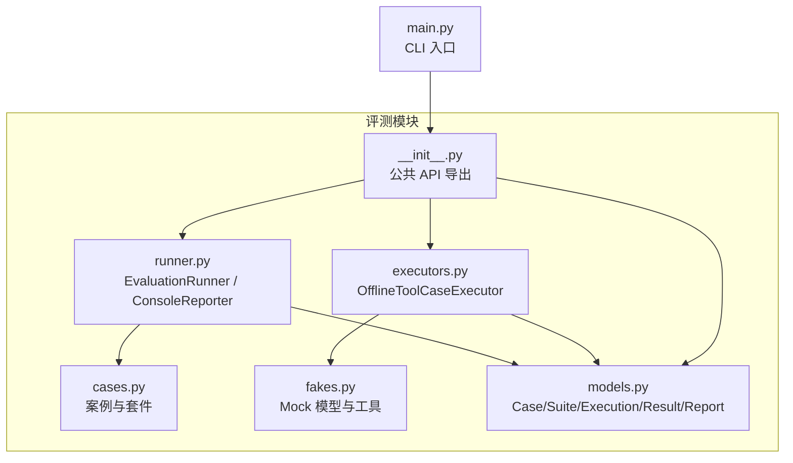
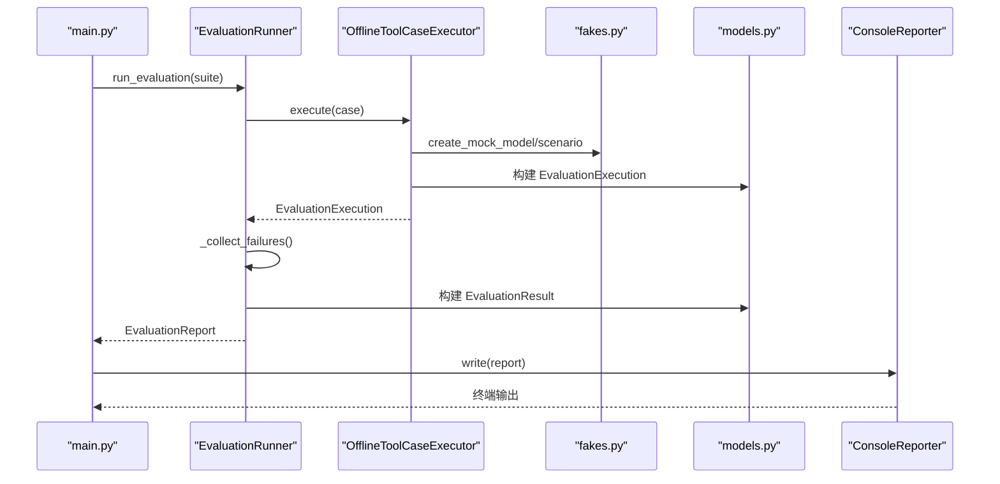
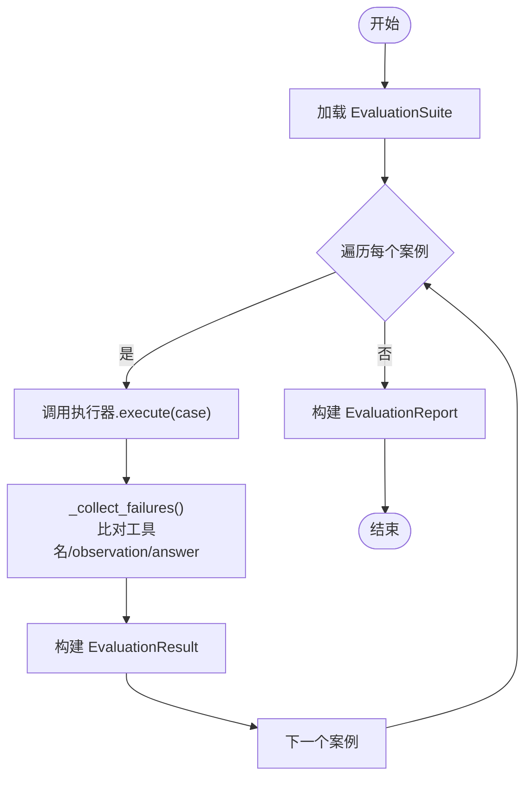
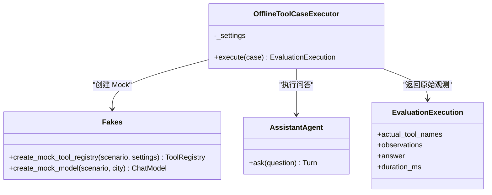
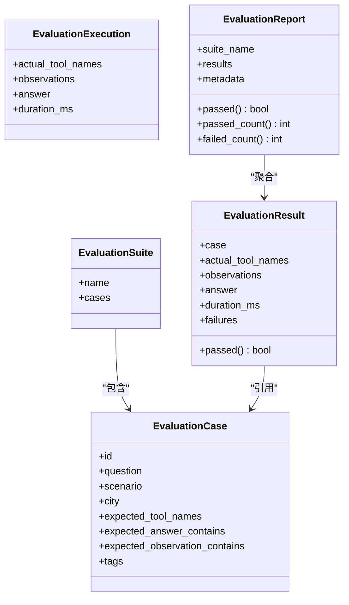
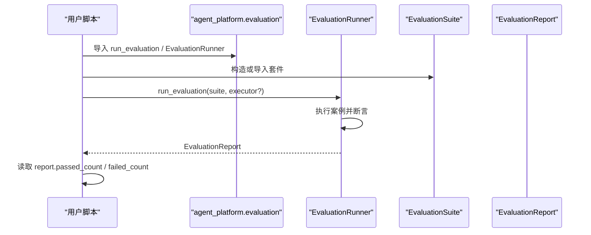
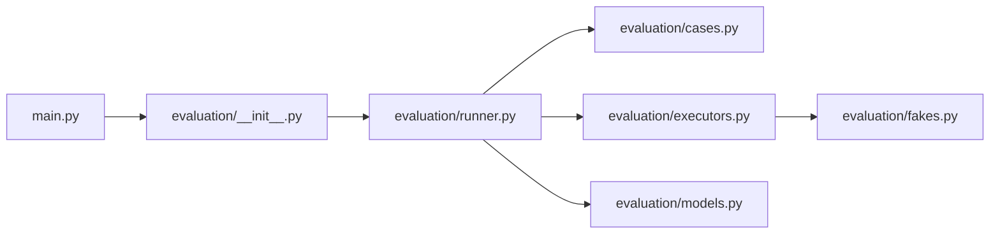

# 运行器与报告

<cite>
**本文引用的文件**   
- [runner.py](file://agent_platform/evaluation/runner.py)
- [models.py](file://agent_platform/evaluation/models.py)
- [executors.py](file://agent_platform/evaluation/executors.py)
- [cases.py](file://agent_platform/evaluation/cases.py)
- [fakes.py](file://agent_platform/evaluation/fakes.py)
- [__init__.py](file://agent_platform/evaluation/__init__.py)
- [main.py](file://main.py)
</cite>

## 目录
1. [引言](#引言)
2. [项目结构](#项目结构)
3. [核心组件](#核心组件)
4. [架构总览](#架构总览)
5. [详细组件分析](#详细组件分析)
6. [依赖关系分析](#依赖关系分析)
7. [性能与扩展性](#性能与扩展性)
8. [持续集成最佳实践](#持续集成最佳实践)
9. [故障排查指南](#故障排查指南)
10. [结论](#结论)

## 引言
本文件面向评测运行器和报告生成系统的使用者与维护者，系统性说明 EvaluationRunner 的工作流程、测试套件的组织方式、命令行与编程式调用方法、报告结构与统计字段含义，以及 CI/CD 集成、大规模套件优化和调试技巧。读者无需深入源码即可理解如何运行评测、如何扩展执行器、如何消费结构化报告并接入自动化流水线。

## 项目结构
评测相关代码集中在 evaluation 包中，采用“案例定义 + 执行器 + 运行器 + 报告模型”的分层组织：
- cases.py：定义离线工具回归案例集合与默认套件。
- fakes.py：提供无网络的 Mock 模型与替身工具，用于确定性验证。
- executors.py：实现可替换的执行器契约，默认使用 fakes 驱动 Agent。
- runner.py：串联执行器、断言逻辑、控制台报告器，并提供 CLI 兼容入口。
- models.py：统一 Case/Suite/Execution/Result/Report 数据模型。
- __init__.py：对外暴露公共 API。
- main.py：应用启动入口，包含 --evaluate 模式。

**图表来源**
- [runner.py:1-104](file://agent_platform/evaluation/runner.py#L1-L104)
- [models.py:1-83](file://agent_platform/evaluation/models.py#L1-L83)
- [executors.py:1-41](file://agent_platform/evaluation/executors.py#L1-L41)
- [cases.py:1-34](file://agent_platform/evaluation/cases.py#L1-L34)
- [fakes.py:1-98](file://agent_platform/evaluation/fakes.py#L1-L98)
- [__init__.py:1-29](file://agent_platform/evaluation/__init__.py#L1-L29)
- [main.py:1-95](file://main.py#L1-L95)

**章节来源**
- [runner.py:1-104](file://agent_platform/evaluation/runner.py#L1-L104)
- [models.py:1-83](file://agent_platform/evaluation/models.py#L1-L83)
- [executors.py:1-41](file://agent_platform/evaluation/executors.py#L1-L41)
- [cases.py:1-34](file://agent_platform/evaluation/cases.py#L1-L34)
- [fakes.py:1-98](file://agent_platform/evaluation/fakes.py#L1-L98)
- [__init__.py:1-29](file://agent_platform/evaluation/__init__.py#L1-L29)
- [main.py:1-95](file://main.py#L1-L95)

## 核心组件
- EvaluationCase：描述一个可重复执行的 Agent 行为断言，包括问题、场景、城市、期望工具序列、答案与 observation 子串、标签等。
- EvaluationSuite：一组案例的容器，带 suite 名称。
- OfflineToolCaseExecutor：默认执行器，基于 fakes 构造 Agent 并回收 tool 消息作为观测。
- EvaluationRunner：顺序执行套件内全部案例，收集失败原因，返回 EvaluationReport。
- ConsoleReporter：将报告渲染为终端可读输出，并在末尾汇总通过数。
- run_evaluation：CLI 兼容函数，返回布尔值供 main.py 转换为退出码。
- EvaluationReport：聚合结果，提供 passed、passed_count、failed_count 等统计属性。

**章节来源**
- [models.py:12-82](file://agent_platform/evaluation/models.py#L12-L82)
- [executors.py:17-41](file://agent_platform/evaluation/executors.py#L17-L41)
- [runner.py:17-81](file://agent_platform/evaluation/runner.py#L17-L81)

## 架构总览
评测流水线遵循“执行器解耦 + 断言集中 + 报告结构化”的设计：
- Runner 不关心 Agent 如何被装配，只要求执行器返回 EvaluationExecution。
- 断言逻辑集中在 _collect_failures，比较实际工具名序列、observation 文本与最终答案。
- Report 提供机器可读的统计字段，ConsoleReporter 提供人类可读视图。

**图表来源**
- [main.py:43-58](file://main.py#L43-L58)
- [runner.py:23-81](file://agent_platform/evaluation/runner.py#L23-L81)
- [executors.py:23-41](file://agent_platform/evaluation/executors.py#L23-L41)
- [fakes.py:28-98](file://agent_platform/evaluation/fakes.py#L28-L98)
- [models.py:34-82](file://agent_platform/evaluation/models.py#L34-L82)

## 详细组件分析

### EvaluationRunner 工作流程
EvaluationRunner 负责：
- 接收 EvaluationSuite。
- 对每个 case 调用执行器获取 Execution。
- 将 Execution 与 Case 断言比对，生成 Result。
- 汇总为 Report。

关键流程如下：

**图表来源**
- [runner.py:29-50](file://agent_platform/evaluation/runner.py#L29-L50)
- [runner.py:84-103](file://agent_platform/evaluation/runner.py#L84-L103)

断言规则要点：
- 工具名序列必须完全相等（既校验路由选择，也校验调用次数）。
- observation 文本需包含所有 expected_observation_contains。
- 最终答案需包含所有 expected_answer_contains。

**章节来源**
- [runner.py:29-50](file://agent_platform/evaluation/runner.py#L29-L50)
- [runner.py:84-103](file://agent_platform/evaluation/runner.py#L84-L103)

### 案例与套件组织
- OFFLINE_TOOL_CASES：覆盖 RAG 命中、天气路由、重复问法、未收录、超时、错误、无需工具等典型路径。
- DEFAULT_OFFLINE_TOOL_SUITE：默认套件名称为 offline-tool-regression。

用例设计建议：
- 使用 tags 标注类别（如 rag、weather、failure），便于后续筛选与统计。
- expected_tool_names 为空元组表示不应调用工具。
- expected_answer_contains 与 expected_observation_contains 应尽可能具体，避免误判。

**章节来源**
- [cases.py:12-33](file://agent_platform/evaluation/cases.py#L12-L33)

### 执行器与 Mock 机制
OfflineToolCaseExecutor：
- 根据 case.scenario 创建 Mock 模型与替身工具注册表。
- 通过 AssistantAgent.ask 执行一轮问答。
- 抽取 ToolMessage 作为观测，记录 actual_tool_names、observations、answer 与 duration_ms。

fakes.py：
- 提供五种 MockScenario：happy、weather、timeout、error、no-tool。
- 针对 timeout/error 替换 search_knowledge；针对 weather 替换 get_weather_forecast。
- FakeMessagesListChatModel 预置两段回复，稳定驱动 assistant→tools→assistant 循环。

**图表来源**
- [executors.py:17-41](file://agent_platform/evaluation/executors.py#L17-L41)
- [fakes.py:28-98](file://agent_platform/evaluation/fakes.py#L28-L98)

**章节来源**
- [executors.py:17-41](file://agent_platform/evaluation/executors.py#L17-L41)
- [fakes.py:18-98](file://agent_platform/evaluation/fakes.py#L18-L98)

### 报告模型与统计字段
EvaluationReport 提供：
- passed：是否全部通过。
- passed_count：通过的案例数。
- failed_count：失败的案例数。
- results：每个案例的 EvaluationResult。
- metadata：可扩展的键值信息。

EvaluationResult 提供：
- case：被断言的案例。
- actual_tool_names：实际工具名序列。
- observations：各工具 observation 文本。
- answer：最终自然语言答复。
- duration_ms：端到端耗时（毫秒）。
- failures：失败描述列表。
- passed：无失败即通过。

**图表来源**
- [models.py:12-82](file://agent_platform/evaluation/models.py#L12-L82)

**章节来源**
- [models.py:12-82](file://agent_platform/evaluation/models.py#L12-L82)

### 命令行接口与编程式调用
命令行接口：
- python main.py --evaluate：运行默认离线工具回归套件，全部通过返回退出码 0，否则为 1。
- 其他参数用于真实或 mock 交互模式，不影响 --evaluate 短路流程。

编程式调用：
- 从 agent_platform.evaluation 导入 run_evaluation、EvaluationRunner、EvaluationSuite、OFFLINE_TOOL_CASES 等。
- 可注入自定义 EvaluationCaseExecutor 以替换默认执行器。
- 可传入自定义 EvaluationSuite 以运行不同案例集。

**图表来源**
- [main.py:43-58](file://main.py#L43-L58)
- [runner.py:74-81](file://agent_platform/evaluation/runner.py#L74-L81)
- [__init__.py:7-29](file://agent_platform/evaluation/__init__.py#L7-L29)

**章节来源**
- [main.py:43-58](file://main.py#L43-L58)
- [runner.py:74-81](file://agent_platform/evaluation/runner.py#L74-L81)
- [__init__.py:7-29](file://agent_platform/evaluation/__init__.py#L7-L29)

## 依赖关系分析
- runner.py 依赖 cases.py 的默认套件、executors.py 的默认执行器、models.py 的数据模型。
- executors.py 依赖 agent 与 config，并通过 fakes.py 构造 Mock 环境。
- main.py 通过 evaluation 包的公共 API 调用 run_evaluation。

**图表来源**
- [main.py:1-95](file://main.py#L1-L95)
- [__init__.py:1-29](file://agent_platform/evaluation/__init__.py#L1-L29)
- [runner.py:1-104](file://agent_platform/evaluation/runner.py#L1-L104)
- [executors.py:1-41](file://agent_platform/evaluation/executors.py#L1-L41)
- [fakes.py:1-98](file://agent_platform/evaluation/fakes.py#L1-L98)
- [cases.py:1-34](file://agent_platform/evaluation/cases.py#L1-L34)
- [models.py:1-83](file://agent_platform/evaluation/models.py#L1-L83)

**章节来源**
- [main.py:1-95](file://main.py#L1-L95)
- [__init__.py:1-29](file://agent_platform/evaluation/__init__.py#L1-L29)
- [runner.py:1-104](file://agent_platform/evaluation/runner.py#L1-L104)
- [executors.py:1-41](file://agent_platform/evaluation/executors.py#L1-L41)
- [fakes.py:1-98](file://agent_platform/evaluation/fakes.py#L1-L98)
- [cases.py:1-34](file://agent_platform/evaluation/cases.py#L1-L34)
- [models.py:1-83](file://agent_platform/evaluation/models.py#L1-L83)

## 性能与扩展性
- 当前 Runner 顺序执行案例，适合中小型套件；若案例数量很大，可在执行器层面引入并发策略（例如按 scenario 分组并行执行），但需注意共享状态隔离与资源竞争。
- 执行器已封装 perf_counter 计时，可通过 EvaluationReport.results 中的 duration_ms 进行性能分析。
- 断言逻辑为字符串包含检查与元组相等比较，时间复杂度与案例规模线性相关，开销较低。
- 扩展点：
  - 自定义 EvaluationCaseExecutor：替换默认执行器以接入真实模型、记忆后端或其他工具链。
  - 自定义 Reporter：替换 ConsoleReporter 以输出 JSON、JUnit XML、HTML 仪表盘等格式。
  - 扩展 EvaluationReport.metadata：附加版本、环境、分支等信息，便于追溯。

[本节为通用指导，不直接分析具体文件]

## 持续集成最佳实践
- 自动化测试脚本：
  - 在 CI 中执行 python main.py --evaluate，依据退出码判定套件是否通过。
  - 如需更细粒度控制，可直接调用 agent_platform.evaluation.run_evaluation 并解析 EvaluationReport。
- CI/CD 管道配置建议：
  - 设置环境变量（如 MODEL_API_KEY）仅在真实模式需要；--evaluate 模式不需要网络。
  - 缓存依赖以提升构建速度。
  - 将 EvaluationReport.results 序列化到 artifacts，便于历史对比。
- 结果可视化方案：
  - 将 EvaluationReport 转为 JSON，结合看板展示 passed_count、failed_count、duration_ms 趋势。
  - 按 tags 维度拆分通过率，识别退化区域（如 rag、weather、failure）。
  - 将 ConsoleReporter 输出归档为日志，便于快速定位失败案例。

[本节为通用指导，不直接分析具体文件]

## 故障排查指南
常见问题与定位方法：
- 工具调用不一致：
  - 检查 expected_tool_names 与实际工具序列是否一致，注意调用次数与顺序。
  - 查看 ConsoleReporter 输出的预期与实际工具列。
- observation 缺失：
  - 确认 expected_observation_contains 是否过于严格或拼写不一致。
  - 检查 fakes.py 中对应 scenario 的工具实现是否返回预期内容。
- 最终答案缺失关键字：
  - 调整 expected_answer_contains，确保关键字与模拟回复匹配。
  - 对于 timeout/error 场景，确认最终答案包含“未编造结果”等语义。
- 套件未通过但无法定位：
  - 使用 report.failed_count 与 report.results 逐项检查 failures。
  - 将 EvaluationReport 序列化后搜索失败描述，快速定位案例 id。

**章节来源**
- [runner.py:53-71](file://agent_platform/evaluation/runner.py#L53-L71)
- [runner.py:84-103](file://agent_platform/evaluation/runner.py#L84-L103)
- [fakes.py:32-56](file://agent_platform/evaluation/fakes.py#L32-L56)
- [fakes.py:81-91](file://agent_platform/evaluation/fakes.py#L81-L91)

## 结论
EvaluationRunner 提供了清晰、可扩展的评测流水线：执行器解耦、断言集中、报告结构化。通过命令行与编程式两种调用方式，既能满足快速回归，也能无缝接入 CI/CD。借助 EvaluationReport 的统计字段与 ConsoleReporter 的可读输出，团队可以高效监控质量趋势、定位退化问题，并在大规模套件下保持可维护性与可观测性。