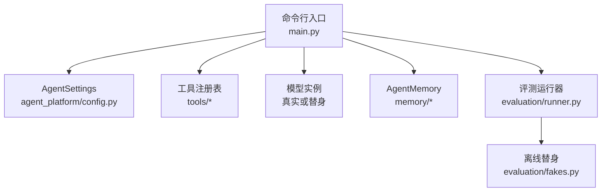

# 部署与运维

<cite>
**本文引用的文件**   
- [README.md](file://README.md)
- [main.py](file://main.py)
- [requirements.txt](file://requirements.txt)
- [config.py](file://agent_platform/config.py)
- [runner.py](file://agent_platform/evaluation/runner.py)
- [fakes.py](file://agent_platform/evaluation/fakes.py)
</cite>

## 目录
1. [简介](#简介)
2. [项目结构](#项目结构)
3. [环境搭建](#环境搭建)
4. [运行模式与配置](#运行模式与配置)
5. [环境变量说明](#环境变量说明)
6. [生产环境部署注意事项](#生产环境部署注意事项)
7. [故障排查指南](#故障排查指南)
8. [性能调优建议](#性能调优建议)
9. [结论](#结论)

## 简介
本指南面向 Agent Platform 的部署与运维人员，覆盖从 Python 环境准备、依赖安装、三种运行模式配置，到生产环境进程管理、日志、监控和资源限制，再到常见问题排查与性能调优。Agent Platform 基于 LangChain 与 LangGraph，提供可替换的工具、记忆和评测模块；默认支持离线模拟、真实模型调用以及自动化回归评测。

## 项目结构
仓库采用按功能划分的包结构：
- `agent_platform`：核心 Agent、工具注册、记忆、RAG、天气等实现。
- `evaluation`：离线评测套件、替身模型与执行器。
- `knowledge`：知识库数据（由 RAG 使用）。
- `main.py`：CLI 入口，统一加载 `.env`、解析参数并启动不同运行模式。
- `requirements.txt`：第三方依赖声明。
- `README.md`：架构说明、运行方式与关键概念。



**图表来源**
- [main.py:43-90](file://main.py#L43-L90)
- [config.py:12-47](file://agent_platform/config.py#L12-L47)
- [runner.py:23-81](file://agent_platform/evaluation/runner.py#L23-L81)
- [fakes.py:28-97](file://agent_platform/evaluation/fakes.py#L28-L97)

**章节来源**
- [README.md:19-48](file://README.md#L19-L48)
- [main.py:1-20](file://main.py#L1-L20)

## 环境搭建
### Python 版本要求
- 需要 Python 3.10+。当前 README 示例使用 `python3.12 -m venv .venv`，但最低版本为 3.10。

### 虚拟环境与依赖安装
1. 创建虚拟环境：
   ```bash
   python3.12 -m venv .venv
   source .venv/bin/activate
   ```
2. 安装依赖：
   ```bash
   python -m pip install -r requirements.txt
   ```
3. 依赖清单包括 LangChain、LangGraph、OpenAI 适配层与 dotenv。

**章节来源**
- [README.md:110-120](file://README.md#L110-L120)
- [requirements.txt:1-5](file://requirements.txt#L1-L5)

## 运行模式与配置
平台提供三种运行模式，通过 CLI 参数切换：

| 模式 | 用途 | 关键参数 | 是否需要网络或 API Key |
|---|---|---|---|
| 离线模拟模式 | 无需外部服务即可体验完整流程，适合本地开发与测试 | `--mock`、`--mock-scenario` | 否 |
| 真实 API 模式 | 连接真实模型后端，走完整工具与记忆链路 | 无额外参数，需 `.env` | 是 |
| 自动化评测模式 | 运行内置离线回归套件，返回退出码表示结果 | `--evaluate` | 否 |

### 离线模拟模式
- 基础命令：
  ```bash
  python main.py --mock
  ```
- 指定场景：
  ```bash
  python main.py --mock --mock-scenario weather "杭州明天天气怎么样？"
  ```
- 可用场景：
  - `happy`：正常 RAG 检索
  - `weather`：天气工具
  - `timeout`：RAG 超时
  - `error`：RAG 报错
  - `no-tool`：无需工具直接回答

注意：
- 模拟模式下，工具与模型行为由替身控制，不访问真实网络。
- 可通过 `--user-id`、`--conversation-id`、`--tenant-id` 设置记忆作用域，便于隔离短期会话与长期偏好。

**章节来源**
- [README.md:122-134](file://README.md#L122-L134)
- [main.py:46-54](file://main.py#L46-L54)
- [fakes.py:18-56](file://agent_platform/evaluation/fakes.py#L18-L56)

### 真实 API 模式
- 前置条件：
  - 复制 `.env.example` 为 `.env`（仓库未包含 `.env`）。
  - 在 `.env` 中配置 `MODEL_API_KEY`。
- 启动命令：
  ```bash
  python main.py "杭州西湖适合怎样安排？"
  python main.py "杭州明天天气怎么样？"
  ```
- 行为说明：
  - 读取 `.env` 中的模型名、API Key、Base URL。
  - 温度设为 0，保证工具路由可复现。
  - 超时与重试受模型初始化参数约束。

**章节来源**
- [README.md:136-144](file://README.md#L136-L144)
- [main.py:22-40](file://main.py#L22-L40)

### 自动化评测模式
- 启动命令：
  ```bash
  python main.py --evaluate
  ```
- 行为说明：
  - 运行内置 10 条离线工具回归案例。
  - 控制台输出结构化报告。
  - 全部通过返回退出码 0，否则返回 1。
- 扩展能力：
  - 评测运行器支持注入自定义 `CaseExecutor`。
  - 报告器支持将结构化报告用于 CI、JSON 或仪表盘。

**章节来源**
- [README.md:98-108](file://README.md#L98-L108)
- [main.py:56-58](file://main.py#L56-L58)
- [runner.py:23-81](file://agent_platform/evaluation/runner.py#L23-L81)

## 环境变量说明
真实 API 模式依赖 `.env` 文件。以下变量由应用启动时读取：

| 变量 | 是否必需 | 默认值 | 说明 |
|---|---:|---|---|
| `MODEL_API_KEY` | 是 | 无 | 模型提供商 API Key；缺失时会抛出错误并提示使用 `--mock` 或 `--evaluate` |
| `MODEL_NAME` | 否 | `gpt-4.1-mini` | 模型名称 |
| `MODEL_BASE_URL` | 否 | `https://api.openai.com/v1` | 模型 Base URL，可用于兼容 OpenAI 格式的后端 |

注意事项：
- `.env` 不应提交到版本库；仓库仅给出示例路径。
- 若未配置 `MODEL_API_KEY`，真实模式会立即失败，避免误用。
- 其他运行时参数（如工具超时、RAG 参数）集中在 `AgentSettings`，可从配置文件或管理台构造。

**章节来源**
- [main.py:29-40](file://main.py#L29-L40)
- [config.py:12-47](file://agent_platform/config.py#L12-L47)

## 生产环境部署注意事项
### 进程管理
- 建议使用进程管理器（如 systemd、supervisor、Docker 容器）托管 `main.py`。
- 确保进程崩溃后自动重启，并保留标准输出以便日志采集。
- 对于多租户或多会话场景，可通过 `--tenant-id`、`--user-id`、`--conversation-id` 区分上下文；当前默认实现为进程内隔离，跨进程共享需结合外部存储。

### 日志配置
- 当前 CLI 通过 `print` 输出用户问题、助手回答与短期消息数量。
- 生产环境建议：
  - 将标准输出重定向到日志系统（如 journald、ELK、云日志）。
  - 对异常堆栈进行捕获与上报（例如接入 Sentry）。
  - 记录关键指标：请求数、工具调用次数、平均耗时、失败率。

### 监控指标
- 建议暴露以下指标：
  - 模型调用成功率与延迟
  - 工具调用成功率与超时比例
  - 记忆写入成功率和窗口大小
  - RAG 检索命中率与 top_k 分布
- 可将 `EvaluationReport` 的结构化结果接入监控系统，用于趋势分析。

### 资源限制
- 内存：
  - 短期记忆默认窗口较小，但仍需关注长对话累积。
  - 长期记忆默认进程内实现，重启丢失；生产建议替换为持久化实现。
- CPU：
  - 工具执行与 RAG 检索可能产生 I/O 与计算开销，需合理分配 CPU。
- 网络：
  - 天气工具依赖外部接口；RAG 可能访问向量库或文件系统。
  - 建议配置网络超时与重试策略，避免雪崩。

### 安全与权限
- 工具只能读取资料或外部信息，不能下单或写入、修改数据。
- 长期记忆以低权限用户数据注入模型，不会提升为 SystemMessage。
- 生产环境应最小化 API Key 权限，并限制 Base URL 白名单。

[本节为通用部署建议，不直接分析具体代码文件]

## 故障排查指南
### 常见错误与解决方案
| 现象 | 可能原因 | 解决方案 |
|---|---|---|
| 真实模式启动时报错缺少 API Key | `.env` 未配置 `MODEL_API_KEY` | 复制 `.env.example` 为 `.env`，填入有效 Key |
| 模型调用超时或频繁重试 | 网络不稳定或后端限流 | 检查 `MODEL_BASE_URL`，调整网络工具超时与重试策略 |
| 工具调用未按预期触发 | Prompt 或工具注册不一致 | 确认 `ToolRegistry` 已正确构建，且系统 Prompt 包含工具目录 |
| 评测用例失败 | 实际工具调用与断言不一致 | 查看控制台报告中的失败原因，修正案例或工具实现 |
| 天气查询结果为空或异常 | 外部天气接口不可用或参数错误 | 检查网络连通性与城市参数，必要时切换到模拟模式验证 |

### 诊断步骤
1. 使用离线模拟模式验证基本链路：
   ```bash
   python main.py --mock --mock-scenario happy
   ```
2. 逐步切换到其他场景，定位问题范围：
   ```bash
   python main.py --mock --mock-scenario weather
   python main.py --mock --mock-scenario timeout
   python main.py --mock --mock-scenario error
   python main.py --mock --mock-scenario no-tool
   ```
3. 运行自动化评测套件，观察结构化报告：
   ```bash
   python main.py --evaluate
   ```
4. 若仍失败，检查 `.env` 配置与网络连通性，再尝试真实模式。

**章节来源**
- [main.py:22-40](file://main.py#L22-L40)
- [fakes.py:28-97](file://agent_platform/evaluation/fakes.py#L28-L97)
- [runner.py:53-81](file://agent_platform/evaluation/runner.py#L53-L81)

## 性能调优建议
### 内存使用优化
- 短期记忆：
  - 调整 `max_history_messages` 或 `memory.short_term_max_messages`，控制会话窗口大小。
  - 长对话场景下，定期清理历史或迁移至外部存储。
- 长期记忆：
  - 默认进程内实现不适合生产；建议替换为 Redis、SQLite 或向量库。
  - 限制偏好长度与写入频率，避免膨胀。

### 并发配置
- 同一会话的“读历史 → 运行 Agent → 写历史”串行化，避免并发覆盖。
- 不同会话可并发执行；生产环境建议根据内存与 CPU 上限设置最大并发数。
- 工具执行器层有超时保护，防止单个工具阻塞整体流程。

### 缓存策略
- RAG 检索结果可考虑缓存热点知识片段，减少重复检索。
- 天气查询可按城市与天数做短期缓存，降低外部接口压力。
- 模型调用响应可缓存短生命周期结果，注意失效策略与一致性。

### 超时与重试
- 工具默认超时较短，网络类工具使用更长超时。
- 模型调用设置固定超时与重试次数，避免无限等待。
- 生产环境建议根据 SLA 调整超时阈值，并配合熔断与降级。

**章节来源**
- [config.py:12-47](file://agent_platform/config.py#L12-L47)
- [fakes.py:44-54](file://agent_platform/evaluation/fakes.py#L44-L54)
- [main.py:32-40](file://main.py#L32-L40)

## 结论
Agent Platform 提供了清晰的运行入口、可替换的工具与记忆实现，以及完整的离线评测能力。部署时应优先完成 Python 环境与依赖安装，明确选择运行模式，并在生产环境中做好进程管理、日志采集、监控指标与资源限制。通过合理的超时、重试、缓存与并发策略，可在稳定性与性能之间取得平衡。遇到问题时，建议先从离线模拟与自动化评测入手，逐步定位真实环境的差异。