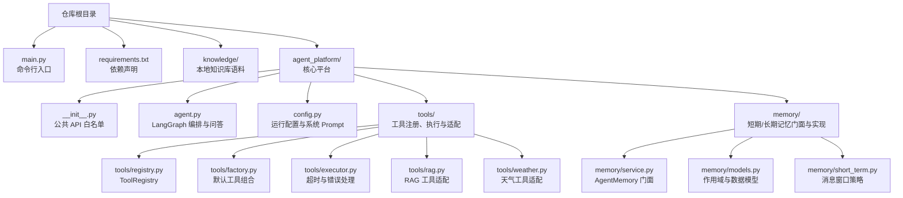
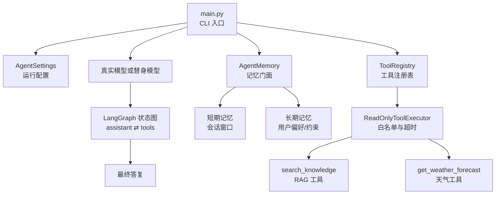
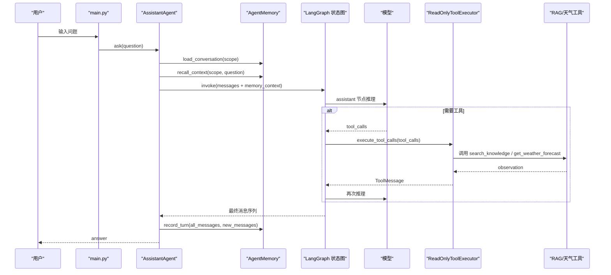
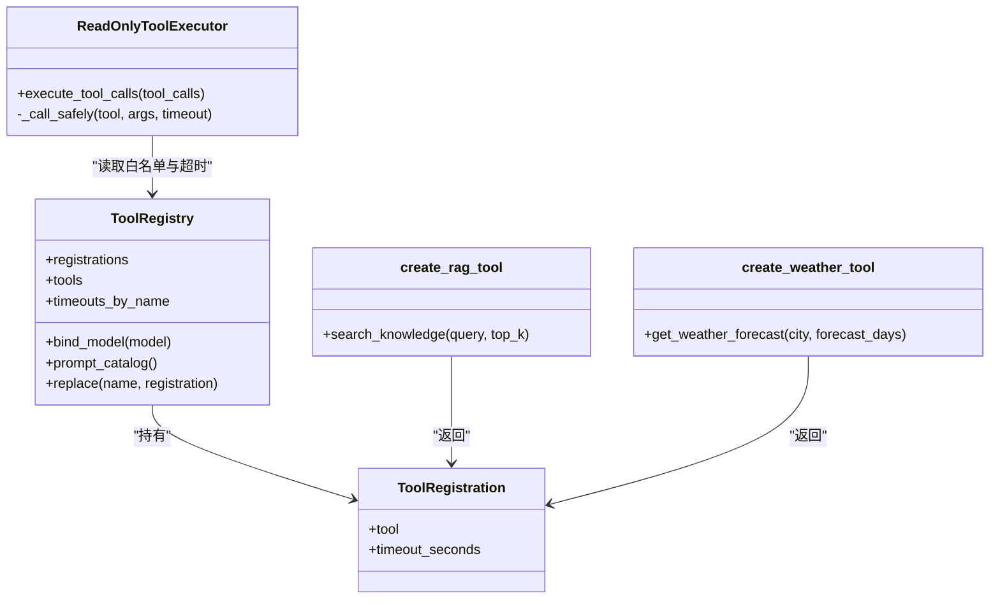
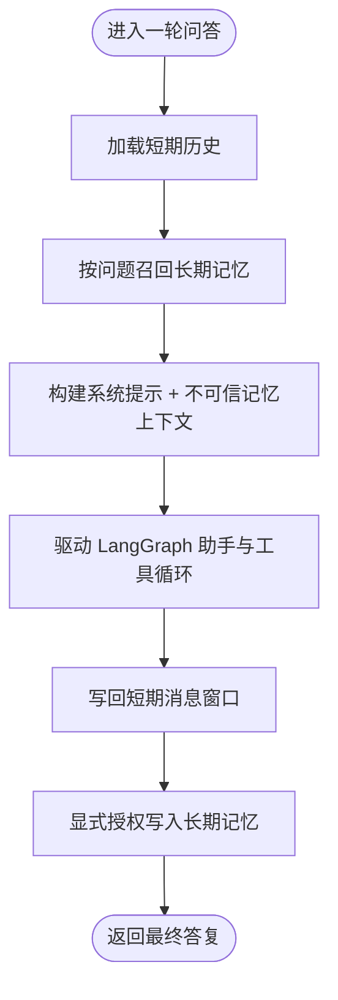
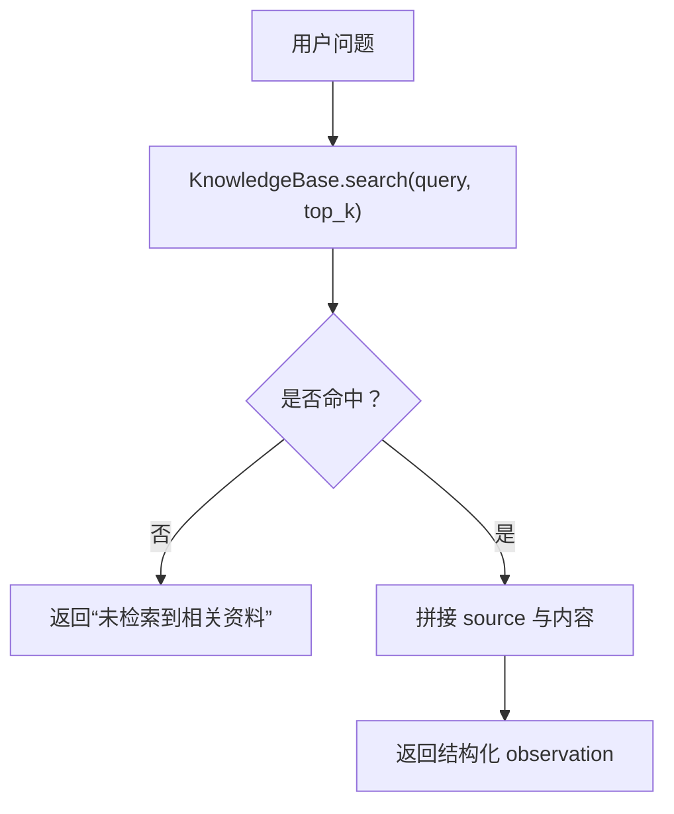
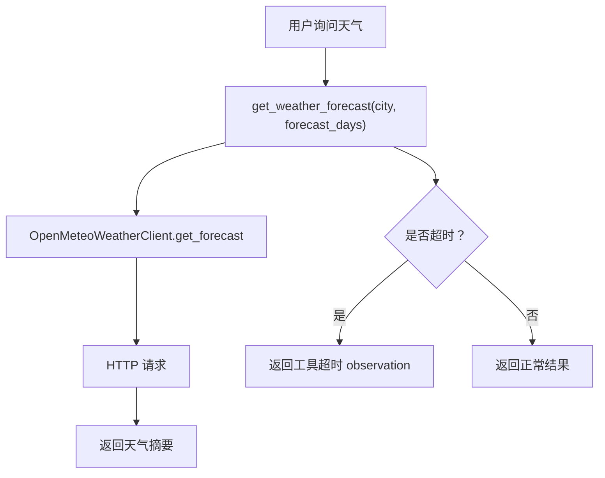
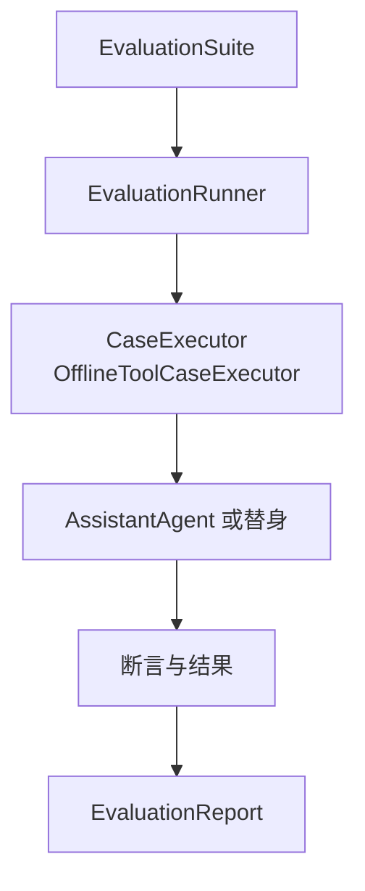
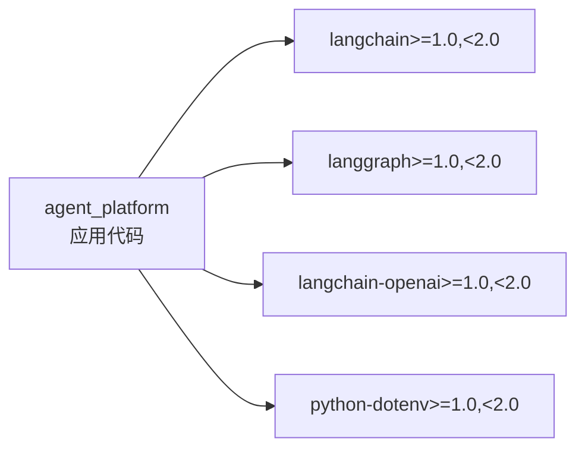

# 项目概述

<cite>
**本文引用的文件**   
- [README.md](file://README.md)
- [main.py](file://main.py)
- [requirements.txt](file://requirements.txt)
- [__init__.py](file://agent_platform/__init__.py)
- [agent.py](file://agent_platform/agent.py)
- [config.py](file://agent_platform/config.py)
- [tools/__init__.py](file://agent_platform/tools/__init__.py)
- [tools/registry.py](file://agent_platform/tools/registry.py)
- [tools/factory.py](file://agent_platform/tools/factory.py)
- [tools/executor.py](file://agent_platform/tools/executor.py)
- [tools/rag.py](file://agent_platform/tools/rag.py)
- [tools/weather.py](file://agent_platform/tools/weather.py)
- [memory/service.py](file://agent_platform/memory/service.py)
- [memory/models.py](file://agent_platform/memory/models.py)
- [memory/short_term.py](file://agent_platform/memory/short_term.py)
</cite>

## 目录
1. [引言](#引言)
2. [项目结构](#项目结构)
3. [核心组件](#核心组件)
4. [架构总览](#架构总览)
5. [详细组件分析](#详细组件分析)
6. [依赖关系分析](#依赖关系分析)
7. [性能与可靠性](#性能与可靠性)
8. [快速开始指南](#快速开始指南)
9. [故障排查](#故障排查)
10. [结论](#结论)

## 引言
本项目是一个基于 LangChain 与 LangGraph 的通用 Agent 平台，目标是提供「模型 + 工具 + 记忆」的完整链路：模型负责决策与语言生成，工具负责读取外部知识与实时信息，记忆负责短期对话上下文与长期用户偏好。与传统 Chatbot 相比，Agent 不是被动回答，而是根据问题动态选择是否调用工具、如何组合多轮工具结果，并在会话中持续积累短期历史与长期偏好。

平台将工具、记忆和评测拆为独立模块，Agent 只依赖稳定边界；RAG、天气、短期记忆和进程内长期记忆都是可替换实现。新增工具只需在工具适配层注册，无需修改 Agent 或图结构。

**章节来源**
- [README.md:1-18](file://README.md#L1-L18)

## 项目结构
仓库采用按职责分层的组织方式：应用入口位于根目录，核心能力集中在 `agent_platform` 包下，知识语料放在 `knowledge` 目录，评测套件位于 `evaluation` 子包。



**图表来源**
- [main.py:1-95](file://main.py#L1-L95)
- [requirements.txt:1-5](file://requirements.txt#L1-L5)
- [__init__.py:1-29](file://agent_platform/__init__.py#L1-L29)
- [agent.py:1-142](file://agent_platform/agent.py#L1-L142)
- [config.py:1-48](file://agent_platform/config.py#L1-L48)
- [tools/__init__.py:1-18](file://agent_platform/tools/__init__.py#L1-L18)
- [tools/registry.py:1-94](file://agent_platform/tools/registry.py#L1-L94)
- [tools/factory.py:1-37](file://agent_platform/tools/factory.py#L1-L37)
- [tools/executor.py:1-67](file://agent_platform/tools/executor.py#L1-L67)
- [tools/rag.py:1-36](file://agent_platform/tools/rag.py#L1-L36)
- [tools/weather.py:1-26](file://agent_platform/tools/weather.py#L1-L26)
- [memory/service.py:1-141](file://agent_platform/memory/service.py#L1-L141)
- [memory/models.py:1-120](file://agent_platform/memory/models.py#L1-L120)
- [memory/short_term.py:1-67](file://agent_platform/memory/short_term.py#L1-L67)

**章节来源**
- [README.md:19-48](file://README.md#L19-L48)
- [main.py:1-95](file://main.py#L1-L95)
- [requirements.txt:1-5](file://requirements.txt#L1-L5)

## 核心组件
- **AssistantAgent**：封装 LangGraph 状态图，驱动「助手 ↔ 工具」循环，负责加载短期历史、召回长期记忆、裁剪上下文、写回消息并提取长期偏好。
- **ToolRegistry 与 ReadOnlyToolExecutor**：统一维护工具 Schema、Prompt 工具目录、执行白名单、专用超时与错误 observation，避免模型幻觉工具直接执行。
- **AgentMemory**：短期会话、长期召回与写入策略的组合门面，提供进程内默认实现，并通过 `MemoryScope` 隔离租户、用户与会话。
- **KnowledgeBase 与 RAG 工具**：本地知识库检索工具，返回带来源标识的知识片段，未命中时引导模型说明资料不足。
- **OpenMeteoWeatherClient 与天气工具**：查询未来 1–7 天天气、温度区间与降水概率，使用网络级超时与工具级超时双层保护。
- **EvaluationRunner 与离线案例**：将案例定义、执行器、断言与报告分离，支持一键回归测试。

**章节来源**
- [agent.py:1-142](file://agent_platform/agent.py#L1-L142)
- [tools/registry.py:1-94](file://agent_platform/tools/registry.py#L1-L94)
- [tools/executor.py:1-67](file://agent_platform/tools/executor.py#L1-L67)
- [memory/service.py:1-141](file://agent_platform/memory/service.py#L1-L141)
- [tools/rag.py:1-36](file://agent_platform/tools/rag.py#L1-L36)
- [tools/weather.py:1-26](file://agent_platform/tools/weather.py#L1-L26)
- [README.md:98-108](file://README.md#L98-L108)

## 架构总览
平台以 Agent 为中心，向上暴露稳定的公共 API，向下通过 ToolRegistry、AgentMemory 与领域客户端解耦模型、工具与记忆。LangGraph 负责控制流，工具只是统一执行位置，并非强制流程。



**图表来源**
- [main.py:22-89](file://main.py#L22-L89)
- [agent.py:35-118](file://agent_platform/agent.py#L35-L118)
- [tools/registry.py:27-75](file://agent_platform/tools/registry.py#L27-L75)
- [tools/executor.py:17-43](file://agent_platform/tools/executor.py#L17-L43)
- [tools/rag.py:14-26](file://agent_platform/tools/rag.py#L14-L26)
- [tools/weather.py:13-25](file://agent_platform/tools/weather.py#L13-L25)
- [memory/service.py:24-90](file://agent_platform/memory/service.py#L24-L90)

## 详细组件分析

### AssistantAgent 与 LangGraph 编排
AssistantAgent 构造时绑定工具、创建系统 Prompt、初始化只读工具执行器和 LangGraph 状态图。一轮问答会串行化当前会话的「读历史 → 召回长期记忆 → 执行图 → 写回记忆」过程，最终取最后一条不带工具调用的 AI 消息作为答案。



**图表来源**
- [main.py:78-89](file://main.py#L78-L89)
- [agent.py:84-142](file://agent_platform/agent.py#L84-L142)
- [memory/service.py:59-90](file://agent_platform/memory/service.py#L59-L90)
- [tools/executor.py:27-43](file://agent_platform/tools/executor.py#L27-L43)

**章节来源**
- [agent.py:20-118](file://agent_platform/agent.py#L20-L118)
- [agent.py:120-142](file://agent_platform/agent.py#L120-L142)

### 工具系统与注册表
工具系统由 `ToolRegistration`、`ToolRegistry`、`ReadOnlyToolExecutor` 和领域适配层组成。`ToolRegistry` 是模型绑定、Prompt 工具目录和执行器超时的唯一事实来源；`build_default_tool_registry` 是新增工具的唯一组合入口。



**图表来源**
- [tools/registry.py:15-94](file://agent_platform/tools/registry.py#L15-L94)
- [tools/executor.py:17-67](file://agent_platform/tools/executor.py#L17-L67)
- [tools/rag.py:14-26](file://agent_platform/tools/rag.py#L14-L26)
- [tools/weather.py:13-25](file://agent_platform/tools/weather.py#L13-L25)

**章节来源**
- [tools/__init__.py:1-18](file://agent_platform/tools/__init__.py#L1-L18)
- [tools/registry.py:1-94](file://agent_platform/tools/registry.py#L1-L94)
- [tools/factory.py:1-37](file://agent_platform/tools/factory.py#L1-L37)
- [tools/executor.py:1-67](file://agent_platform/tools/executor.py#L1-L67)
- [tools/rag.py:1-36](file://agent_platform/tools/rag.py#L1-L36)
- [tools/weather.py:1-26](file://agent_platform/tools/weather.py#L1-L26)

### 双层记忆架构
短期记忆按 `MemoryScope(tenant_id, user_id, conversation_id)` 隔离消息窗口，默认实现仅存在于进程内存；长期记忆按 `MemoryOwner(tenant_id, user_id)` 隔离，支持跨会话召回用户偏好与约束。`AgentMemory.turn` 对同一会话加锁串行化，避免并发覆盖。



**图表来源**
- [memory/service.py:51-90](file://agent_platform/memory/service.py#L51-L90)
- [memory/models.py:27-120](file://agent_platform/memory/models.py#L27-L120)
- [memory/short_term.py:17-67](file://agent_platform/memory/short_term.py#L17-L67)

**章节来源**
- [memory/service.py:1-141](file://agent_platform/memory/service.py#L1-L141)
- [memory/models.py:1-120](file://agent_platform/memory/models.py#L1-L120)
- [memory/short_term.py:1-67](file://agent_platform/memory/short_term.py#L1-L67)

### 本地 RAG 检索
RAG 工具通过 `create_rag_tool` 包装 `KnowledgeBase.search`，返回带 `[source:...]` 的证据片段；未命中时明确引导模型说明资料不足。检索条数与切块大小由 `AgentSettings.rag_top_k` 与 `rag_chunk_size` 控制。



**图表来源**
- [tools/rag.py:14-35](file://agent_platform/tools/rag.py#L14-L35)
- [config.py:12-29](file://agent_platform/config.py#L12-L29)

**章节来源**
- [tools/rag.py:1-36](file://agent_platform/tools/rag.py#L1-L36)
- [config.py:1-48](file://agent_platform/config.py#L1-L48)

### 天气服务集成
天气工具调用 Open-Meteo 地理编码与预报接口，不需要 API Key。工具层标记专用执行超时，底层 HTTP 请求也有独立超时参数，形成两层防护。



**图表来源**
- [tools/weather.py:13-25](file://agent_platform/tools/weather.py#L13-L25)
- [config.py:24-26](file://agent_platform/config.py#L24-L26)

**章节来源**
- [tools/weather.py:1-26](file://agent_platform/tools/weather.py#L1-L26)
- [config.py:12-29](file://agent_platform/config.py#L12-L29)
- [README.md:65-66](file://README.md#L65-L66)

### 评测架构
评测套件将案例、执行器、结果与报告分离。默认离线执行器使用 fakes，不依赖真实模型或网络；`run_evaluation` 输出控制台视图并按通过与否返回退出码。



**图表来源**
- [README.md:98-108](file://README.md#L98-L108)

**章节来源**
- [README.md:98-108](file://README.md#L98-L108)

## 依赖关系分析
项目依赖 LangChain、LangGraph、OpenAI 适配器与 dotenv，版本范围限定在主版本之间，便于升级时保持兼容。



**图表来源**
- [requirements.txt:1-5](file://requirements.txt#L1-L5)

**章节来源**
- [requirements.txt:1-5](file://requirements.txt#L1-L5)

## 性能与可靠性
- **工具超时**：所有工具默认执行超时较短，网络类工具（如天气）使用专用超时覆盖，避免长时间阻塞。
- **消息裁剪**：短期记忆按窗口策略裁剪，避免孤立 AI 或工具消息导致上下文不完整，同时控制 token 成本。
- **长期记忆预算**：召回的长期记忆以不可信数据形式注入，字符长度受上限约束，防止 Prompt 膨胀。
- **错误降级**：工具异常与模型异常不会让整张图崩溃，而是转为 observation 或降级答复，保证流程可恢复。
- **并发安全**：同一会话的完整 turn 串行化，不同会话可并发执行，避免短期历史互相覆盖。

**章节来源**
- [tools/executor.py:17-67](file://agent_platform/tools/executor.py#L17-L67)
- [memory/short_term.py:17-67](file://agent_platform/memory/short_term.py#L17-L67)
- [memory/service.py:108-141](file://agent_platform/memory/service.py#L108-L141)
- [agent.py:120-137](file://agent_platform/agent.py#L120-L137)

## 快速开始指南

### 安装与环境
- 使用 Python 3.10+，推荐 Python 3.12。
- 创建虚拟环境并安装依赖。

```bash
python3.12 -m venv .venv
source .venv/bin/activate
python -m pip install -r requirements.txt
```

**章节来源**
- [README.md:110-120](file://README.md#L110-L120)
- [requirements.txt:1-5](file://requirements.txt#L1-L5)

### 三种运行方式

#### 1. 离线模拟
无需 API Key 或网络，适合体验工具路由、记忆与评测流程。

```bash
python main.py --mock
python main.py --mock --mock-scenario weather "杭州明天天气怎么样？"
python main.py --evaluate
```

**章节来源**
- [README.md:122-128](file://README.md#L122-L128)
- [main.py:43-58](file://main.py#L43-L58)

#### 2. 真实 API 调用
配置模型密钥后，走完整「模型 + 工具 + 记忆」链路。

```bash
cp .env.example .env
python main.py "杭州西湖适合怎样安排？"
python main.py "杭州明天天气怎么样？"
```

**章节来源**
- [README.md:136-142](file://README.md#L136-L142)
- [main.py:22-40](file://main.py#L22-L40)

#### 3. 自动化评测
运行离线工具回归套件，全部通过返回退出码 0，否则为 1。

```bash
python main.py --evaluate
```

**章节来源**
- [README.md:104-108](file://README.md#L104-L108)
- [main.py:56-58](file://main.py#L56-L58)

### Python API 使用示例
以下示例展示如何在代码中组装 Agent、记忆与作用域，适合二次开发与集成测试。

```python
from agent_platform import AgentSettings
from agent_platform.memory import AgentMemory, MemoryScope

settings = AgentSettings()
shared_memory = AgentMemory.in_memory(settings.memory)
first_scope = MemoryScope(user_id="u-1", conversation_id="c-1")
second_scope = MemoryScope(user_id="u-1", conversation_id="c-2")
```

**章节来源**
- [README.md:81-96](file://README.md#L81-L96)
- [memory/service.py:41-49](file://agent_platform/memory/service.py#L41-L49)
- [memory/models.py:39-59](file://agent_platform/memory/models.py#L39-L59)

## 故障排查
- **缺少模型密钥**：真实模式未配置 `MODEL_API_KEY` 时会抛出错误，建议使用 `--mock` 或 `--evaluate`。
- **工具未注册**：模型若尝试调用未注册工具，执行器会拒绝并返回 observation，不会执行任意命令。
- **工具超时**：网络工具可能触发工具级超时；可通过 `network_tool_timeout_seconds` 调整。
- **记忆作用域泄露**：注入共享 `AgentMemory` 时必须显式传入 `memory_scope`，否则会报错。
- **短期历史不完整**：窗口裁剪会丢弃孤立的 AI 或工具消息，确保从人类或系统消息开始。

**章节来源**
- [main.py:29-31](file://main.py#L29-L31)
- [tools/executor.py:32-43](file://agent_platform/tools/executor.py#L32-L43)
- [config.py:24-26](file://agent_platform/config.py#L24-L26)
- [agent.py:47-49](file://agent_platform/agent.py#L47-L49)
- [memory/short_term.py:25-38](file://agent_platform/memory/short_term.py#L25-L38)

## 结论
该平台以 Agent 为核心，围绕「模型 + 工具 + 记忆」构建可扩展、可替换、可评测的通用智能助手基础设施。它既适合初学者理解 AI Agent 的工作方式，也为有经验的开发者提供了清晰的扩展点：新增工具、替换记忆后端、接入不同模型与评测场景。通过稳定的公共 API、严格的超时与错误处理、以及双层记忆设计，平台能够在真实业务环境中逐步演进，同时保持开发体验与回归质量。